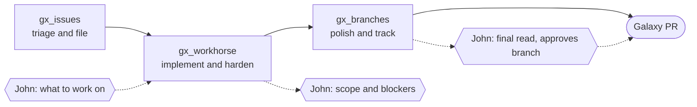
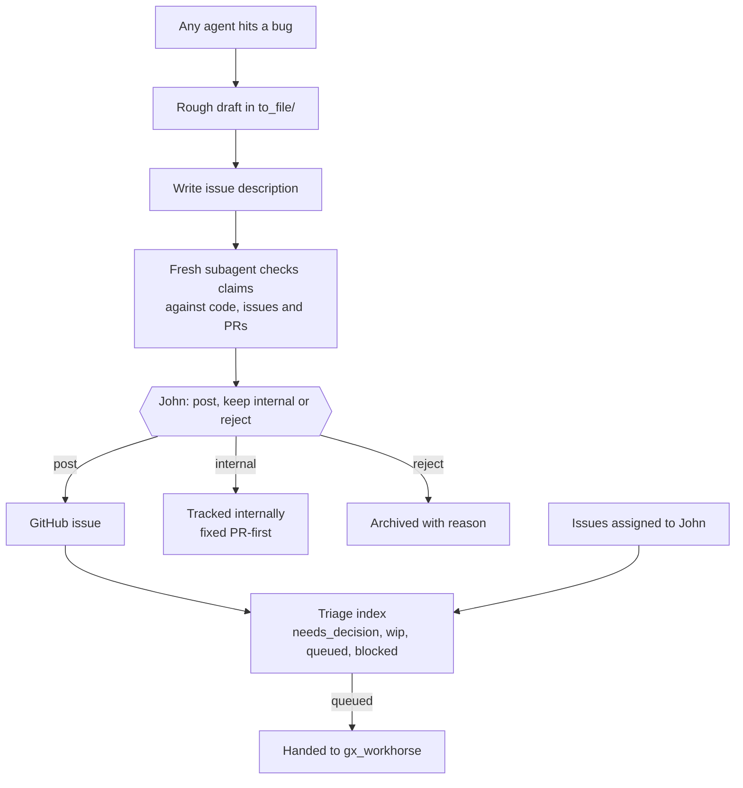
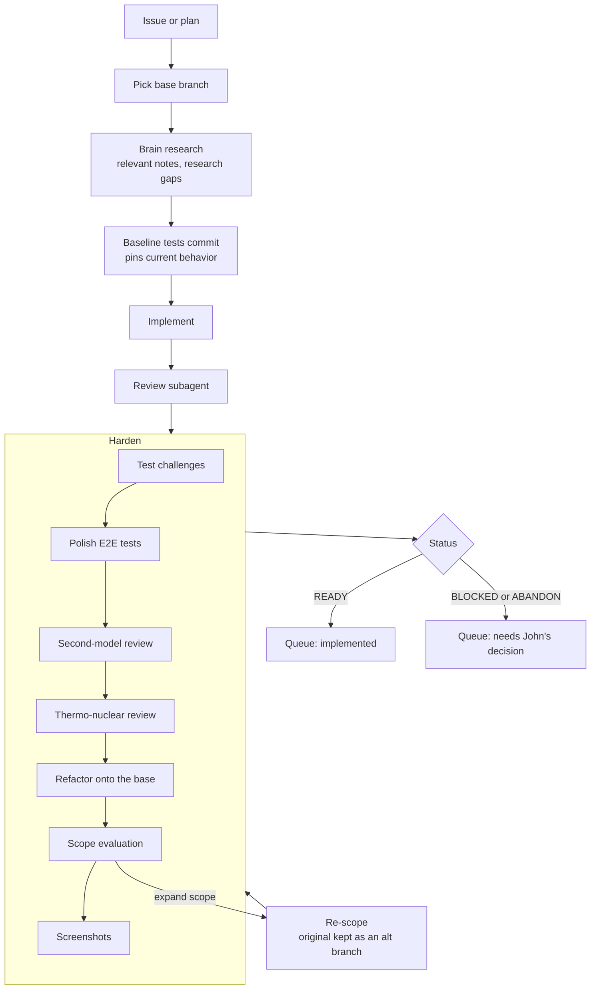
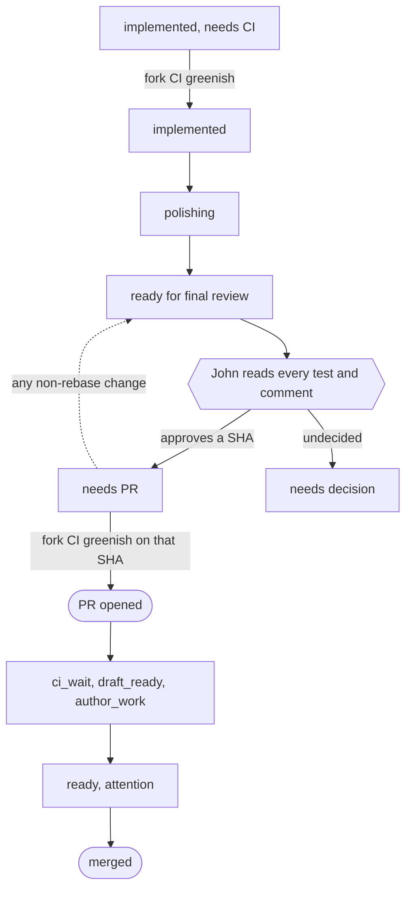

# John's Galaxy Brain Branch Factory

If a Galaxy pull request linked you here, coding agents developed it under the process below, and John read and approved it before it was opened. This page explains how the branch was built, what the "Agentic Checks" in the description mean, and where John made the decisions.

## Overview

Three agents, each with a narrow job, pass the work along. Agents never open their own PRs, and each handoff goes through a tracked queue.

| Agent                                                                                                     | Job                                                                                        |
| --------------------------------------------------------------------------------------------------------- | ------------------------------------------------------------------------------------------ |
| [`gx_issues`](https://github.com/jmchilton/galaxy-brain/blob/main/vault/agents/gx_issues/AGENTS.md)       | Triage Galaxy issues and turn rough bug reports into issues ready to file.                 |
| [`gx_workhorse`](https://github.com/jmchilton/galaxy-brain/blob/main/vault/agents/gx_workhorse/AGENTS.md) | Implement one scoped change, harden it with a series of checks, and hand off the branch.   |
| [`gx_branches`](https://github.com/jmchilton/galaxy-brain/blob/main/vault/agents/gx_branches/AGENTS.md)   | Track every branch and PR: CI, rebases, polish, PR descriptions, and opening approved PRs. |

## gx_issues: triage and filing

The issue agent keeps a triage index of the Galaxy issues John is tracking, each with a short "next step" and a notes directory. It prefers issues about workflows, Pulsar, Planemo, tool development, file sources and the API, and issues no one else has claimed.

Any agent that runs into a bug while working on something else doesn't file it. It writes a rough, context-heavy draft into a `to_file/` queue. The issue agent turns that draft into a proper description, has a fresh subagent check it against the code, and hands John a recommendation.

> [!TIP]
> **💭 Workflow Rule:** an agent saying something is a bug is not evidence. If an agent surfaced a problem, it has to be reproduced as a failing workflow or a real example before it's filed. The review subagent is told to push back on unreproduced claims, wrong premises and duplicates, not polish them.

> [!TIP]
> **💭 John's Dev Philosophy:** most pull requests should have issues first. Developers' eyes glaze over when reading pull request descriptions. Keeping the issue reproduction and the detailed description separate allows separate, more focused reading of the problem and the approach.

> [!TIP]
> **💭 Workflow Rule:** alternatives should be considered, and as early as possible. Creating an issue that lays out alternatives is important in scoping the problem and implementation.

> [!TIP]
> **💭 John's Dev Philosophy:** issue descriptions are sales pitches. Information should be presented persuasively and with purpose, implications at top, and easy to visualize. The issue should make it clear the problem has been reproduced and is real.

## gx_workhorse: implement and harden

The workhorse gets one issue or plan. Before writing code it picks the base branch: Galaxy's policy is the oldest supported release that has the bug. More intricate fixes lean toward a newer release, and simpler or more serious ones toward an older one. A lighter-model subagent (Sonnet or Sol) then collects the galaxy-brain notes relevant to the change, as optional reading for every later step, and queues research requests for gaps worth a new note. Large plans run phase by phase, with a review subagent between phases.

After the first implementation passes a normal review, the branch goes through **hardening**. Each step runs in its own subagent, makes its changes on the branch, and writes a debrief. Those debriefs become the "Agentic Checks" in the PR description.

Not every step runs every time. Test challenges run only when the branch adds tests, E2E polish only for browser tests, thermo-nuclear only above about 50 lines or for intricate plumbing, and screenshots only for UI changes. A scope evaluation that recommends contracting scope, or a second re-scope, parks the branch for John instead of looping.

> [!TIP]
> **💭 John's Dev Philosophy:** refactoring and tests always land ahead of the implementation. The fix or feature should look like it always belonged in the codebase. New tests for an existing component land first, in their own "Baseline tests" commits that pass on the base branch. Reviewers can then see exactly what the change alters, and the baseline can be split into its own PR. John has been doing this for Galaxy for over a decade, and it is a pattern agents should follow. In the era of agentic development we need to prioritize developer attention and understanding, and baseline refactoring and tests aid this.

> [!TIP]
> **💭 Galaxy Reviewer Opinion:** agents scope too narrowly by default, and most Galaxy reviewers want more. Scope evaluation leans toward a modest expansion, such as fixing related bugs in code the branch already touches or generalizing the feature a little. If the issue thread proposes a reusable abstraction, building that abstraction counts as part of the work, not a follow-up.

> [!TIP]
> **💭 John's Dev Philosophy:** unit tests are absolutely beautiful or suck. Every unit test should be challenged. Test challenges drop tests that only restate the implementation, move tests to the API, integration or E2E layer when that's where the behavior lives, and treat hard-to-mock code as a design problem to refactor. Every non-baseline test has to fail without the change, at its own assertion.

> [!TIP]
> **💭 Workflow Rule:** roads not taken are kept, not deleted. A re-scope keeps the original as an `_alt_` branch, and alternatives are listed in the PR's Context section so reviewers can compare.

> [!TIP]
> **💭 Workflow Rule:** to optimize human review time, screenshots should be generated from tests and be available when reviewing the implementation.

When the work is done, the workhorse writes an implementation debrief, adds one line to the branch queue, and for the first handoff posts a short note on the issue saying a branch exists and John hasn't reviewed it yet.

At the end of implementation, hardening and, later, polishing, the agent also saves a [differential review snapshot](https://github.com/jmchilton/galaxy-brain/blob/main/vault/agents/_shared/PROCESS_DIFFERENTIAL_REVIEW_SNAPSHOT.md) of the branch, so John's review tooling can show only what changed since he last checked it off.

## gx_branches: polish, approve, open

The branch manager owns a single queue of every open PR and every branch meant to become one. It reclassifies entries from live GitHub state. It rebases only when that unblocks something, and never just because a branch is old. It reruns unrelated CI failures and takes green drafts out of draft.

**Polishing** is where the PR description is written:

1. Check CI, and fix anything the branch caused.
2. A fresh subagent answers John's checklist with evidence from the diff. It never answers the "did a human read every test and comment" item; that one is left for John.
3. Write the description: a single-line opener, the pitch, risks, context and the agentic checks.
4. A second subagent asks whether more development would make the pitch more convincing, lists the likely misreadings of the PR, and checks that a highlighted sentence answers each one.
5. Suggest 3–5 titles and the `kind/` and `area/` labels.

> [!TIP]
> **💭 John's Dev Philosophy:** a PR description is a sales pitch and an essential coding artifact. Information should be presented persuasively and with purpose, implications at top, and easy to visualize. In 2026 the pull request description is much more important than the comments, and maybe even than the implementation.

> [!TIP]
> **💭 John's Dev Philosophy:** a PR description must be developed with the implementation. The PR description exposes critical limitations and defects in an implementation. If the implementation can be changed to improve the pull request, the implementation should be changed.

> [!TIP]
> **💭 Stealing Best Practices:** the Risks section uses [Matt Pocock's risk assessment ideas](https://www.youtube.com/watch?v=LlgiOCmFG_w): a one-way door is hard to walk back, a two-way door is not.

> [!TIP]
> **💭 Stealing Best Practices:** issue and PR descriptions use HumanLayer's [show-me skill](https://github.com/humanlayer/skills/blob/main/plugins/show-me/skills/show-me/SKILL.md) to show the problem with diagrams, call trees and diffs.

## What the Agentic Checks mean

Each check in a PR's "Agentic Checks" section links to the process that produced it, and its summary comes from that step's debrief.

| Check | What happened |
| --- | --- |
| [Scope Evaluation](https://github.com/jmchilton/galaxy-brain/blob/main/vault/agents/_shared/GX_PROCESS_SCOPE_EVALUATION.md) | Alternative scopes were weighed against the branch as implemented, leaning toward modest expansion. Larger branches also get possible ways to split them into several PRs. |
| [John's Galaxy Test Challenges](https://github.com/jmchilton/galaxy-brain/blob/main/vault/agents/_shared/GX_PROCESS_CHALLENGE_TESTS.md) | Every new test was challenged: dropped, rewritten at a better layer, de-mocked, or backed up by a missing E2E test. |
| [Cursor's Thermo Nuclear Review](https://github.com/jmchilton/galaxy-brain/blob/main/vault/agents/_shared/prompts/thermo-nuclear-code-quality-review.md) | A strict maintainability review covering abstraction quality, oversized files and growing tangles of conditionals, with its findings addressed. |
| Second Frontier Model Review | A model from another vendor reviewed the branch, and the recommendations that made sense were applied. |
| [Refactoring of base branch](https://github.com/jmchilton/galaxy-brain/blob/main/vault/agents/_shared/GX_PROCESS_REFACTOR_BASELINE.md) | Refactoring that the change needed was moved into its own commits ahead of it, so the fix or feature reads as a small diff on top. |

"John's Checklist" is answered from the diff by an agent, except the human-read item, which only John can check.

> [!NOTE]
> Want to see the raw records? Each branch's notes, debriefs and earlier drafts live under [`vault/repositories/galaxy/branches/`](https://github.com/jmchilton/galaxy-brain/tree/main/vault/repositories/galaxy/branches) while the work is active.
