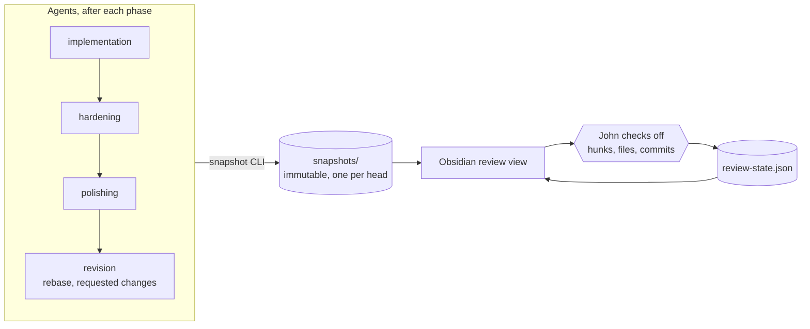

# John's Galaxy Brain Differential Review

Agent branches keep moving after John first reads them: hardening adds commits, polishing amends them, rebases rewrite every SHA, and reviewers' requests bring another round. Differential review lets John check work off once and, from then on, see only what actually changed. It works the same for John's own branches and for other people's pull requests John reviews.

## Overview

Agents take a snapshot of the branch after each phase. John reads the latest snapshot in Obsidian and checks off hunks, files or commits. The next snapshot is matched against everything already checked off, so a clean rebase leaves nothing to read and an amended commit shows only its differing hunks.

| Piece | Job |
| --- | --- |
| [Snapshot step](https://github.com/jmchilton/galaxy-brain/blob/main/vault/agents/_shared/PROCESS_DIFFERENTIAL_REVIEW_SNAPSHOT.md) | Agents run it at the end of implementation, hardening, polishing and every later revision. Review agents run it at the start of each round on someone else's PR. |
| [`differential-review`](https://github.com/jmchilton/differential-review) | A standalone package: the snapshot CLI and a pure TypeScript library for diff parsing, hunk fingerprints, commit and hunk matching, and review-state derivation. |
| [Obsidian view](https://github.com/jmchilton/galaxy-brain/blob/main/obsidian-plugin/src/diff-review-view.ts) | The only thing that writes review state. Opened from the git-compare icon on a branch or review record. |

## What a snapshot holds

Each snapshot records the branch's committed head against its merge-base with the base branch: the full diff, a fingerprint for every hunk, a `git patch-id` for every commit, and a mapping to the previous snapshot. Snapshots are immutable and keyed by head SHA, so rerunning a phase on the same head does nothing. A stacked branch is measured against its parent branch, not the release it eventually targets.

The CLI prints a short summary of what changed since the previous snapshot, which agents paste into their phase debrief.

## How check-offs survive change

- **Hunks** are fingerprinted by their changed lines, not by line numbers or surrounding context. A hunk that only moved, because the base changed under it, is still reviewed. A hunk whose lines changed a little is `changed`, with an interdiff against the version John checked off. Anything else is `new`.
- **Files** are reviewed when all their hunks are.
- **Commits** are signed off separately, as a holistic read, and matched across rebases by patch-id and `git range-diff`. A rebased commit with the same patch-id keeps its sign-off. An amended one is flagged with only the hunks that differ from the signed-off version.

Every item is one of `reviewed`, `new` or `changed`. The view hides reviewed items by default and can narrow further to "only what changed since the implementation snapshot", which is how John reads just the hardening and polishing work.

> [!TIP]
> **💭 Workflow Rule:** human attention is the scarce resource. Agents may rebase, amend and force-push as much as the work needs; the cost of that churn should never land on the reviewer as a full re-read.

> [!TIP]
> **💭 Workflow Rule:** agents add snapshots and append replies, and only John writes review state and resolves threads. An agent can't mark its own work reviewed.

> [!TIP]
> **💭 Workflow Rule:** when in doubt, show more. If a matching rule can't be sure a hunk is unchanged, it comes back as `changed` or `new`, never silently reviewed.

## Comments and replies

Click an old or new line number in Obsidian to write a comment. Shift-click another line in the same hunk to select a range. The comment keeps the original snapshot, selected code and a little surrounding text. Open comments stay accessible when reviewed hunks or unchanged baseline hunks would otherwise be hidden. Use **Open threads only**, the thread links, or `[` / `]` to navigate them.

Select **Address diff comments** on a Galaxy branch or review record to hand the open threads to an agent. The agent can read and reply through the CLI while Obsidian is closed. Replies can name the snapshot containing the change. John inspects that revision and selects **Resolve**, or **Reopen** for another round. Resolving a thread and checking off code are separate actions.

When the quoted code moves, the thread follows an unambiguous text match. Changed or ambiguous code keeps its original excerpt and a placement warning. Missing code never resolves a request automatically. Comments and replies remain readable even when their original snapshots are unavailable.

Threads and replies live beside the snapshots under `annotations/`, in tracked JSON files. John owns the threads and their resolution. Agents can append replies through the CLI, and cannot change threads or review check-offs through it.

## Where it fits

- In the [branch factory](https://galaxy-brain.jmchilton.net/factory/galaxy-branches/), snapshots land at the end of each workhorse phase and after every rebase or round of requested changes, so John's final read before approving a branch covers only what John hasn't already seen. Once every commit or every diff is checked off, the view writes `human_review.md` into the branch record, and the PR description quotes it under "Human Review".
- In the [review factory](https://galaxy-brain.jmchilton.net/factory/galaxy-reviews/), each review round snapshots the PR head, so follow-up rounds on someone else's PR show only what the author changed since the last round, even across force-pushes.

Everything is local: no server, and no GitHub integration beyond the git fetches agents already do. Snapshots stay out of git; `review-state.json` is committed with the record.

> [!NOTE]
> The matching rules, storage and JSON formats are in the package's [design doc](https://github.com/jmchilton/differential-review/blob/main/docs/design.md). galaxy-brain's integration is in [`LIBRARY_DIFFERENTIAL_REVIEW.md`](https://github.com/jmchilton/galaxy-brain/blob/main/LIBRARY_DIFFERENTIAL_REVIEW.md).
