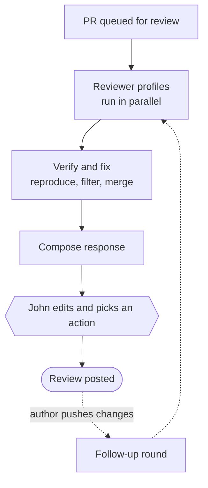
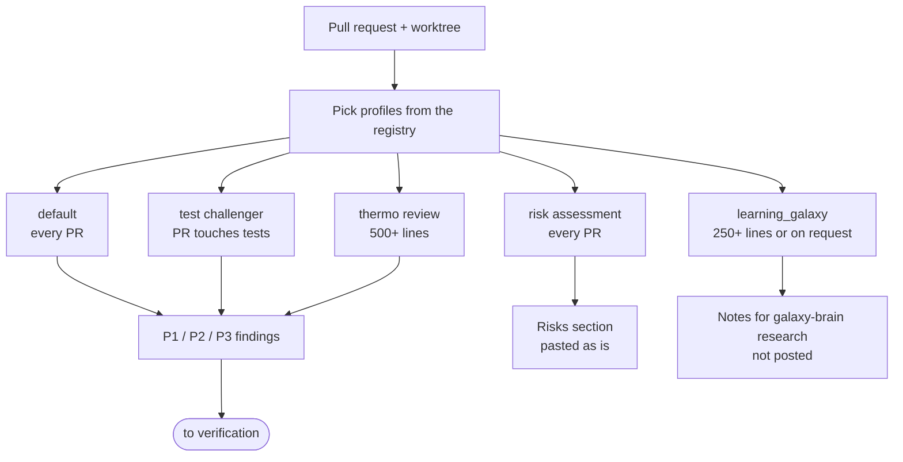
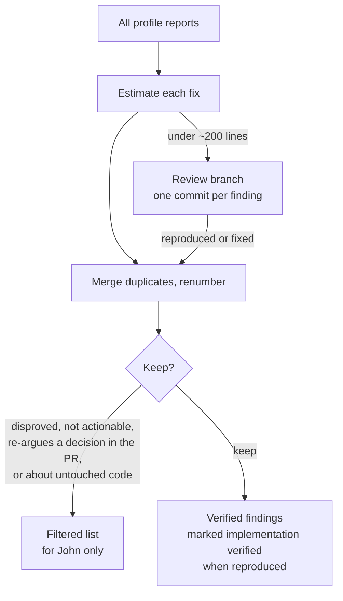
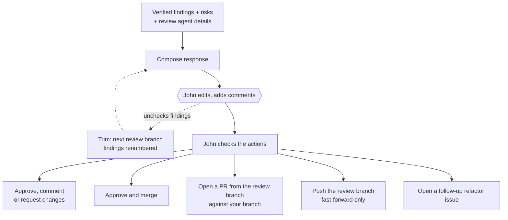

# John's Galaxy Brain Review Factory

If a review on your Galaxy pull request linked you here, the findings came from several reviewer agents, were checked by a verifier, and were edited by John before posting. This page explains how the review was put together, what the labels mean, and how to push back.

## Overview

A coordinating agent keeps the review queue. Reading a diff plus the code around it burns a lot of context, so the coordinator leaves that to subagents: each kind of review runs in its own, at an effort level the coordinator sets explicitly. Each round also starts with a local snapshot of the PR head, so on follow-up rounds John can read only [what changed](https://jmchilton.github.io/galaxy-brain/factory/differential-review/) since the last look, even across force-pushes.

John can also comment on diff lines in Obsidian and select **Address diff comments** on the record. The agent reads the persistent threads, responds with any resulting revision snapshot, and leaves resolution to John.

> [!TIP]
> **💭 John's Dev Philosophy:** the review weighs most heavily on reusing existing abstractions, staying consistent with sibling code paths, and leaving behind something reusable instead of accreting code. Galaxy is old and well established, so a change that fits what's already there usually beats a clever new path.

## Profiles

Each profile is a short instruction file. The coordinator picks every profile that applies to the PR from the [reviewer registry](https://github.com/jmchilton/galaxy-brain/blob/main/vault/agents/_shared/reviewers/index.md).

| Profile | Looks for |
| --- | --- |
| [default](https://github.com/jmchilton/galaxy-brain/blob/main/vault/agents/_shared/reviewers/default.md) | A thorough review weighted by [John's review focus](https://github.com/jmchilton/galaxy-brain/blob/main/vault/agents/_shared/REVIEW_FOCUS.md): reuse, sibling-path consistency, test coverage, typing. |
| [gx_test_challenger](https://github.com/jmchilton/galaxy-brain/blob/main/vault/agents/_shared/reviewers/gx_test_challenger.md) | The same [test challenges](https://github.com/jmchilton/galaxy-brain/blob/main/vault/agents/_shared/GX_PROCESS_CHALLENGE_TESTS.md) John's own branches go through, given as recommendations. |
| [thermo_review](https://github.com/jmchilton/galaxy-brain/blob/main/vault/agents/_shared/reviewers/thermo_review.md) | Maintainability: abstraction quality, oversized files, growing tangles of conditionals. |
| [gx_risk_assessment](https://github.com/jmchilton/galaxy-brain/blob/main/vault/agents/_shared/reviewers/gx_risk_assessment.md) | One-way versus two-way doors: what the change would lock Galaxy into. |
| [learning_galaxy](https://github.com/jmchilton/galaxy-brain/blob/main/vault/agents/_shared/reviewers/learning_galaxy.md) | What a Galaxy developer should learn from architecturally interesting changes. Feeds John's notes, not your review. |

> [!TIP]
> **💭 John's Dev Philosophy:** don't keep broken input alive. If code supports input that never worked and nothing could have relied on, the review asks for it to be rejected with a load-time, lint or validation error instead.

> [!TIP]
> **💭 Workflow Rule:** effort is matched to the PR. A bug fix against a release branch gets its test and maintainability challenges at low effort. Big refactorings that don't belong in a release fix are collapsed into one P2 or P3 finding and offered as a follow-up issue instead. Thermo review starts at 500 lines here, compared with 50 on John's own branches, because John spends more attention on work they author than on PRs they review.

> [!TIP]
> **💭 Stealing Best Practices:** thermo review runs the [Cursor team's thermo-nuclear code quality prompt](https://github.com/jmchilton/galaxy-brain/blob/main/vault/agents/_shared/prompts/thermo-nuclear-code-quality-review_readme.md) as is, and risk assessment uses [Matt Pocock's one-way and two-way doors](https://www.youtube.com/watch?v=LlgiOCmFG_w), with a [Galaxy list](https://github.com/jmchilton/galaxy-brain/blob/main/vault/agents/_shared/GX_ASSESSING_RISK.md) of which changes are which.

## Verify

When all reports are in, one verification subagent checks them. It estimates the fix for each finding. Fixes under about 200 lines go on a review branch, one commit per finding, often with a test that shows the problem. It then merges duplicates across profiles, renumbers the findings, and filters out the ones that don't hold up.

> [!TIP]
> **💭 Workflow Rule:** a finding the verifier couldn't stand behind shouldn't cost you time. Disproved and non-actionable findings are dropped, along with anything that re-argues a choice your PR description already explains or is about code your PR doesn't touch.

> [!TIP]
> **💭 Workflow Rule:** slow test layers are no excuse. If a finding needs an API, integration or Selenium test to prove it, the verifier writes that test. A low-effort review is only an agent setting; it never means missing API, integration or E2E tests can be skipped.

## Respond

A low-effort subagent assembles the response: space for John's own comments at the top, the risk summary, then the verified findings, each with its evidence, suggested fix, and the review-branch commit if there is one. If nothing survives verification, the response says so in one line. John can uncheck findings to drop them; the review branch is then rebuilt without their commits, the remaining findings are renumbered, and the response is composed again. John edits it and checks the actions to take.

> [!TIP]
> **💭 Workflow Rule:** once the review is delivered, the next move is yours. The agents are told never to nudge you, bump a stale thread, or chase a PR. They come back only when you push changes that need checking, or when John has promised a follow-up.

> [!TIP]
> **💭 Workflow Rule:** your branch stays yours. Review fixes reach it only as a PR you can merge, or as a fast-forward push when John checks Push. The agents never force-push, and they never @-mention anyone.

## Reading a review from this factory

- **P1** must be fixed before merge, **P2** should be fixed, and **P3** is minor or a nit. The agents assign these ratings. If John hasn't called out a P3 above the findings, feel free to ignore it.
- **(implementation verified)** means the verifier reproduced the problem, wrote a test for it, or fixed it on the review branch.
- **The review branch** is the verifier's working copy, not production-ready code. Take any commits that help; a human should still review them.
- **Suggested follow-up refactoring** appears when the review recommends work that doesn't fit your PR or its target branch. It's offered as draft issue text, not as a merge blocker.
- **Disagree?** Please push back. You're contributing to a repository John cares about, and you deserve a human response. If a finding is wrong or missing context, say so.

> [!NOTE]
> The "Automated Review Details" block near the top of each review lists which profiles ran, on which model, and at what effort. The full process is in [`PROCESS_INITIAL_REVIEW.md`](https://github.com/jmchilton/galaxy-brain/blob/main/vault/agents/_shared/PROCESS_INITIAL_REVIEW.md).
