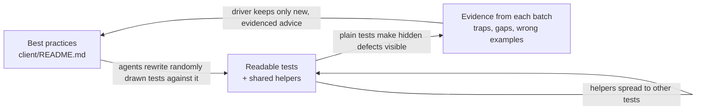

# The refactoring loop



## The Process

Each batch draws a few client tests at random. Subagents rewrite each one against the testing guidance in `client/README.md`, for readability and reuse, and never weaken an assertion. They also carry any useful shared helper into the other tests that need it. Every test lands as its own commit with a review note, and an independent reviewer checks the batch. Agents also report what the guidance missed, with the test that shows it. The driver adds only advice that is new and backed by a real case, so the README stays short. Better guidance improves the next batch's rewrites, and plainer tests make the next trap easier to spot.

## Metrics

_Stub: link the pitch from [REFACTORING_METRICS.md](REFACTORING_METRICS.md) here._

## Readme Updates

### Update: Readable test scenarios

The first batch added the core section: name each test after its behaviour and condition, split independent scenarios, use `it.each` for variations, and reuse factories before writing new ones. parseBool shows it at its smallest. Seven ad-hoc cases became three tables, and 13 inputs now each run as their own test. So a failure names the input that broke, and one bad input no longer hides the rest. In a grouped case, the first failing `expect` ends the case, and the inputs after it never get checked.

Here are both versions run against a plausible bug, where `parseBool` also accepts `"yes"` and `"1"`:

```diff
- × should return false for other strings
-     27|     it("should return false for other strings", () => {
-     28|         expect(parseBool("yes")).toBe(false);
-       |                                  ^
-     29|         expect(parseBool("1")).toBe(false);
-      Tests  1 failed | 6 passed (7)
+ × parses string "yes" as false
+ × parses string "1" as false
+      Tests  2 failed | 11 passed (13)
```

The old run reports only `"yes"`, and `"1"` is never checked. The new run names both broken inputs without anyone opening the file.

Passing runs read better too. Here's FormNumber's slider check, as `vitest list` shows it:

```diff
- FormNumber > renders a range input only when both min and max are defined and max > min
+ FormNumber > renders a slider: 'no bounds'
+ FormNumber > renders a slider: 'only a minimum'
+ FormNumber > renders a slider: 'increasing bounds'
+ FormNumber > renders a slider: 'a zero minimum'
+ FormNumber > renders a slider: 'a maximum below the minimum'
```

### Update: `initialState` is keyed by the store id

In WorkflowMissingToolsRequest, every "authenticated" case had been running with a null user. The store id is `userStore`, not `user`, and Pinia silently ignores a wrong key.

```ts
// before: the key matches no store
createTestingPinia({ createSpy: vi.fn, initialState: { user: { currentUser: REGISTERED_USER } } });

// after
createTestingPinia({ createSpy: vi.fn, initialState: { userStore: { currentUser } } });
```

### Update: Mock config with refs (the README's own example was wrong)

Masthead's single-user test passed without testing anything. The config mock returned a plain object, so the template read `config.single_user` as undefined. The README's mocking example used the same shape, so the guidance itself was corrected.

```ts
// before (README example)
vi.mock("@/composables/config", () => ({
    useConfig: vi.fn(() => ({ config: { enable_feature: true }, isConfigLoaded: true })),
}));

// after
vi.mock("@/composables/config");
beforeEach(() => {
    resetMockConfig();
    setMockConfig({ enable_feature: true });
});
```

### Update: Run composables with effects in `runInTestScope`

Three suites kept hand-written `effectScope` lists. useScrollEdges stopped its scope only after its assertions, so a failing assertion skipped the cleanup. The new helper stops the scope even when the test fails.

```ts
// before
const scope = effectScope();
const edges = scope.run(() => useScrollEdges(ref(row)))!;
// ...assertions...
scope.stop();

// after
const edges = runInTestScope(() => useScrollEdges(ref(row)));
```

### Update: Click a mounted GModal's buttons; don't emit on it

UserSharing's exact `toEqual([[]])` caught a second `cancel` event. A synthetic `vm.$emit` leaves GModal's native dialog open, so a later close emits again. The fix became a shared helper, then a README rule, then a batch of its own: four originators plus three adopters. The probe also found WorkflowInvocationShare's modal stayed open after Share.

```ts
// before
wrapper.findComponent(GModal).vm.$emit("cancel");
await flushPromises();
expect(wrapper.emitted("cancel")).toBeTruthy();

// after
await clickModalButton(wrapper, "Cancel");
expect(wrapper.emitted("cancel")).toEqual([[]]);
```

## Examples of Improved Readability

### WorkflowInvocationShare: positional booleans hid a duplicate test

Three positional booleans made two "renders nothing" cases call the same setup without anyone noticing. Once the helper took named options, the duplicate became the missing case, where the user owns neither.

```ts
// before: mountWorkflowInvocationShare(ownsWorkflow = true, bothShareable = false, ownsHistory = true)
it("renders nothing when the user does not own the workflow", async () => {
    const { wrapper } = await mountWorkflowInvocationShare(false);
it("renders nothing when the user owns the history but not the workflow", async () => {
    const { wrapper } = await mountWorkflowInvocationShare(false, false, true); // same arguments as above

// after
it.each([
    { condition: "the user owns neither the workflow nor the history", ownsWorkflow: false, ownsHistory: false },
    { condition: "the user owns the workflow but not the history", ownsWorkflow: true, ownsHistory: false },
    { condition: "the user owns the history but not the workflow", ownsWorkflow: false, ownsHistory: true },
])("renders nothing when $condition", async ({ ownsWorkflow, ownsHistory }) => {
    const wrapper = await mountWorkflowInvocationShare({ ownsWorkflow, ownsHistory });
```

### SwitchToHistoryLink: six positional arguments became named scenarios

The old helper took a tooltip, a history and four booleans. Each call needed a comment to say what it meant.

```ts
// before
// Since history was not current, we switch to it AND apply filters
await expectActionForHistory("Switch to history and view dataset", history, false, true, true, true);

// after: one row in an it.each table
{
    name: "switches to a purged history and applies filters",
    purged: true,
    filters: datasetFilters,
    tooltip: "Switch to history and view dataset",
    switches: 1,
    appliesFilters: 1,
    newTabs: 0,
},
```

Each scenario now also asserts the new-tab URL. The test count went 7 → 12.

### ScrollList: a sleep and an unbounded loop became an explicit count

```ts
// before
async function scrollOnce() {
    if (loadItems) {
        loadItems();
        await new Promise((resolve) => setTimeout(resolve, 10));
        await nextTick();
    }
}
while (wrapper.findAll(TEST_ITEM_DIV).length < TOTAL_ITEMS) {
    await scrollOnce();
}

// after
await scrollToEnd(SCROLLS_TO_LOAD_ALL); // awaits the real callback; throws if none was registered
```

If the component never registered its callback, the old loop would spin forever. Now the test fails with a message, and the reader can see how many scrolls the list should take.

## Examples of Helpers That Paid Off

### `setupMockConfig`: a two-line fix made 11 suites honest

The shared config mock returned a plain `{ value }` and a bare boolean, where the real `useConfig` returns refs. So any template or Options API read of `config.x` got undefined.

```js
// before
config: { value: configValues },
isConfigLoaded: isConfigLoaded,

// after
config: ref(configValues),
isConfigLoaded: ref(isConfigLoaded),
```

All 11 consumers pass unchanged. SelectionOperations' two "With Celery Disabled" cases had been passing no matter what the config said; now the config decides them, with no test edit. WorkflowListTabs had worked around the bug with a hand-rolled `vi.hoisted` mock of about 15 lines, plus a comment blaming the helper. Now it's one call:

```ts
setupMockConfig({ curated_workflows_source: curatedSource }, configLoaded);
```

### GalaxyAI chat harness: a duplicated ~100-line block became one import

Both chat suites had an identical block: hoisted API spies, stubs, eleven `vi.mock` registrations, a mount function, message helpers and an untyped deferred promise. All of it moved into `GalaxyAI/test-utils.ts`. Two of the mocks turned out to be dead and were dropped. routesync went 133 → 17 lines, newchat 173 → 63, and every assertion stayed the same.

```ts
// after: a test is the scenario and nothing else
mockPost.mockResolvedValue(chatReply("Here you go", "exchange-123"));
const { wrapper, chatStore } = await mountChat();

await sendMessage(wrapper, "find me a mapper");

expect(messageTexts(wrapper)).toEqual([NEW_CONVERSATION, "find me a mapper", "Here you go"]);
```

### `getFakeDatasetSummary`: six private builders and five casts became one typed factory

Six suites each built their own dataset, and five forced partial objects through `as unknown as HDASummary`. PairCollectionCreator's builder was an exact copy of ListCollectionCreator's.

```ts
// before, repeated with small differences across six files
function buildFakeDataset(id: string, hid: number, name: string, overrides: object = {}): HDASummary {
    return {
        id, hid, name,
        history_content_type: "dataset",
        deleted: false, purged: false, visible: true,
        state: "ok", extension: "txt", history_id: "history-1",
        ...overrides,
    } as unknown as HDASummary;
}

// after
function buildFakeDataset(id: string, hid: number, name: string, overrides: Partial<HDASummary> = {}) {
    return getFakeDatasetSummary({ id, hid, name, ...overrides });
}
```

The type checker now catches a fixture that drifts from the API schema. Every value a test depends on still sits in the test.
