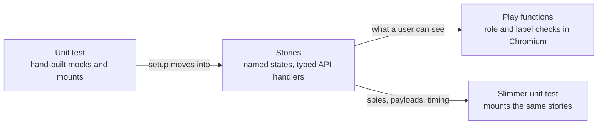

# Storybook stories and play functions for client tests

This PR adds Storybook to the client. It moves component tests' setup into stories and their user-visible checks into play functions that run in real Chromium. It builds on #24038 (readability) and lands two passes as one: stories, then plays. Stories separate a test's setup from its behaviour, so each test names a state and checks it. Plays then check that state the way a user would.


## The Process / Loop

<details>

Each component test goes through two passes, one commit each.
- **Story pass.** Setup moves into a `.stories.ts` file beside the component. Each story is a state worth looking at, named for that state, and API requests are answered by typed MSW handlers. The test still runs in happy-dom, but it now mounts those composed stories, so the states a developer browses and the states the test checks are the same objects.
- **Play pass.** Every check whose result a user can see moves into a play function on a story. It queries by role and label, in real Chromium. Checks about spies, request payloads or timing stay in vitest.

Every moved check is run against a deliberate break, so the play has to fail on the step it claims. Where a play claims to be stronger, the old test is shown passing that same break. An independent review then confirms every original assertion still has a home.

</details>

## Metrics

_Snapshot as of 2026-10-10, measured from each file's state on the readability branch to the play tip. The lanes are still moving._

29 component tests got stories. 22 of them also have play functions so far.

| Signal                                   | Before | After |             Δ |
| ---------------------------------------- | -----: | ----: | ------------: |
| Unit test lines                          |  6,481 | 3,606 | −2,875 (−44%) |
| Story lines                              |      0 | 4,928 |        +4,928 |
| Unit test cases                          |    285 |   173 |          −112 |
| Stories (each renders as a browser test) |      0 |   191 |          +191 |
| Play functions                           |      0 |   133 |          +133 |
| `expect`s (tests + stories)              |    817 |   862 |           +45 |
| Role/label queries                       |      0 |   265 |          +265 |
| Exact `toEqual`/`toStrictEqual`          |     81 |   101 |           +20 |
| Direct `mount`/`shallowMount` calls      |     43 |     8 |           −35 |
| `vi.mock` module mocks                   |     20 |     8 |           −12 |
| `wrapper.vm` reach-ins                   |     24 |    17 |            −7 |

Three unit files are gone, because every check now runs in the browser: InstallationSettings, WorkflowInvocationShare and ObjectStoreRestrictionSpan.

What the numbers mean:
- **Lines move, they don't vanish.** In total the line count grows by about 2,000. What you get for that is 191 states anyone can browse, plus checks that run where users are.
- **Fewer cases is not fewer checks.** A play is a script of steps, so several old cases often become one play. `expect`s go up.
- **Real modules instead of mocks.** Module mocks give way to the real modules behind MSW handlers. In the browser, the real sanitizer, router, tooltips and scrolling run too.
- **Checks read like a user.** All 265 role and label queries are new. They replace class selectors and `wrapper.vm` reads.

**Stronger, not just moved.** In 20 of 22 play conversions, at least one check is shown failing under a break that the old test passed. For example, an `.old.test.ts` copy runs green while the play goes red.

## Stories Make Tests Easier to Review

Moving setup into stories pays off before any play is written. Each test gets shorter: it names a state, acts on it, and checks the result. The setup behind that state sits in the stories file, which a reviewer reads once. They can also open it in Storybook and see the state. The total line count goes up, but the setup is no longer repeated inside every test. Seven of the 29 tests have stories and no plays yet, and they still read better.

### HistoryExportWizard: per-test mocks become a story name

Each test used to start by mocking the file-sources request inline, and guarded every step with `if (exists())`:

```ts
// before
it("should prioritize user-defined Zenodo over default Zenodo", async () => {
    server.use(
        http.get("/api/remote_files/plugins", ({ response }) => {
            return response(200).json([ZENODO_PLUGIN, USER_ZENODO_PLUGIN]);
        }),
    );
    const wrapper = await mountHistoryExportWizard();
    // Navigate to destination step
    const nextButton = wrapper.find(selectors.nextButton);
    if (nextButton.exists()) {
        await nextButton.trigger("click");
    }
    const zenodoCard = wrapper.find('[data-history-export-destination="zenodo-repository"]');
    if (zenodoCard.exists()) {
        // Should show user-defined Zenodo label
        expect(zenodoCard.text()).toContain("My Zenodo");
    }
});

// after
it("should prioritize user-defined Zenodo over default Zenodo", async () => {
    const wizard = await mountWizard(stories.WithUserAndDefaultZenodo);
    await next(wizard);
    expect(destinationCard(wizard, "zenodo-repository").text()).toContain("My Zenodo");
});
```

The stories file lists the scenarios in four lines:

```ts
export const DownloadOnly: Story = {};
export const WithRemoteFileSource: Story = { parameters: fileSources([posixSource]) };
export const WithZenodo: Story = { parameters: fileSources([zenodo]) };
export const WithUserAndDefaultZenodo: Story = { parameters: fileSources([zenodo, userZenodo]) };
```

The test file went from 460 to 179 lines, and the stories file is 72. The old guarded `expect` passed even with no card on the page. Now a missing card fails the test.

### BroadcastsList: a fake clock and random fixtures become two named states

This test has no plays. It dropped its fake `Date`, a builder on top of a random `generateNewBroadcast`, and the request mock it set up on every mount:

```ts
// before
const oneOfEach = () => [
    broadcastBetween("Active", -1000, 1000),
    broadcastBetween("Scheduled", 1000, 2000),
    broadcastBetween("Expired", -2000, -1000),
];
const wrapper = await mountBroadcastsList(oneOfEach());

// after
const wrapper = await mountBroadcastsList(stories.OneOfEach);
```

The timing now lives in the stories file, as realistic broadcasts: "Maintenance on Saturday" is published in two days and expires in three. The test file went from 139 to 97 lines. The cost is that the test repeats the three subjects, because a stories file exports only stories.

### FormData: prop objects become story names, and `setProps` becomes a real parent

This test has no plays either:

```ts
// before
const wrapper = createTarget({
    value: { values: [{ id: "hda2", src: "hda" }, { id: "hda3", src: "hda" }] },
    multiple: true,
    optional: true,
    options: defaultOptions,
});
await wrapper.setProps({ value: value_0 });

// after
const { wrapper, setValue } = mountFormData(stories.MultipleDatasets);
await setValue(inputValue([["hda", "hda2"], ["hda", "hda3"]]));
```

Four stories replace the prop objects that each test rebuilt: `SingleDataset`, `OptionalDataset`, `MultipleDatasets` and `NoDatasetsInWorkflowRun`. The shared fixture, the datatypes mock and the store setup moved out of the test. `setValue` goes through a harness that acts as the v-model parent, so a value round-trips the way it does on a tool form. The test file went from 611 to 342 lines.

## Examples

### ConfigurationMarkdown: the browser runs the real sanitizer

The unit test mocks `sanitizeHtml`, so the mock passes HTML through untouched. The old test could never see what the sanitizer actually allows.

```ts
// before: happy-dom, sanitizer mocked
const wrapper = mountConfigurationMarkdown("the <b>content</b>", true);
expect(wrapper.html()).toContain("<b>content</b>");

// after: a play on the AdminConfigured story, in Chromium
await step("See the storage policy link open in a new window", async () => {
    const link = canvas.getByRole("link", { name: "storage policy" });
    await expect(link).toHaveAttribute("target", "_blank");
    await expect(link).toHaveAttribute("rel", "noopener noreferrer");
});
```

Now, if the `links` profile drops `target` or forbids `<b>`, the play fails, while the old test still passes. The one spy check that needs the mock stays in vitest.

### InstallationSettings: `wrapper.vm` becomes what the user sees

```js
// before
expect(wrapper.vm.installToolDependencies).toBe(true);
expect(wrapper.vm.installRepositoryDependencies).toBe(true);
expect(wrapper.vm.installResolverDependencies).toBe(true);
```

```ts
// after
export const UnchecksDisabledDependencies: Story = {
    parameters: dependencySettings(NO_DEPENDENCY_SETTINGS),
    play: async (context) => {
        await openAdvancedSettings(context);
        await context.step("See every dependency option unchecked", () => expectDependencyOptions(context, false));
    },
};
```

The old config was all `true`, so a hard-coded `true` passed it. The new story turns every setting off, and the play opens the collapsed section the way a user would. Writing that step showed the collapse toggle has no accessible name (#24036). The unit file is deleted.

### UserDeletion: real error bodies find a real bug

Stories answer with Galaxy's actual error bodies, not a bare status. When self-deletion is off, Galaxy answers with a 403 status and `err_code` 403004:

```ts
export const SelfDeletionNotAllowed: Story = {
    parameters: { msw: { handlers: { deleteUser: http.delete("/api/users/{user_id}", ({ response }) =>
        response("4XX").json({ err_msg: "…does not allow admins to delete users.", err_code: 403004 }, { status: 403 }),
    ) } } },
};
```

The component checks `error.err_code === 403`, so users get the generic "An error occurred" message and never the one that explains why. This is the same code on `dev`.

### ScrollList: plays scroll the real list

The unit test mocks `useInfiniteScroll` and calls the loader by hand. The plays scroll the real list page by page, and check the exact row names and "Loaded N out of 50 datasets" after each page. A loader that always fetched from offset 0 returned duplicate pages with the right counts. The old test passed it 10/10, and the plays fail it. The per-scroll timing checks stay in vitest, where a mock makes them deterministic.

### Lint: a realistic story exposed a test baselined on an artifact

The old test linted a detached copy of the workflow before filling the step store. So a wired input looked disconnected, and a January 2026 change had baselined the expectations to that. The story renders Lint over the real store, the way the editor does, and the input reads as connected. The 2023 expectations come back. The disconnected case is now its own story.

## Bugs Found

Plays query by role and name, which is how a screen reader sees the page, so accessibility gaps fail loudly. Realistic API answers surface the rest. The fixes go in separate PRs.

| Bug | Where | Status |
| --- | --- | --- |
| Tooltip shows literal `<p>…</p>` | `ObjectStoreBadge.vue` | #24031 |
| Tooltip text joins a button's accessible name | galaxy-ui `GButton` | #24035 |
| Collapse toggle has no accessible name | `InstallationSettings.vue` | #24036 |
| Modal dialog has no accessible name | galaxy-ui `GModal` | #24037 |
| `v-g-tooltip` replaces a text button's name | galaxy-ui `vGTooltip` | Same code on `dev` |
| Admin form fields have no accessible name | `FormElementLabel.vue` | Same code on `dev` |
| Self-deletion refusal shows the generic error | `UserDeletion.vue` | Same code on `dev` |
| Load error reads "Error: User does not own…" | `WorkflowInvocationState.vue` | Same code on `dev` |
| `useConfig(true)` never loads config | `composables/config.ts` | Fix on its own branch |

Five more are smaller, such as a dead "Select this folder" label and a stray space before a period.

## Visual checks could protect future migrations

The story catalog also opens up [visual regression testing](https://storybook.js.org/docs/writing-tests/visual-testing) as a future option. For migrations such as replacing BootstrapVue components, we could capture the same states before and after a change and review screenshot differences for spacing, wrapping, clipping or overlay regressions that behavioral tests might miss. Chromatic or local Vitest screenshot comparisons could build on these stories; adding capture, baselines and a review workflow would be separate follow-up work beyond this branch.

## Accessibility checks alongside the plays

The separate `vitest_story_a11y` experiment adds the version-matched accessibility addon, checks rendered content including body-level teleports, and includes WCAG 2.2 AA alongside the existing rulesets. New stories fail on violations; observed legacy problems receive explicit `todo` exceptions. The initial audit found violations in 121 of 236 stories, including unnamed controls, invalid ARIA relationships, contrast, and small targets; shared controls repeat across many stories, so this is not 121 distinct bugs. The built-in viewport toolbar gains desktop, narrow-panel and mobile presets for review; those presets alone do not run a screenshot matrix.

The important switches are `parameters.a11y.test: "error"` and the axe `runOnly` rulesets. `todo` shows warnings in Storybook but produces no accessibility diagnostics in CLI/CI; it also stops future violations in that story from failing the command. Each exception is recorded with its observed rules and must be revisited. In Storybook's test widget, enable the Accessibility checkbox when running component tests. The addon also provides violation highlighting and vision simulations. [Storybook accessibility testing](https://storybook.js.org/docs/writing-tests/accessibility-testing).

This experiment does not add Chromatic credentials or a visual CI gate, and it does not change the conversion lanes' branches or ledger. Browser CI remains a separate requirement for upstream adoption.

## Costs

### CLI runtime

The last three comparisons average **68.94s before → 77.25s after**, an increase of **8.31s (12.1%)**. The remaining unit tests average 54.21s and the browser stories add 23.04s. Moving checks into plays saves unit time, which offsets much of the browser cost.

| Run | Before: original units | After: remaining units | After: Chromium stories | After: combined | Change |
| --- | ---: | ---: | ---: | ---: | ---: |
| 1 | 81.16s | 69.31s | 36.64s | 105.95s | +30.5% |
| 2 | 81.10s | 54.79s | 23.71s | 78.50s | −3.2% |
| 3 | 69.23s | 54.62s | 23.09s | 77.71s | +12.2% |
| 4 | 68.69s | 54.01s | 22.93s | 76.94s | +12.0% |
| 5 | 68.89s | 54.00s | 23.09s | 77.09s | +11.9% |
| **Mean, runs 3–5** | **68.94s** | **54.21s** | **23.04s** | **77.25s** | **+12.1%** |

Measured on 2026-10-12–13 using fixed snapshots: pre-Storybook base `27e6eaab100` versus Play tip `81c4987360d`. Before runs the 59 original unit files in the conversion range: **482 tests**. After runs their 55 remaining unit files (**345 tests**) plus all 59 story files (**379 browser tests**). All five comparisons pass. The after suite includes additional rendered states and checks, so the test counts are not equivalent workloads. This measures the conversion range, not the entire repository's test suite.

Times are end-to-end CLI wall time, including startup. Units and browser stories run sequentially, so the combined column is their sum; Vitest's summed parallel test durations are not used. Both snapshots use pinned Node 22.20.0, three workers and an 8 GB Node heap, with coverage and a11y excluded. Runs 3–5 alternate which snapshot runs first. The first two comparisons show startup/cache variability; the final three are steadier, but this is a local benchmark rather than a CI performance guarantee.

### Other costs

- **A new CI job.** Stories and plays need a browser job (`pnpm test:browser`, Playwright Chromium). The existing `unit` job is unchanged.
- **New dev dependencies.** Storybook 10.6, `@storybook/addon-vitest`, `msw-storybook-addon`, `@vitest/browser-playwright` and `playwright`.
- **Size.** About 29 test files plus shared story infrastructure. The infrastructure commits come first. After that, each test has a story commit and a play commit, so the PR can be reviewed one test at a time.

## How to test the changes?

- `pnpm test`: the unit project, as today.
- `pnpm test:browser`: every story renders, and every play passes, in headless Chromium.
- `pnpm storybook`: browse the stories, and watch a play step by step in the Interactions panel.
