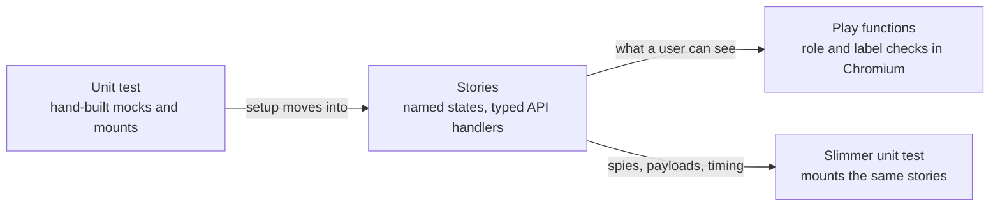

# Make client tests easier to review with Storybook

[Presentation: client testing and review time](https://jmchilton.net/slides/client-testing/#/4)

- **Review behavior directly.** Open a component state and watch its test run step by step.
- **Reuse setup.** Browse and test the same named scenarios instead of rebuilding them in each test.
- **Test in a real browser.** Exercise styles, focus, scrolling and interactions together in Chromium.
- **Catch accessibility problems.** Check rendered states and find controls by the names users rely on.
- **Make UI changes easier to inspect.** Build a catalog of states for component migrations and future visual regression checks.

Move component setup into Storybook stories and user-visible assertions into browser play functions. A reviewer should be able to open the scenario, see what changes and follow the checks. Keep unit tests for logic, request contracts and controlled timing.

## Our tests are too much work to review

Small client fixes routinely arrive with much larger tests. The [datatype request fix (#23995)](https://github.com/galaxyproject/galaxy/pull/23995) and [retry/count fix (#24141)](https://github.com/galaxyproject/galaxy/pull/24141) each carried roughly three times as much test diff as production diff. Before judging the fix, a reviewer has to reconstruct the screen from API fixtures, store setup, mocks and timing helpers. The intended behavior gets buried in the machinery used to test it.

The dataset-edit alert failure in [#24273](https://github.com/galaxyproject/galaxy/issues/24273) is another example. Saving attributes triggered a background refresh that unmounted the Edit tab and lost the alert. Keeping that result visible sounds small, but preparing the fix required a separate PR, [#24297](https://github.com/galaxyproject/galaxy/pull/24297), with **283 added lines of baseline tests**, plus refactoring and a backport. These establish existing behavior before the fix; the refresh investigation also uncovered related problems. Splitting the preparation helps review, but adds another PR to understand before we can fix the original failure.

Some of this machinery exists because our unit environment does not run the UI as a browser does. The [popover-width fix (#23910)](https://github.com/galaxyproject/galaxy/pull/23910) changed one CSS selector and needed a 50-line test that reads the Vue source, compiles and injects its styles, then checks a width cap. The reviewer must understand that workaround as well as the bug, and still cannot see whether the popover fits on screen.

Better fixtures and shared helpers help. They do not make the rendered state visible, and hand-written API responses can describe states the server never sends. Difficult tests can also signal that a component needs better boundaries; an agent can instead generate an elaborate harness around it, leaving a human with two complicated pieces to understand. Generating tests faster does not make them easier to trust.

## Make the scenario visible

A story names a state and owns its setup. A play performs an interaction and checks the visible result in Chromium. Reviewers can inspect the same state the test uses and watch each step succeed or fail.

For the dataset-edit bug, that could mean watching a save alert remain visible through a background refresh, with another scenario showing a failed refresh that preserves existing content. Request-order and race checks would stay in unit tests. Those dataset scenarios are proposed examples, not conversions already in this prototype.

This builds on [#24038's readability work](https://github.com/galaxyproject/galaxy/pull/24038). The prototype spans 100 story files and already exposes behavior hidden by mocks. Adoption still needs browser CI and work on the accessibility findings. The case is for clearer, more inspectable tests; review-time savings have not been measured.



## Stories Make Tests Easier to Review

Moving setup into stories pays off before any play is written. Each test gets shorter: it names a state, acts on it, and checks the result. The setup behind that state sits in the stories file, which a reviewer reads once. They can also open it in Storybook and see the state. The total line count goes up, but the setup is no longer repeated inside every test. The story pass is useful independently of the play pass: some states are useful to browse even when their assertions still belong in unit tests.

### HistoryExportWizard: per-test mocks become a story name

Each test used to start by mocking the file-sources request inline, and guarded every step with `if (exists())`:

```ts
// before
it("should prioritize user-defined Zenodo over default Zenodo", async () => {
    server.use(
        http.get("/api/remote_files/plugins", ({ response }) => {
            return response(200).json([ZENODO_PLUGIN, USER_ZENODO_PLUGIN]);
        }),
    );
    const wrapper = await mountHistoryExportWizard();
    // Navigate to destination step
    const nextButton = wrapper.find(selectors.nextButton);
    if (nextButton.exists()) {
        await nextButton.trigger("click");
    }
    const zenodoCard = wrapper.find('[data-history-export-destination="zenodo-repository"]');
    if (zenodoCard.exists()) {
        // Should show user-defined Zenodo label
        expect(zenodoCard.text()).toContain("My Zenodo");
    }
});

// after
it("should prioritize user-defined Zenodo over default Zenodo", async () => {
    const wizard = await mountWizard(stories.WithUserAndDefaultZenodo);
    await next(wizard);
    expect(destinationCard(wizard, "zenodo-repository").text()).toContain("My Zenodo");
});
```

The stories file lists the scenarios in four lines:

```ts
export const DownloadOnly: Story = {};
export const WithRemoteFileSource: Story = { parameters: fileSources([posixSource]) };
export const WithZenodo: Story = { parameters: fileSources([zenodo]) };
export const WithUserAndDefaultZenodo: Story = { parameters: fileSources([zenodo, userZenodo]) };
```

This is the story-pass example; on the current play branch the visible check lives in `PrefersUserZenodo`:

```ts
play: async (context) => {
    await context.step("Keep the default format", () => next(context));
    await expect(await context.canvas.findByText("My Zenodo")).toBeVisible();
},
```

The old guarded `expect` could pass with no card on the page. The visible assertion now fails when the label is missing.

### BroadcastsList: a fake clock and random fixtures become two named states

In the story pass, this test dropped its fake `Date`, a builder on top of a random `generateNewBroadcast`, and the request mock it set up on every mount:

```ts
// before
const oneOfEach = () => [
    broadcastBetween("Active", -1000, 1000),
    broadcastBetween("Scheduled", 1000, 2000),
    broadcastBetween("Expired", -2000, -1000),
];
const wrapper = await mountBroadcastsList(oneOfEach());

// after
const wrapper = await mountBroadcastsList(stories.OneOfEach);
```

The timing and broadcasts now live in the stories file. The current play pass goes further: `OneOfEach`, `NoBroadcasts`, `FiltersByState` and `TogglesEveryFilter` check the list and its filter interactions in the browser; the old standalone unit file is gone.

### FormData: prop objects become story names, and `setProps` becomes a real parent

The story pass separates the input state from the controlled-parent behavior:

```ts
// before
const wrapper = createTarget({
    value: { values: [{ id: "hda2", src: "hda" }, { id: "hda3", src: "hda" }] },
    multiple: true,
    optional: true,
    options: defaultOptions,
});
await wrapper.setProps({ value: value_0 });

// after
const { wrapper, setValue } = mountFormData(stories.MultipleDatasets);
await setValue(inputValue([["hda", "hda2"], ["hda", "hda3"]]));
```

The initial stories replace prop objects that each test rebuilt: `SingleDataset`, `OptionalDataset`, `MultipleDatasets` and `NoDatasetsInWorkflowRun`. The shared fixture, the datatypes mock and the store setup moved out of the test. `setValue` goes through a harness that acts as the v-model parent, so a value round-trips the way it does on a tool form. The catalog now also includes dataset/collection selection and batch-linking plays, while serialization and other contract checks remain in units.

## Examples

### ConfigurationMarkdown: the browser runs the real sanitizer

The unit test mocks `sanitizeHtml`, so the mock passes HTML through untouched. The old test could never see what the sanitizer actually allows.

```ts
// before: happy-dom, sanitizer mocked
const wrapper = mountConfigurationMarkdown("the <b>content</b>", true);
expect(wrapper.html()).toContain("<b>content</b>");

// after: a play on the AdminConfigured story, in Chromium
await step("See the storage policy link open in a new window", async () => {
    const link = canvas.getByRole("link", { name: "storage policy" });
    await expect(link).toHaveAttribute("target", "_blank");
    await expect(link).toHaveAttribute("rel", "noopener noreferrer");
});
```

Now, if the `links` profile drops `target` or forbids `<b>`, the play fails, while the old test still passes. The one spy check that needs the mock stays in vitest.

### InstallationSettings: `wrapper.vm` becomes what the user sees

```js
// before
expect(wrapper.vm.installToolDependencies).toBe(true);
expect(wrapper.vm.installRepositoryDependencies).toBe(true);
expect(wrapper.vm.installResolverDependencies).toBe(true);
```

```ts
// after
export const UnchecksDisabledDependencies: Story = {
    parameters: dependencySettings(NO_DEPENDENCY_SETTINGS),
    play: async (context) => {
        await openAdvancedSettings(context);
        await context.step("See every dependency option unchecked", () => expectDependencyOptions(context, false));
    },
};
```

The old config was all `true`, so a hard-coded `true` passed it. The new story turns every setting off, and the play opens the collapsed section the way a user would. Writing that step originally exposed the unnamed collapse toggle ([#24036](https://github.com/galaxyproject/galaxy/issues/24036)). Shared-control fixes have since landed upstream. The current unit file remains for seven newer target-section and emitted-payload regression cases; the display and dependency defaults are checked by plays.

### UserDeletion: real error bodies find a real bug

Stories answer with Galaxy's actual error bodies, not a bare status. When self-deletion is off, Galaxy answers with a 403 status and `err_code` 403004:

```ts
export const SelfDeletionNotAllowed: Story = {
    parameters: { msw: { handlers: { deleteUser: http.delete("/api/users/{user_id}", ({ response }) =>
        response("4XX").json({ err_msg: "…does not allow admins to delete users.", err_code: 403004 }, { status: 403 }),
    ) } } },
};
```

The component checks `error.err_code === 403`, so users get the generic "An error occurred" message and never the one that explains why. This check remains in the October 20 prototype.

### ScrollList: plays scroll the real list

The unit test mocks `useInfiniteScroll` and calls the loader by hand. The plays scroll the real list page by page, and check the exact row names and "Loaded N out of 50 datasets" after each page. A loader that always fetched from offset 0 returned duplicate pages with the right counts. The old test passed it 10/10, and the plays fail it. The per-scroll timing checks stay in vitest, where a mock makes them deterministic.

### Lint: a realistic story exposed a test baselined on an artifact

The old test linted a detached copy of the workflow before filling the step store. So a wired input looked disconnected, and a January 2026 change had baselined the expectations to that. The story renders Lint over the real store, the way the editor does, and the input reads as connected. The 2023 expectations come back. The disconnected case is now its own story.

## Bugs found and what remains

Role/name queries and realistic API responses exposed product problems as well as test problems. The early reports included storage badge HTML ([#24031](https://github.com/galaxyproject/galaxy/issues/24031)), tooltip names ([#24035](https://github.com/galaxyproject/galaxy/issues/24035)), unnamed collapse controls ([#24036](https://github.com/galaxyproject/galaxy/issues/24036)) and unnamed dialogs ([#24037](https://github.com/galaxyproject/galaxy/issues/24037)). These are discovery examples, not a current list of unfixed code: shared-control and form repairs landed in [#24046](https://github.com/galaxyproject/galaxy/pull/24046), although those issue records remain open at the October 20 check.

The current strict browser audit still exposes unnamed controls, label associations, nested interactive elements, contrast and target-size failures. Many stories share a control, so story failures must be grouped before treating them as separate defects. The UserDeletion error-code example above remains in the current prototype. Product fixes are kept separate from the test migration; the existing release accessibility follow-up branch also remains independent.

## Visual checks could protect future migrations

The story catalog also opens up [visual regression testing](https://storybook.js.org/docs/writing-tests/visual-testing) as a future option. For migrations such as replacing BootstrapVue components, we could capture the same states before and after a change and review screenshot differences for spacing, wrapping, clipping or overlay regressions that behavioral tests might miss. Chromatic or local Vitest screenshot comparisons could build on these stories; adding capture, baselines and a review workflow would be separate follow-up work beyond this branch.

## Accessibility checks alongside the plays

The same states used for interaction tests can expose inaccessible controls. A missing label becomes a problem both for the test that needs to find a button and for the person who needs to use it. Storybook makes those findings inspectable, with violation highlighting and vision simulations alongside the rendered component.

The combined prototype checks rendered content, including body-level teleports, against automated accessibility rules including WCAG 2.2 AA. Desktop, narrow-panel and mobile presets also make it easier to inspect the UI at different sizes. These are useful checks, not a claim of complete accessibility or a screenshot matrix.

Strict failures remain, and historical per-story exceptions need reassessment now that some fixes are upstream. Adopting this approach means dealing with those findings and adding browser CI. The current unit job does not run the plays or accessibility checks.

<details>
<summary>Accessibility configuration and existing exceptions</summary>

The global setting is `parameters.a11y.test: "error"`. The 121 per-story `todo` annotations are retained historical exceptions, not a newly verified list of necessary workarounds. Some correspond to fixes now upstream; the current 150 known failing stories also include additional states and newer markup. These are not all new regressions or all leftovers from the initial audit.

`todo` shows warnings in Storybook but produces no accessibility diagnostics in CLI/CI; it also stops future violations in that story from failing the command. Each exception needs review before it can be removed. No new TODOs or disabled rules were added to make this rebase pass. In Storybook's test widget, enable the Accessibility checkbox when running component tests. [Storybook accessibility testing](https://storybook.js.org/docs/writing-tests/accessibility-testing).

</details>

## Costs

### CLI runtime

An earlier local comparison took about **8 seconds longer overall (12%)**. Moving checks out of units offsets much of the browser cost.

That benchmark used a smaller catalog and excluded accessibility checks; it does not predict the current combined branch's runtime.

### Other costs

- **A new CI job.** Stories and plays need a browser job (`pnpm test:browser`, Playwright Chromium). The existing `unit` job is unchanged.
- **More tooling to maintain.** Storybook, its testing and accessibility addons, API mocking and Playwright become part of the client development setup.
- **Review size.** The catalog now spans 100 story files. Stories and combined play/accessibility remain separate review layers. Shared infrastructure comes first; per-test commits group the relevant stories, plays and annotations so a reviewer can take a smaller slice.

<details>
<summary>Validation details and branch snapshot — October 20</summary>

The published prototype is `jmchilton/vitest_story_play` at `3eaa09792d6`, above `vitest_stories` at `fd5fd27f67a` and readability at `1358d378879`. Play and accessibility are one maintained lane. Shared infrastructure comes first; story-specific plays and accessibility annotations are grouped by test. The prototype is now open as [RFC #24300](https://github.com/galaxyproject/galaxy/pull/24300); the strict browser gate is not all green.

| Evidence | Current result |
| --- | --- |
| Story catalog exercised by the browser run | 100 files / 583 collected story tests |
| Combined lane history above stories | 4 infrastructure/helper commits, then 96 per-test commits |
| Accessibility annotations folded into their test commits | 26 story files; 121 historical per-story TODO exceptions retained |
| Full strict browser run | 432 passing / 151 failing stories |
| Same-source reruns of the two interaction timeouts | Both interactions complete; one then fails axe contrast |
| Known strict axe failures across those runs | 150 distinct stories, not 150 distinct bugs |
| Affected composed-story unit checks for the accessibility layer | 9 files / 128 tests pass |
| Full types, scoped style checks and static Storybook build | Pass |

Some full-run interaction timeouts pass in isolated reruns, but strict accessibility failures remain. Consolidation added no exception or disabled rule.

These counts describe collected cases and validation results, not line or branch coverage. Several old unit cases can become one multi-step play; a rendered story without a play is not an equivalent interaction test. Code moves into stories and helpers rather than simply vanishing, and upstream regression tests can still require a unit file after older cases move out.

[Consolidation mapping and exact-tree proof](reviews/combine_play_a11y_2026-10-20/commit_mapping.json), [independent review](reviews/combine_play_a11y_2026-10-20/review_debrief.md), and [strict browser findings](reviews/restack_2026-10-20/a11y_browser_findings.json) record the snapshot. The examples above illustrate the original migration and its current plays; historical line-count comparisons are not presented as current measurements.

</details>

<details>
<summary>How conversions preserve the checks</summary>

Each component test goes through two passes, one commit each.

- **Story pass.** Setup moves into a `.stories.ts` file beside the component. Each story is a state worth looking at, named for that state, and API requests are answered by typed MSW handlers. The test still runs in happy-dom, but it now mounts those composed stories, so the states a developer browses and the states the test checks are the same objects.
- **Play pass.** Every check whose result a user can see moves into a play function on a story. It queries by role and label, in real Chromium. Checks about spies, request payloads or timing stay in vitest.

The conversion process calls for deliberate-break checks: the play must fail at the step it claims. Claims of stronger coverage need an old-green/new-red comparison, and independent review checks that original assertions still have a home. These are verification requirements, not a guarantee that every rendered story has an interaction check. The latest consolidation only reorganized history and preserved the previously tested source tree exactly.

</details>

## How to test the changes?

- `pnpm test`: the unit project, as today.
- `pnpm test:browser`: render stories, run plays and enforce the configured axe checks in headless Chromium. The current full strict run fails as documented above.
- `pnpm storybook`: browse the stories, and watch a play step by step in the Interactions panel.

Use the pinned Node version from `client/.node_version` when installing and running these commands. Start from `jmchilton/vitest_story_play` for the combined prototype; the unit and browser projects are separate, so a passing `pnpm test` does not validate plays or accessibility.
