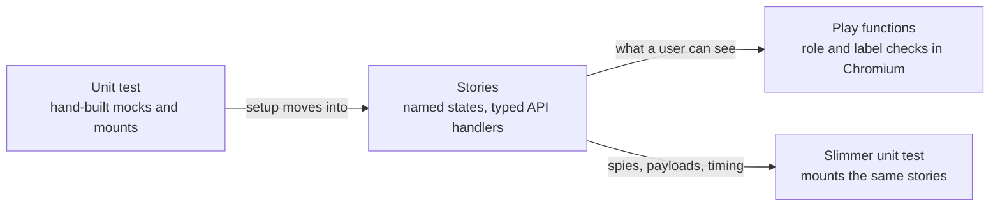

# Storybook stories and play functions for client tests

[Presentation: client testing and review time](https://jmchilton.net/slides/client-testing/#/4)

The proposal is to move component setup into browsable Storybook stories and user-visible checks into play functions that run in real Chromium. It builds on [#24038 (readability)](https://github.com/galaxyproject/galaxy/pull/24038). Stories name the states a reviewer can inspect; plays check those states through roles, labels and real interactions. Unit tests retain request contracts, spies, controlled timing and other checks that need those tools.

As of **2026-10-20**, the published prototype is `jmchilton/vitest_story_play` at `3eaa09792d6`, above `vitest_stories` at `fd5fd27f67a` and readability at `1358d378879`. Play and accessibility are now one maintained lane. Shared infrastructure comes first; story-specific plays and accessibility annotations are grouped by test. This is a prototype with known strict accessibility failures, not an open Storybook PR or an all-green browser gate.

## Why this is about review time

A test has to communicate the behavior to the next person reviewing a change. In the slides' API fan-out examples, test additions and deletions were roughly three times the production diff; that is a substantial amount of code for a human to understand. Cleaner fixtures help, but a named state that the reviewer can open and exercise makes more of that work visible.

Unit tests also provide design feedback. When a test needs elaborate mocks or is more complicated than the feature, that can tell a human to decompose the implementation. My concern with generated tests is that an agent can instead write around the existing implementation, leaving the reviewer to understand both complicated pieces. Stories do not replace good decomposition; they give agents and humans a shared, inspectable description of the behavior.

Fast feedback still matters. The tradeoff includes authoring and human review time as well as CLI runtime. The historical benchmark below measures runtime; it does not measure a review-time saving. The reason to try this is that a reviewer can see the story in action and follow the assertions step by step.


## The Process / Loop

<details>

Each component test goes through two passes, one commit each.
- **Story pass.** Setup moves into a `.stories.ts` file beside the component. Each story is a state worth looking at, named for that state, and API requests are answered by typed MSW handlers. The test still runs in happy-dom, but it now mounts those composed stories, so the states a developer browses and the states the test checks are the same objects.
- **Play pass.** Every check whose result a user can see moves into a play function on a story. It queries by role and label, in real Chromium. Checks about spies, request payloads or timing stay in vitest.

The conversion process calls for deliberate-break checks: the play must fail at the step it claims. Claims of stronger coverage need an old-green/new-red comparison, and independent review checks that original assertions still have a home. These are verification requirements, not a guarantee that every rendered story has an interaction check. The latest consolidation only reorganized history and preserved the previously tested source tree exactly.

</details>

## Current snapshot

The October 10 counts (29 component conversions and 191 stories) described an early prototype. The October 20 stack is larger:

| Evidence | Current result |
| --- | --- |
| Story catalog exercised by the browser run | 100 files / 583 collected story tests |
| Combined lane history above stories | 4 infrastructure/helper commits, then 96 per-test commits |
| Accessibility annotations folded into their test commits | 26 story files; 121 historical per-story TODO exceptions retained |
| Full strict browser run | 432 passing / 151 failing stories |
| Same-source reruns of the two interaction timeouts | Both interactions complete; one then fails axe contrast |
| Known strict axe failures across those runs | 150 distinct stories, not 150 distinct bugs |
| Affected composed-story unit checks for the accessibility layer | 9 files / 128 tests pass |
| Full types, scoped style checks and static Storybook build | Pass |

Before accessibility was added, the full play run passed 578 stories and failed five. All 39 stories across those four affected files passed isolated reruns on identical source. That timing-sensitive result does not make the full run green. The combined strict run retains its failures; consolidation added no exception or disabled rule.

These counts describe collected cases and validation results, not line or branch coverage. Several old unit cases can become one multi-step play; a rendered story without a play is not an equivalent interaction test. Code moves into stories and helpers rather than simply vanishing, and upstream regression tests can still require a unit file after older cases move out.

[Consolidation mapping and exact-tree proof](reviews/combine_play_a11y_2026-10-20/commit_mapping.json), [independent review](reviews/combine_play_a11y_2026-10-20/review_debrief.md), and [strict browser findings](reviews/restack_2026-10-20/a11y_browser_findings.json) record the snapshot. The code below illustrates the original migration and its current plays; historical line-count comparisons are not presented as current measurements.

## Stories Make Tests Easier to Review

Moving setup into stories pays off before any play is written. Each test gets shorter: it names a state, acts on it, and checks the result. The setup behind that state sits in the stories file, which a reviewer reads once. They can also open it in Storybook and see the state. The total line count goes up, but the setup is no longer repeated inside every test. The story pass is useful independently of the play pass: some states are useful to browse even when their assertions still belong in unit tests.

### HistoryExportWizard: per-test mocks become a story name

Each test used to start by mocking the file-sources request inline, and guarded every step with `if (exists())`:

```ts
// before
it("should prioritize user-defined Zenodo over default Zenodo", async () => {
    server.use(
        http.get("/api/remote_files/plugins", ({ response }) => {
            return response(200).json([ZENODO_PLUGIN, USER_ZENODO_PLUGIN]);
        }),
    );
    const wrapper = await mountHistoryExportWizard();
    // Navigate to destination step
    const nextButton = wrapper.find(selectors.nextButton);
    if (nextButton.exists()) {
        await nextButton.trigger("click");
    }
    const zenodoCard = wrapper.find('[data-history-export-destination="zenodo-repository"]');
    if (zenodoCard.exists()) {
        // Should show user-defined Zenodo label
        expect(zenodoCard.text()).toContain("My Zenodo");
    }
});

// after
it("should prioritize user-defined Zenodo over default Zenodo", async () => {
    const wizard = await mountWizard(stories.WithUserAndDefaultZenodo);
    await next(wizard);
    expect(destinationCard(wizard, "zenodo-repository").text()).toContain("My Zenodo");
});
```

The stories file lists the scenarios in four lines:

```ts
export const DownloadOnly: Story = {};
export const WithRemoteFileSource: Story = { parameters: fileSources([posixSource]) };
export const WithZenodo: Story = { parameters: fileSources([zenodo]) };
export const WithUserAndDefaultZenodo: Story = { parameters: fileSources([zenodo, userZenodo]) };
```

This is the story-pass example; on the current play branch the visible check lives in `PrefersUserZenodo`:

```ts
play: async (context) => {
    await context.step("Keep the default format", () => next(context));
    await expect(await context.canvas.findByText("My Zenodo")).toBeVisible();
},
```

The old guarded `expect` could pass with no card on the page. The visible assertion now fails when the label is missing.

### BroadcastsList: a fake clock and random fixtures become two named states

In the story pass, this test dropped its fake `Date`, a builder on top of a random `generateNewBroadcast`, and the request mock it set up on every mount:

```ts
// before
const oneOfEach = () => [
    broadcastBetween("Active", -1000, 1000),
    broadcastBetween("Scheduled", 1000, 2000),
    broadcastBetween("Expired", -2000, -1000),
];
const wrapper = await mountBroadcastsList(oneOfEach());

// after
const wrapper = await mountBroadcastsList(stories.OneOfEach);
```

The timing and broadcasts now live in the stories file. The current play pass goes further: `OneOfEach`, `NoBroadcasts`, `FiltersByState` and `TogglesEveryFilter` check the list and its filter interactions in the browser; the old standalone unit file is gone.

### FormData: prop objects become story names, and `setProps` becomes a real parent

The story pass separates the input state from the controlled-parent behavior:

```ts
// before
const wrapper = createTarget({
    value: { values: [{ id: "hda2", src: "hda" }, { id: "hda3", src: "hda" }] },
    multiple: true,
    optional: true,
    options: defaultOptions,
});
await wrapper.setProps({ value: value_0 });

// after
const { wrapper, setValue } = mountFormData(stories.MultipleDatasets);
await setValue(inputValue([["hda", "hda2"], ["hda", "hda3"]]));
```

The initial stories replace prop objects that each test rebuilt: `SingleDataset`, `OptionalDataset`, `MultipleDatasets` and `NoDatasetsInWorkflowRun`. The shared fixture, the datatypes mock and the store setup moved out of the test. `setValue` goes through a harness that acts as the v-model parent, so a value round-trips the way it does on a tool form. The catalog now also includes dataset/collection selection and batch-linking plays, while serialization and other contract checks remain in units.

## Examples

### ConfigurationMarkdown: the browser runs the real sanitizer

The unit test mocks `sanitizeHtml`, so the mock passes HTML through untouched. The old test could never see what the sanitizer actually allows.

```ts
// before: happy-dom, sanitizer mocked
const wrapper = mountConfigurationMarkdown("the <b>content</b>", true);
expect(wrapper.html()).toContain("<b>content</b>");

// after: a play on the AdminConfigured story, in Chromium
await step("See the storage policy link open in a new window", async () => {
    const link = canvas.getByRole("link", { name: "storage policy" });
    await expect(link).toHaveAttribute("target", "_blank");
    await expect(link).toHaveAttribute("rel", "noopener noreferrer");
});
```

Now, if the `links` profile drops `target` or forbids `<b>`, the play fails, while the old test still passes. The one spy check that needs the mock stays in vitest.

### InstallationSettings: `wrapper.vm` becomes what the user sees

```js
// before
expect(wrapper.vm.installToolDependencies).toBe(true);
expect(wrapper.vm.installRepositoryDependencies).toBe(true);
expect(wrapper.vm.installResolverDependencies).toBe(true);
```

```ts
// after
export const UnchecksDisabledDependencies: Story = {
    parameters: dependencySettings(NO_DEPENDENCY_SETTINGS),
    play: async (context) => {
        await openAdvancedSettings(context);
        await context.step("See every dependency option unchecked", () => expectDependencyOptions(context, false));
    },
};
```

The old config was all `true`, so a hard-coded `true` passed it. The new story turns every setting off, and the play opens the collapsed section the way a user would. Writing that step originally exposed the unnamed collapse toggle ([#24036](https://github.com/galaxyproject/galaxy/issues/24036)). Shared-control fixes have since landed upstream. The current unit file remains for seven newer target-section and emitted-payload regression cases; the display and dependency defaults are checked by plays.

### UserDeletion: real error bodies find a real bug

Stories answer with Galaxy's actual error bodies, not a bare status. When self-deletion is off, Galaxy answers with a 403 status and `err_code` 403004:

```ts
export const SelfDeletionNotAllowed: Story = {
    parameters: { msw: { handlers: { deleteUser: http.delete("/api/users/{user_id}", ({ response }) =>
        response("4XX").json({ err_msg: "…does not allow admins to delete users.", err_code: 403004 }, { status: 403 }),
    ) } } },
};
```

The component checks `error.err_code === 403`, so users get the generic "An error occurred" message and never the one that explains why. This check remains in the October 20 prototype.

### ScrollList: plays scroll the real list

The unit test mocks `useInfiniteScroll` and calls the loader by hand. The plays scroll the real list page by page, and check the exact row names and "Loaded N out of 50 datasets" after each page. A loader that always fetched from offset 0 returned duplicate pages with the right counts. The old test passed it 10/10, and the plays fail it. The per-scroll timing checks stay in vitest, where a mock makes them deterministic.

### Lint: a realistic story exposed a test baselined on an artifact

The old test linted a detached copy of the workflow before filling the step store. So a wired input looked disconnected, and a January 2026 change had baselined the expectations to that. The story renders Lint over the real store, the way the editor does, and the input reads as connected. The 2023 expectations come back. The disconnected case is now its own story.

## What the browser adds beyond a DOM mock

The slides' [popover-width fix (#23910)](https://github.com/galaxyproject/galaxy/pull/23910) is a useful boundary example. A one-selector change needed a 50-line regression test that reads the Vue file, compiles and injects its CSS, mounts the component and checks a computed width cap. The content is teleported under `body`, so a descendant selector no longer matches. That test protects selector matching; it does not establish actual viewport geometry, clipping or overlay placement.

Browser stories exercise real styles, teleports, focus, scrolling and sanitization together. Behavioral plays can assert interactions and selected computed properties. Visual regression would add a different check for wrapping, spacing and clipping; a browser test alone does not automatically compare screenshots.

## Recorded API responses are a complementary improvement

A payload can type-check and still describe a response Galaxy never sends. The separate [`vitest_real_api_calls` prototype](https://github.com/jmchilton/galaxy/tree/vitest_real_api_calls), now based directly on readability, records backend responses and loads typed fixtures for history-summary and disk-usage tests ([#24030](https://github.com/galaxyproject/galaxy/issues/24030)). It improves fixture fidelity whether a test uses stories or stays in a unit suite.

Typed hand-written MSW handlers are still used throughout the story catalog; the recording lane is not a prerequisite and has not converted all those handlers. A real server is needed to capture or refresh responses. The latest rebase preserved the recordings without recapturing them, and fork CI/live-capture validation remains separate work.

## Bugs found and what remains

Role/name queries and realistic API responses exposed product problems as well as test problems. The early reports included storage badge HTML ([#24031](https://github.com/galaxyproject/galaxy/issues/24031)), tooltip names ([#24035](https://github.com/galaxyproject/galaxy/issues/24035)), unnamed collapse controls ([#24036](https://github.com/galaxyproject/galaxy/issues/24036)) and unnamed dialogs ([#24037](https://github.com/galaxyproject/galaxy/issues/24037)). These are discovery examples, not a current list of unfixed code: shared-control and form repairs landed in [#24046](https://github.com/galaxyproject/galaxy/pull/24046), although those issue records remain open at the October 20 check.

The current strict browser audit still exposes unnamed controls, label associations, nested interactive elements, contrast and target-size failures. Many stories share a control, so story failures must be grouped before treating them as separate defects. The UserDeletion error-code example above remains in the current prototype. Product fixes are kept separate from the test migration; the existing release accessibility follow-up branch also remains independent.

## Visual checks could protect future migrations

The story catalog also opens up [visual regression testing](https://storybook.js.org/docs/writing-tests/visual-testing) as a future option. For migrations such as replacing BootstrapVue components, we could capture the same states before and after a change and review screenshot differences for spacing, wrapping, clipping or overlay regressions that behavioral tests might miss. Chromatic or local Vitest screenshot comparisons could build on these stories; adding capture, baselines and a review workflow would be separate follow-up work beyond this branch.

## Accessibility checks alongside the plays

Accessibility checks now live in the same `vitest_story_play` branch as the plays. The version-matched addon checks rendered content including body-level teleports, with WCAG 2.2 AA alongside the existing rulesets. The standalone accessibility branch is no longer maintained. Desktop, narrow-panel and mobile presets support review; those presets alone do not run a screenshot matrix.

The global setting is `parameters.a11y.test: "error"`. The 121 per-story `todo` annotations are retained historical exceptions, not a newly verified list of necessary workarounds. Some correspond to fixes now upstream and need reassessment; the current 150 known failing stories also include additional states and newer markup. These are not all new regressions or all leftovers from the initial audit.

`todo` shows warnings in Storybook but produces no accessibility diagnostics in CLI/CI; it also stops future violations in that story from failing the command. Each exception needs review before it can be removed. No new TODOs or disabled rules were added to make this rebase pass. In Storybook's test widget, enable the Accessibility checkbox when running component tests. The addon also provides violation highlighting and vision simulations. [Storybook accessibility testing](https://storybook.js.org/docs/writing-tests/accessibility-testing).

There is no Chromatic account, screenshot baseline workflow or browser CI gate in this prototype. Upstream adoption needs a browser job and a decision about the outstanding accessibility failures and exceptions.

## Costs

### CLI runtime — historical benchmark, without accessibility

No new runtime comparison was made for the October 20 combined branch. The October 12–13 benchmark below excludes axe and uses an earlier, smaller catalog. Its last three comparisons average **68.94s before → 77.25s after**, an increase of **8.31s (12.1%)**. The remaining unit tests average 54.21s and the browser stories add 23.04s. Moving checks into plays saves unit time, which offsets much of the browser cost.

| Run | Before: original units | After: remaining units | After: Chromium stories | After: combined | Change |
| --- | ---: | ---: | ---: | ---: | ---: |
| 1 | 81.16s | 69.31s | 36.64s | 105.95s | +30.5% |
| 2 | 81.10s | 54.79s | 23.71s | 78.50s | −3.2% |
| 3 | 69.23s | 54.62s | 23.09s | 77.71s | +12.2% |
| 4 | 68.69s | 54.01s | 22.93s | 76.94s | +12.0% |
| 5 | 68.89s | 54.00s | 23.09s | 77.09s | +11.9% |
| **Mean, runs 3–5** | **68.94s** | **54.21s** | **23.04s** | **77.25s** | **+12.1%** |

Measured on 2026-10-12–13 using fixed snapshots: pre-Storybook base `27e6eaab100` versus Play tip `81c4987360d`. Before runs the 59 original unit files in the conversion range: **482 tests**. After runs their 55 remaining unit files (**345 tests**) plus all 59 story files (**379 browser tests**). All five comparisons pass. The after suite includes additional rendered states and checks, so the test counts are not equivalent workloads. This measures the conversion range, not the entire repository's test suite.

Times are end-to-end CLI wall time, including startup. Units and browser stories run sequentially, so the combined column is their sum; Vitest's summed parallel test durations are not used. Both snapshots use pinned Node 22.20.0, three workers and an 8 GB Node heap, with coverage and a11y excluded. Runs 3–5 alternate which snapshot runs first. The first two comparisons show startup/cache variability; the final three are steadier, but this is a local benchmark rather than a CI performance guarantee.

### Other costs

- **A new CI job.** Stories and plays need a browser job (`pnpm test:browser`, Playwright Chromium). The existing `unit` job is unchanged.
- **New dev dependencies.** Storybook 10.6, `@storybook/addon-vitest`, `@storybook/addon-a11y`, `msw-storybook-addon`, `@vitest/browser-playwright` and `playwright`.
- **Review size.** The catalog now spans 100 story files. Stories and combined play/accessibility remain separate review layers. Shared infrastructure comes first; per-test commits group the relevant stories, plays and annotations so a reviewer can take a smaller slice.

## How to test the changes?

- `pnpm test`: the unit project, as today.
- `pnpm test:browser`: render stories, run plays and enforce the configured axe checks in headless Chromium. The current full strict run fails as documented above.
- `pnpm storybook`: browse the stories, and watch a play step by step in the Interactions panel.

Use the pinned Node version from `client/.node_version` when installing and running these commands. Start from `jmchilton/vitest_story_play` for the combined prototype; the unit and browser projects are separate, so a passing `pnpm test` does not validate plays or accessibility.
