# Rerun spike: lessons learned

Spike of [RERUN_ISSUE.md](RERUN_ISSUE.md) / [RERUN_UX.md](RERUN_UX.md). Branch `workflow_run_exposed_step_params` on `jmchilton`, on top of the #24177 stack (`46db8f9d5b6`). Branch record: [workflow_run_exposed_step_params](../../repositories/galaxy/branches/active/workflow_run_exposed_step_params/index.md).

**Verdict: the UI makes sense and the issue holds up, with five corrections** (see [Issue edits](#suggested-issue-edits)). Every flow (F1–F4) works end to end in the spike. G1, G2 and G4 are each about 20–30 lines of server code, with no migration. G3 is half done already. The biggest UX risk is the scope rule, not the mechanics: excluding data-dependent params removes column params, which are probably what users most want to change.

## What was built

- **Server** (`cce1cb094c0`)
  - G1: strict keys.
  - G4: `exposed_step_parameters` on invoke, stored as a `meta` request row, returned by `/request`.
  - G2: `parameters_display` rows carry `name` and `exposable`.
- **Client** (`6ed1cfe0b54`)
  - `stepParameterTree.ts`, a pure tree builder with vitest.
  - A picker modal, bonus cards in the simple form, and `step_param`/`step_param_value` route args.
  - Reruns re-show recorded keys, and the gate only fires on unrecorded keys.
  - A "rerun with this changed" row action in the invocation job parameters.
- **Tests**
  - API probes: `lib/galaxy_test/api/test_workflow_exposed_step_params.py`, 10 tests.
  - Vitest: 8 tests.
  - E2E: `lib/galaxy_test/selenium/test_workflow_run_exposed_step_params.py`, 5 tests, all green under Playwright.
  - New test tool `exposed_step_params` echoes its section, repeat, conditional and scalar values, so tests check what the job actually got.

## Screenshots

**F1, empty state.** Below the inputs, a "Step parameters (0)" section with one button. It stays quiet for users who don't need it.

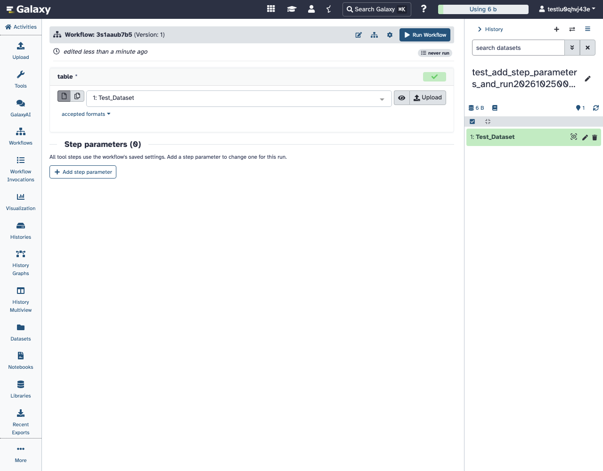

**Picker.** The tree mirrors the tool form: section (Advanced), repeat instances (Query 1/2), and a conditional with only the active case listed. Each row shows what the workflow sets ("workflow sets to 0.5"). Locked rows are grayed with a lock icon: the conditional selector (`Filter type`) and `Column` (a `data_column`). Exposure keys are not shown.

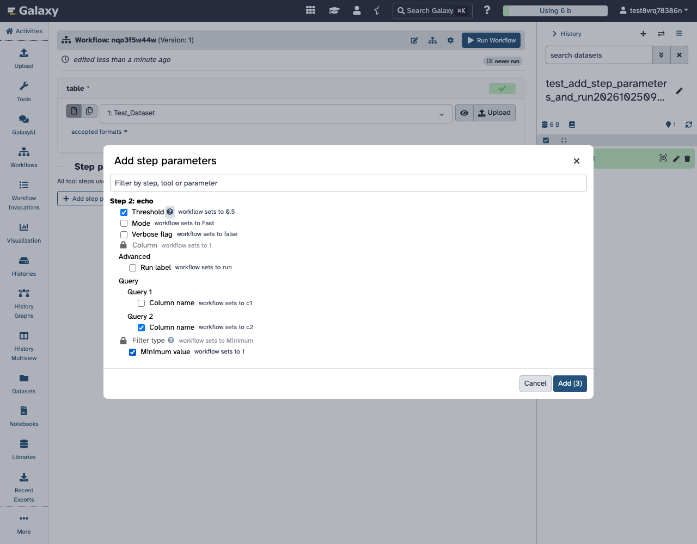

**Help.** A `?` icon appears only on params with help text. Hover or click shows it.

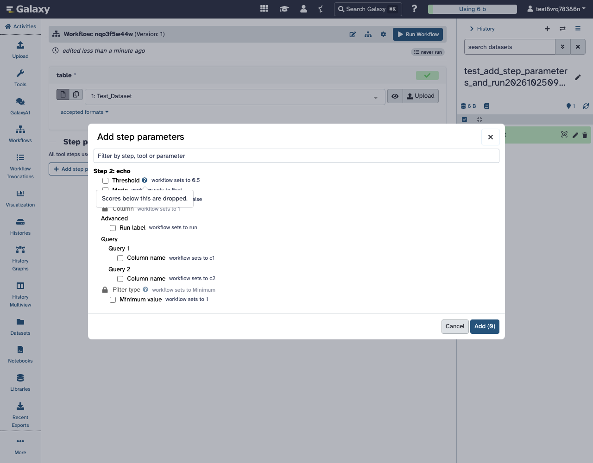

**Locked conditional selector.** Hovering the lock explains: changing it would change which params below apply, so set it in the expanded form.

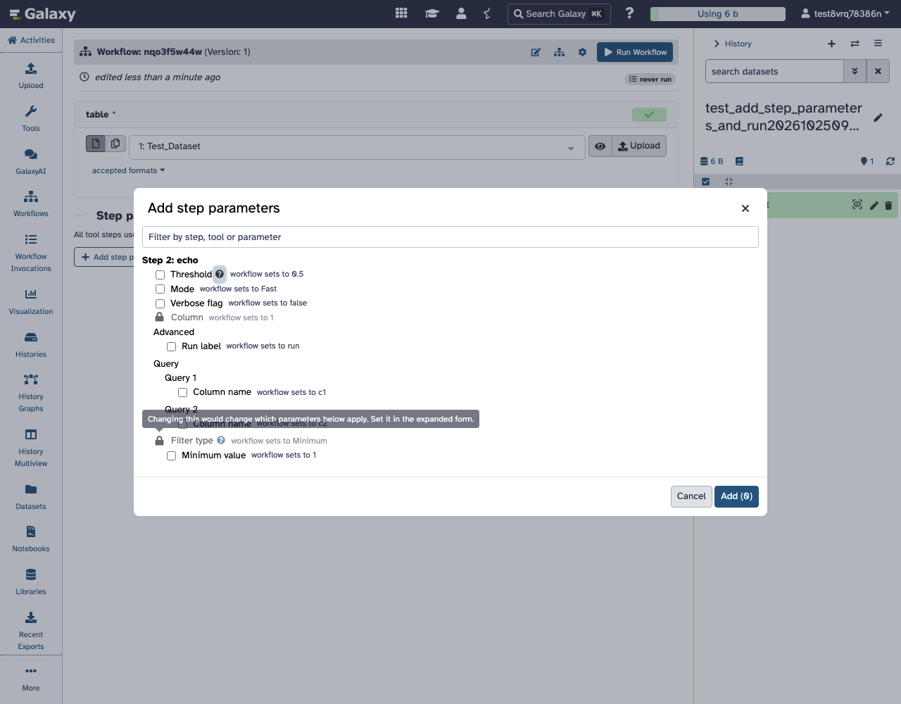

**Picker filter** ("query") keeps the ancestor nodes.

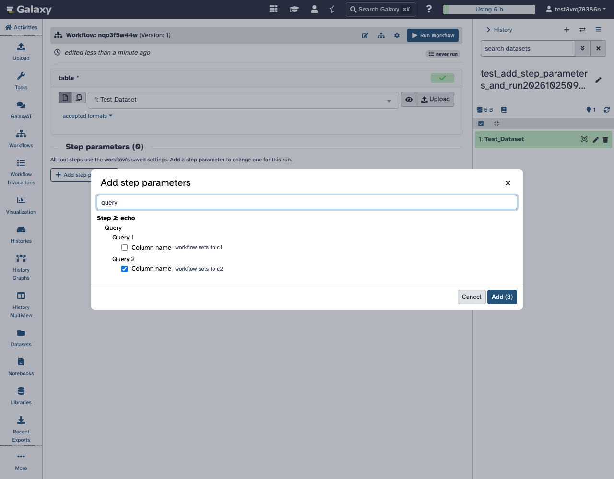

**Cards.** Each card has its breadcrumb, the saved value, × to remove, and the tool's own input widget.

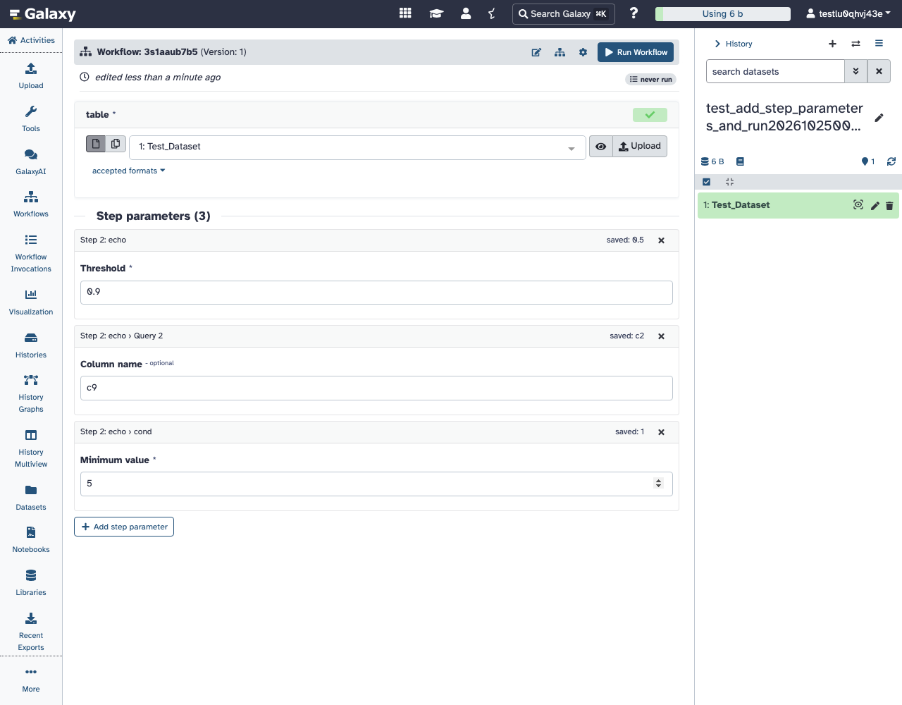

**F4, rerun of a run with recorded keys.** It stays in the simple form with exactly those cards, prefilled with the original run's values.

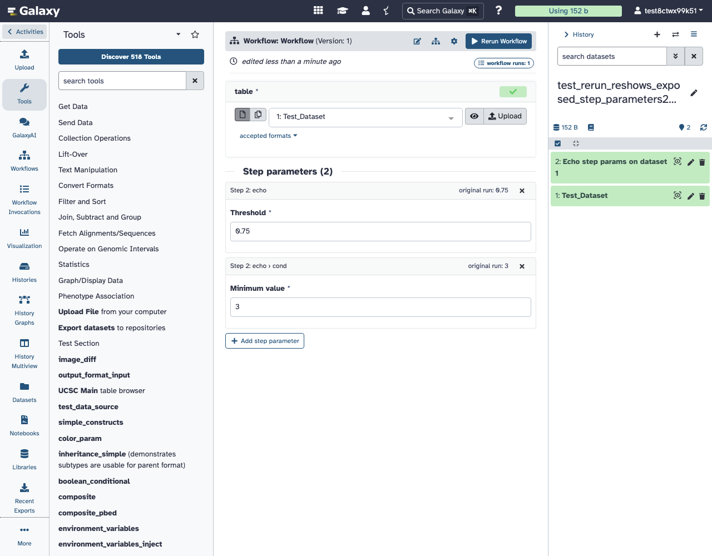

**Rerun of a run whose step params were not recorded** (expanded form or API). It keeps the #24177 expanded-form gate.

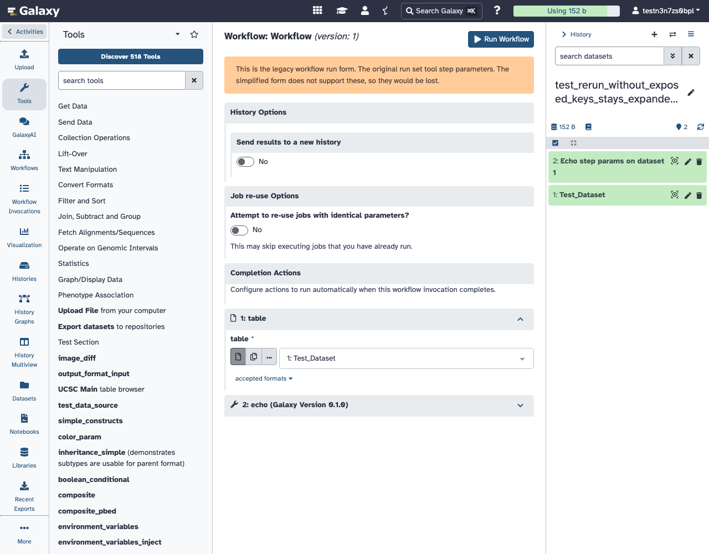

**F3, row action in the invocation's job parameters.** Rerun icons appear on scalar rows only. `Column` has none. The test also checks that the conditional selector row (below the fold here) has none.

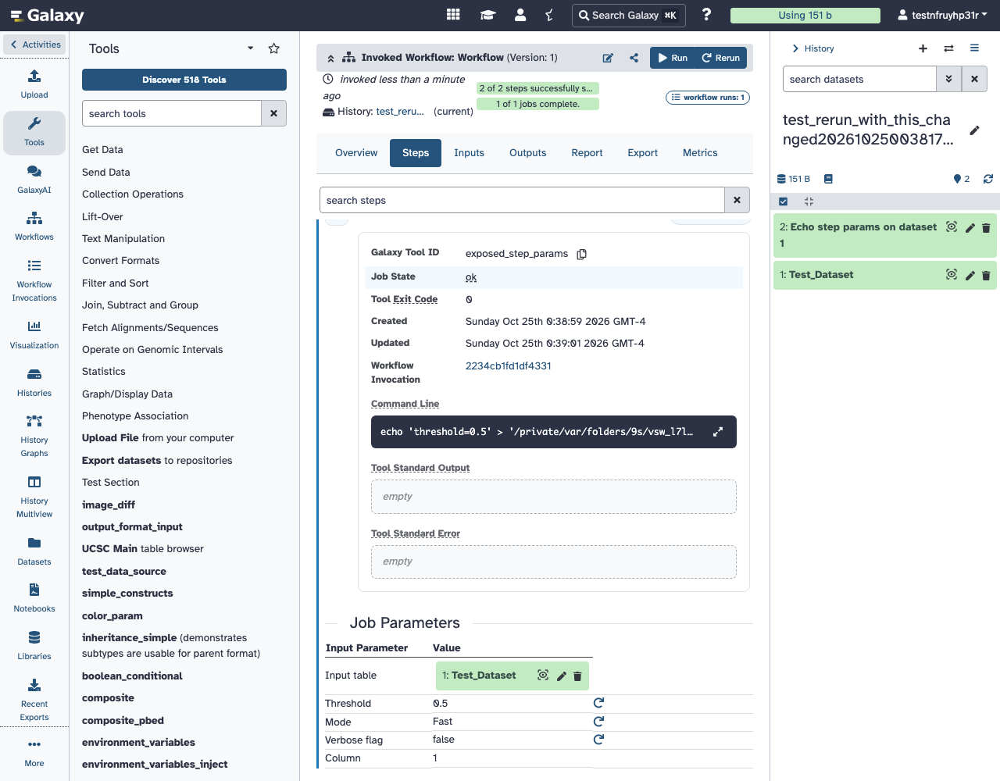

**F3 landing.** The simple form with just that parameter exposed, prefilled from the original run.

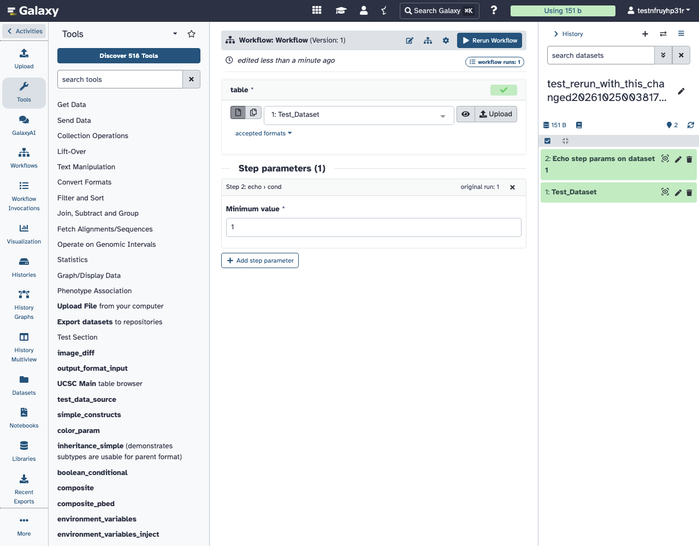

**F2, link** `step_param=1|cond|min&step_param_value=1|cond|min=7&step_param=1|cond|pattern&step_param=1|column`: the preset is applied, and the two unusable keys are listed in a dismissible warning.

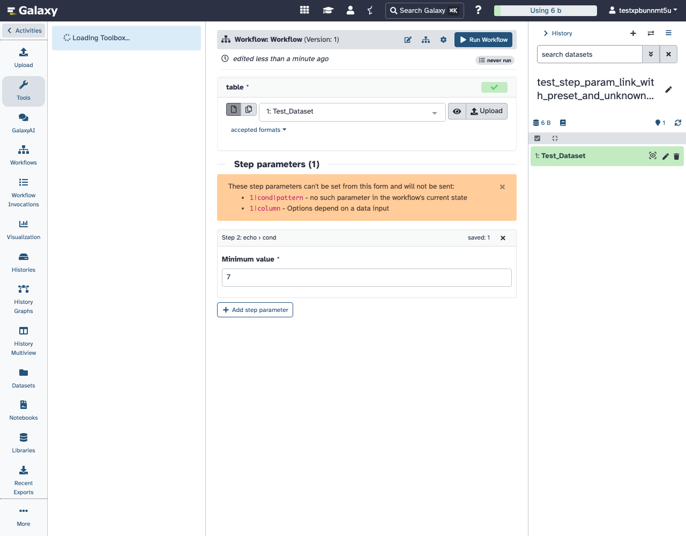

## UI lessons

1. **Picker tree: works.** For a tool with about 10 params it reads like the tool form. The locked conditional selector, with its value, explains why the other case's params are missing. Polish pass (`a6e08520821`, on both spikes): keys hidden, workflow values and help shown, locked rows grayed with a lock tooltip. Two leftovers: the filter still matches the now-hidden keys, and the dropped-keys alert still lists raw keys.
2. **Cards: work.** Rendering each card through its own one-input `FormDisplay` got validation, the right widget and value parsing for free. The "saved:" or "original run:" hint plus × covers "what am I changing". Nit: a conditional has no label, so the breadcrumb shows its name (`cond`). Use the test param's label.
3. **Data-dependent params are the real scope problem.** `data_column` is shown disabled ("Options depend on a data input"). That's correct for a first pass, but column choice is probably the most common thing people want to change at run time (Cut, Filter, Sort, Join). Ship the first pass knowing that, and plan a follow-up that lets a `data_column` be picked once its `data_ref` input is chosen in the simple form.
4. **The simple form sends values as strings** (`"0.9"`, `"5"`), the same as the expanded form, so `/request` records strings. Harmless, but tests must not compare types. An API-launched run (numbers) and its UI rerun (strings) record different JSON for the same values.
5. **The rerun gate wording is now wrong.** For unrecorded params the alert still says "The simplified form does not support these". It should say the original run didn't record which params were chosen.
6. **Per-row rerun icons are noisy.** Every scalar row gets an icon. A hover-only icon, or a single "Rerun with a changed parameter…" button that opens the picker pre-scoped to the step, may read better. It is also only correct for top-level steps (see API lesson 6).
7. **F3 on a run with unrecorded step params opens the expanded form,** and the `step_param` it was given is ignored there. The issue should say this, or F3 should only be offered when the run's params are all recorded (or absent).

## API lessons

1. **G1 strict keys: cheap, and it holds up.**
   - The change: `ToolModule.compute_runtime_state` records which `step_updates` keys the visit applied. `populate_module_and_state` raises a 400 for leftover keys when `parameters_normalized` is set, with `err_data` keyed by step index.
   - `__`-prefixed keys (runtime PJAs, step meta state) are skipped.
   - Strictness is passed down to subworkflow inner tool steps.
   - Unknown, inactive-case and missing-repeat keys now 400. The 22 existing step-param API tests still pass.
   - Expanded-form E2E audit: with strictness on, `test_workflow_rerun.py` plus `test_workflow_run.py` passed 41 of 41 (one upload timeout under load passed on re-run). Most of those tests submit the simple form, which never sends `parameters`. About 13 drive the expanded form (subworkflows, subworkflow runtime params, replacement params, step-parameter inputs, rules, reports, the #24177 expanded rerun), and all of them pass strict.
   - That audit only covers the tools those suites use. Before turning this on by default, still check: tools with dynamic options, hidden params, `__job_resource`, and old saved states with keys from upgraded tools.
2. **G2 machine paths: cheap.**
   - `summarize_job_parameters` now tracks a prefix through repeats, sections and conditionals, and adds `name` and `exposable` to each row.
   - Watch out: the `exposable` rule now lives both server-side (`EXPOSABLE_PARAMETER_TYPES` plus `is_dynamic`) and in the client tree. Pick one source, preferably the server, which could also drive the tree.
   - The raw value is not added. F3 didn't need it, because the rerun run dict is already seeded from the invocation.
3. **G3: the server half already works.**
   - Probes against a non-runtime inner tool step applied with no code change: one level deep (`{"1": {"1|threshold": 0.9, "1|cond|min": 7}}`) and two levels deep (`{"1": {"1|1|threshold": 0.9}}`). G1 strictness also rejects an unknown key two levels deep. #24178's `step_parameters_by_id` plus `param_map.get(step.id)` already carries the keys into the sub-invocation.
   - What's missing is only the **listing**: `SubWorkflowModule.get_runtime_inputs` returns only inner RuntimeValue params, so the picker can't show the inner tree.
   - The spike lists only those runtime params, as `2|1|num_lines` leaves. Full listing needs a recursive `tool.to_json` per inner step in `_workflow_to_dict_run`, plus a nested picker. Not built.
4. **G4 record exposed keys: no migration.**
   - A `WorkflowRequestInputParameter` row (`type=meta`, `name=exposed_step_parameters`, JSON list) fits the existing table. Writing and reading it is about 10 lines each side.
   - Invoke validates that each key names a value in `parameters`, and requires `parameters_normalized`.
   - **Re-keying on import is unnecessary.** Exposure keys use `order_index`, which belongs to the workflow, never database step ids. The #24175 re-keying exists because `step` rows are keyed by step id.
   - Not verified: that the `meta` row survives model-store export/import. It should, since other `meta` rows do. Add a test.
5. **`InvokeWorkflowPayload` silently ignores unknown fields.** Before G4, `exposed_step_parameters` was accepted and dropped. So a client sending the new field to an older server degrades silently: the run works, but rerun falls back to the expanded form. Probably fine, but worth knowing.
6. **The F3 row action is wrong inside subworkflows.** The invocation step view for a sub-invocation would build `/workflows/rerun?invocation_id=<sub-invocation>`. The spike doesn't guard against it. Inner steps need `<outer>|<inner>|name` keys against the parent invocation, so the step view needs to know its parent invocation and outer step index.
7. **The `${...}` exclusion rests on a false premise.** The issue says params whose value is `${...}` are "already exposed in the simple form". In fact any `${...}` in a tool step sets `hasReplacementParametersInToolForm`, which **disables the simple form entirely** (`hasReplacementParameters`). Those workflows never reach the picker.

## Suggested issue edits

1. Drop or reword the `${...}` exclusion: "workflows with `${...}` in tool steps still use the expanded form."
2. G3: say the apply path already works (with a test to pin it). The work is listing inner tool trees in the run data.
3. G4 / import: exposure keys are index-based and need no re-keying. Storage fits the existing request-parameter table (no migration).
4. Rerun: say what happens when "rerun with this changed" is used on a run with unrecorded step params (expanded form, link param ignored), and that inner subworkflow steps need parent-invocation keys.
5. Scope: call out that data-dependent params (column pickers) are excluded in the first pass, and track a follow-up. This is the most likely user complaint.

## Graph picker spike

The alt branch `workflow_run_exposed_step_params_alt_graph_picker` ([alt note](../../repositories/galaxy/branches/active/workflow_run_exposed_step_params/alts/graph_picker.md)) replaces the tree picker with a picker on the workflow graph. The cards, the payload and the server are the same as above, so the only thing that changes is how parameters are picked. Subworkflow parameters are deliberately locked out.

**Verdict: it works and reads well for small, flat workflows. It is a navigation aid, not a replacement for the tree.** Picking reuses the tree's per-step list, so the graph adds only "where is this step" and per-step counts. The subworkflow lock costs real function: recorded rerun overrides inside subworkflows are dropped.

### Screenshots

**Overview.** A read-only graph of the whole workflow. Each tool node says how many parameters it has to pick. The subworkflow node gets a warning-colored header, a lock icon, and "can't be picked here".

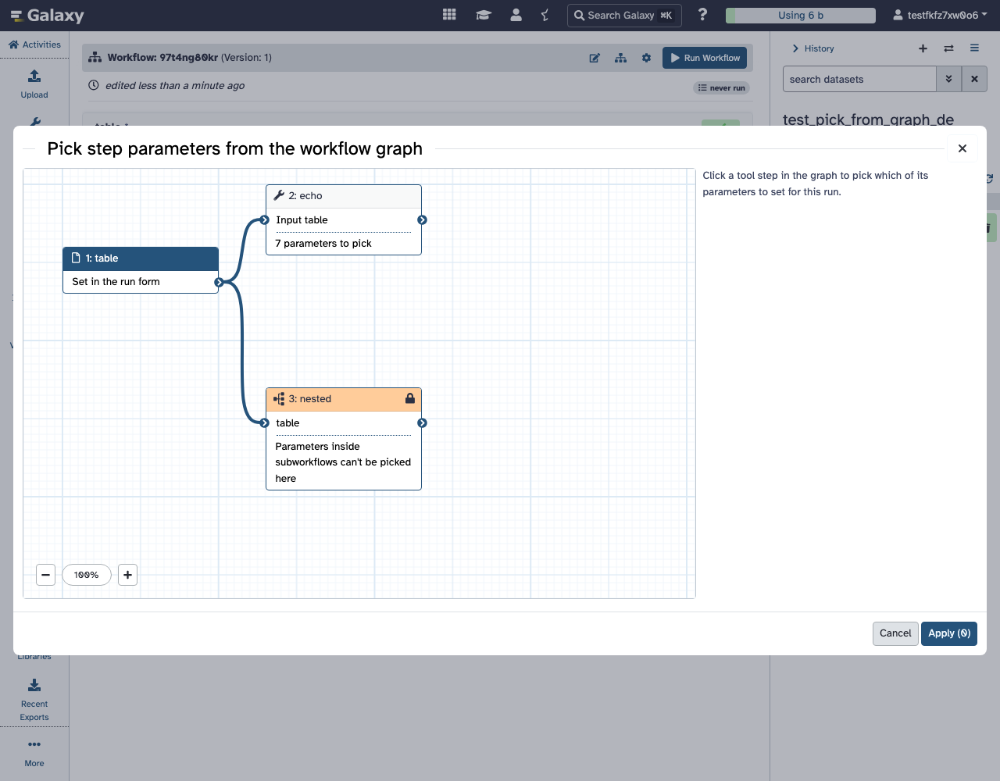

**Tool node clicked.** The side panel lists that step's parameters, with the same widgets as the tree picker: the conditional badge, and the disabled data-dependent `Column`. Checking two of them turns the node green with "2 of 7 parameters picked".

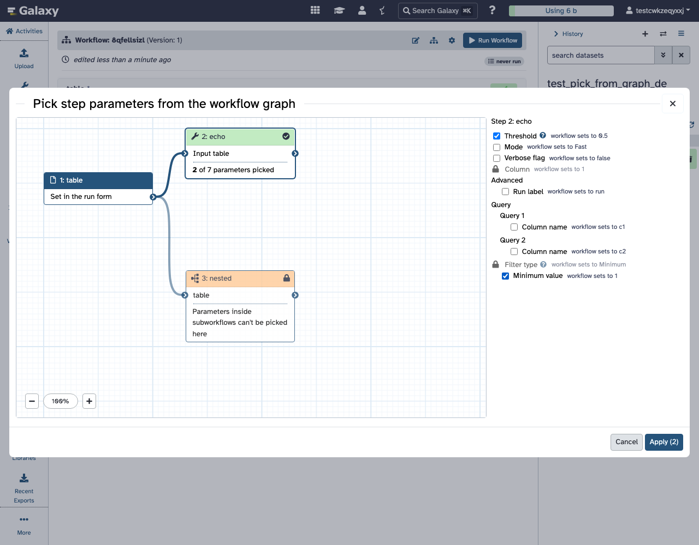

**Subworkflow node clicked.** It explains the lock and shows no list.

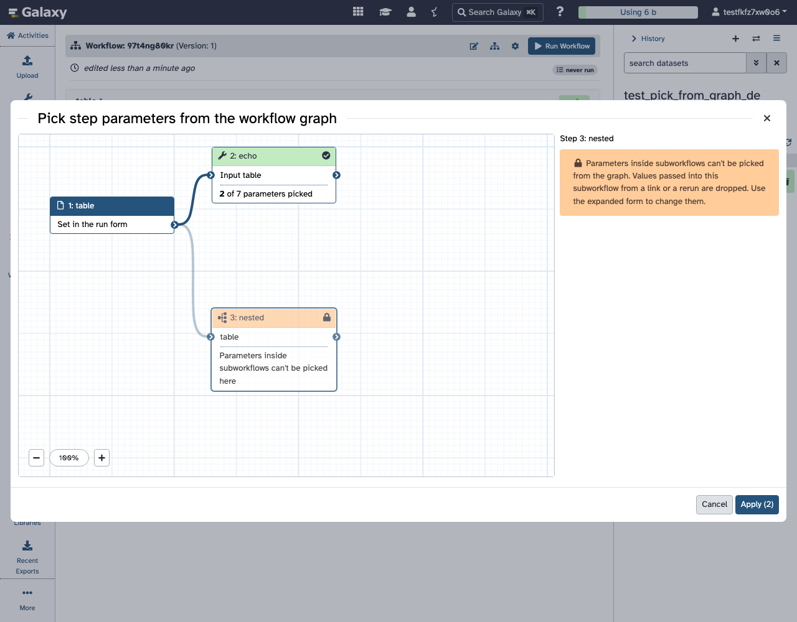

**Cards after Apply.** These are the same cards as the tree spike. Reopening the picker and unchecking a parameter removes its card. That's the select/deselect behaviour the tree picker didn't have.

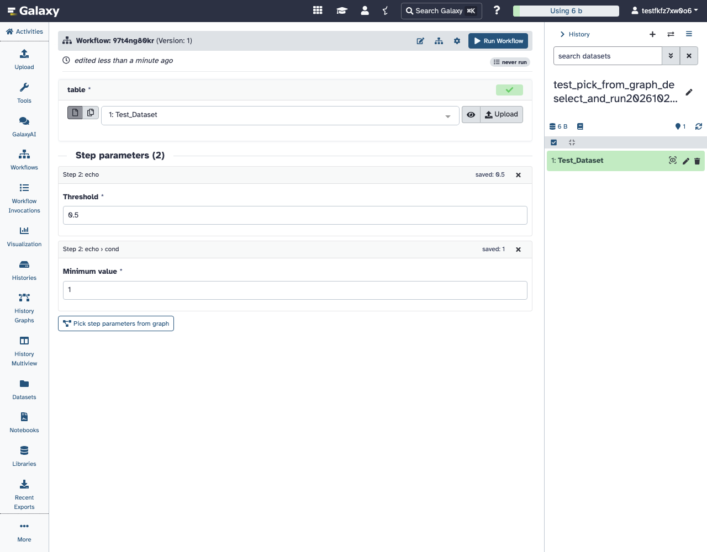

**A link with a subworkflow key** (`step_param=2|1|threshold&step_param_value=2|1|threshold=0.9`). A red, non-dismissible alert says the parameter **will not be sent**. The top-level key next to it still becomes a card.

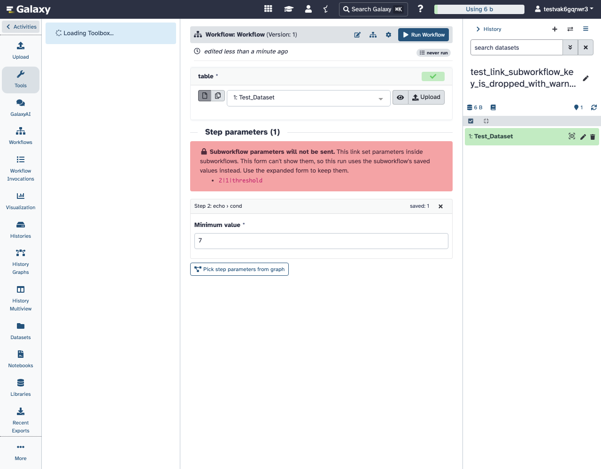

**Picker with dropped keys.** A banner repeats the warning, and the Apply button counts what's lost: "Apply (1) - 1 subworkflow parameter(s) not sent".

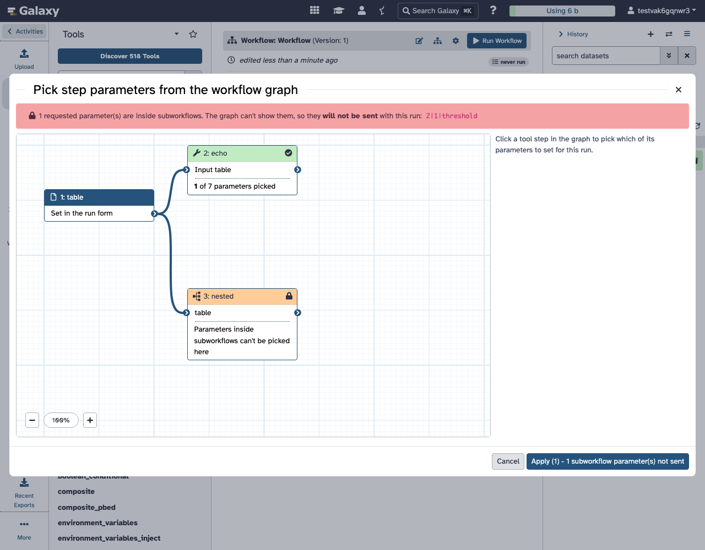

### Lessons

1. **Step numbers are off by one between the node and the key.** The node header reads **"2: echo"**, using the run form's 1-based index, but the keys read **`1|threshold`**, using the 0-based `order_index`. The tree picker had the same mismatch ("Step 2" with `1|…` keys), but it's much more visible next to the graph. Either hide keys by default (UI lesson 1 above) or show keys 1-based in the UI. Never mix the two side by side.
2. **The graph only helps with "where".** Once a node is clicked, the panel is the tree picker's subtree. On a 3-step workflow the graph is just extra chrome. It pays off on large workflows where the step name alone doesn't tell you which step you mean. Filtering by parameter name across steps (the tree picker's filter) is lost, and a large workflow is exactly where you'd want it.
3. **Select/deselect is better than add-only.** Starting from the current exposed set and applying the full set, with removals, is the right model whichever picker ships. Port `diffExposures` back to the tree picker.
4. **Locking subworkflows costs function, not just listing.** The server already applies inner keys (G3 above), so this mode throws away something that works. The bad case is a **rerun** whose original run recorded an override inside a subworkflow. The form drops it, with a warning, and the rerun quietly uses the saved value instead of the one from the original run. Options:
   - fall back to the expanded form, as the #24177 gate does for unrecorded params;
   - keep such keys as read-only, pass-through cards that still get sent but can't be picked;
   - drill into the subworkflow node, showing its inner graph, once G3 lists inner trees.

   The second option is cheap and loses nothing. The spike built the drop-with-warning behaviour as asked.
5. **Integration cost is small but touches the editor.**
   - `Node.vue` and `WorkflowGraph.vue` need an `annotated` prop. Without it, `NodeInvocationText` shows `nodeText` only for invocations and populated inputs, and says "This is a subworkflow." otherwise.
   - The picker needs its own store scope. Otherwise node clicks move the run form's active step.
   - The node header color reuses an invocation job-state class (`setting_metadata`, for the yellow warning). A real version wants its own class.
   - `useDatatypesMapper()` keeps a copy of the mapper that never updates. If another component is already loading it, the copy stays `null` forever and the picker hangs on "Loading workflow". Use the store's reactive ref.
6. **The scope problem is unchanged.** `Column` is still disabled ("Options depend on a data input"). The graph makes the data edge into the step visible, but picking a column still needs the follow-up described in UI lesson 3.

### Tree vs graph

| | Tree picker | Graph picker |
|---|---|---|
| Find a step in a big workflow | By name, or with the filter | By its place in the graph |
| Find a parameter by name across steps | Filter | No |
| Remove exposed parameters | × on the card only | Uncheck in the picker, or × on the card |
| Subworkflow parameters | Runtime ones listed. Full listing needs G3 | Locked. Link and rerun keys are dropped with a warning |
| Extra client cost | One modal | Modal, store scope, `annotated` prop on editor nodes |

Recommendation: ship the tree picker with select/deselect. Consider the graph as an optional "show in graph" view on top of it, reusing the run form's existing graph panel, rather than as the only way to pick. If graph mode ships, prefer pass-through cards for subworkflow keys over dropping them.

## Not done

- G3 listing of full inner subworkflow trees, and a nested picker.
- A test that exposed keys survive invocation import/export.
- Mapping server `err_data` back to the bonus card (errors currently show in the generic submission alert).
- A guard for F3 inside subworkflow invocations.
