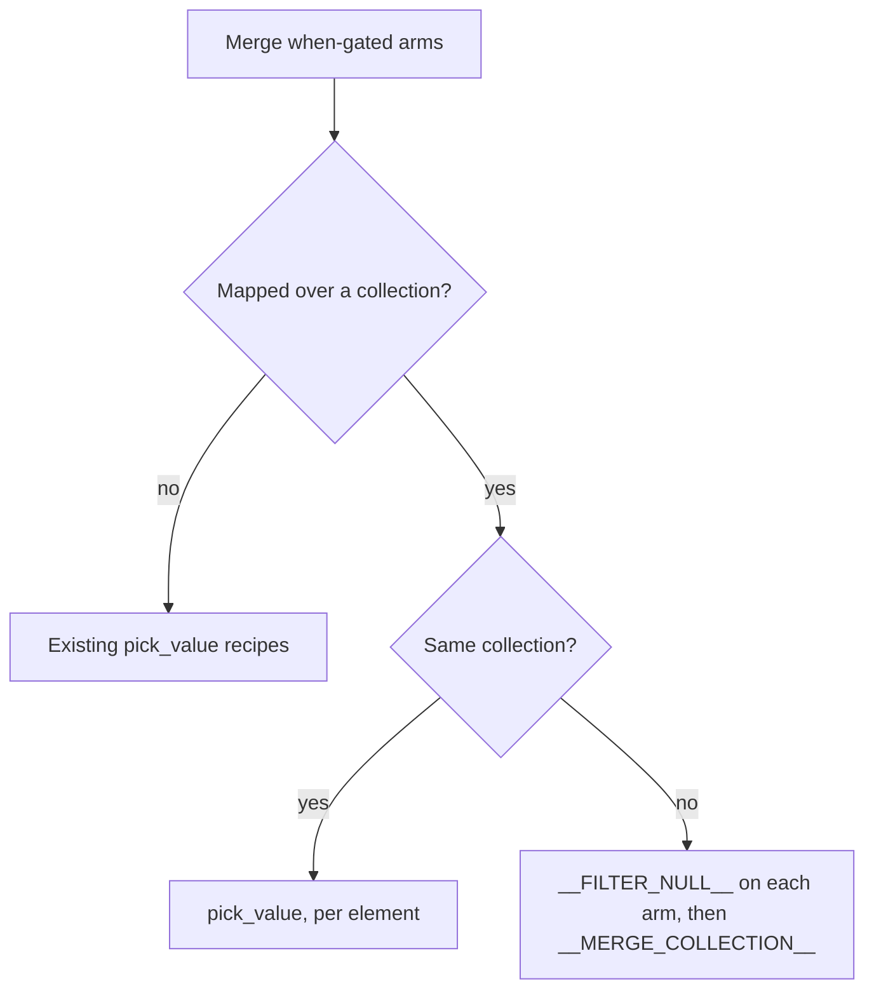

Extends the route pattern to mapped `when`-gated branches, which it didn't cover. A gated step mapped over a collection leaves a null element for each skipped job, so a fan-in must select per element.

Part of #661, which stays open until #738 lands.

## Which recipe



## The two traps

Both succeed with no error. In both, the left arm is skipped.

```text
Direct merge (keep_first):
  left    a1=null     shared=null
  right               shared=live   b1=live   b3=live
  result  a1=null     shared=null   b1=live   b3=live     live `shared` is lost

pick_value over different lists of equal length:
  left    a1=null     shared=null
  right   c1=one      c2=two
  result  a1=one      shared=two                          right data, left names
```

Different lengths fail instead, with `Cannot match collection types`. A direct merge of same-list arms gives N elements, not #661's 3N, and all are null when the first arm is skipped.

## What changed

- **`conditional-route-between-alternative-outputs` (rev 5):** a "Mapped branches" section and a direct-merge pitfall. It leads with the built-in `type: pick_value`, which needs `release_26.1` or later.
- **`galaxy-conditionals-patterns` (rev 5):** the rule that picks a recipe. `repair` already bundles this page through #753, and this PR recasts it there.
- **`conditional-run-optional-step`, `conditional-transform-or-pass-through`:** their `__FILTER_NULL__` pitfalls now point at the mapped recipe.
- **`verification/`:** `route-mapped-same-arms` and `route-mapped-different-arms`, with test data. Each adds one Galaxy boot to `verification-workflows.yml`.
- **Generated:** casts, `Dashboard.md` and `Index.md`.

## For John

- **`the_only_non_null` and `pick_style: only`** are used where #661 proposed `first_or_error`, following the page's own guidance.
- **Recommending filter then merge is an expert call.** No IWC workflow uses it, and the page says so. Its evidence is the verification test.
- **The recipe doesn't enforce one live arm.** With both on, the output holds both arms' elements, and the first arm's wins on a shared identifier. The page says the booleans have to be exclusive.
- **File or drop these five upstream items?** The drafts are in the branch record, and none is filed:
  - Galaxy: `element_count: 0` checks nothing.
  - Galaxy: equal-length mapped inputs pair by position. This may be by design.
  - Planemo: `element_tests` naming a null element raises `TypeError`.
  - Planemo: workflow tests can't expect a failed invocation.
  - Planemo: `collection_type` in a workflow test asserts nothing.

## Left out

- **`first_or_error` or `fail` advice:** Planemo can't verify a failure, and the page says only what's shown.
- **The built-in on unmapped shapes:** the page keeps the Tool Shed spelling there, and no Foundry test covers the built-in on them.
- **`collection_element_identifiers` in place of the test's sentinel merge:** untested, and it adds a Tool Shed dependency.
- **`planemo lint` being a non-check and the stale `0.75.41` in `verification/README.md`:** pre-existing, and worth a small separate fix.

## Evidence

`planemo test` with Planemo 0.75.47 and `--galaxy_branch release_26.1`, on a live Galaxy: `route-mapped-same-arms` 2 of 2, `route-mapped-different-arms` 3 of 3.

| Shape | Left arm on | Right arm on | Both on |
|---|---|---|---|
| Same list, Tool Shed `pick_value` (`only`) | 2 elements, left content | 2 elements, right content | not run |
| Same list, built-in `pick_value` (`the_only_non_null`) | 2 elements, left content | 2 elements, right content | not run |
| Same list, direct merge | 2 live elements | 2 elements, 0 live | not run |
| Different lists, filter then merge | `a1`, `shared` | `b1`, `shared`, `b3` | all 4, `shared` from the left arm |
| Different lists, direct merge | 4 elements, 2 live | 4 elements, 2 live, `shared` lost | not asserted |
| Equal lengths, different identifiers, built-in `pick_value` (`first_non_null`) | `a1`, `shared`, left content | `a1`, `shared`, right content | not asserted |

**No committed test, because Planemo can't expect a failed invocation.** The verification README lists both:

- Different lengths failing. Galaxy's `test_lists_of_different_cardinality_do_not_match` covers it, and one manual run of the built-in showed the message. That run predates the review pass, and the Tool Shed spelling wasn't run.
- `the_only_non_null` failing with more than one live input. Galaxy's `test_pick_value_the_only_non_null_error_multiple` covers it, unmapped.

**Not tested**

- Neither arm on, because `element_count: 0` is skipped as falsy, so an empty collection can't be asserted.
- A mix of skipped and live elements within one arm. Gates here are workflow-level booleans. Galaxy's `pick_value_mapped_mixed_skip_pja`, on `dev`, covers it for the built-in.
- `planemo lint`, which exits 2 with no output here, as it does on the existing `route-between-alternatives`. `planemo workflow_lint` passes tests, tool ids and tool versions, with missing-annotation warnings. `gxwf validate` passes with tool state.

**CI at `13f00121`:** running. `test`, `changeset` and `planemo`, including all five new tests, passed on the same hand-written changes before the rebase onto #754, at `5f1f34db`.

**`make -k check`:** everything passes (496 tests, 15 fixtures) except `check-vendored`, a known failure on this machine.

## Collisions

- **#738:** cast regeneration only. Until it lands, the leaf page isn't in `repair`'s bundle, and the map-of-content page carries the rule and names both tools.
- **#696:** revision and `related_molds` lines.

🤖 Generated with [Claude Code](https://claude.com/claude-code)
