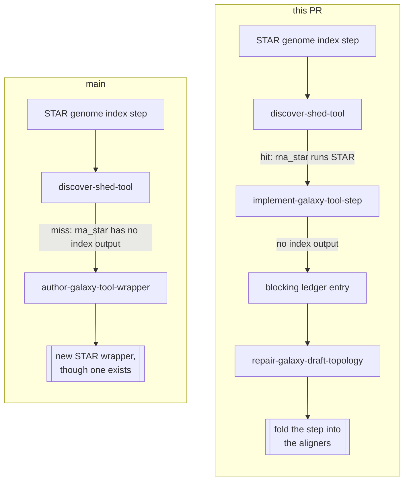
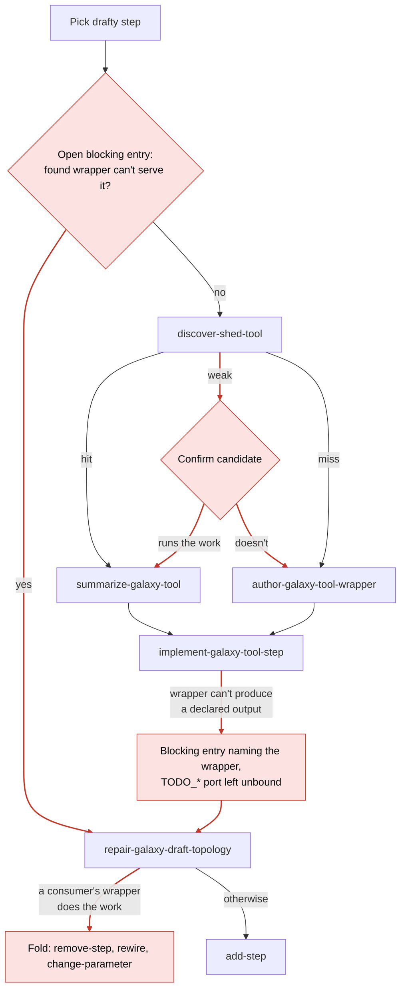
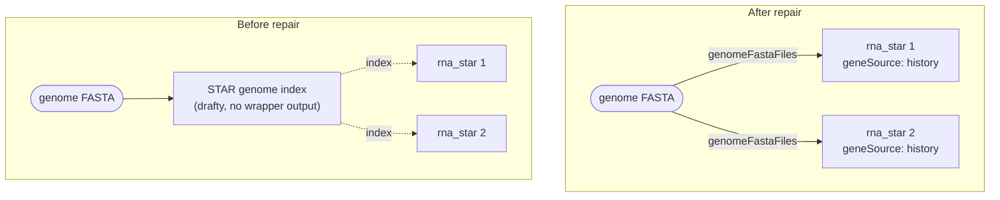

When the Tool Shed has a wrapper that runs a step's tool but can't serve the step, the draft loop now sends that step to topology repair instead of authoring a replacement wrapper. Repair can fold the step into its consumers. There is no new discovery status.

Part of #678. #773 takes an `unsuitable` status instead. This PR leaves `author-galaxy-tool-wrapper` to #773's authoring gate (#723).

## The case

An nf-core/rnaseq-style template has a `STAR genome index` step feeding two STAR alignments. `iuc/rgrnastar/rna_star` runs STAR, but it has no index output. With `geneSource: history` it builds a temporary index inside each alignment job.

## Routing after this PR

The red parts are new. Everything else is the routing on `main`.

`weak` used to say "confirm or fall through", so a confirmed wrapper could still be authored around. Now only `miss` authors:

| `status` | `main` | This PR |
|---|---|---|
| `hit` | Pin it | Pin it |
| `weak` | Confirm, or fall through to authoring | Confirm before pinning. A rejected candidate counts as a `miss` |
| `miss` | No usable hit | No wrapper runs the executable or operation the need names |

Discovery classifies on what a wrapper runs, not on fit, because it can't see the step's ports or consumers. Fit is checked in `implement-galaxy-tool-step`, after summarize.

## The STAR fold

When the blocking entry shows a consumer's wrapper does the step's work, repair removes the step instead of adding a producer. An added producer would pick `rna_star` again and raise the same entry until the escalation cap.

The wiring follows `examples/star-sa-index-input/`: `refGenomeSource|genomeFastaFiles` and `refGenomeSource.geneSource: history`.

## What changed

| Mold or note | Change |
|---|---|
| `discover-shed-tool` (rev 6) | Classifies on what a wrapper runs. Searches with the executable when the need names one. Drops `data_manager_*` hits, which are admin-only and write a tool data table. |
| `advance-galaxy-draft-step` (rev 12) | Only `miss` authors. Pick goes straight to repair on an open "found wrapper can't serve the step" entry. Deferred search names the source executable. For a wrapper-choice mismatch, a wrapper that lacks only a parameter drops the setting and gets a plain entry. One that can't produce an output gets a blocking entry. |
| `implement-galaxy-tool-step` (rev 14) | A wrapper that runs the work but can't produce a declared output gets a blocking entry with `step` set. `missing` names the wrapper and version and quotes the summary. The port stays unbound. |
| `repair-galaxy-draft-topology` (rev 7) | The fold clause. |
| Ledger and draft-format notes, `harness-pipelines` | The new blocking-entry kind, and "fall through on a miss". |
| `galaxy-tool-discovery` schema | Description text only. The enum is unchanged. |
| Evals and scenarios | One property each in discover, advance and implement. STAR scenarios in discover, implement and repair. |

`casts/`, `Dashboard.md` and the schema's `.generated.ts` are regenerated.

## Release

The schema description changes its hash, so `@galaxy-foundry/gxwf-foundry` needs a patch release with this merge (`.changeset/discovery-weak-miss-wording.md`).

## Known limitations

- **Re-pick after the cap.** A step repair can't close stays drafty, and the loop picks it again after the escalation cap. This already happens on `main`. #678's dead-end question decides it.
- **No repair fixture.** The STAR fold scenario has no committed draft fixture yet.
- **No run.** No pipeline run or eval has exercised these changes.

## Testing

`make check` passes locally, with 496 tests, except two checks:

- `check-vendored` fails on this machine only.
- `validate-roadmap` fails on `main` too: #768 (`roadmap/main`) isn't in `content/meta/roadmap.md` yet, so `test` will be red here until that's fixed.

🤖 Generated with [Claude Code](https://claude.com/claude-code)
