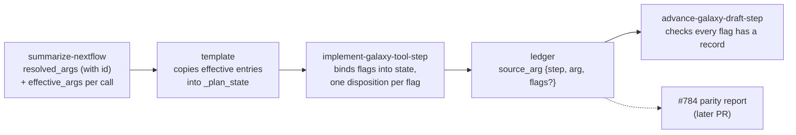

Toward 🎯 #781 - carry each nf-core step's effective `ext.args` into the Galaxy draft as data, and require a recorded disposition for every flag.

***This is the prevention half of #781, not the flags-vs-state report the issue asks for. That table lands with #784's parity Mold, which reads the records this PR creates, so #781 stays open after this merges.***

On `main`, `summarize-nextflow` records every `ext.args` / `ext.args2` / `ext.prefix` assignment (#777), but nothing downstream reads them. The template writes a free-text `_plan_state`, the per-step Mold binds `state` from that prose, and a flag nf-core sets can be dropped or contradicted with every gate green. #647 is that failure: a plan that would have run featureCounts unstranded for every sample. Copying the raw list isn't enough either. A process often has several matching selectors, and Nextflow applies only the highest-ranked one per call:

- nf-core/rnaseq calls `SALMON_QUANT` from three subworkflows. Only the subsampling call gets `'--skipQuant'`. Give every step all three entries and the quantification steps skip quantification.
- nf-core/sarek's `CRAM_TO_BAM` block sets `ext.prefix` to `.dedup` or `.md` in the two branches of an `if (params.tools …)`. "Later declaration wins" would silently pick `.md`.

## What a step now carries

One bamtofastq step, translating `SAMTOOLS_VIEW_MAP_MAP` (the free-text line stands in for what `main` writes):

```diff
-_plan_state: Keep paired reads whose read and mate are both mapped.
+_plan_state: |
+  calls: ["NFCORE_BAMTOFASTQ:BAMTOFASTQ:ALIGNMENT_TO_FASTQ:SAMTOOLS_VIEW_MAP_MAP"]
+  resolved_args:
+    - {"id": "conf/modules.config#withName:SAMTOOLS_VIEW_MAP_MAP/args", "key": "args", "expression": "'-b -f1 -F12'", "selector": "withName:SAMTOOLS_VIEW_MAP_MAP", "config": "conf/modules.config"}
+    - {"id": "conf/modules.config#withName:SAMTOOLS_VIEW_MAP_MAP/prefix", "key": "prefix", "expression": "{ \"${meta.id}.map_map\" }", "selector": "withName:SAMTOOLS_VIEW_MAP_MAP", "config": "conf/modules.config"}
+  intent: |
+    Keep paired reads whose read and mate are both mapped.
```

…and once implemented, the ledger holds one record per flag, joined to the summary by entry `id`:

```yaml
decisions:
  - id: arg-view-map-map-args
    decided_by: implement-galaxy-tool-step
    source_arg:
      step: view_map_map
      arg: conf/modules.config#withName:SAMTOOLS_VIEW_MAP_MAP/args
      flags: ["-b", "-f1", "-F12"]
    disposition: carried               # carried | not_applicable
    decision: "BAM output, require flag 1, exclude flags 4 and 8, all set in `state`."
```

A flag the wrapper can't express becomes an open `kind: dropped` entry citing the tool summary's missing option. A flag that tied entries set differently becomes an open gap and stays out of `state`.

## How it flows



- **`summarize-nextflow` ranks.** Every `resolved_args` entry gets an `id` (`<config>[<profile>]#<selector>/<key>`). New `processes[].effective_args: [{call, key, ids, tie?}]` names the entries that take effect for each call. `call` is Nextflow's fully qualified name (what `task.process` reports), traced from the entry workflow through subworkflow aliases, so one call name used from two subworkflows gets two rows. The Molds never re-derive Nextflow's precedence.
- **The template copies.** For a step whose call has `effective_args` rows, `_plan_state` becomes a YAML document with `calls`, the effective `resolved_args` entries copied unchanged (plus `"tie": true` from tie rows), and the old free text as `intent`. A step it resolves itself carries no `_plan_*`, so it binds and records the flags directly.
- **implement records.** Flags outrank `intent`. Each flag gets exactly one disposition in the `open-requirements-ledger` note's new **Source arguments** section: `carried`, `not_applicable`, `kind: dropped`, or a tie gap. Records name their step only in `source_arg`, never in a top-level `step`.
- **advance checks.** Implementation strips `_plan_*`, so advance keeps the step's `resolved_args` and re-enters implementation for any flag without a record.

<details><summary>Ranking rules</summary>

- Rank, low to high: `withLabel` < `withName` on the process name < `withName` on the alias < `withName` on the whole call path. A pattern, regex or not, must match a whole name, so `.*:NAME` reaches no aliased call and a selector naming another alias never reaches this one.
- Call names resolve through the calling file's own `include`s, since two files can bind one alias to different processes. The anonymous entry workflow adds no path segment. Without one, each uncalled named workflow starts a path, as under `-entry`. A process no traced workflow calls keeps its bare name and aliases.
- At the same rank, a selected profile beats the root chain. That is the legacy config parser's order. ***Under the strict parser (Nextflow's default since 26.04), nf-core's trailing `includeConfig 'conf/modules.config'` can win instead; the Mold, schema and schema note document this caveat.*** If the root chain also declares the profile's selector, the profile entry replaces only that selector's root entries, at the root's position, and can tie another root selector.
- Among entries still level, the later declaration of the same selector in one config wins.
- Level entries with different expressions get `tie: true`: two root configs, two selected profiles, two different selectors at one rank in one config (Nextflow orders those by first insertion across the merged config), or one block assigning a key in different `if` / `else` / `switch` branches. Level entries with identical expressions give one id and no tie.

</details>

***`summarize-nextflow` doesn't evaluate config `if`s or closures.*** Branch assignments tie, a selector inside a top-level `if` counts as always declared, and closures such as `{ "${meta.id}.map_map" }` travel as Groovy text. implement lists every flag a closure can set and names the `params` or `meta` field each conditional flag depends on.

## Why `_plan_state` is YAML inside a string

***`_plan_state` is still a string. This PR doesn't add a draft field.*** `@galaxy-tool-util/schema` 1.15.0 types `_plan_state` as `string | null`, and draft steps are `additionalProperties: false`, which also rules out a new sibling key. With `gxwf` 1.15.0, a mapping-valued `_plan_state` fails `draft-validate --json` with a structure error (exit 2), and the same data as a YAML document inside the string passes (exit 0). Each entry is written as a one-line JSON object, because plain YAML corrupts Groovy: `'--quiet'` loses its quotes and closures read as mappings. The table below shows no real expression survives as plain YAML, and every one round-trips as a JSON line. `tests/plan-state-transport.test.ts` pins both behaviours against `validateDraft` from `@galaxy-tool-util/schema`. A structured `_plan_state` needs an upstream schema change. The refinement and draft-format notes record that, and nothing here depends on it.

## Evidence

`summarize-nextflow --no-with-nextflow` at this head on the pinned fixtures (`workflow-fixtures/fixtures.yaml`), with schema self-validation on:

| Pipeline | `resolved_args` | `effective_args` rows | Ties | Bare-name rows | Expressions that round-trip as JSON lines / as plain YAML |
|---|---|---|---|---|---|
| bamtofastq `8698321` | 25 | 25 | 0 | 0 | 25 / 0 |
| rnaseq `47b3b0d` | 130 | 175 | 10 | 0 | 130 / 0 |
| sarek `4bd2948` | 263 | 354 | 2 | 0 | 263 / 0 |

- bamtofastq: each `SAMTOOLS_VIEW` alias's rows name only its own `withName:` block, and `SAMTOOLS_PE` has no row.
- rnaseq: `SALMON_QUANT` has three `args` rows. Only `…:FASTQ_SUBSAMPLE_FQ_SALMON:SALMON_QUANT` names the `--skipQuant` entry. All 10 ties are `ext.prefix`, between two whole-path patterns at one rank, in one config (e.g. `SAMTOOLS_SORT` under `BAM_DEDUP_UMI`) or across two (the tximport `SE_*_UNIFIED` calls).
- sarek: the `CRAM_TO_BAM` `prefix` row ties `…/prefix` and `…/prefix~2` (the `.dedup` / `.md` branches). The other tie is `MERGE_DEEPVARIANT_GVCF`'s `prefix`, set by both `withName:MERGE_DEEPVARIANT_.*` and `withName:MERGE_DEEPVARIANT_GVCF` in one config.

The resolver changes are covered by `packages/summarize-nextflow/test/resolver.test.ts` (rank ladder, profile vs root and merge position, ties, if/else branches, call chains, aliased subworkflows, per-file includes, ids, and a bamtofastq-shaped fixture), and two of those tests validate their summaries against the schema. One pins call tracing through a workflow whose `//` comment holds an apostrophe; #790 made such blocks parse, which is what lets nf-core/rnaseq's `RNASEQ` calls trace.

The template's copy format has a deterministic test, `tests/plan-state-transport.test.ts`. It runs the resolver on a bamtofastq-shaped pipeline (entry workflow → `BAMTOFASTQ` → `ALIGNMENT_TO_FASTQ` → two `SAMTOOLS_VIEW` aliases), copies each call's effective entries the way the template says, and embeds them in a one-step draft. The draft passes `validateDraft` and the entries parse back unchanged, `tie` marks included. The same data as a mapping fails `validateDraft`, and every expression is lost when written as plain YAML. The template Mold's `_plan_state` example must equal resolver output for its call, so the example can't drift from the summary.

***Whether the Molds follow these rules (template, implement, advance, ledger) is checked only by LLM-judged evals and scenarios, and no end-to-end pipeline run has exercised them yet.*** The new cases pin real values: the four bamtofastq `samtools view` filters (`-F12`, `-F260`, `-F264`, `-F256`) each reach only their own alias's step, `SAMTOOLS_PE` keeps prose, rnaseq's `--skipQuant` reaches only the subsampling step, and an implement case binds `-b -f1 -F12` over a vaguer `intent`. A Mold that binds from `intent`, or copies every matching entry instead of the effective ones, fails these cases. ***advance's completeness check is a Mold instruction, not a CLI validator: nothing deterministic fails a run that leaves a flag without a record.*** "One record per flag" and "`_plan_state.resolved_args` equals the entries the rows name" are deterministic and would make a good `foundry-build` check later.

<details><summary>Files</summary>

- `packages/summarize-nextflow`: `resolver.ts` (call paths, membership along real call chains, ids), new `selector-precedence.ts` (ranking and the `ResolvedArg` / `EffectiveArg` contract), schema JSON and generated TS, tests. Changeset: `@galaxy-foundry/summarize-nextflow` minor.
- Molds: `summarize-nextflow` rev 21, `nextflow-summary-to-galaxy-template` rev 11 (+ `refinement.md`), `implement-galaxy-tool-step` rev 16, `advance-galaxy-draft-step` rev 13, each with eval properties and scenarios.
- Research and schema notes: `open-requirements-ledger` rev 8 (**Source arguments**), `galaxy-workflow-draft-format` rev 7, `summary-nextflow` schema note rev 14, `galaxy-workflow-draft` wording.
- `tests/plan-state-transport.test.ts`: the `_plan_state` copy format, draft validation and the template example.
- Generated: casts and `Dashboard.md`.

</details>

## Risks

The one-way part is the contract three stacked branches join on: a required `id` on `ResolvedArg`, `effective_args` keyed by `call`, and the ledger's `source_arg {step, arg, flags?}`; the Mold prose around it is cheap to revise.

<details><summary>Risk Details</summary>

- `ResolvedArg.id` is now required, and `id`s are cited by ledger records. Changing the `id` scheme later breaks joins in saved ledgers.
- `effective_args[].call` is promised to equal `task.process`. #784 joins it to real runs, so a parser miss that leaves a bare name shows up as a mismatch there.
- `resolved_args` membership changes on existing pipelines. Qualified selectors must now reach a traced call, so `SUB_B:FOO` no longer lands on a `FOO` only `SUB_A` calls, and path regexes reach calls they used to miss.
- Profile-wins follows the legacy parser. On Nextflow ≥ 26.04 with the strict parser, a few profile-vs-root cases may resolve the other way.
- Tied entries become open gaps and stay out of `state` until someone resolves them. On the three fixtures all 12 ties are `ext.prefix`, so none holds back a tool flag, but another pipeline's could.
- The ledger note is cast verbatim into about 20 skills, so the new **Source arguments** section adds context to each of them.

</details>

<details><summary>Risk Review Advice</summary>

Read `selector-precedence.ts` and the **Source arguments** section of the ledger note together: they hold the whole contract. Check that the profile-wins and tie choices match how you want Foundry to read nf-core configs today, and that the `id` format is something you'd be happy to keep.

The template's `_plan_state` shape is the other piece worth a look. It is a workaround for upstream typing, so decide whether to accept it now or push the schema change first.

</details>

## Context

Builds on 🔀 #777, which added `resolved_args`. Base of the source-parity stack: branches for 🎯 #796 (draft snapshot and removed-step check), 🎯 #798 (scope decisions for excluded branches) and 🎯 #784 (the parity report) build on this one in that order, and their PRs will say they depend on this one.

## Agentic Checks

### ✅ [Cursor's Thermo Nuclear Review](https://github.com/jmchilton/galaxy-brain/blob/main/vault/agents/_shared/prompts/thermo-nuclear-code-quality-review.md)

<details><summary>Mold-era review: precedence belonged in <code>summarize-nextflow</code>, not Mold prose. Done on this branch.</summary>

Reviewed the Markdown-only version of the branch. It removed implement's restatement of ledger rules and a dead "different alias" branch, gave ties one uniform record shape (an open gap with `source_arg`), added a tie scenario, and split "carried" the verb from `disposition: carried`. Its lead finding, that three LLM-judged Molds re-derived Nextflow config precedence the resolver already had the facts for, became the `effective_args` / `id` work in this PR.

[Full report](https://galaxy-brain.jmchilton.net/repositories/foundry/branches/issue-781-plan-state-resolved-args/thermo_nuclear_review/). Run via Claude Opus 5.5 at high effort.

</details>

### ✅ [Cursor's Thermo Nuclear Review](https://github.com/jmchilton/galaxy-brain/blob/main/vault/agents/_shared/prompts/thermo-nuclear-code-quality-review.md) (resolver)

<details><summary>Ranking moved into its own module; behaviour identical on 10 fixture summaries.</summary>

Collapsed the `effectiveArgs` condition chain that four fix rounds had built up, ranked each selector once per call, split the pure `configDirectives` out of `attachConfigDirectives`, replaced three copies of the name-to-workflow map, and moved the precedence contract into `selector-precedence.ts`. Full CLI summaries for bamtofastq, bacass, demo, rnaseq and sarek, with and without `--profile test`, were identical before and after under `jq -S`. Left in place: the global `aliasToCanonical` fallback, which is reachable only when a local workflow's name equals another file's alias.

[Full report](https://galaxy-brain.jmchilton.net/repositories/foundry/branches/issue-781-plan-state-resolved-args/thermo_nuclear_review_resolver/). Run via Claude Opus 5.5 at high effort.

</details>

### ✅ Second Frontier Model Review

<details><summary>Ledger records couldn't tell apart two assignments that share a selector. Fixed.</summary>

A root `withName:FOO` and a profile `withName:FOO`, or the same selector in two configs, produced identical ledger records, so coverage checks couldn't see which assignment a record covered. That pre-`id` join key was widened at the time and is now replaced by `source_arg.arg`, the entry's `id`.

[Full report](https://galaxy-brain.jmchilton.net/repositories/foundry/branches/issue-781-plan-state-resolved-args/codex_review/). Run via gpt-6-sol at medium effort.

</details>

### ✅ Second Frontier Model Review (resolver)

<details><summary>Three conservative limits of the first ranking pass; two now fixed by call-path tracing.</summary>

A qualified selector reached a call in an unrelated subworkflow, and one call name used from two subworkflows collapsed into a tied row. Both are fixed: `effective_args` is keyed by the traced call path. Different selectors at one rank in one config stay a tie, because Nextflow orders them by first insertion across the whole merged config.

[Full report](https://galaxy-brain.jmchilton.net/repositories/foundry/branches/issue-781-plan-state-resolved-args/codex_review_resolver/).

</details>

### ✅ Second Frontier Model Review (call context)

<details><summary>Alias lookup was pipeline-wide, not per file. Fixed with a red-first test.</summary>

Two files binding one alias to different processes gave both calls to whichever was parsed last. Call names now resolve through the calling file's own `include`s. Real fixture output was unchanged. A process name inside a string literal still counts as a call (pre-existing), and untraced processes keep bare-name rows so parser misses don't silently lose arguments.

[Full report](https://galaxy-brain.jmchilton.net/repositories/foundry/branches/issue-781-plan-state-resolved-args/codex_review_callctx/).

</details>

🤖 Generated with [Claude Code](https://claude.com/claude-code)
