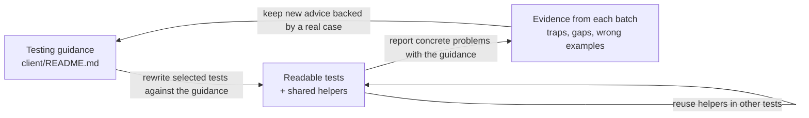

This refactors client and Tool Shed frontend tests so the scenario, action and expected result are easier to read. Shared typed fixtures and small mount helpers replace repeated setup; named table rows replace positional flags; exact assertions and real component interactions expose cases that previously passed for the wrong reason.

It also updates the testing guidance in `client/README.md` using examples found during the refactoring. This PR contains the readability work and shared test support. Storybook migrations, browser play functions and accessibility auditing are maintained separately.

## The refactoring loop



Batches draw tests at random, refactor them against the guidance and independently review the results. The goal is to preserve or strengthen assertions while making setup and failure reports clearer. Each originating test has its own commit; shared helpers are separate review units. Upstream regression tests are preserved when rebasing.

## Current scope and metrics

Snapshot: head `390b78fc122` against `dev` at `93b3c85e532` (2026-10-20).

History reorganized without source changes; validation below was run on the identical pre-rewrite tree.

The diff touches **428 files: 395 test paths and 33 supporting files**, including helpers, fixtures and testing documentation. Overall diff: **18,520 insertions / 20,456 deletions**. The counts below compare the same set of changed test paths at both refs, including the main client and Tool Shed frontend; supporting files are excluded from this table.

| Source signal | Before | After | Change |
| --- | ---: | ---: | ---: |
| Test lines | 65,704 | 63,155 | −2,549 |
| Exact `toEqual` / `toStrictEqual` assertions | 970 | 1,111 | +141 |
| `toBeTruthy` / `toBeFalsy` assertions | 368 | 161 | −207 |
| Imports from shared `@tests/test-data` fixtures | 24 | 105 | +81 |
| Direct `mount` / `shallowMount` calls | 540 | 368 | −172 |
| `.vm` accesses | 416 | 263 | −153 |
| `as any` / `as unknown` / `as never` casts | 291 | 60 | −231 |
| `flushPromises` / `setTimeout` calls | 954 | 751 | −203 |
| `vi.mock` calls | 334 | 273 | −61 |
| `eslint-disable` occurrences | 7 | 1 | −6 |

These are source-pattern counts, not executed-test counts or coverage measurements. A mount or wait moved into a helper disappears from the test-only count; table-driven tests also change the relationship between assertion expressions and executed cases. The numbers describe the shape of the rewrite; the examples below explain why individual changes help.

## Guidance improvements backed by tests

### Readable scenarios: `parseBool`

Seven tests become three tables containing 13 independently reported inputs. For example, the old “other strings” case stopped at the first failure:

```ts
// Before: a failure on "yes" prevents the remaining assertions from running.
it("should return false for other strings", () => {
    expect(parseBool("yes")).toBe(false);
    expect(parseBool("1")).toBe(false);
    expect(parseBool("")).toBe(false);
});

// After: excerpt from the string-input table.
it.each<[string, boolean]>([
    ["yes", false],
    ["1", false],
    ["", false],
])("parses string %j as %s", (input, expected) => {
    expect(parseBool(input)).toBe(expected);
});
```

If a bug accepts both `"yes"` and `"1"`, the new tests report both broken inputs by name. This splits existing checks into separate cases; it does not by itself add coverage.

### Pinia `initialState` is keyed by the store ID

WorkflowMissingToolsRequest seeded `user`, which matches no store; Pinia silently ignored it. Named setup now supplies the real `userStore` key:

```ts
// Before
createTestingPinia({ createSpy: vi.fn, initialState: { user: { currentUser: REGISTERED_USER } } });

// After
createTestingPinia({ createSpy: vi.fn, initialState: { userStore: { currentUser } } });
```

The current suite explicitly distinguishes registered, anonymous and changing-user scenarios. The README explains both store IDs and state that a setup store does not expose.

### Config mocks must return refs

The README's old `useConfig` example returned plain values even though the real composable returns refs. The guidance now uses the shared ref-backed mock:

```ts
vi.mock("@/composables/config");
beforeEach(() => {
    resetMockConfig();
    setMockConfig({ enable_feature: true });
});
```

It also documents seeding the actual configuration store. Masthead now uses that approach: its mount helper supplies `configurationStore: { config }` and `userStore: { currentUser: user }` through the same testing Pinia, so the masthead and command palette read consistent configuration.

### Composables with effects run in a test scope

Hand-written `effectScope` cleanup after assertions is skipped when an assertion fails. `runInTestScope` registers scope disposal with `onTestFinished` before invoking the composable:

```ts
// Before
const scope = effectScope();
const edges = scope.run(() => useScrollEdges(ref(row)))!;
// ...assertions...
scope.stop();

// After
const edges = runInTestScope(() => useScrollEdges(ref(row)));
```

### Mounted GModal tests click its buttons

Synthetic `vm.$emit("cancel")` leaves GModal's native dialog open, allowing a later close to emit a second cancellation. Clicking the real footer button exercises the dialog lifecycle, and an exact emitted-event assertion detects duplicates:

```ts
// Before
wrapper.findComponent(GModal).vm.$emit("cancel");
await flushPromises();
expect(wrapper.emitted("cancel")).toBeTruthy();

// After
await clickModalButton(wrapper, "Cancel");
expect(wrapper.emitted("cancel")).toEqual([[]]);
```

The helper is shared across modal tests; the README distinguishes a mounted modal from a shallow stub.

## Examples of improved readability

### WorkflowInvocationShare: positional booleans hid a duplicate scenario

Two old “renders nothing” cases supplied the same arguments. Named options make the missing ownership combination explicit:

```ts
it.each([
    { condition: "the user owns neither the workflow nor the history", ownsWorkflow: false, ownsHistory: false },
    { condition: "the user owns the workflow but not the history", ownsWorkflow: true, ownsHistory: false },
    { condition: "the user owns the history but not the workflow", ownsWorkflow: false, ownsHistory: true },
])("renders nothing when $condition", async ({ ownsWorkflow, ownsHistory }) => {
    const wrapper = await mountWorkflowInvocationShare({ ownsWorkflow, ownsHistory });
    // ...assert the component renders nothing...
});
```

### SwitchToHistoryLink: six positional arguments become named scenarios

The old helper required a tooltip, history and four booleans, with comments explaining the call. A table row now states both the condition and each expected side effect:

```ts
{
    name: "switches to a purged history and applies filters",
    purged: true,
    filters: datasetFilters,
    tooltip: "Switch to history and view dataset",
    switches: 1,
    appliesFilters: 1,
    newTabs: 0,
}
```

The test checks switch/filter/tab counts, the opened URL when applicable, and that Ctrl-click opens a new tab without switching history or applying filters.

### ScrollList: replace a sleep and unbounded loop with an explicit count

The old loop waited until enough items appeared, sleeping after each callback. If no callback was registered, it could spin indefinitely. The replacement awaits the actual callback and fails explicitly if it is missing:

```ts
await scrollToEnd(SCROLLS_TO_LOAD_ALL);
expect(loader).toHaveBeenCalledTimes(SCROLLS_TO_LOAD_ALL);
```

`SCROLLS_TO_LOAD_ALL` is calculated from the total and buffer size, so the expected amount of work is visible.

## Shared helpers that paid off

### `setupMockConfig`: match the real composable's return shape

The shared config helper itself returned a plain `{ value }` and bare boolean. It now returns actual refs:

```ts
// Before
config: { value: configValues },
isConfigLoaded: isConfigLoaded,

// After
config: ref(configValues),
isConfigLoaded: ref(isConfigLoaded),
```

Consumers can exercise configuration-dependent rendering correctly. WorkflowListTabs replaces its bespoke config mock with `setupMockConfig({ curated_workflows_source: curatedSource }, configLoaded)`.

### GalaxyAI chat harness: share setup, keep the scenario in the test

The new-chat and route-sync suites share API spies, child stubs, component mounting and message helpers through `GalaxyAI/test-utils.ts`. A test can concentrate on the conversation:

```ts
mockPost.mockResolvedValue(chatReply("Here you go", "exchange-123"));
const { wrapper, chatStore } = await mountChat();

await sendMessage(wrapper, "find me a mapper");

expect(messageTexts(wrapper)).toEqual([NEW_CONVERSATION, "find me a mapper", "Here you go"]);
```

The suites also retain upstream chat error-handling and routing regressions.

### `getFakeDatasetSummary`: replace private builders and forced casts

Collection and dataset tests reuse a typed factory rather than repeating partial datasets forced through `as unknown as HDASummary`:

```ts
function buildFakeDataset(id: string, hid: number, name: string, overrides: Partial<HDASummary> = {}) {
    return getFakeDatasetSummary({ id, hid, name, ...overrides });
}
```

The factory returns `HDASummary`; overrides expose the fields relevant to the scenario, and the type checker checks the fixture against the API schema.

## Validation

Local validation of head `1358d378879` on 2026-10-20:

- Main client unit project: **646 files, 5,682 tests passed; one test skipped**.
- Tool Shed frontend: **27 files, 183 tests passed**.
- Both frontend type checks passed, along with lint/format checks for the rebase adaptations and normal commit hooks.
- Independent review checked the conflict resolutions and preservation of upstream regression assertions.

These are whole-suite results for the current head, not a before/after test-count comparison. The TypeScript CollectionProgress suite remains; its duplicate JavaScript suite was removed earlier. CI results are shown in the PR checks.

## How to test the changes?

- [x] This is a refactoring of components with existing test coverage.

Run each frontend's unit suite and type check; the examples above also identify useful focused suites for review.

## License

- [x] I agree to license these and all my past contributions to the core galaxy codebase under the [MIT license](https://opensource.org/licenses/MIT).
