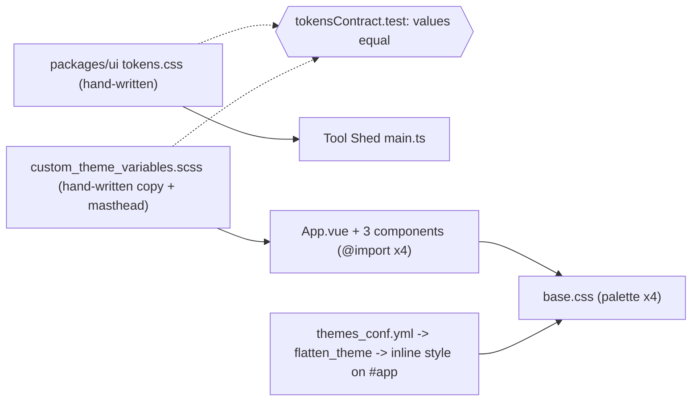
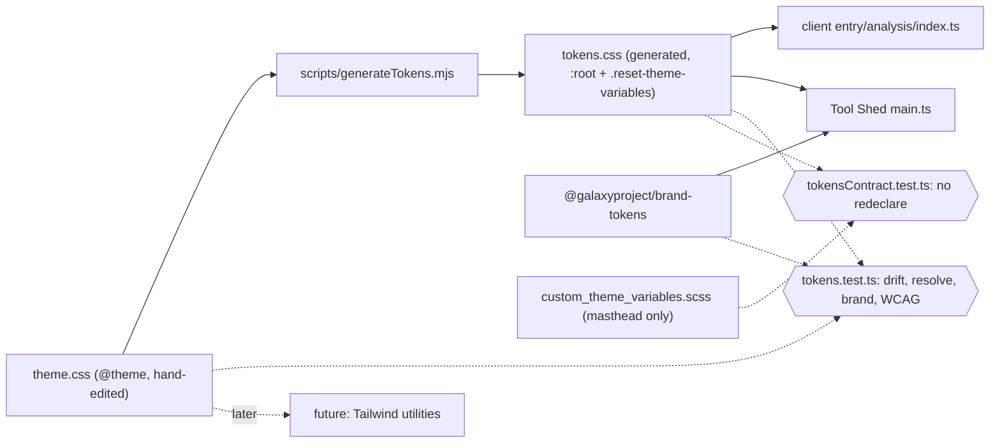
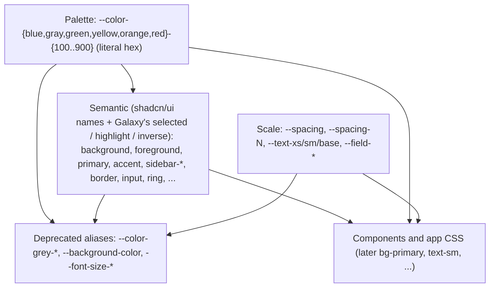

# Learning Galaxy — #23964 semantic design tokens

- Profile: [learning_galaxy](https://github.com/jmchilton/galaxy-brain/blob/main/vault/agents/_shared/reviewers/learning_galaxy.md)
- Model: claude-opus-5-5, medium effort
- Reviewed commit: `9b8df5aa76e` (PR head `b81b32379c4` merged with dev `0073b5e9224`)
- Diff: `git diff 0073b5e9224 9b8df5aa76e`

Verdict: architecturally interesting. The client's CSS custom-property contract gets a single owner (the galaxy-ui package) and a build step, and a semantic layer goes on top of the palette. It is the groundwork for the Tailwind RFC (#23702).

## Before: two hand-synced copies

- **galaxy-ui** (`client/packages/ui`) is an internal package of G-prefixed Vue components. It ships raw source, not a build, and has two consumers: the Galaxy client (Vue 3 under `@vue/compat`, with Bootstrap 4 on the page) and the Tool Shed frontend (plain Vue 3 with Quasar and no Bootstrap). Its components style themselves with `var(--color-blue-600)`, `var(--spacing-2)` and so on.
- **Package side:** `packages/ui/src/styles/tokens.css` declared the palette, spacing, font sizes and field sizes on `:root, .reset-theme-variables`. Only the Tool Shed imported it, right after `@galaxyproject/brand-tokens/tokens.css`, which provides the cross-property `--color-galaxy-*` brand colors.
- **Client side:** `client/src/style/scss/custom_theme_variables.scss` declared the same values again, plus masthead tokens computed from SCSS variables in `theme/blue.scss`.
  - It was `@import`ed from App.vue's styles and from three component `<style>` blocks (ItemListEditor, PersonForm, AutoPairing).
  - `cssCodeSplit: false` merges all of those into one `base.css`, so the palette was emitted four times.
- **Sync test:** `client/src/style/tokensContract.test.ts` checked that every package token existed in the SCSS file with the same text value.
- **Admin themes** (`themes_conf.yml`) are nested YAML. `galaxy.util.themes.flatten_theme` turns any key path into a `--a-b-c` property, and App.vue binds the result as inline `:style` on `#app`. The shipped samples only set `--masthead-*`. `.reset-theme-variables` (used by ThemeSelector's preview card) re-declares the defaults so a theme's overrides don't leak into the preview.

## After: one source, generated output, two consumers

- **`theme.css` is the only hand-edited token file.** It holds one Tailwind v4 `@theme { ... }` block. Tailwind isn't installed yet and nothing imports `theme.css` at runtime. `@theme` isn't valid CSS to a browser, so for now the file is input to the generator plus a ready-made entry point for later Tailwind adoption. The package export and the Vite alias for `./theme.css` exist for that future, not for current use.
- **`scripts/generateTokens.mjs`** (`pnpm --filter @galaxyproject/galaxy-ui build:tokens`) writes `tokens.css`. It swaps `@theme {` for `:root,\n.reset-theme-variables {` and adds a "GENERATED, do not edit" header. `tokens.css` is the only runtime artifact.
- **Both apps load the same file.** The client imports `@galaxyproject/galaxy-ui/tokens.css` at the top of `entry/analysis/index.ts`. `cssCodeSplit: false` means the single `base.css` also covers the `generic` entry's Mako pages. `custom_theme_variables.scss` keeps only the app-level masthead tokens.
- **Contract test inverted.** `tokensContract.test.ts` no longer checks that values are equal. It checks that the client never redeclares a package token and that the analysis entry imports `tokens.css`. The package now owns the contract.
- **Token tests moved into the package** (`packages/ui/src/styles/tokens.test.ts`). They check:
  - `tokens.css` is regenerated from the current `theme.css`;
  - every palette shade is a literal hex;
  - every semantic color resolves to a hex;
  - there are no dangling `var()` references;
  - primary, foreground, highlight and input are pinned to `@galaxyproject/brand-tokens` (a new devDependency);
  - WCAG contrast is met (4.5:1 for each X / X-foreground pair, 3:1 for `input` against `background`).

### The token layers

- **Naming:** names follow Tailwind and shadcn/ui wherever they have one, so the same identifier works as `var(--color-primary)` today and as `bg-primary` once Tailwind is installed. `--spacing-N` matches Tailwind's `p-N`.
- **Semantic values come from a screenshot pass of current UI** (see the RFC thread):
  - `accent` = blue-100 (the hover surface);
  - `selected` = blue-200;
  - `sidebar-accent` = gray-200;
  - headers use `secondary`.
- **Literal exceptions:** two semantic colors are deliberately literal rather than palette shades.
  - `info` = `#2077b3`, today's `$brand-info`. No palette shade both looks the same and carries white text at 4.5:1.
  - `input` = `#8992b2`, brand-tokens' ebony-clay-400, for 3:1 non-text contrast.
- **Migration:** old names stay as aliases, so call sites can move over gradually.

## Things worth knowing

- **Semantic aliases resolve where they are declared.** A custom property's `var()` is substituted on the element that declares it, so `--color-primary: var(--color-blue-600)` is computed on `:root`, and descendants inherit the resulting hex.
  - An override on a subtree, such as an admin theme's inline style on `#app` that sets `--color-blue-600`, changes the palette shade there but not `--color-primary`, `--color-grey-*`, `--font-size-*` or anything else defined in terms of it.
  - `flatten_theme` passes any key path through, so a theme author can write such an override. Nothing in the shipped samples does that today, so this isn't a regression. It does set the rule for the future: re-theme the semantic layer, not the palette.
  - `.reset-theme-variables` works only because `tokens.css` re-declares the whole set on that element, which re-resolves every alias there.
- **The generator is just string manipulation.** It slices from `@theme`, refuses anything that doesn't start with `@theme {`, and renames the selector. The package needs no Tailwind or PostCSS dependency, and the drift test is simply `tokens == generateTokens(theme)`.
- **The test helpers live in `.mjs` on purpose.** `readTokenSources()` sits in the generator script because vitest empties CSS imports, even with `?raw`, and the package has no Node types for type-checking `fs` from a `.ts` test.
- **Vite aliases match by prefix.** The old `"@galaxyproject/galaxy-ui"` alias turned `@galaxyproject/galaxy-ui/tokens.css` into `index.ts/tokens.css`. Exact subpath aliases now come before the package alias. Watch for this whenever a package export gains a subpath.
- **Order and specificity:** `tokens.css` uses `:root` (0,1,0), while `custom_theme_variables.scss` uses `html` (0,0,1). Today they declare disjoint names, and the no-redeclare test keeps it that way, so this never matters. Without that test, a package value would win over a client "override" of the same name.
- **Name collision to know about:** `components/TagsMultiselect/Tag.vue` sets `--color-primary` inline, to the tag's hashed color, and reads it in its scoped CSS. That locally shadows what is now a global semantic token. It is harmless while no descendant expects the global `primary`, but it will surprise anyone adding a semantic-token consumer inside a tag.
- **Accessibility is a test, not a convention.** Every semantic pair `X` / `X-foreground` gets an automatic WCAG 1.4.3 check, so adding a new pair adds a check for free. The commits show `info` and `input` changing to pass.
