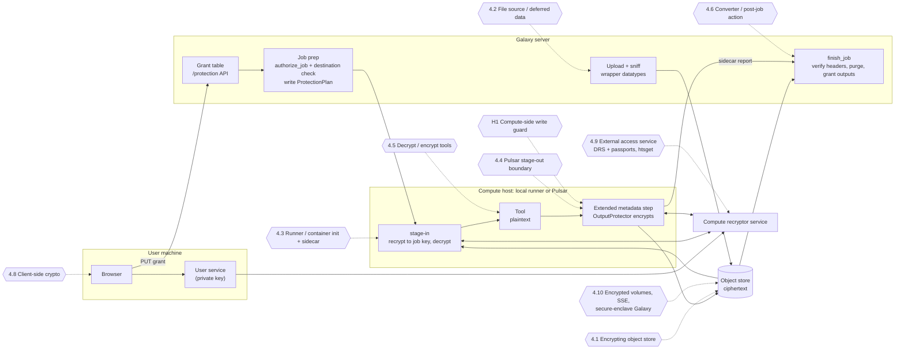

# Alternative layers for Crypt4GH protection: design-space review of #23986

- Profile: `alternative_layers` (ad-hoc, from the coordinator's brief; no profile file)
- Model: Claude Opus 5.5, effort high
- Reviewed commit: `ae37e517ebc3e8acbbd2225848f4b896511375f1`
- Date: 2026-11-21
- Audience: John, for learning and judgment. Not for posting; no P-labels.

## Short answer

None of the other layers can replace the PR. Each one covers one or two stages of the
data lifecycle: ingest typing, who may decrypt, dispatch, decryption on the compute host,
writing outputs, and verification. The requirements touch all of those stages, so any
alternative still needs most of what the PR builds. The PR's spread across Galaxy comes
mostly from the problem, not from poor design. Its seams are defensible:

- a job-script stage-in, which works for both the local runner and Pulsar;
- extended-metadata output persistence, the one place on the compute host that knows both
  datasets and datatypes;
- `finish_job` verification on the Galaxy side;
- a server-managed grant table, the lesson from #23277.

Two **partial** relocations are worth John's attention:

1. **A compute-side object-store write guard.** This keeps the PR's encryption hooks but
   adds one choke point: the object store that the metadata step writes through refuses
   any byte not produced by the output protector. The PR finds plaintext after it is
   stored and then purges it. The guard would stop plaintext from being stored at all.
   It is cheap and complements the PR rather than replacing it. Medium confidence that
   it is worth asking for.
2. **Runner- or container-level stage-in** (init container, Pulsar staging action,
   sidecar). This would lift the PR's refusal of Kubernetes, TES, GCP Batch and Pulsar
   coexecution, and would separate the code that handles keys from the tool. It is future
   work, not for this PR. `Crypt4GHJobRuntime` is already reusable for it.

Confidence that no full replacement exists: high (about 80%). The main source of doubt is
the external-service option (GA4GH DRS/passport-style access brokering). Under a different
product decision, keeping data in archives instead of in Galaxy, it could replace the
grant table and the compute recryptor's authorization. It would still not replace the job
integration.

## 1. What the PR does, by layer

| Stage | PR seam | Main code (`lib/galaxy/` unless noted) | Approx. lines |
| --- | --- | --- | --- |
| Typing | `<inner>.c4gh` wrapper datatypes, one per registered datatype; `matches_any` delegates to the inner type; filename inference; refusal to relabel encrypted as plain or plain as encrypted | `datatypes/crypt4gh.py`, `datatypes/registry.py`, `datatypes/sniff.py`, `util/crypt4gh.py` | ~600 |
| Authority | `dataset_protection_grant` table bound to `(user, Dataset)`; `GET/PUT /api/datasets/{id}/protection`; browser → user service → grant; key icon in the client | `managers/dataset_protection.py` (893), `schema/dataset_protection.py`, migration, API/service, `client/src/composables/datasetProtection.ts` | ~1,400 |
| Dispatch | `MinimalJobWrapper._authorize_protected_job` → `DatasetProtectionManager.authorize_job`; `ProtectionDestination.check` (extended metadata, outputs in the job directory, no tasks, no live output, Pulsar remote metadata and parameter rewriting, no runner that runs the job script in the tool container); writes a `ProtectionPlan` (0600) | `jobs/__init__.py`, `jobs/handler.py`, `job_execution/protection/__init__.py` | ~450 |
| Decrypt (compute host) | `galaxy-protected-stage stage-in`, prepended to the job script with `run_only_if`, outside any container; per-job X25519 key in memory; recryptor `recrypt_header_to_job_key`; decrypt into `_protected/inputs`; create metadata files such as BAM indexes; `ProtectedInputsComputeEnvironment` rewrites input paths | `job_execution/protection/{crypt4gh,stage,metadata_files}.py`, `job_execution/compute_environment.py`, `jobs/command_factory.py` | ~800 |
| Encrypt (compute host) | `OutputProtector` hooked into `set_metadata_portable`, `collect_primary_datasets`, and `ModelPersistenceContext` (discovered outputs, collection elements, extra files); encrypt in place to the compute key, then the recryptor re-seals the header to the user key; switch the extension to the wrapper; encrypt metadata files; write a sidecar report | `job_execution/protection/outputs.py`, `metadata/set_metadata.py`, `model/store/discover.py`, `job_execution/output_collect.py` | ~600 |
| Verify, contain leaks | `finish_job` reads each output's header from the store (`get_data_head` from #24517), compares digests, purges failures, grants verified outputs to the job user; redacts stdout/stderr; skips validation; cleans the job directory unconditionally; no job-cache reuse across users | `managers/dataset_protection.py`, `jobs/__init__.py`, `tool_util/output_checker.py`, `job_execution/actions/post.py` | ~400 |

The code that runs on the compute host stays importable from the `galaxy-job-execution`
package, which is what lets it run on Pulsar.

## 2. Requirements used to judge each layer

Taken from the PR description, the admin doc, and the #23277 discussion:

- **R1 Key custody.** Galaxy never sees the user's private key.
- **R2 At rest.** Galaxy storage holds only ciphertext: object stores, caches, backups.
- **R3 Owner-gated, non-copyable authority.** Only jobs of a user holding their own grant
  decrypt. Sharing or copying ciphertext does not share the ability to compute (the
  central lesson of #23277).
- **R4 Outputs re-encrypted for the user.** Every kind of output: declared, `from_work_dir`,
  discovered, collection elements, extra files.
- **R5 Metadata files.** BAM indexes and similar files work for encrypted inputs and outputs.
- **R6 Chaining.** Workflows chain without the user authorizing again.
- **R7 Pulsar.** Works with Pulsar without a shared filesystem.
- **R8 Fail-closed.** Anything that can't be verified encrypted is not kept, and the job fails.
- **R9 Interop.** Data comes in and goes out as standard Crypt4GH, readable by EGA/FEGA
  and `crypt4gh` tooling, with no re-encryption at the boundary.

The PR explicitly leaves these outside its trust boundary: the tools themselves, compute-host
administrators, and names and element identifiers written by tools.

## 3. Lessons from #23277: designs already tried

| Tried in #23277 or its review | Why it was dropped | Bearing on the alternatives |
| --- | --- | --- |
| Compute authority (compute header + keypair id) stored as **dataset metadata** | `HDA.copy()` copies metadata, so a recipient of a shared dataset gets the owner's decryption authority. Hiding fields or clearing them on copy doesn't cover all the ways datasets move. | Any layer that ties authority to the *data* (object store, datatype metadata, file-source URI) rather than to a *principal* repeats this mistake. |
| **User public key as the authenticator** on the recryptor | In Crypt4GH method 0 the writer's public key is in the clear in every header packet, and the recryptor reuses the user key as writer. Anyone holding the header can rebuild the key. | Rules out "cheap" external-service authorization. Real authorization needs an opaque, server-held secret or a job-scoped token. |
| A **per-user enrollment row** with a keypair id supplied by the browser | Alice can enroll with Bob's keypair id, which she can read from shared metadata. | The PR's grant requires a compute *header* that no API returns, not just an id. |
| **Separate discovery code** for output encryption | Missed shapes: collection elements returned unencrypted, `from_work_dir` failed, the verifier failed open. | This is why the PR hooks Galaxy's own persistence path. It also motivates the write guard proposed here, so that *new* output shapes can't bypass encryption. |
| sveinugu: **require Pulsar** so outputs leave through a single payload | Out of scope at the time. | The PR supports Pulsar and recommends it, but doesn't require it. See §4.4. |
| wm75: **private object stores** | Useful, but they don't enforce anything (see the vault note on private object stores: user-defined stores are private "only by report"). | The admin doc recommends them, but they are no basis for R3. |
| A **pluggable protection-scheme layer** | Dropped on the branch itself (commit `2e30accf5db`); the design note explains why. | §4.7. |

## 4. Candidate layers

The diagram shows where each alternative would sit in the data and job flow (dashed
nodes), relative to the PR's seams (solid nodes).

### 4.1 Encrypting/decrypting object store plugin

**Concrete shape.** A new `ConcreteObjectStore` (or a wrapper that nests another store,
like `distributed`/`hierarchical`) in `lib/galaxy/objectstore/`. It would override
`update_from_file`/`_push_to_os` to encrypt and `get_filename`/`get_data`/`_pull_into_cache`
to decrypt. Transparent at rest: every dataset in that store is ciphertext on the backend.

**What it meets.**
- R2 for the backend, and only partly. Decrypt-on-read puts plaintext in the store's
  *cache* (`CachingConcreteObjectStore` serves bytes through a local cache, per the vault
  note on object-store caching and direct access), on the Galaxy server and on any
  compute host that reads through it.
- Writes have a single choke point (`update_from_file`), which is attractive for R4/R8.

**What it fails.**
- **R1.** An object store has to decrypt with a key. Either Galaxy holds per-user keys
  (in the Galaxy vault), which breaks R1 outright, or the object store calls the
  recryptor on every read. The object-store API is user- and job-agnostic:
  `get_filename(obj, ...)` takes no principal. So it can't tell an authorized job from
  the web tier rendering a peek, a download, a Celery metadata task, or another user's
  job. Adding a principal parameter to every object-store call would touch far more
  code than the PR does.
- **R3.** Authority would attach to the *storage location*: anyone whose request reads
  from that store gets plaintext. This is exactly the copyable-authority shape #23277
  rejected. Display, download, `get_data_head`, and export would all serve plaintext to
  whoever passes the ordinary dataset access check.
- **R9.** Galaxy would control the encryption format, so data arriving already as
  Crypt4GH would be double-wrapped, or would need a special case.
- **R5, R6.** Trivially met, but only because everything is plaintext to Galaxy, which
  defeats the point.

**Costs.** Small to write (~300–500 lines), but it either changes the threat model (Galaxy
operators can read everything) or needs a principal-aware object-store API, which is a
large and invasive change.

**PR code replaced.** At most the encryption call inside `OutputProtector` and the
datatype wrappers, if the threat model is downgraded. All of the R3 machinery would still
be needed, and the read path would become the hard part.

**Verdict.** Not viable as the protection layer. The **write half** is viable as a
compute-side guard (H1). It doesn't encrypt; it refuses non-ciphertext. The object store
is the one interface every output byte passes through.

### 4.2 File source / remote data layer (data never really "in" Galaxy)

**Concrete shape.** Encrypted data stays in an external archive (FEGA node, S3, `drs://`
via `files/sources/drs.py`) and Galaxy holds **deferred** datasets.
`DatasetInstanceMaterializer` (`model/deferred.py`) fetches them at job time, either from
`ToolEvaluator._materialize_objects` (`tools/evaluation.py`) or on the compute host with
remote tool evaluation. A "decrypting materializer" would decrypt while materializing.

**What it meets.**
- R2 trivially for inputs: Galaxy stores nothing.
- R9 strongly. This is where controlled-access data actually lives in the GA4GH world.
- If the source is a principal-aware service (passport/visa-checked DRS), authority is
  per user by construction, which is a better answer to R3's residual risk than the
  unauthenticated compute recryptor.

**What it fails.**
- **Materialization happens on the Galaxy server by default.** Plaintext would land in the
  Galaxy-side job directory unless remote tool evaluation is used, and the PR refuses
  remote tool evaluation on Pulsar for a good reason: the command line is built after
  materialization.
- **Materializing creates a new `Dataset` row** (`ensure_materialized` with
  `in_place=False`). Grants keyed on `(user, Dataset)` wouldn't carry across. Encrypted
  deferred datasets also lack a stored header: `_has_content` excludes deferred datasets
  and the wrapper `set_meta` reads the header from the file. So deferred encrypted inputs
  look unsupported in the PR today. I haven't verified this by running it.
- **R4, R5, R6.** Unaffected. Outputs are ordinary Galaxy datasets, so they still need
  all of the PR's output encryption, metadata files, verification, and output grants.
  File sources only help on the input side.
- The PR refuses tools given the user's file sources, because export-style tools could
  write plaintext out of Galaxy. A file-source design has to separate read-only
  materialization from write-capable file-source access.

**Costs.** Moderate (materializer plus key brokering) and a dependency on external
infrastructure. It doesn't remove any of the job-side code.

**PR code replaced.** Possibly the upload and grant UX for archive-sourced data. Nothing
on the compute side.

**Verdict.** Not a replacement. A **complementary ingestion path** that will probably be
wanted eventually ("analyze FEGA data without uploading it"). If that happens, materialize
the *ciphertext* and let the PR's stage-in decrypt it, rather than decrypting inside the
materializer. That would need grants to survive materialization.

### 4.3 Job runner / destination level

Two different things go by this name.

**(a) TPV- or rule-routed dedicated destinations.** Route jobs with `.c4gh` inputs to a
locked-down destination: no egress, tmpfs scratch, vetted tools. This is *policy routing*;
it doesn't decrypt anything. The admin doc already recommends it. It complements the PR
and replaces none of it. A tighter coupling could make `ProtectionDestination.check` a TPV
rule, but a check inside Galaxy fails closed and a routing rule fails open when it is
misconfigured. Keeping the check in Galaxy is right.

**(b) A runner- or container-level wrapper around any tool.** For example, a Kubernetes
init container that decrypts into an `emptyDir`, a post-step container that encrypts, a TES
task with `inputs`/`outputs` executors before and after the tool executor, or the Pulsar
coexecution sidecar doing it in the Pulsar container rather than the tool container.

- **Meets.** R1, R2, R3, R7 the same as the PR, if it consumes the same `ProtectionPlan`.
  It is the *only* way to support the runners the PR refuses ("runners that run the whole
  job script in the tool's container: Pulsar Kubernetes, TES, GCP Batch"). It also adds
  something the PR lacks: **privilege separation**. In the PR the stage-in and the
  metadata step run as the same UID as the tool, in the same job directory. The plan file
  is 0600, which keeps other users out but not the tool. A separate init container could
  hold the compute headers and the job key out of the tool's reach. Given that the PR
  trusts tools, this is defense in depth rather than a fix, but it shrinks the
  precondition of the documented residual risk ("a process holding a compute header").
- **Fails or costs.** R4 and R5 are the hard part. Encrypting outputs after the tool needs
  to know which files are outputs, which datatype each has (for the wrapper extension and
  for metadata files), and which are discovered. That knowledge is in Galaxy's metadata
  step. A post-step container would end up running Galaxy's metadata code anyway, which is
  essentially where the PR already is. Each runner family needs its own wiring.
- **PR code replaced.** The `command_factory` prepend (~70 lines) for those runners. Not
  the runtime, the grants, the output protector, or verification.

**Verdict.** (a) is complementary and already recommended. (b) is a viable *future
extension* for container-native runners and the right home for privilege separation; it
is not a replacement. The PR's stage-in is a small CLI over `Crypt4GHJobRuntime` with a
plan path, so the extension needs no refactor. It's worth making sure the PR keeps it that
way.

### 4.4 Pulsar-only (or remote-compute-only)

**Concrete shape.** Require Pulsar for protected jobs, as sveinugu suggested, and do the
crypto in Pulsar's own staging layer. Decrypt as a Pulsar input staging action during
`preprocess`, a custom action next to `remote_transfer`/`remote_object_store_copy` in
Pulsar's `FileActionMapper`. Encrypt in `postprocess` before outputs are sent back over
the job files API. Galaxy's `/api/job_files` POST could then refuse non-Crypt4GH uploads
for protected jobs, a second choke point. sveinugu's intuition was that this turns many
output sinks into one payload boundary.

**What it meets.**
- R7 by construction.
- R8 becomes structurally simple *for the transfer path*: everything crossing the wire is
  either ciphertext or a whitelisted control file.

**What it fails or costs.**
- **R5 and the datatype switch** still need Galaxy datatypes on the compute host, which
  means Galaxy's metadata code there, which is `remote_metadata`. The admin doc's
  preferred topology (path 3: Pulsar REST, `remote_metadata`, user S3) writes outputs
  **directly to the object store from the Pulsar host**, so no transfer boundary is left
  to guard. The guard has to sit in the metadata step anyway, which is where the PR put it.
- **Control-file whitelist.** `galaxy.json`, exit codes and metadata results must cross in
  the clear. The PR already accepts names from `galaxy.json` in the clear, so this doesn't
  get worse, but the whitelist becomes a security boundary.
- **Cross-repository coupling.** The security-critical code would live in Pulsar, with its
  own release cadence. The vault note on Galaxy–Pulsar code sharing records a manually
  synced util mirror with heavy drift.
- **Local runner support goes away.** The doc already calls shared-filesystem deployments
  a "single trust domain", so arguably little is lost.

**PR code replaced.** Little. The local-runner paths (`outputs_to_working_directory`
checks, local cleanup) could shrink. Output encryption, grants and verification stay.

**Verdict.** Partially viable as a *scoping policy*: Pulsar without a shared filesystem as
the only supported topology. As a different *layer* it is not better. It moves code into
another repository without removing the need for compute-side Galaxy metadata. The PR's
choice of the metadata step is the one seam that works for local, embedded, MQ and REST
Pulsar alike.

### 4.5 Tool level: explicit decrypt/encrypt tools, or a wrapper macro

**Concrete shape.** Either (a) `c4gh_decrypt`/`c4gh_encrypt` tools that workflows put
around analysis steps, or (b) a macro (`<expand macro="c4gh_in"/>`) that wraps each
tool's command in `c4gh decrypt | tool | c4gh encrypt`.

**(a) fails R2 immediately.** The decrypt tool's output is a normal HDA persisted to the
object store in plaintext, visible, shareable and copyable. Galaxy has no ephemeral or
in-job-only dataset concept, and no job fusion.

**(b) fails at scale.**
- Every Tool Shed tool would need rewriting; outputs declared `bam` would become
  `bam.c4gh`.
- Discovered outputs, collection elements and extra files would each need per-tool logic.
  This is the fragility #23277 hit, multiplied by the number of tools.
- Key brokering (the recryptor and per-job keys) would still need Galaxy's grant and plan
  machinery, because a tool can't call the user service.
- Fail-closed would be per-tool: a buggy wrapper fails open.

**Verdict.** Not viable. A vetted, small tool set is a real deployment pattern (the doc
asks for vetted tools), but even then the Galaxy-level hooks are less code and fail
closed for all tools at once.

### 4.6 Datatype / converter level

**Concrete shape.** Implicit converters `X.c4gh → X` (decrypt) and re-encryption as an
output action (`<actions>` or a post-job action), using
`ImplicitlyConvertedDatasetAssociation` (vault note on implicit dataset conversion).

**Fails.**
- **R2, R3.** An implicit conversion is a real converter job whose output is a persisted
  hidden HDA. That is plaintext at rest, and since conversions are reused across users of
  the same dataset, plaintext is shared too. This is the exact cross-user leak, now in the
  converter cache.
- **Post-job and output actions** run on the Galaxy server *after* outputs are stored.
  Plaintext would have been at rest and Galaxy would need the key (R1). That is the
  opposite order to what's needed.

**What the PR takes from this layer, correctly.** The datatype layer is the right place for
*typing*: wrapper types keep encrypted data from being sniffed, peeked, validated, or
relabelled as plain. Converters of the inner type are offered for wrappers, but they run
as protected jobs (decrypt, convert, re-encrypt), and the doc says so ("implicit
conversions ... can only be decrypted by the user whose job converted them"). That
inverts the converter idea in the safe direction.

**An alternative inside this layer that I considered: a model-level flag instead of
wrapper datatypes.** For example a `Dataset.protection_scheme` column, with the extension
staying `bam`.

- Pros: `$input.ext` is honest, workflows and the client datatype mapper need no changes,
  and the registry doesn't double in size.
- Cons: every content reader would need to check the flag: peek, `set_meta`, display,
  visualizations, sniff and redetect, Celery metadata, change-datatype, export, hashing.
  A reader that misses the check treats ciphertext as `bam`. That is mostly breakage
  rather than leakage, but it is far wider. Wrapper types fail safe because unaware code
  sees `Binary`.

The PR's choice is the better default.

**A side effect of the wrapper design worth knowing about** (read in the code, not run).
Wrappers are dynamic subclasses of `Crypt4GH(Binary)`, not of the inner type. Matching
works on the server because `Crypt4GH.matches_any` is overridden. But the client's
datatype mapper is built from Python class bases (`managers/datatypes.py:view_mapping`),
so `bam.c4gh` is not a subtype of `bam` in the client. Client paths that use
`isSubTypeOfAny` will likely disagree with the server:

- drag-and-drop onto a tool's `bam` input (`FormData.vue:canAcceptDatatype`);
- workflow editor connection checks (`Workflow/Editor/modules/terminals.ts`) from a data
  input typed `bam.c4gh`;
- collection extension filters.

The dropdown works because it is filled on the server. This is a sibling-path consistency
question for the datatype reviewer, not a reason to change layers. `view_mapping` could add
the inner type's class chain for wrappers.

**Verdict.** Not viable for decryption or re-encryption. Viable, and already used, for
typing.

### 4.7 A generic "dataset protection scheme" plugin interface

**Note: this re-argues a decision the PR makes explicitly.** The design note says there is
deliberately no pluggable layer, and commit `2e30accf5db` dropped one.

**A fair case for it.** The job-side *shape* is already scheme-neutral: a "protected job"
gets refused at dispatch, a plan, a stage-in, an output protector, verification,
stdout redaction, unconditional cleanup, and no cross-user job cache. Grants and jobs
already record a `scheme`. Other schemes are plausible:

- age/SOPS with a KMS;
- HashiCorp Vault transit;
- cloud KMS envelope encryption;
- a future Crypt4GH variant with job-scoped tokens on the recryptor.

An interface would keep Crypt4GH-specific code out of `jobs/__init__.py` and
`set_metadata.py`.

**The case against it, which I find stronger.**
- Everything that varies between schemes is the hard part, and the PR has exactly one data
  point for each: header formats, key brokering, how outputs are encrypted for a user, what
  "verified" means (a header digest), and destination requirements (a recryptor URL).
- The generic seams the PR touches are already named neutrally (`protection_scheme`,
  `ProtectionPlan`, `OutputProtector`, `ProtectionDestination`). Extracting an interface
  later is mostly mechanical; designing one now is guesswork.
- An interface also adds a configuration surface that admins could misconfigure, and here
  misconfiguration fails open.

**Verdict.** Not now. The useful review question is narrower: does any Crypt4GH-specific
logic leak into the generic seams beyond the names? For example, header-digest
verification in `finish_job` is Crypt4GH-specific, but it lives in the manager. A
scheme-agnostic hook surface keeps the later extraction cheap.

### 4.8 Client-side / user-side only

**Concrete shape.** The browser, or the user service, does all crypto. Galaxy stores
ciphertext and never computes on it.

**Fails the core requirement.** Tools need plaintext, and Galaxy compute is the whole point.
"Client-side only" reduces Galaxy to an encrypted file locker.

**Viable add-ons on top of the PR.**
- **Encrypt on upload** in the browser or user service, using the user's public key. This
  lowers the barrier: today users run `crypt4gh encrypt` by hand and must keep the inner
  extension in the filename for typing.
- **Decrypt on download or view.** The browser streams the ciphertext to the user service,
  which decrypts locally. Users would see peeks and visualizations of their own outputs
  without the CLI round trip. The user service already holds the key and already talks to
  the browser.

**Verdict.** Not viable as a replacement; good follow-up UX work.

### 4.9 External service / sidecar instead of in-Galaxy logic

Three flavors:

- **(a) htsget-style streaming decryption.** htsget implementations can serve Crypt4GH
  data, with region slicing re-encrypted to a requester key. Only reads and variants
  formats (BAM/CRAM/VCF/BCF), and tools would need to be htsget clients, or Galaxy would
  stage through it, which is the PR's stage-in again. **Too narrow** to be the general
  mechanism. Interesting for "view a region" features.
- **(b) A GA4GH-style data-access broker.** A DRS endpoint with passport/visa
  authorization, or an EGA/FEGA download service that re-encrypts to a key the requester
  supplies. This is the strongest alternative for the **authorization** half. Requests
  carry a principal and a visa, so the job-scoped authorization that #23277 concluded was
  needed would come from an established protocol rather than a recryptor patch. It
  addresses the PR's main residual risk: the compute service doesn't authenticate callers.
  - Costs: an AAI integration (LS Login, visas), a dependency on archive infrastructure,
    and a product shift. Data would live in archives rather than Galaxy histories, and
    *outputs* still have to be encrypted and stored somewhere. The compute-side job
    integration (stage-in, output protector, verification) stays.
  - PR code replaced: the grant table and the browser → user service → grant flow (~1,400
    lines), if the broker issues per-job access instead of grants.
- **(c) A compute-node sidecar daemon.** A per-node service holds job keys and exposes
  decrypted inputs to the tool, for example through a FUSE mount such as
  `crypt4ghfs`-style filesystems, or named pipes. Plaintext would never touch disk, which
  addresses the PR's "plaintext cleanup is best effort" limitation, and the key handling
  would be separated from the tool UID.
  - Costs: FUSE is often unavailable on HPC or in unprivileged containers; random-access
    tools (indexed BAM) on a decrypting FUSE can be slow; another daemon to run.
  - This is a refinement of the *mechanism inside* the PR's stage-in, not a different
    Galaxy layer.

**Verdict.**
- (b): a plausible **future replacement for the authority layer** (grants plus recryptor
  authorization), not for the job integration. It is a product and AAI decision, not a
  code review point.
- (c): a worthwhile optional hardening behind the existing stage-in interface.
- (a): not viable generally.

### 4.10 Storage or infrastructure only (no Crypt4GH awareness in Galaxy)

**Concrete shape.**
- Encrypted volumes (LUKS) or object-store server-side encryption (SSE-S3/SSE-KMS/SSE-C).
- Per-user user-defined object stores pointing at buckets the user controls.
- The common real-world pattern: a **secure-enclave Galaxy** (a TSD-like project
  enclave, or CSC SD-Desktop-style environments). The whole Galaxy runs inside an isolated
  environment and data is decrypted at ingest.

**What it meets.**
- R2 against stolen disks or backups, or against the storage provider.
- With an enclave: strong isolation, no egress, and **zero Galaxy code**. This is a mature
  operational model.

**What it fails.**
- **R1.** The platform holds the keys.
- **R3.** Anyone inside Galaxy with dataset access, including admins, reads plaintext.
  There's no owner-gated per-job decryption.
- **R9 on the output side.** Results leave as plaintext unless someone encrypts them.
- Per-project enclaves don't scale to a shared public instance, which is the deployment
  this PR targets.

**Verdict.** Viable **if the threat model is weaker**: "storage or the network is
untrusted, Galaxy operators are trusted." For that model it is far cheaper than the PR. For
the PR's model, where neither the Galaxy server nor its storage ever holds plaintext and the
owner gates each use, it is **complementary only**. The admin doc already recommends a
private object store and tmpfs or encrypted scratch. John may want to confirm with the
authors which threat model the deployers (ELIXIR, UiO, BSC) actually need. If enclaves
already serve them, the PR's value is specifically the *shared-instance* case and Crypt4GH
interop.

### 4.11 Others considered briefly

- **Confidential computing (SGX, SEV-SNP, TDX enclaves on compute nodes).** This would
  bring compute-host admins inside the protection boundary, which the PR explicitly leaves
  outside. It complements the PR rather than replacing it: a TEE still needs the same
  dispatch, key-release and output-encryption flow, with attestation added to the
  recryptor's key release. A long-term direction, not an alternative seam.
- **Galaxy-held per-user keys in the Galaxy vault** (`galaxy.security.vault`). Fails R1.
  This is §4.1 with a different key store.
- **Homomorphic or searchable encryption.** Dropped: Galaxy tools are arbitrary binaries
  that need plaintext.
- **Workflow-level "secure subworkflow" scheduling.** Dropped: workflows schedule jobs, and
  job-level protection already chains through output grants (R6). A workflow layer adds
  nothing the job layer lacks.

## 5. Comparison

Legend: **Y** met, **~** partial or conditional, **N** not met, **=** same as the PR
(the layer reuses the PR's machinery for that requirement).

| Layer | R1 key | R2 rest | R3 authority | R4 outputs | R5 meta files | R6 chain | R7 Pulsar | R8 fail-closed | PR code it would replace | Verdict |
| --- | --- | --- | --- | --- | --- | --- | --- | --- | --- | --- |
| PR as is | Y | Y | Y (residual: unauthenticated recryptor) | Y | Y | Y | Y | Y (detect then purge) | none | baseline |
| 4.1 Encrypting object store | N | ~ (caches hold plaintext) | N | ~ | Y (no protection) | Y | ~ | ~ | encrypt call only | not viable; write half becomes H1 |
| 4.2 File source / deferred | = | Y inputs | ~ (Y with a principal-aware source) | = | = | = | ~ | = | upload/grant UX for archive data | complement (ingest) |
| 4.3a TPV routing | = | = | = | = | = | = | = | weaker if it replaced the check | none | complement (already recommended) |
| 4.3b Runner/container init + post | = | = | = | ~ (needs Galaxy metadata code) | ~ | = | Y, plus k8s/TES | = | `command_factory` prepend | future extension; adds privilege separation |
| 4.4 Pulsar-only staging | = | = | = | ~ | N without remote metadata | = | Y | ~ (control-file whitelist) | little | scoping policy at most |
| 4.5 Decrypt/encrypt tools | ~ | N | N | ~ per tool | ~ | ~ | Y | N | output protector, partly | not viable |
| 4.6 Converters / post-job actions | N | N | N | N | Y | Y | Y | N | none | not viable (typing use is right) |
| 4.7 Generic plugin | = | = | = | = | = | = | = | = | none (adds code) | not now; re-argues the PR |
| 4.8 Client-only | Y | Y | n/a | n/a | n/a | n/a | n/a | n/a | none | not viable; upload/download UX add-ons |
| 4.9b DRS/passport broker | Y | Y | Y+ (principal on every request) | = | = | ~ | = | = | grants + recryptor authorization | possible future authority layer |
| 4.9c Compute sidecar / FUSE | = | Y+ (no plaintext on disk) | = | = | ~ | = | ~ (FUSE limits) | = | stage-in mechanism | optional hardening |
| 4.10 Infrastructure / enclave | N | ~ | N | N | Y | Y | Y | n/a | everything, under a weaker model | different threat model; complement |

## 6. Hybrids

- **H1: PR plus a compute-side write guard** (recommended to raise; see §8).
  `set_metadata_portable` builds its object store with `build_object_store_from_config` /
  `get_object_store`. For protected jobs, wrap that object store so that `update_from_file`
  (and `MetadataFile.update_from_file`, which `export_store.push_metadata_files` uses)
  refuses any file whose header digest isn't one the `OutputProtector` recorded. Copies of
  encrypted inputs, which the protector also records, pass.
  - Result: "nothing reaches the store unless the protector produced it." Today's property
    is "anything that reached the store unverified gets purged later in `finish_job`."
  - Purge-after-write is weaker wherever stores keep history: S3 versioning, object lock,
    replication, backup snapshots, CDN caches, and user-defined buckets the admin doesn't
    control.
  - Covers future output shapes automatically.
  - Roughly 60–120 lines. The `finish_job` verification stays as the Galaxy-side check of
    the compute host's claims.
- **H2: PR plus a runner-level stage-in for container-native runners** (§4.3b). The same
  `ProtectionPlan` and `Crypt4GHJobRuntime`, invoked by a Kubernetes init container, a TES
  executor, or the Pulsar coexecution container instead of the job-script prepend. It lifts
  the PR's refusal list and separates key handling from the tool's UID.
- **H3: PR plus an external authority** (§4.9b, or a job-scoped recryptor token). Keep the
  job integration and replace "grant row plus unauthenticated recryptor" with a principal-
  or job-bound authorization. The PR already names this as its main follow-up. The `scheme`
  column and the plan abstraction are enough to accommodate it.
- **H4: PR plus file-source ingestion** (§4.2). Deferred `drs://` encrypted inputs,
  materialized as *ciphertext* on the compute host and decrypted by the existing stage-in.
  Needs grants that survive materialization (a new `Dataset` row) and a header captured at
  ingest.
- **H5: PR plus client-side crypto UX** (§4.8). Encrypt on upload and decrypt on view or
  download through the user service.
- **H6: PR plus infrastructure hardening** (§4.10). Private object store, tmpfs job
  directories, no egress, and optionally TEEs. The doc already recommends most of this.

## 7. Recommendation

Keep the PR's layering. I found no alternative that meets R1, R3 and R4 together with less
Galaxy-core involvement:

- The object-store, converter and tool layers can't express per-user, per-job authority
  without re-creating #23277's copyable-authority problem, or without making the object
  store principal-aware, which is more invasive than the PR.
- File-source, Pulsar-only and runner-level designs move *one* stage to a different seam
  and still need Galaxy's metadata code on the compute host for output typing and metadata
  files. That is where the PR already encrypts.
- Infrastructure-only and enclave designs are cheaper by orders of magnitude but answer a
  weaker threat model. That trade-off is worth confirming with the authors rather than
  assuming.

For *parts* of the PR:

- **Output persistence:** keep encryption in the metadata step, and add the H1 write guard
  so the object store, the one interface every output byte passes through, enforces the
  invariant. Medium confidence it's worth asking for; low cost.
- **Input staging:** the job-script prepend is the right seam for this PR. H2 is the
  natural path for container-native runners later. No change requested.
- **Authority:** the grant table is the right Galaxy-side shape. Longer term, H3 (a job-
  scoped token on the recryptor, or a DRS/passport broker) is the real fix for the residual
  risk. The PR documents this. No change requested.
- **Typing:** wrapper datatypes beat a model-level flag. The client datatype-mapper
  divergence (§4.6) is worth a look by whoever reviews the datatype part.

Overall confidence: about 80% that no full replacement is viable; about 60% that H1 is worth
the extra code in this PR rather than a follow-up.

## 8. Possible review points

Unlabeled; for John to decide whether to raise them.

- **Enforce "only ciphertext reaches the store" at the object-store seam on the compute
  host, rather than detecting and purging afterwards.** The PR encrypts at three or four
  persistence call sites:
  - `protect_declared` in `set_metadata_portable`;
  - `protect` in `collect_primary_datasets`;
  - `protect`/`protect_all` in `ModelPersistenceContext`;
  - extra and metadata files.

  It relies on `finish_job` to purge anything unverified. Every write in the metadata step
  goes through the `ObjectStore` built in `set_metadata.py`, including metadata files via
  `export_store.push_metadata_files()`. For protected jobs, a thin wrapper whose
  `update_from_file` accepts only files whose header digest the `OutputProtector` recorded
  would make fail-closed hold *before* storage. That matters on versioned, replicated or
  backed-up stores, and on user-owned buckets, where a purge doesn't erase history. It
  would also catch future output shapes that bypass the per-call-site hooks, which is how
  #23277 failed. `finish_job` verification stays as the check of the compute host's claims.
  It's cheap, and it reuses the object-store abstraction instead of adding to the hooks.

- **Client datatype mapping disagrees with server-side wrapper matching** (read in the
  code, not run). `BamCrypt4gh` and similar classes subclass `Crypt4GH(Binary)`, and the
  server uses `matches_any` to accept them for `bam` inputs. The client's
  `datatypes_mapping`, built from class bases in `managers/datatypes.py:view_mapping`,
  doesn't know about that. So drag-and-drop onto tool inputs (`FormData.vue`
  `canAcceptDatatype`), workflow editor terminal checks, and collection extension filters
  probably reject `X.c4gh` where the server accepts it. Consider having `view_mapping` add
  the inner type's class chain for wrappers, plus a client or Selenium test of
  drag-and-drop and a workflow connection. This is a consistency point within the PR's own
  layer choice, not a change of layer.

- **Keep the compute-side runtime independent of the job script** so a runner-level
  stage-in (Kubernetes init container, TES executor, Pulsar coexecution) can reuse it
  later. It already is (a CLI over `ProtectionPlan`). A sentence in the admin doc, next to
  the refused runners, saying this is the intended extension point would help future
  contributors avoid adding a second decryption path. Optional and minor.
