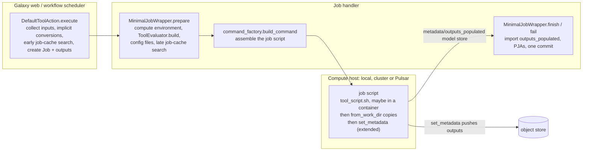
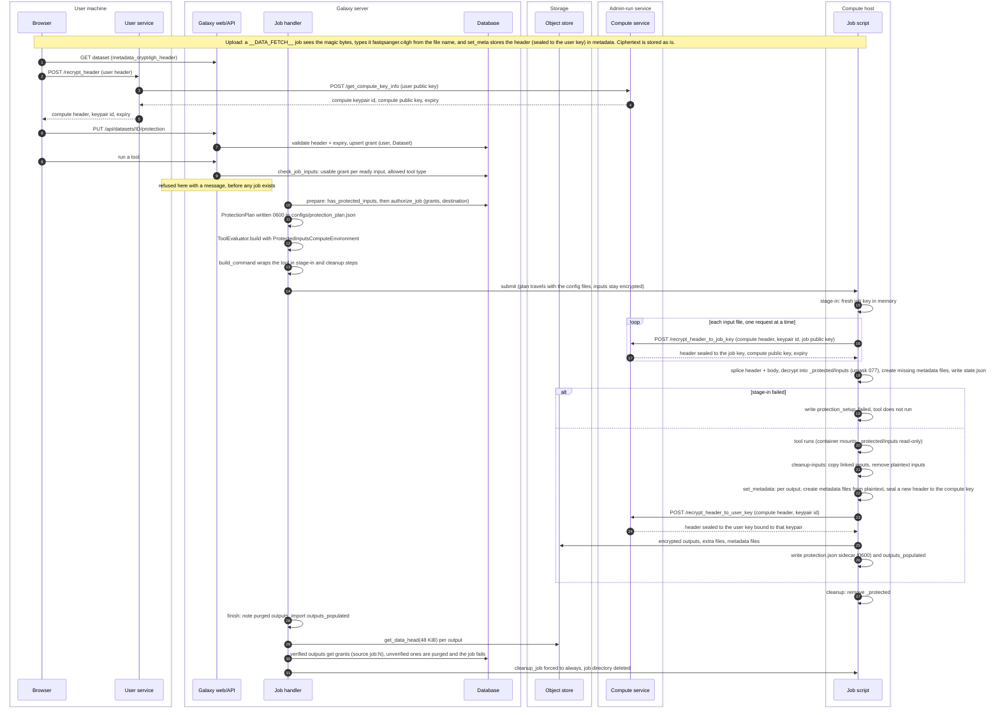
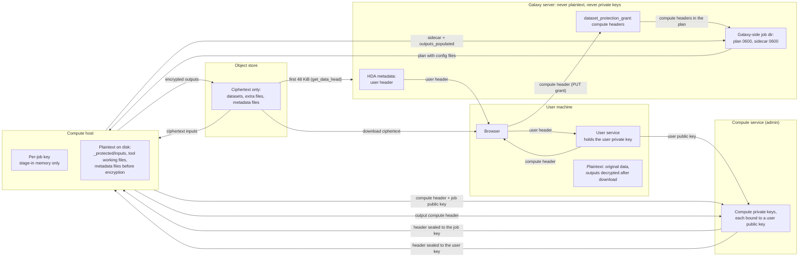
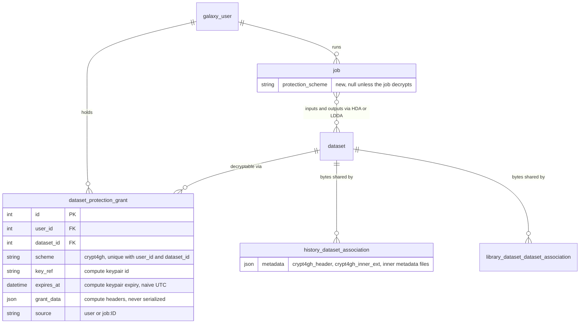
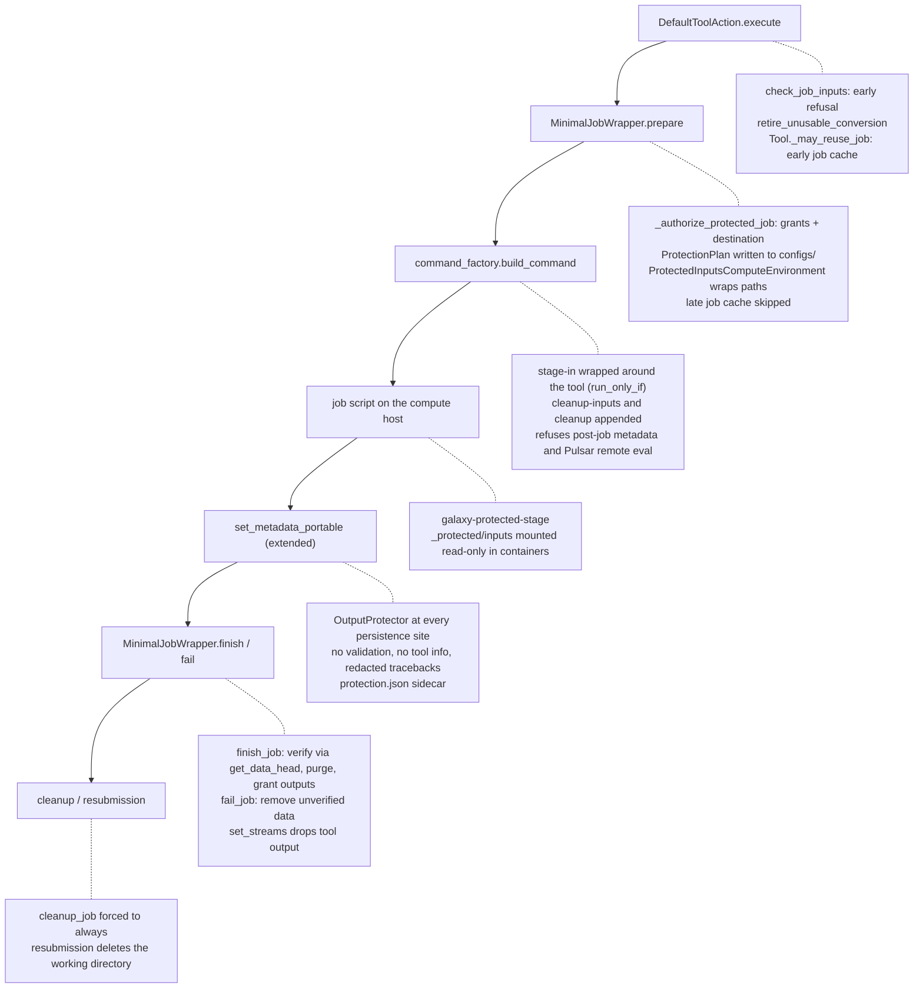
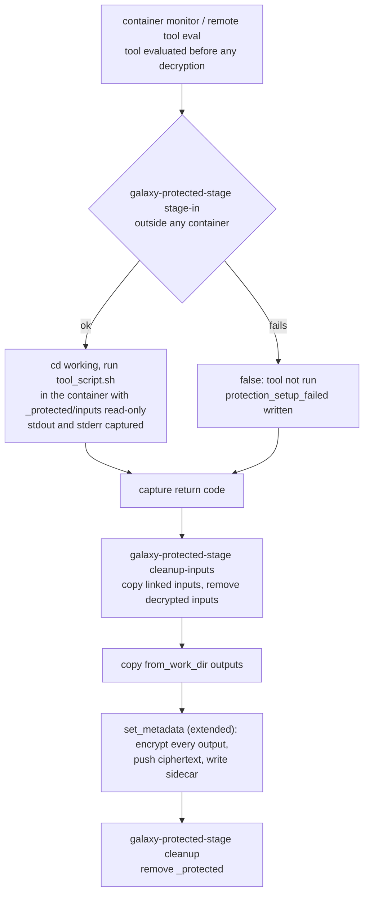
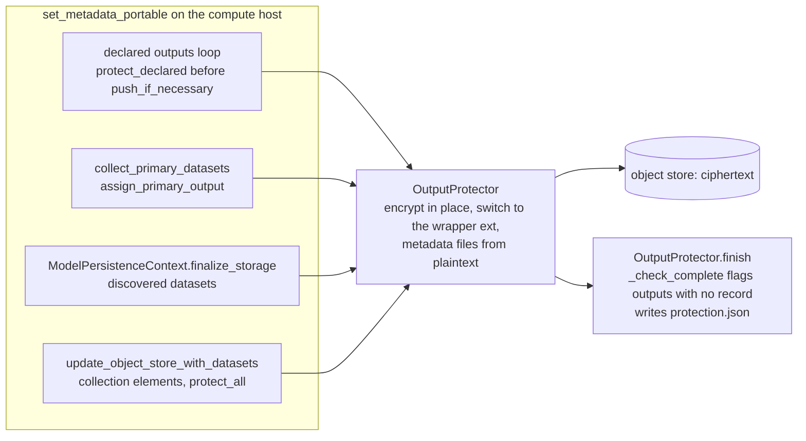

# Learning Galaxy: #23986 Crypt4GH-encrypted datasets with server-managed compute grants

- **Profile:** learning_galaxy (`gx_reviews/reviewers/learning_galaxy.md`)
- **Model:** Claude Opus 5.5, effort xhigh
- **Reviewed commit:** `ae37e517ebc3e8acbbd2225848f4b896511375f1` (draft, 105 commits on `dev`)
- **Baseline:** "before" statements were checked against `origin/dev` @ `7e7dfea5535` (merge base `eec9c54787d`). "After" statements were checked against the PR head, not only the PR description. [Section 9](#9-where-the-pr-description-and-the-code-differ) lists where the two differ.

**Architecturally interesting:** yes. The PR adds a manager (`DatasetProtectionManager`), an API (`GET`/`PUT /api/datasets/{id}/protection`), a compute-side package (`galaxy.job_execution.protection`), a migration (a new table and a new `job` column), dynamically generated datatypes, and hooks at every stage of the job lifecycle.

This document is for learning, not for review: it has no findings. John asked for extra depth, so each part is broken into small sections that can be read on their own.

## Contents

0. [The feature in one page](#0-the-feature-in-one-page)
1. [Prerequisites: Galaxy concepts you need first](#1-prerequisites-galaxy-concepts-you-need-first)
2. [End-to-end lifecycle](#2-end-to-end-lifecycle)
3. [Trust boundaries and key custody](#3-trust-boundaries-and-key-custody)
4. [Data model](#4-data-model)
5. [How existing Galaxy code changed](#5-how-existing-galaxy-code-changed)
6. [The new modules at a glance](#6-the-new-modules-at-a-glance)
7. [Guided reading order](#7-guided-reading-order)
8. [Notable design choices and clever bits](#8-notable-design-choices-and-clever-bits)
9. [Where the PR description and the code differ](#9-where-the-pr-description-and-the-code-differ)
10. [Where to look when debugging](#10-where-to-look-when-debugging)
11. [Self-check questions](#11-self-check-questions)
12. [Glossary](#12-glossary)
13. [Research notes: conflicts and requests](#13-research-notes-conflicts-and-requests)

---

## 0. The feature in one page

**What users do.** They upload a `.c4gh` file, click the key icon on the dataset once, and run tools and workflows as usual. Outputs come back encrypted for them. They download the outputs and decrypt them with their own key.

**What makes it work.** A Crypt4GH file has two parts:

- a small **header**: packets holding the file's symmetric data key, each sealed to one recipient's X25519 public key;
- a large **body**: 64 KiB segments encrypted with that data key.

*Re-encrypting* (recrypting) a file means opening the header with one private key and sealing it again to another public key. The body never changes. Every piece of this PR relies on that property, which is why **only headers ever travel between services**.

**Three external actors, from [crypt4gh-recryptor-service](https://github.com/elixir-europe/crypt4gh-recryptor-service):**

| Actor | Runs where | Holds | Called by |
|---|---|---|---|
| User service | the user's machine | the user's private key | the user's browser |
| Compute service | one per Galaxy, run by the admin | short-lived compute private keys (7 days), each bound to the user public key it was issued for | user services (`/get_compute_key_info`) and compute hosts (the two re-encryption routes) |
| Galaxy | server and compute hosts | ciphertext, headers, and **grants** (headers sealed to a compute key) | never calls either service from the server |

**The idea in one sentence.** The user's own machine seals a dataset's header to a compute key, and Galaxy stores the result as a per-user **grant**. On the compute host, a job asks the compute service to re-seal that header to a fresh per-job key held only in memory, then decrypts the inputs next to the tool. It encrypts the outputs again for the user before anything reaches the object store, and Galaxy verifies them before accepting them.

Everything is behind `crypt4gh_enabled`, which is off by default. The migration applies either way.

---

## 1. Prerequisites: Galaxy concepts you need first

The PR touches about fifteen existing subsystems. Each item below explains how the subsystem worked **before** this PR, in two to four sentences, with a link to the research note where one exists. The diagram shows the pre-PR job path that most of the PR hooks into.



### 1.1 Datatypes registry and sniffing

`Registry.load_datatypes` reads `datatypes_conf.xml` into `datatypes_by_extension` (extension to datatype instance), `datatypes_by_suffix_inferences` (filename suffix to datatype), converters, and a `sniff_order` list. `sniff.guess_ext` walks `sniff_order` and asks each datatype's `sniff()` whether it recognizes the file. `get_datatype_from_filename` infers a type from up to three dotted suffixes. Tool inputs accept a dataset when `Data.matches_any` finds it to be an instance of one of the accepted format classes. The registry is serialized to `registry.xml` in the job's `configs/` directory so that compute-side code, such as `set_metadata`, can load the same datatypes. *Research:* none. A request is queued ([section 13](#13-research-notes-conflicts-and-requests)).

### 1.2 Upload pipeline

Uploads run the internal `__DATA_FETCH__` tool as a normal job. On the compute host, `handle_upload` calls `handle_uploaded_dataset_file_internal`. That function sniffs the type when the user chose `auto`, and otherwise validates the requested type with that datatype's sniffer. It also optionally converts line endings and spaces. Galaxy then sets metadata on the new dataset like any other output. *Research:* [[Component - Data Fetch]].

### 1.3 Dataset vs HDA/LDDA

A `Dataset` row owns the bytes: object store id, uuid, file size and the extra-files directory. Many `HistoryDatasetAssociation`s (HDAs) and `LibraryDatasetDatasetAssociation`s (LDDAs) can point at one `Dataset`, which is what history copies, imports and library imports create. **Metadata lives on the instance** (HDA/LDDA `_metadata`, with `MetadataFile` rows for files such as BAM indexes), and it is copied, serialized by the API and exported with the instance. *Research:* [[Component - Dataset and Collection Access Checks]]. Two pending requests also cover this: `hda_copies_and_dataset_sharing`, `dataset_metadata_files`.

### 1.4 Job wrapper and `prepare()`

The job handler builds a `MinimalJobWrapper` and its runner calls `prepare(compute_environment)`. Preparation creates the working directory and loads the job. It evaluates the tool's Cheetah template through a `ToolEvaluator` bound to a **compute environment**, which yields the command line plus config files (`extra_filenames`). Then it runs the late job-cache search. Exceptions such as `ParameterValueError` are caught in `BaseJobRunner.prepare_job`, which fails the job with a user-facing message. *Research:* none. A request is queued.

### 1.5 `command_factory` and the job script

`build_command` starts from the tool's command line and grows it. Dependency setup is prepended. Tool and dependencies are externalized into `tool_script.sh`, and wrapped in `docker run`/`singularity exec` when there is a container. stdout/stderr capture is appended, then `cd working` is prepended, remote tool evaluation and the container monitor are prepended, and the return code is captured. After that come `from_work_dir` copies and, with `embed_metadata_in_job`, the metadata command. Commands are joined with `;`, so everything after the tool runs whatever the tool's exit status. The script ends by exiting with the captured tool code. *Research:* none. Same request as 1.4.

### 1.6 Compute environment and Pulsar

`ComputeEnvironment` is the interface tool wrappers ask for every path a tool sees: `input_path_rewrite`, `input_extra_files_rewrite`, `input_metadata_rewrite`, `output_path_rewrite` and others. `SharedComputeEnvironment` (local and cluster jobs) mostly returns Galaxy paths. Pulsar's environment, with `rewrite_parameters`, returns remote paths and records each rewrite, and those records decide what Pulsar stages. With `remote_metadata`, Galaxy's metadata step runs on the Pulsar host. *Research:* [[Component - Pulsar Input Staging]], [[Component - Galaxy Pulsar Runner Code Sharing]]. The pending request `tool_evaluation_compute_environment` covers the hooks.

### 1.7 Extended metadata and `set_metadata` on the compute side

With `metadata_strategy: extended`, the job script runs `set_metadata_portable` on the compute host as part of the job. It imports the `metadata/outputs_new` model store into a sessionless context and discovers dynamic outputs. It also sets metadata and **pushes output files to the object store itself** (`push_if_necessary`, `collect_extra_files`). Finally it exports the result to `metadata/outputs_populated`. The `directory` strategy instead leaves storage and most discovery to Galaxy after the job, and the `*_celery` variants run metadata in a Celery task. *Research:* [[Component - Job Completion Lifecycle]] (extended-metadata path). The pending request `model_store_import_trust` covers the round trip.

### 1.8 Model store `discover`: output persistence

`ModelPersistenceContext` in `model/store/discover.py` creates discovered datasets and collection elements. It persists them through `finalize_storage` (one dataset) and `update_object_store_with_datasets` (a chunk of collection elements), then applies tool-provided attributes in `set_datasets_metadata`. `output_collect.collect_primary_datasets` handles `assign_primary_output`, where a discovered file replaces a declared output. The same classes serve Galaxy-side contexts and the sessionless compute-side context. That shared code is the seam this PR uses for output encryption.

### 1.9 Object store, cache and `get_data_head`

Caching object stores (S3, Azure, iRODS, ...) keep a local cache, and `get_filename` pulls an object into it. Data written from another host, such as a Pulsar host writing outputs straight to S3, can leave Galaxy's cached copy stale or empty. `ObjectStore.get_data_head(obj, size)` from the merged #24517 reads the first bytes **from the backend**. It falls back to a non-empty cached copy when the object is missing remotely, and to a cache pull for backends that can't stream. On `dev` nothing outside `objectstore/` calls it yet; this PR is its first caller. *Research:* [[Component - Object Store Cache and Direct Access]], which predates `get_data_head` ([stale](learning_galaxy_followup_issue.md)).

### 1.10 `finish()` and `fail()`

`MinimalJobWrapper.finish()` decides the final state, then either imports `outputs_populated` (extended) or discovers and finishes each output (directory). It runs post-job actions, charges disk usage and commits outputs, metrics and the final state once. `fail()` refreshes the job, moves outputs from the working directory to their real paths, sets every output to error and charges whatever it hasn't charged yet. *Research:* [[Component - Job Completion Lifecycle]]. Its disk-accounting section is [stale](learning_galaxy_followup_issue.md): #24511 has merged.

### 1.11 Job cache

There are two searches. The **early** search, `Tool.completed_jobs` at job creation, matches on parameters and requires dataset names to match. The **late** search, in `prepare()` after tool evaluation, runs only when the template never read `$input.name`. Candidate jobs are the user's own jobs **and jobs in published histories**, so other users' jobs can be reused. *Research:* [[Component - Jobs API and Job Cache]].

### 1.12 Resubmission and working-directory cleanup

When a resubmit rule fires, `clear_working_directory` moves the old job directory to `_cleared_contents/<timestamp>` and recreates it. Nothing removes `_cleared_contents` later. The destination's `cleanup_job` (`always`, `onsuccess` or `never`) decides whether a finished job's directory is deleted, and Pulsar receives the same flag to clean up its remote directory. *Research:* none. The pending request `job_resubmission_and_runner_states` covers this.

### 1.13 Containers

Since #24561, tool containers mount only the `inputs`, `configs` and `outputs` subdirectories of the job directory (plus `working`) through `$defaults`. Runners such as Kubernetes, AWS/GCP Batch, Chronos, GoDocker and the Pulsar coexecution/TES flavors set `runs_job_script_in_container = True`: the whole job script, not only the tool, runs in the tool's container. *Research:* none. The pending request `tool_containers_volumes_and_enforcement` covers this.

### 1.14 Implicit conversion and post-job actions

When an input's format doesn't match, `DefaultToolAction` asks `find_conversion_destination`. That either reuses an existing conversion (`ImplicitlyConvertedDatasetAssociation`) or starts a converter job, and converter dependencies come from `converter_deps`. `ChangeDatatypeAction` relabels outputs after a job or a workflow step. *Research:* [[Component - Implicit Dataset Conversion]], [[Component - Post Job Actions]].

### 1.15 Merged prerequisites of this PR

- **#23984** makes the runner report a `remote_tool_eval.py` failure, when the tool never ran and its stream files are missing (`ENOENT`), as "Galaxy failed to prepare this job, so the tool was not run". This PR reuses that path for decryption failures.
- **#23985** surfaces why a dataset attribute save failed. The UI uses it when a datatype change on an encrypted dataset is refused.
- **#24517** adds `get_data_head`, used by output verification.

---

## 2. End-to-end lifecycle

### 2.1 Sequence diagram

The boxes are hosts. With the local runner, the "Compute host" box is the Galaxy host itself, which the docs call a single trust domain.



### 2.2 Which process runs each step

| Step | Process | Host | Entry point |
|---|---|---|---|
| Type an encrypted upload | data fetch job (an internal `__` tool, never decrypts) | compute host | `sniff.handle_uploaded_dataset_file_internal`, `Crypt4GH.set_meta` |
| Authorize (key icon) | browser, then user service, then compute service, then Galaxy API | user machine, then Galaxy web | `client/src/composables/datasetProtection.ts`, `DatasetsService.update_protection`, `register_user_grant` |
| Early refusal | tool action (legacy tool API, tool-request Celery task, or workflow scheduler), before the `Job` row exists | Galaxy server | `DatasetProtectionManager.check_job_inputs` |
| Authoritative checks and plan | job handler, `prepare()` | Galaxy server | `MinimalJobWrapper._authorize_protected_job`, `authorize_job` |
| Script-level checks | runner building the job script | Galaxy server | `command_factory.build_command` |
| Decrypt inputs | `galaxy-protected-stage stage-in`, outside any container | compute host | `protection/stage.py`, `Crypt4GHJobRuntime.stage_inputs` |
| Remove decrypted inputs | `galaxy-protected-stage cleanup-inputs` | compute host | `Crypt4GHJobRuntime.cleanup_inputs` |
| Encrypt outputs | `set_metadata` (extended), in the job | compute host (Pulsar host with `remote_metadata`) | `OutputProtector` |
| Remove `_protected` | `galaxy-protected-stage cleanup` | compute host | `Crypt4GHJobRuntime.cleanup` |
| Verify, grant or purge | `finish()` | Galaxy server | `DatasetProtectionManager.finish_job` |
| Failed job | `fail()` | Galaxy server | `DatasetProtectionManager.fail_job` |
| Delete job directory | `cleanup_job` forced to `always` (Pulsar told the same) | both | `MinimalJobWrapper.cleanup_job` |

**Galaxy's server processes never call the recryptor services.** The only callers are the browser (to the user service), the user service (to the compute service) and the compute host (to the compute service). That is why a refused job can truthfully be "refused before any call to the compute service": every server-side decision uses database state only.

---

## 3. Trust boundaries and key custody

### 3.1 Who holds which key

| Key | Generated by | Held by | Lifetime | Opens |
|---|---|---|---|---|
| User private key | the user | user service on the user's machine | long-lived | the user header of uploads and of every encrypted output |
| Compute keypair (`key_ref`) | compute service | compute service only. The public half reaches user services and, through recrypt responses, compute hosts | 7 days, refused within 1 day of expiry | compute headers, i.e. grants |
| Per-job key | `stage-in` (`os.urandom(32)`) | memory of the stage-in process only | one stage-in run | the job-sealed headers of this job's inputs |
| Writer key | `Crypt4GHJobRuntime` (`os.urandom(32)`) | memory of the metadata process | one metadata run | nothing: it seals output headers to the compute public key |
| Data (session) key | per output file | inside the header packets | the file's life | the body |

The compute service is the pivot. Each compute keypair is **bound to the user public key it was issued for**, so `recrypt_header_to_user_key` only needs a header and a keypair id: the service already knows which user to seal to. That binding is also the residual risk the PR documents: the service doesn't authenticate callers, so anyone who holds a compute header and can reach the job-key route can get it sealed to a key of their choice. Deployment mitigates it with a proxy that limits those routes to compute hosts, ideally with mTLS, and with job isolation.

### 3.2 Boundary diagram



### 3.3 What crosses each boundary

| Boundary | What crosses | Content or headers? |
|---|---|---|
| Galaxy to browser | the user header in dataset metadata (`metadata_crypt4gh_header`) | header |
| Browser and user service | user header in, compute header + keypair id + expiry out | headers |
| User service and compute service | user public key in, compute keypair id + public key out | keys only |
| Browser to Galaxy | `PUT .../protection` with the compute header | header |
| Galaxy to compute host | `protection_plan.json`: paths, compute headers, recryptor settings. On Pulsar it travels with the job's other config files | headers |
| Object store to compute host | encrypted inputs (shared filesystem or Pulsar staging) | ciphertext |
| Compute host and compute service | compute headers, job public key, user-sealed headers back | headers |
| Compute host to object store | encrypted outputs, written directly by `set_metadata` | ciphertext |
| Compute host to Galaxy | `outputs_populated` model store + `protection.json` sidecar with the output compute headers | metadata and headers |
| Object store to Galaxy | the first 48 KiB of each output, for verification | header bytes |

### 3.4 Where plaintext ever exists on disk

Only on the compute host, while a job runs:

- `<job dir>/_protected/inputs/<dataset id>/plaintext.<ext>`, plus `plaintext_files/` (extra files) and `metadata_files/` or created metadata files. Written with `umask 077`, and removed by `cleanup-inputs` right after the tool exits.
- Whatever the tool writes in `working/` and `outputs/`, until `set_metadata` encrypts each output **in place** (`os.replace` of a hidden `.name.c4gh` temp file). Copies of decrypted inputs that outputs linked to are made by `cleanup-inputs` and removed by `cleanup` unless they were encrypted as outputs.
- `_protected/metadata_files/<uuid>/`: indexes derived from output plaintext, encrypted before they are stored.
- Anything the tool writes outside the job directory (`$TMPDIR`, the network). This is outside the protection. The docs recommend `tmp_dir: true`, tmpfs or boot-keyed scratch, and blocking egress.

With a shared filesystem between Galaxy and the compute hosts, the Galaxy host can read that plaintext too. The recommended topology is Pulsar without a shared filesystem.

---

## 4. Data model



Migration `83bb43259ae6` creates `dataset_protection_grant` and adds the nullable `job.protection_scheme`. `Dataset.protection_grants` cascades on delete. No serializer, model store exporter or API response includes grants.

**`grant_data` (`Crypt4GHGrantData`)** keeps everything scheme-specific in one JSON column:

```text
compute_header       primary file's header sealed to key_ref (missing until the user authorizes a copied input)
extra_files          {relpath: compute header}, from the job that wrote them
extra_files_key      {key_ref, expires_at} when extra/metadata files keep the writing job's keypair
copied_extra_files   [relpath] extra files that copy encrypted inputs, never decryptable
metadata_files       {metadata name: compute header}, e.g. bam_index
```

### 4.1 Why `(user, Dataset)` and not HDA

- **The grant authorizes decrypting bytes, and bytes belong to `Dataset`.** Every HDA/LDDA copy of a dataset points at the same object, so one authorization covers the user's history copies and the library dataset. The docs say so: "a grant covers every copy of the dataset its user can access".
- **Keying by user stops authority from moving with copies.** If another user gets an HDA pointing at the same `Dataset`, through a shared history, import or published page, they get the ciphertext and no grant. `authorize_job` only looks up `job.user`'s grants.
- **An HDA key would fail one way or the other.** Either every copy, including the user's own, would need authorizing again, or the grant would have to follow HDA copy semantics, which is exactly what made #23277's design leak.

### 4.2 Why grants live outside dataset metadata

Metadata is instance state that Galaxy **copies** (HDA copy, job cache `copy_from`), **serializes** (dataset API), **exports and imports** (model stores, history archives) and lets users **edit**. In #23277 the compute authority lived there, so a copy of Bob's shared dataset carried what Alice's job needed to decrypt it. A server-managed row that nothing serializes removes that whole class of leak by construction. The tests check that a second user's job on a shared dataset or a copy is refused before any staging.

What **does** stay in metadata is the **user header** (`crypt4gh_header`), sealed to the user's key. It is public in the sense that only the user's private key opens it, and the browser needs it to authorize. Typed wrappers also keep the inner format's **metadata file** elements (e.g. `bam_index`), stored encrypted.

### 4.3 Why `job.protection_scheme` is a column

Much later code has to know a job decrypted data, often in another process or after a restart: `cleanup_job` (force `always`), `clear_working_directory` (delete, don't archive), `JobLike.set_streams` (don't store tool output), `finish()`/`fail()` (verify or remove), and the late job-cache search (skip). `prepare()` sets the column during authorization and clears it at the start of every preparation, so a resubmitted job is re-decided. The compute-side `set_metadata` sets it again on the exported job, because exported jobs don't carry it, so the job's own `set_streams` redacts there too.

### 4.4 Scheme columns

Grants (`scheme`, part of the unique key), jobs (`protection_scheme`) and the API (`scheme: "crypt4gh"` in the payload, `scheme` in the status) all record the scheme. Commit `2e30accf5db` deliberately **removed** a pluggable scheme layer, because one implementation is too little to design an interface from. The columns are the cheap part of extensibility: a second scheme would need new code but no migration or API change.

---

## 5. How existing Galaxy code changed

### 5.1 Hooks on the job lifecycle



### 5.2 The job script of a protected job

`build_command` wraps everything built so far, which by then is the **containerized** tool script, in `if <stage-in>; then ...; else false; fi` (`CommandsBuilder.run_only_if`). Because the wrap happens after containerization, the stage-in runs on the host, outside the container. Remote tool evaluation is prepended after the wrap, so the template is evaluated **before** anything is decrypted.



Steps after the tool are joined with `;`, so `cleanup-inputs`, metadata and `cleanup` run even when the tool fails. A killed job skips them, which is why `cleanup_job` is forced to `always` and resubmission deletes the directory.

### 5.3 The output persistence seam

On the compute host, outputs reach the object store from four places. Each now calls `OutputProtector` immediately before the bytes would be pushed, and a final completeness check records an error for any output that went around all four.



### 5.4 Module map: the hook and why that seam

| Core module | Hook | Why that seam |
|---|---|---|
| `jobs/__init__.py` (`MinimalJobWrapper`) | `_authorize_protected_job` in `prepare()`, **before** `tool_evaluator.build()`. `_write_protection_plan` adds the plan to `extra_filenames`. Skips the late cache search. `cleanup_job` returns `always`. `clear_working_directory` deletes instead of archiving. `protection_setup_failure()`. `finish()` collects `purged_outputs` before the import and calls `finish_job` after outputs are collected, before the error fan-out. `fail()` doesn't move outputs out of the working directory and calls `fail_job`. `_finish_dataset` keeps tool output out of `info` | `prepare()` is the only place where the job's user, tool parameters, destination and compute environment (local or remote paths) are all known **and** the command line doesn't exist yet. Paths can still be redirected there |
| `job_execution/compute_environment.py` | New decorator `ProtectedInputsComputeEnvironment` and a new base hook `input_metadata_file_rewrite(dataset, name, value)` | Every path a tool sees passes through the compute environment, so wrapping it covers conditionals, repeats, collections and remote evaluation without touching tool evaluation. As a decorator it composes with Pulsar's environment, so plan paths are remote |
| `job_execution/setup.py` (`JobIO`) | `protection_plan_path` slot | Serialized in `job_io.json`, so remote tool evaluation finds the plan |
| `jobs/command_factory.py` | `run_only_if(stage-in)`, then `cleanup-inputs` after the tool and `cleanup` after metadata. Refuses jobs whose metadata isn't collected in the job, or Pulsar jobs with remote evaluation. `_source_or_package` is shared with remote tool eval | The job script is the only thing that runs around the tool on the compute host. Wrapping after containerization puts the decryption outside the container |
| `jobs/handler.py` (`DefaultJobDispatcher`) | Extracted `runner_of`, `is_pulsar`, `splits_into_tasks` | The wrapper asks the same questions dispatch answers, so "is this Pulsar / split into tasks" can't drift between the two |
| `jobs/runners/__init__.py`, `runners/pulsar.py` | `ProtectionError` rejects at prepare and launch like `ParameterValueError`. A setup failure is read when tool streams are missing (#23984's path). `extra_job_subdirectories` for containers | Reuses the existing "rejected while preparing" and "tool never ran" channels |
| `metadata/__init__.py`, `metadata/set_metadata.py` | `protection_plan` metadata parameter. `OutputProtector.for_job` attached to the job context. Declared outputs protected before the push. Exactly the protected extra files persisted. No validation. Tool metadata and `info` stripped. Log filter redacts tracebacks. `finish()` writes the sidecar. `write_job_metadata` skipped | The only process on the compute host that sees every output, in every form, right before it reaches the object store |
| `model/store/discover.py`, `job_execution/output_collect.py` | `output_protector` attribute. Protect in `finalize_storage` and `update_object_store_with_datasets`. Keep the wrapper extension in `set_datasets_metadata`. Protect `assign_primary_output` before `update_from_file` | Discovered datasets and collection elements are persisted here, not in the declared-outputs loop |
| `tools/actions/__init__.py` | `check_job_inputs` when the job isn't skipped or reused. `retire_unusable_conversion` in `process_dataset` | A user-facing error at request time. Implicit conversions are chosen here |
| `tools/__init__.py` | `_may_reuse_job` filters the early job-cache search | Other users' protected outputs are encrypted for them |
| `tools/wrappers.py` | `$input.metadata.<file>` goes through `input_metadata_file_rewrite(..., name, ...)` | The tool must see the **decrypted** index, chosen by metadata name |
| `tools/remote_tool_eval.py` | Wraps the environment with the plan when evaluating on the compute host | Paths point where the plaintext will be, and the template runs before decryption |
| `tool_util/output_checker.py`, `model.JobLike.set_streams` | `without_tool_output` redacts regex messages, and streams become a fixed notice | stdout/stderr may contain plaintext. One place covers every caller |
| `tool_util/deps/container_classes.py`, `dependencies.py` | Generic `JobInfo.extra_job_subdirectories` | Mounts `_protected/inputs` read-only without teaching `galaxy-tool-util` about protection |
| `datatypes/registry.py`, `sniff.py`, `upload_util.py` | Wrappers registered after load. `*.c4gh` filename inference. `redetect_ext`. Converters of the inner type. `get_converter_deps`. `crypt4gh_enabled` in the registry XML. Only the generic type sniffs. Upload detection by magic bytes | Typing happens in the registry, and the registry XML is how compute hosts get the same types |
| `managers/datasets.py`, `library_datasets.py`, `services/history_contents.py`, `controllers/dataset.py`, `celery/tasks.py`, `job_execution/actions/post.py` | `keeps_encryption` guards on every datatype change path. `redetect_ext` on every "auto" path. `ChangeDatatypeAction` wraps the new type | Galaxy knows a dataset is encrypted **only from its datatype**, so every relabel path must preserve encryption |
| `model/__init__.py` | `Job.protection_scheme`, `DatasetProtectionGrant`, `Dataset.protection_grants`, `MetadataFile.purge`, `set_streams` redaction, callers of `get_converter_deps` | |
| `app/__init__.py`, `structured_app` | `DatasetProtectionManager` singleton, built with the global walltime limit | The walltime goes into the job margin |

### 5.5 Where a job can be refused

| When | Code | Process | Typical reasons |
|---|---|---|---|
| Job creation | `check_job_inputs` (from `DefaultToolAction.execute`) | web/API, tool-request Celery task, or workflow scheduler | no usable grant for a **ready** input, disallowed tool type, the same dataset passed both encrypted and decrypted, unusable extra files |
| Preparation | `authorize_job` + `ProtectionDestination.check` (from `prepare()`) | job handler | everything above, plus the destination: not `extended`, outputs outside the job directory, tasks, Pulsar without `remote_metadata` or `rewrite_parameters`, `live_tool_output_reporting`, a runner running the job script in the container, no `crypt4gh_recryptor_url`, runner not found |
| Job script build | `build_command` | job handler / Pulsar runner | metadata not collected in the job (`embed_metadata_in_job: false`, post-job metadata runners), Pulsar with remote tool evaluation |
| Stage-in | `galaxy-protected-stage stage-in` | compute host | compute service unreachable, `404`/`410`/`422`, invalid response, missing TLS files, extra files that can't be decrypted |

Only the last row involves the compute service, and by then every Galaxy-side check has passed.

---

## 6. The new modules at a glance

| Module | Role |
|---|---|
| `lib/galaxy/util/crypt4gh.py` | Header parsing (`read_crypt4gh_header`, `check_crypt4gh`, 48 KiB cap) and the `<inner>.c4gh` naming rules. Never decrypts |
| `lib/galaxy/datatypes/crypt4gh.py` | `Crypt4GH` datatype (`c4gh`), the `build_crypt4gh_datatype` factory for typed wrappers, `keeps_encryption`, `metadata_file_names` |
| `lib/galaxy/schema/dataset_protection.py` | `Crypt4GHGrantPayload` (timezone required) and `DatasetProtectionStatus` |
| `lib/galaxy/managers/dataset_protection.py` | Grants, `check_job_inputs`, `authorize_job` (builds the plan), `finish_job`/`fail_job` (verify, grant, purge), conversions, status |
| `lib/galaxy/job_execution/protection/__init__.py` | Plan models (`ProtectionPlan`, `ProtectedInput`, `ProtectedFile`), `RecryptorSettings`, `ProtectionDestination.check`, `ProtectionError`, user-safe error and traceback helpers |
| `.../protection/crypt4gh.py` | `RecryptorClient` (retries, never logs) and `Crypt4GHJobRuntime` (stage-in, single-pass output encryption, cleanup) |
| `.../protection/outputs.py` | `OutputProtector` and the `ProtectionSidecar` it writes |
| `.../protection/metadata_files.py` | Creates a datatype's metadata files from plaintext, safely |
| `.../protection/stage.py` | The `galaxy-protected-stage` entry point (`stage-in`, `cleanup-inputs`, `cleanup`) |
| `client/src/composables/datasetProtection.ts` | Key icon flow: status, user service call, `PUT` |

`protection/__init__.py` has to stay importable with the `galaxy-job-execution` package alone, so it runs on Pulsar and other remote hosts. The stage-in path (`stage.py`, then `crypt4gh.py`) imports only `galaxy.util`, `requests` and Pydantic, and imports `crypt4gh` lazily. `metadata_files.py` imports the model, which would add seconds to every stage command, so stage-in imports it only when an input needs metadata files created. `outputs.py` runs inside `set_metadata`, which has the model loaded already.

---

## 7. Guided reading order

The commits are atomic, but later ones rewrite earlier code a lot. Read the first five as the design skeleton, then the final files, then the commits listed under each theme for the "why".

**Phase A: skeleton (read in order).**

1. `5467108dfa5` datatypes behind `crypt4gh_enabled`
2. `8dd174846ba` migration
3. `132a8134809` grants, API, key icon
4. `89d8ed35463` decrypt inputs: plan, `stage.py`, `command_factory`, compute environment
5. `14360052ceb` encrypt outputs: `OutputProtector`, sidecar, `finish_job`
6. `9bfe9051cd1` docs and recryptor errors

**Phase B: topologies and destination policy.** `07c8920ec21` (Pulsar), `8b7edf19494` (refuse post-job metadata), `363f12c7398` and `6208a30f4da` (recryptor settings per destination only), `edf7fdbe301` and `badd47898f3` (ask the dispatcher about Pulsar and tasks), `c1d80b28729` (live tool output), `5a9c22a249b` and `36cc6d14c0b` (evaluate before decrypting), `d6d9820221a` (container mount), `ae37e517ebc` (job script in container).

**Phase C: every kind of output.** `997ae4a465c` (single-pass encryption), `e0552f54268` and `c1c2a63abe5` (`assign_primary_output`), `4c5190a10ef` (exactly the protected extra files), `d983bb2e83f` (outputs linked to inputs), `5924baa80fa` (copies of encrypted inputs), `01a10e289d2` (unnamed outputs), `48f5a053be2` and `bef97a1c6fb` (failures recorded in one place), `dc5396b04c7` (remove plaintext after a failure), `57423dbccd4` (**verify from the object store**), `6338f4f184d` (missing outputs fail the job).

**Phase D: plaintext leak hardening.** `b08383948a2` (never store what failed jobs wrote), `6233fc2aa65` (file-source tools, regex messages), `ea277c1da6c` (redaction in one place), `4b4b981dbeb` (resubmission deletes), `4f3e968f4d2` (tool-provided info), `7c905ecb0ab` and `fcd896b5b49` (error messages out of stderr and logs), `7cfd18ce095` (no validation), `3adee49a491` and `58d87b8f608` (errors without config, verbose switch).

**Phase E: grants and lifetimes.** `34e344abc66` (extra files kept on re-authorize), `7a1cddb543b` (concurrent authorizations), `1c5a531e723`, `b19f5681753` (job margin everywhere), `90c119d899b` and `77d65c4b7bf` (expiration required), `45f9413febd` (another user's extra files), `82ecffb5d0c` (grant checks in one place), `cb5d0643b4a` and `3d3ae45d9c0` ("usable until").

**Phase F: datatypes, uploads, conversions, workflows.** `5837b517f36` (redetection), `74c56f0de53`, `fde8a3245c8`, `e9b6ab2e4da` (datatype changes), `911d0d1e0b4` (plain uploads refused), `c17f543e5c0` and `21995a8ee57` (simplify inference), `c5161b1dccf`, `be4155612aa`, `34b469975ae`, `e856380ecf7`, `c050d74e473` (conversions), `fe60920f61d` (workflow ChangeDatatype).

**Phase G: job cache and skipped jobs.** `45722c56439`, `70686bde9ef`, `f2c353d6321`.

**Phase H: performance.** `a76d2414d67` and `1858f0ce60a` (sessions), `6b56b5dbabc` and `e0ae2376549` (concurrent decryption within `GALAXY_SLOTS`), `2a3a10d27a9`, and `b4f5cc957bf`, which **reverts to one key service request at a time**.

**Phase I: simplification.** `2e30accf5db` (drop the scheme layer: read this one), `f3633293c97`, `7e7b253dfad`, `94da104cc7e` (typed results), `ff66c9f423b` (plan path on `JobIO` only), `c95da575769`, `0f646deb864`.

**Phase J: metadata files.** `75d94c9c2df` is a self-contained mini-feature (BAM indexes) that touches every layer: datatype, plan, stage-in, compute environment, `OutputProtector`, grants and verification. It is the best single commit to read once you know the skeleton.

**Suggested file order for the final state:** `util/crypt4gh.py`, then `datatypes/crypt4gh.py`, `protection/__init__.py`, `managers/dataset_protection.py` (`authorize_job`, then `finish_job`), `protection/crypt4gh.py`, `jobs/command_factory.py` (the protected block), `protection/outputs.py`, the `set_metadata.py` diff, `discover.py` diff, `jobs/__init__.py` diff, then `doc/source/admin/crypt4gh.md`.

---

## 8. Notable design choices and clever bits

| Choice | How | Trade-off |
|---|---|---|
| **The server never talks to the recryptor** | Grants come from the browser. Only compute hosts call re-encryption | Galaxy can't check that a grant actually opens the dataset, since that would mean decrypting the header. An invalid grant only fails its submitter's jobs |
| **Fail closed, early and repeatedly** | Four refusal points ([5.5](#55-where-a-job-can-be-refused)). The stage-in gates the tool (`run_only_if`). Unverified outputs are purged. Missing outputs fail the job unless the user purged them while it ran | Stricter UX: a job can fail for reasons the plain path would ignore (e.g. a `from_work_dir` output looked for in the wrong place) |
| **Purge on unverified, verified independently** | `finish_job` compares the extension, the metadata header digest and the **stored** header digest (`get_data_head`), and checks extra and metadata files are Crypt4GH | Proves the bytes are encrypted, not which key they are encrypted to. Compute headers in the sidecar are trusted from the compute host |
| **Encrypt at the persistence seam** | Hooks right before each push, plus `_check_complete` as a catch-all | Four call sites to keep in sync, but #23277's separate discovery code (which missed collection elements and `from_work_dir`) is gone |
| **Wrapper datatypes** | One `<inner>.c4gh` class per registered type, generated at load time. `matches_any` delegates to the inner type, and `fastqsanger.c4gh` matches `fastq.c4gh`. Only generic `c4gh` sniffs. The inner type comes from the file name | Twice as many datatypes. `$input.ext` shows the wrapper. No content metadata (column counts etc.). Every relabel path needs `keeps_encryption` |
| **Converters of the inner type** | `get_converters_by_datatype("sam.c4gh")` exposes the `sam` converters with wrapped targets (`bam.c4gh`). `get_converter_deps` wraps dependencies | Conversions are decryptable only by the user whose job made them, so `retire_unusable_conversion` reconverts for others, replacing the shared conversion |
| **Metadata files from plaintext** | `create_metadata_files` runs the datatype's own `set_meta` on a throwaway HDA with **no object store**, streams redirected to `/dev/null` at the fd level, temp files in a private directory, and keeps only `FileParameter` outputs | One extra pass over the data per job when stored indexes aren't usable. Tools see a path for every metadata file of the format, even ones that never get created |
| **Per-job key, header splicing** | `_HeaderThenBody` streams the job-sealed header followed by the unchanged body into `crypt4gh.lib.decrypt` | No long-lived private key on compute hosts. The body is read once |
| **Single-pass output encryption** | `protect_file` builds the compute header, has it sealed to the user **first**, then writes user header + body in one pass (`_encrypt_body` mirrors `crypt4gh.lib.encrypt`) | Reimplements a few lines of the library's segment loop |
| **Output key = latest-expiring input keypair** | `output_key_ref = max(grants, key=expires_at).key_ref`. The stage-in learns that keypair's **public key from the recrypt response** and records it in `state.json` | Galaxy never fetches compute public keys. Outputs inherit at most the inputs' remaining lifetime |
| **Extra and metadata files keep the job's keypair** | Re-authorizing renews only the primary file, and `extra_files_key` remembers the old keypair | Composite outputs and indexes expire with the writing job's key, about 7 days |
| **Job script ordering** | Tool evaluated before decryption, so the stored command line can't contain plaintext. Stage-in outside the container. `cleanup-inputs` right after the tool. `cleanup` after metadata | Rules out Pulsar remote evaluation and runners that run the whole script in the container |
| **Side files in `metadata/outputs_populated/`** | `protection.json`, `protection_setup_failed`, `protection_cleanup_failed` | That is the only directory Pulsar with remote extended metadata stages back |
| **Registry flag travels to compute hosts** | `crypt4gh_enabled` attribute on `<registration>` in `registry.xml`, plus a separate `protection_datatypes.xml` for stage-in | Compute-side code builds exactly the server's wrappers without Galaxy's config |
| **Leak hardening everywhere output can surface** | Tool streams replaced. Regex messages redacted. Traceback log filter. No validation. Tool-provided `info`/metadata ignored. `crypt4gh` logger capped at WARNING (it logs session keys at DEBUG) | Harder debugging, offset by `crypt4gh_recryptor_verbose_errors` per destination |
| **Job directory never kept** | `cleanup_job` forced to `always`. Resubmission deletes instead of archiving | Less post-mortem material for admins |
| **Job cache, own user only** | Early search filters other users' protected jobs. The late search is off for protected jobs | Fewer cache hits, and reused outputs keep the original job's grant lifetime |
| **Linked inputs survive input cleanup** | `_copy_linked_inputs` replaces symlinks into `_protected/inputs` with copies, recorded in `copied_inputs.json` and removed at `cleanup` unless encrypted as outputs | One extra copy for tools that link outputs to inputs |
| **Concurrency inside the job's allocation** | Decryption threads capped by `GALAXY_SLOTS` (at most 8). Key service calls sequential | Many-file datasets (e.g. Zarr) take one request per file |
| **Scheme recorded, no plugin layer** | See [4.4](#44-scheme-columns) | A second scheme means real refactoring later, but no migration |

---

## 9. Where the PR description and the code differ

None of these is a bug. They are places where the PR description or the docs would teach you a slightly wrong model.

1. **"Dispatch. Galaxy checks ... before preparing the job."** The authoritative check runs **inside** `MinimalJobWrapper.prepare()`, after the working directory exists and before tool evaluation. An earlier advisory check runs at job creation (`check_job_inputs`), only for inputs already `ok`. Two more checks run when the job script is built, after preparation. All of them come before any compute-service call, so the description's main claim holds.
2. **"Reading the output's header from the object store, not from its cache."** That is true for the **primary file** (`get_data_head`). Extra files and metadata files are checked with `check_crypt4gh` on `dataset.extra_files_path` and `metadata_file.get_file_name()`, which go through the regular cache path.
3. **Security model, "the compute header is stored only in the grant row and ... a plan file."** Output compute headers also sit in the `protection.json` sidecar (mode 0600) in `metadata/outputs_populated/`. Pulsar stages it back to Galaxy's job directory, and it goes away with that directory. On Pulsar the plan travels with the job's config files.
4. **Admin docs, "`celery_extended`, `directory` and `legacy` are refused."** The config names are `extended_celery` and `directory_celery`, and `legacy` was already removed. The check simply requires `metadata_strategy == "extended"`.
5. **"Decrypted inputs are removed as soon as the tool exits."** True for `_protected/inputs`. Copies made for outputs that linked to inputs live until `cleanup`, unless they were encrypted as outputs.
6. **Design note, "the rest of Galaxy only talks about protected datasets and jobs."** Mostly true, but Crypt4GH names still leak into core modules: `keeps_encryption` and `Crypt4GH` isinstance checks in the managers, `ChangeDatatypeAction` and the dataset controller, and Crypt4GH helpers in the registry and sniffing.

---

## 10. Where to look when debugging

| Symptom | Look at | Notes |
|---|---|---|
| Refused at submission: "...encrypted and you are not authorized..." | `DatasetProtectionManager.check_job_inputs`, `get_usable_grant`, `job_margin` | `GET /api/datasets/{id}/protection` shows `ready` and `expires_at`. The margin is 1 day + 1 hour + the global walltime limit |
| "...destination can't run it securely: ..." | `ProtectionDestination.check` (`protection/__init__.py`), `MinimalJobWrapper._protection_destination`, `_outputs_in_directory` | The message lists every problem. `runs_job_script_in_container` comes from the runner class |
| "Can't find the job runner of destination" | `_protection_destination`, `DefaultJobDispatcher.runner_of` | No dispatcher or runner, e.g. in unusual app setups |
| "metadata must be collected within the job" / "Pulsar destinations can't use remote tool evaluation" | `command_factory.build_command` (protected block) | Raised at job-script build, after `prepare()` |
| "Galaxy failed to prepare this job, so the tool was not run: Could not decrypt..." | `protection/stage.py`, `Crypt4GHJobRuntime.stage_inputs`, `RecryptorClient._post` (`ERROR_MESSAGES` for 404/410/422) | Read from `metadata/outputs_populated/protection_setup_failed` by `protection_setup_failure()` in the runner and in `finish()`. Set `crypt4gh_recryptor_verbose_errors: true` for the underlying error |
| TLS or certificate errors | `RecryptorClient._check_tls_files`, the destination's `crypt4gh_recryptor_ca_cert`/`client_cert`/`client_key` | Paths are read on the compute host. The admin docs give a `curl` test |
| "...could not be verified to be encrypted and were purged" | `finish_job`, `_is_protected_as_recorded`, `protection.json` in `metadata/outputs_populated/` | Compare extension, metadata header digest, `get_data_head` result, extra and metadata files. A stale or empty backend object points at the storage path |
| "Output(s) ... were not found after the job ran" | `finish_job` (missing branch), `OutputProtector.protect_declared` (`purged` outcome) | E.g. Pulsar + `outputs_to_working_directory` looking for `from_work_dir` outputs in the wrong place |
| "Output 'x' could not be protected: ..." | `OutputProtector.protect` / `_failed`, `Crypt4GHJobRuntime.protect_file` | Key service failure on `recrypt_header_to_user_key`, linked data, or an expired keypair |
| "Output 'x' was not protected." | `OutputProtector._check_complete` | Some persistence path bypassed the four hooks. Suspect a new output kind |
| "Tools writing unnamed outputs can't be used..." | `set_metadata_portable` | `__unnamed_outputs` in `galaxy.json` |
| BAM index missing, or the tool sees a nonexistent index path | `_staged_metadata_files` (manager), `ProtectedInputsComputeEnvironment.input_metadata_file_rewrite`, `Crypt4GHJobRuntime._create_metadata_files`, `metadata_files.create_metadata_files` | Stored indexes are used only while the writing job's keypair outlives the margin. Creation fails silently (e.g. an unsorted BAM), and `bam_csi_index` never exists |
| Tool in a container can't find its inputs | `extra_job_subdirectories` in `runners/__init__.py`, `container_classes._job_directory_subdirectories` | Custom `docker_volumes`/`singularity_volumes` must keep `$defaults` |
| Plaintext found after a crash | `cleanup_job`, `clear_working_directory`, `Crypt4GHJobRuntime.cleanup`, `protection_cleanup_failed` | Best effort by design. Use tmpfs or boot-keyed scratch |
| Encrypted dataset converted again for every user | `retire_unusable_conversion`, `_read_datasets`, `Registry.get_converters_by_datatype`, `get_converter_deps` | Conversions are sealed to the converting job's user |
| Datatype change refused | `keeps_encryption`, `ensure_datatype_change_keeps_encryption`, `ChangeDatatypeAction._change_datatype` | The API refuses. Workflow PJAs log a warning and skip |
| Upload typed `c4gh` instead of `fastqsanger.c4gh` | `handle_uploaded_dataset_file_internal`, `infer_crypt4gh_file_ext`, `Registry.get_datatype_from_filename` | Content can't be sniffed, so the name must carry the inner extension |
| Key icon missing or stale | `datasetProtection.ts`, `DatasetActions.vue`, `grant_status` | A stale client build is the usual cause, per the PR |
| Job cache didn't reuse a protected job | `Tool._may_reuse_job`, the late-search guard in `prepare()` | Only the same user's earlier jobs, early search only |
| A job's stdout/stderr says "Tool output is not stored..." | `JobLike.set_streams`, `PROTECTED_TOOL_STREAM` | Expected for protected jobs |

---

## 11. Self-check questions

<details>
<summary>1. Bob shares a history with an encrypted dataset. Alice copies it into her history and runs a tool on it. Trace why she is refused, and what she would need to compute on it.</summary>

The copy is a new HDA on the same `Dataset`, and the HDA's metadata only holds the user header. `check_job_inputs` and, authoritatively, `authorize_job` look up `get_grant(job.user, dataset)`: grants are keyed by user and never copied, so there is none for Alice. To get one she needs a compute header, which only a private key that opens the dataset's header can produce. That works only if the file was also encrypted to her public key, and then she authorizes through her own user service.
</details>

<details>
<summary>2. Name the four refusal points, the process each runs in, and why none of them contacts the compute service.</summary>

Job creation (`check_job_inputs`, in the tool action: web/API, tool-request Celery task or workflow scheduler), preparation (`authorize_job` + `ProtectionDestination.check`, job handler), job-script build (`build_command`, job handler or Pulsar runner), and stage-in (compute host). The first three use only database state and job configuration, because Galaxy's server never calls the recryptor. The stage-in is the first and only caller of the job-key route, and it runs only after the first three passed.
</details>

<details>
<summary>3. Why must the destination use `metadata_strategy: extended` with metadata embedded in the job?</summary>

Output encryption runs inside `set_metadata_portable`, which must run on the compute host before the plaintext is removed and before anything pushes outputs to the object store. `directory` and the Celery variants collect outputs on Galaxy's side after the job, so plaintext would cross to Galaxy or the store. Runners that collect metadata after the job, or `embed_metadata_in_job: false`, can't run the step in time.
</details>

<details>
<summary>4. Why does the stage-in run outside the tool's container, and why does that rule out Kubernetes, TES and GCP Batch?</summary>

`run_only_if` wraps the commands built so far, which are already containerized, so the stage-in condition runs in the host shell. It needs Galaxy's code, the `crypt4gh` package and network access to the compute service, and it holds the per-job key in its own memory, none of which belongs in an arbitrary tool image. Runners with `runs_job_script_in_container = True` would run the stage-in inside the tool container, so `ProtectionDestination.check` refuses them.
</details>

<details>
<summary>5. Where does the compute public key that outputs are encrypted to come from?</summary>

Galaxy never fetches it. The plan names `output_key_ref`, the keypair of the grant expiring last. During stage-in, each `/recrypt_header_to_job_key` response carries `crypt4gh_compute_public_key`. `_check_responses` keeps the one for `output_key_ref`, requires an expiration date, and writes both to `_protected/state.json`, which the metadata step reads later.
</details>

<details>
<summary>6. How does Galaxy verify an output, and why does it need `get_data_head`?</summary>

The compute host records each output's header SHA-256 in `protection.json`. `finish_job` requires the output to have the recorded wrapper extension and a Crypt4GH datatype. The digest of `metadata.crypt4gh_header` and the digest of the header read from the stored object must both match the record, and extra files and metadata files must all be Crypt4GH and recorded. With Pulsar and remote metadata, outputs go straight to the store, and Galaxy's cache holds only the empty placeholder made with the output. Reading through the cache would purge correctly encrypted outputs, so `get_data_head` reads from the backend.
</details>

<details>
<summary>7. What happens to an output that fails verification, and to its job?</summary>

`_purge` sets it to error, purged and deleted, calls `dataset.full_delete()` and purges its metadata files with the new `MetadataFile.purge()`. The job's final state becomes error, and `job.info` and each output's `info` get the first three errors, plus a count of any others (`_summarize`). No grants are recorded for that job's outputs.
</details>

<details>
<summary>8. Why are tool stdout/stderr not stored, and which code enforces it on both sides?</summary>

They may contain plaintext. On the Galaxy side, `JobLike.set_streams` checks `protection_scheme`, replaces both streams with `PROTECTED_TOOL_STREAM` and redacts regex job messages with `without_tool_output`. `_finish_dataset` and `set_metadata` also stop copying streams into dataset `info`. On the compute side, `set_metadata` sets `protection_scheme` on the exported job so its `set_streams` redacts too, and installs `UserTracebackFilter` so error messages don't leak into the job's stderr.
</details>

<details>
<summary>9. Why does the PR keep the early job-cache search (filtered) but turn off the late one for protected jobs?</summary>

Candidate jobs include other users' jobs in published histories, and a protected job's outputs are encrypted for **its** user, so they are useless to anyone else. The early search filters them with `_may_reuse_job`: same user, or the job needs no decryption. The late search runs inside `prepare()` after authorization has set `protection_scheme`, and the PR skips it entirely for protected jobs instead of adding the same filter there.
</details>

<details>
<summary>10. A tool reads `$input.metadata.bam_index` from a `bam.c4gh` input. Where does the index file it opens come from, in the two possible cases?</summary>

When the job is prepared, `_staged_metadata_files` checks whether the grant holds `metadata_files` headers and whether the writing job's keypair (`extra_files_key` or the grant's own) outlives the job margin. If so, the stored encrypted index is staged and decrypted next to the input (`metadata_files/bam_index`). Otherwise the plan lists `created_metadata_files`, and stage-in creates the index from the decrypted BAM with the server's datatypes (`protection_datatypes.xml`). Either way, the path in the command line comes from `ProtectedInputsComputeEnvironment.input_metadata_file_rewrite` at evaluation time, before Galaxy knows whether creation will succeed.
</details>

<details>
<summary>11. Why is a resubmitted protected job's working directory deleted rather than moved to `_cleared_contents`?</summary>

An interrupted run may have left decrypted inputs, plaintext outputs and the plan with its compute headers in the directory. Nothing ever cleans `_cleared_contents`, so archiving would keep that material indefinitely. `clear_working_directory` checks `job.protection_scheme` and calls `JobWorkingDirectory.delete()` instead.
</details>

<details>
<summary>12. Which risk does the PR explicitly not solve, and what would fix it?</summary>

The compute service doesn't authenticate its callers. A process holding a compute header, on a host allowed to reach the re-encryption routes, can call `/recrypt_header_to_job_key` with its own public key. Deployment limits the routes to compute hosts (proxy, mTLS) and isolates jobs. The real fix is a job-scoped token checked by the service, which needs a change in the recryptor.
</details>

---

## 12. Glossary

| Term | Meaning |
|---|---|
| **User header** | The Crypt4GH header of a stored file, sealed to the user's public key. Kept in dataset metadata (`crypt4gh_header`). Public in practice |
| **Compute header** | The same header packets sealed to a compute keypair. Holding one plus network access to the compute service is enough to get the file decrypted, so it is a bearer capability. Stored in grants, plans and sidecars, and never logged or returned by the API |
| **Grant** | A `dataset_protection_grant` row: user + `Dataset` + scheme, with `key_ref`, `expires_at` and `grant_data` (compute headers). `source` is `user` (key icon) or `job:N` (output grant) |
| **Compute keypair / `key_ref`** | A short-lived (7-day) keypair issued by the compute service for one user public key. `key_ref` is its id |
| **Job key** | A per-stage-in X25519 key generated in memory. The compute service re-seals input headers to it |
| **Output key** | The compute keypair outputs are encrypted to: the latest-expiring input grant's keypair, recorded in `state.json` |
| **User service** | `crypt4gh-recryptor-service user` on the user's machine. Holds the private key and turns user headers into compute headers |
| **Compute service** | `crypt4gh-recryptor-service compute`, one per Galaxy. Issues compute keypairs and re-seals headers to job keys or to the bound user key. Sees only headers |
| **Protected dataset** | A dataset whose datatype is a `Crypt4GH` subclass, with `crypt4gh_enabled` on |
| **Protected job** | A job that decrypts at least one input. `job.protection_scheme` is set during `prepare()` |
| **Passed encrypted** | A protected input given to a parameter that explicitly accepts `c4gh` or a `.c4gh` wrapper, or to an internal `__` tool. Not decrypted, and not a reason to protect the job |
| **Scheme** | `crypt4gh`, the only one. Recorded on grants, jobs and API payloads for future schemes |
| **Wrapper type** | `<inner>.c4gh`, a typed wrapper generated per registered datatype that matches inputs of its inner type. `c4gh` is the generic one, for unknown inner types and the only one that sniffs |
| **Protection plan** | `configs/protection_plan.json` (0600): job directory, inputs with source and staged paths and compute headers, the output key ref, recryptor settings, encrypted-input paths |
| **`_protected/`** | Next to `working/`, so output discovery never sees it. `inputs/` holds decrypted inputs (mounted read-only in containers). Also holds `state.json`, `metadata_files/` and `copied_inputs.json` |
| **Sidecar** | `metadata/outputs_populated/protection.json` (0600): per-output outcome, extension, header digest, compute headers, key ref and expiry, errors |
| **Setup / cleanup failure files** | `protection_setup_failed` and `protection_cleanup_failed` in `metadata/outputs_populated/` |
| **Job margin** | 1 day (key service refusal window) + 1 hour + the walltime limit. Grants must outlive it at dispatch, and the key icon shows `expires_at - margin` |
| **Metadata files (of a wrapper)** | The inner format's `FileParameter` metadata (e.g. `bam_index`), stored **encrypted** with outputs, or created per job from plaintext |
| **`extra_files_key`** | The keypair that extra and metadata files of an output stay sealed to after the user re-authorizes only the primary file |
| **Verbose errors** | `crypt4gh_recryptor_verbose_errors`: a per-destination switch to show underlying errors to users, for setup only |

---

## 13. Research notes: conflicts and requests

**Checked against this PR's baseline:** [[Component - Job Completion Lifecycle]], [[Component - Jobs API and Job Cache]], [[Component - Object Store Cache and Direct Access]], [[Component - Pulsar Input Staging]], [[Component - Galaxy Pulsar Runner Code Sharing]], [[Component - Implicit Dataset Conversion]], [[Component - Post Job Actions]], [[Component - Data Fetch]].

**Stale against current `dev`** (point by point in [learning_galaxy_followup_issue.md](learning_galaxy_followup_issue.md)):

- *Object Store Cache and Direct Access* lists three read paths. `dev` also has `get_data_head` (#24517), which this PR is the first to call.
- *Job Completion Lifecycle* describes disk accounting before #24511, which has since merged (`_charge_outputs`, charging in `fail()`).
- *Galaxy Pulsar Runner Code Sharing* says remote tool evaluation always runs from `$GALAXY_LIB` with no other option. `dev` falls back to the packaged `galaxy-remote-tool-eval`, and this PR reuses that pattern for `galaxy-protected-stage`.

The follow-up file also lists post-merge updates for eight notes and five pending requests.

**Research requests queued** (no existing note or pending request covered these):

- `vault/agents/gx_research/todo/job_preparation_and_job_script.md`: Component - Job Preparation and Job Script (`prepare()` and `build_command` assembly order).
- `vault/agents/gx_research/todo/datatypes_registry_and_sniffing.md`: Component - Datatypes Registry and Sniffing.

Pending requests that already cover other prerequisites (not edited): `tool_evaluation_compute_environment`, `dataset_metadata_files`, `model_store_import_trust`, `tool_containers_volumes_and_enforcement`, `job_resubmission_and_runner_states`, `hda_copies_and_dataset_sharing`.
