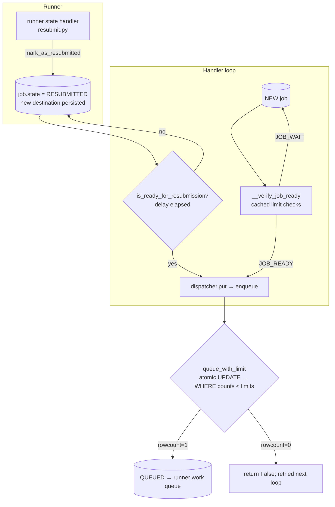
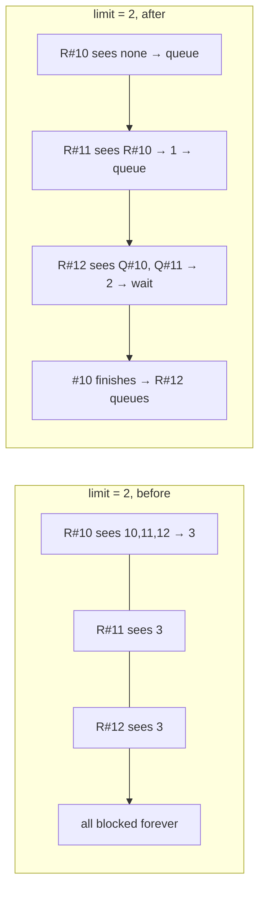

# learning_galaxy review — galaxy#24257

- Profile: [learning_galaxy](https://github.com/jmchilton/galaxy-brain/blob/main/vault/agents/_shared/reviewers/learning_galaxy.md)
- Model: Claude Opus 5.5 (`claude-opus-5-5`), medium effort
- Reviewed commit: `d48fe03e0e7` (base `release_25.1`, merge-base `6cc95b16284`)

The diff is small (one `or_` filter added to five count subqueries), but it exposes how Galaxy enforces job concurrency limits in two layers and how resubmission fits into them. That's why it's worth studying.

## Before the change: two layers of limit enforcement

Galaxy checks `job_conf` limits (`registered_user_concurrent_jobs`, `anonymous_user_concurrent_jobs`, `destination_user_concurrent_jobs`, `destination_total_concurrent_jobs` including tag-keyed totals) in two places:

1. **Handler pre-check (soft, cached).** `JobHandlerQueue.__monitor_step` (`lib/galaxy/jobs/handler.py`) runs `__verify_job_ready` → `__check_destination_jobs` / `__check_user_jobs` against per-iteration count caches (`__cache_user_job_count` and related). Over limit → `JOB_WAIT`, try again next loop. `increase_running_job_count` bumps the cache so one loop iteration can't overshoot.
2. **DB guard at enqueue (hard, atomic).** Since #19824 (commit `e84e715693d`, "Guard state update with limit queries"), `MinimalJobWrapper.queue_with_limit` (`lib/galaxy/jobs/__init__.py`) does the state transition to `QUEUED` as a single `UPDATE job SET state='queued' … WHERE id=:id AND (count subquery) < limit AND …`. If `rowcount == 0`, the limit was hit and `enqueue()` returns False. The runner's `put()` then does nothing, and the job is picked up again on a later handler loop. This closes the multi-handler race where two handlers' caches both said "room for one more".

Resubmitted jobs skip layer 1 entirely: the handler fetches `state == RESUBMITTED AND handler == me` first and calls `dispatcher.put()` directly once `is_ready_for_resubmission` (the `__resubmit_delay_seconds` check) passes. Before #19824 that meant resubmissions ignored limits. After #19824, layer 2 became their only gate. Layer 2 counts `QUEUED`, `RUNNING` **and `RESUBMITTED`**, and a resubmitted job is still `RESUBMITTED` when it hits the guard.

## The bug and the change

Each count subquery in `queue_with_limit` included the job being queued. New jobs are `NEW`, so they never counted themselves. A resubmitted job did count itself, plus every other resubmitted job. With limit *L* and at least *L* resubmitted jobs in one scope, every count came back ≥ *L* and no update ever succeeded. That's a permanent livelock, and the handler pre-check that might have shown the problem never runs for resubmissions (#22974).

The PR adds one predicate, `other_jobs`, to every count subquery:

- Job being queued is **not** resubmitted → `id != job.id`. This changes nothing in practice, since new jobs aren't in a counted state. It does make "a job never counts itself" a rule of the guard.
- Job being queued **is** resubmitted → `state != RESUBMITTED OR id < job.id`. The job counts every queued or running job, plus only the resubmitted jobs older than itself.

The rule that results: **resubmitted jobs drain in id order, and a resubmitted job is admitted against the jobs already admitted plus the older resubmissions ahead of it.** New jobs still count all resubmitted jobs. So resubmissions keep reserving their slots against fresh work, which the handler comment "Check resubmit jobs first so that limits of new jobs will still be enforced" already intended.

## Interesting choices worth noticing

- **Id as the tiebreaker matches the handler's dispatch order.** The handler's resubmit query is `order_by(Job.id)`, and the guard admits by `id <`, so within one handler loop the first jobs tried are the ones the guard admits. Ordering by id is a cheap total order with no new column or timestamp, and the same total order means two resubmitted jobs can't each wait on the other.
- **Head-of-line blocking is an accepted trade-off, documented inline.** A lower-id resubmitted job that isn't ready (still in its `__resubmit_delay_seconds` window, or owned by a handler that's down) still counts against higher-id resubmissions. Under destination-total or tag limits this crosses users. The alternative, letting the guard skip resubmissions that aren't ready, would need the delay logic in SQL. The comment states this limitation honestly instead of hiding it.
- **One predicate covers every scope.** Rather than special-casing the user, destination-user, anonymous, destination-total and tag counts, the same `other_jobs` clause is added to each `and_(…)`. The five count subqueries remain near-copies of each other, and of the handler's `__check_*` queries (the `TODO: … refactored to minimize duplication` in `__verify_job_ready` still applies). A shared "count active jobs in scope" helper would have made this a one-line change.
- **The two layers still don't count resubmitted jobs the same way.** `JobHandlerQueue.get_user_job_count_per_destination` counts only `QUEUED`/`RUNNING`, while `get_user_job_count` and the guard also count `RESUBMITTED`. That inconsistency predates this PR and the PR leaves it alone. It's a reminder that the soft layer and the hard layer can disagree, and only the hard layer is authoritative.
- **The tests now exercise the guard properly.** The old "at limit" assertions re-queued the *same* job, which only failed because the job counted itself. That's exactly the behavior this PR removes, so the tests were rewritten to queue a second job. The new parametrized test covers all five limit scopes, and `test_more_resubmitted_jobs_than_destination_user_limit` shows the drain-in-order property, including the slot freeing up.
- **Transaction note (unchanged but adjacent).** On success, `queue_with_limit` deliberately does not commit: the row lock from the `UPDATE` is held until `enqueue()` commits after `update_output_states`, so a concurrent delete can't slip in between. Anyone changing the guard should keep that in mind.

## Vault research

No galaxy-brain research note covers job handlers, `job_conf` concurrency limits, or resubmission. Existing notes only mention the `resubmitted` state for UI display (`Component - Invocation Graph View`), and nothing there conflicts with this PR. No follow-up issue file was written: no research is stale, and a narrow bug fix doesn't meet the "introduces or substantially reshapes an area" bar for proposing new research.
