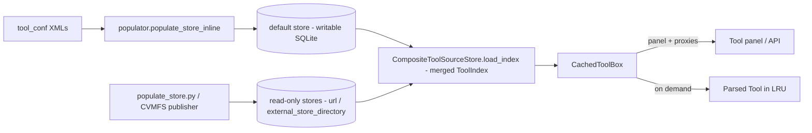
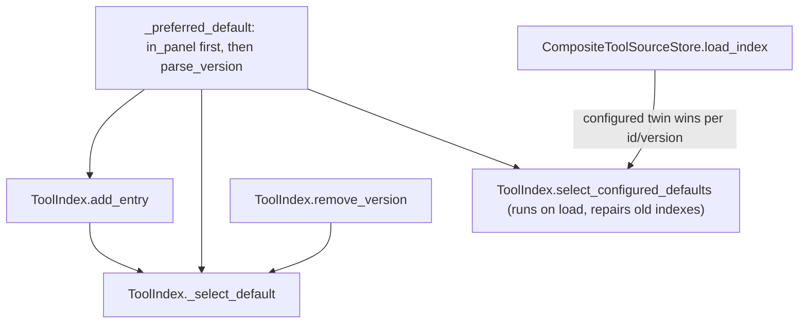
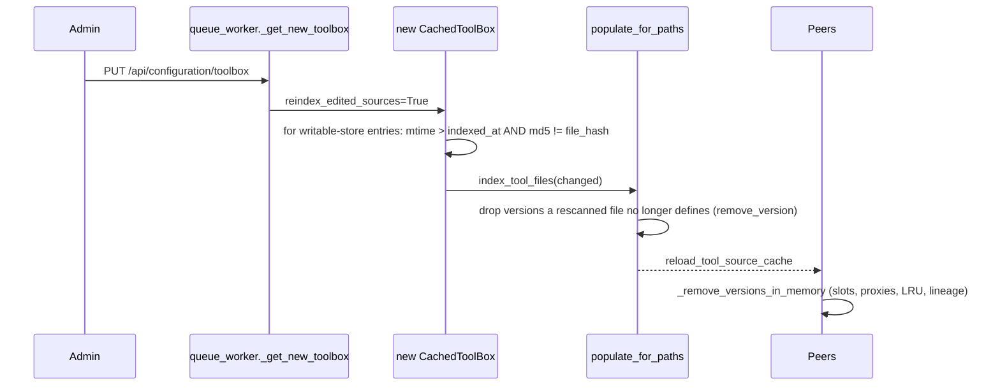
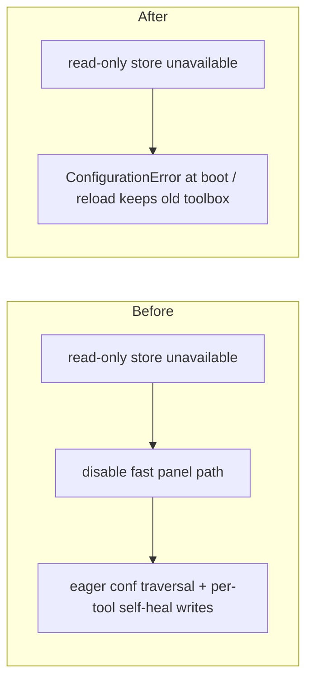

# Learning Galaxy — galaxy#24279

- Profile: [learning_galaxy](https://github.com/jmchilton/galaxy-brain/blob/main/vault/agents/_shared/reviewers/learning_galaxy.md)
- Model: Opus 5.5, medium effort
- Reviewed commit: `890d6f7ab98` (base `release_26.2`)

This is a bug-fix PR, but it changes cross-cutting semantics of the cached toolbox's
index: which version is the default (precedence), how composite stores merge entries,
and what happens when a read-only store has no index. Those rules shape every lookup,
so the PR counts as architecturally interesting.

## Before: how the cached toolbox works

With `use_cached_toolbox: true`, `CachedToolBox` (`lib/galaxy/tools/cached_toolbox.py`)
does not parse every tool at boot. It builds the panel from a persisted `ToolIndex`
(`lib/galaxy/tools/source_store/index.py`) kept in one or more `ToolSourceStore`s.
It registers lightweight proxies (`_cached_tool_for_entry`) and parses a real `Tool`
only on demand, keeping parsed tools in an LRU.

What helps to know before reading the diff:

- **Two maps in `ToolIndex`.** `entries[id]` is the default version of each id.
  `entries_by_version[id][version]` holds every indexed version. `get(id, version)`
  resolves through them. Each entry has `in_panel`: true when a tool conf declares
  it, false for "storage-only" files (bundled versions no conf names, found by
  directory scans).
- **Default selection was "newest wins."** `add_entry` replaced the default whenever
  `parse_version(new) >= parse_version(old)`, with no regard to `in_panel`.
- **Freshness.** `_index_needs_population` trusts a freshness token (conf contents
  plus tool *directory* mtimes, see `source_store/freshness.py`). It skips the conf
  walk when every member says it is fresh. Read-only members always count as fresh
  when their index loads.
- **Read-only stores.** A missing `external_store_directory` cohort becomes an
  `UnavailableToolSourceStore`. Before this PR it disabled the index-only panel fast
  path. Galaxy then fell back to the eager `ToolBox._init_tools_from_configs`
  traversal, where each index miss self-healed one tool at a time.
- **Multi-process coherence.** After any store write, a `reload_tool_source_cache`
  control message makes peer processes reload the index. `CachedToolBox` then
  reconciles registries, proxies, LRU and lineages against the new index.
- **Reload.** `PUT /api/configuration/toolbox` → `queue_worker._get_new_toolbox`
  builds a fresh `CachedToolBox`.

## What this PR changes

### 1. "Configured beats newest" is now the index's precedence rule

A single comparator, `_preferred_default(entry, other)` in `index.py`, ranks by
`in_panel` first and then by version. Everything that picks a default uses it:

There is also a new *view* layer on the index:

- `configured_versions(id)` returns only the `in_panel` versions when any exist,
  otherwise every version. Converters and data managers have no configured version,
  so they still offer everything.
- `get_configured(id, version)` is `get` limited to that view.

`CachedToolBox.get_tool`, `has_tool`, the lineage map (`_index_versions_for`) and the
version registry built in `_materialize_for_cached_tool` now read through this view.
Storage-only versions stay in the index and can be reached by path, but the toolbox
no longer offers them. That matches the eager toolbox, which only ever loads
configured versions.

The `supersede` flag on `add_entry` splits writes into two kinds. A full scan's
storage-only twin does not displace a configured slot. A rescan or runtime write
(`sqlalchemy.write_entries`, partial populate) is treated as the newer truth and
always replaces it.

### 2. Reload re-indexes in-place edits to local tools

- This runs only on reload, not at startup. It runs only when the index did not
  already need a full populate.
- The partial populate now works out the "superseded" `(id, version)` keys. Those
  are versions a rescanned path used to define but no longer does, as after an
  in-place version bump. It removes them, keeping placements when the id survives.
- Peer processes compare the old and new `entries_by_version` and drop removed
  versions from every in-memory projection. Before this PR, reconciliation only
  added, updated, or removed whole ids.
- One known gap, documented in the code: an edit that touches only an imported
  macro file does not change the tool file's hash, so it is not detected.

### 3. A read-only store with no index is now a configuration error

`_require_read_only_store_indexes` runs first in the cached init. If the composite
store reports any `unavailable_read_only_member_names`, the toolbox raises
`ConfigurationError` instead of falling back to eager parsing. Galaxy will not boot,
and a reload keeps the old toolbox. The eager fallback branch in
`_init_tools_from_index` is gone. Log messages, `UnavailableToolSourceStore` docs,
the config schema and the admin docs all now describe "refuse" rather than "parse
eagerly."

The populator follows the same contract. It skips confs routed to unavailable
stores, and it enumerates converters whenever the default store is written, so
`--target __default__` no longer drops them.

## Interesting choices

- **Fix old indexes on load without invalidating them.** `select_configured_defaults`
  runs in the `ToolIndex` model validator and in the composite merge. Already
  published indexes, CVMFS bundles included, get the new precedence without a
  schema-hash bump that would make every published cohort incompatible.
- **One comparator.** `_preferred_default` replaces the inline try/except version
  comparison. Its `replace_equal` flag captures the one difference between "should
  this write replace the default" (ties go to the newcomer) and "which existing
  version is best" (strictly better only).
- **The view is not a filter on storage.** `configured_versions` falls back to all
  versions when none is configured. This one rule keeps converters and data managers
  working without special cases.
- **Cheap edit detection.** `_reindex_edited_tool_files` follows the eager
  `ToolCache` approach: stat first, hash only files newer than `indexed_at`, then
  compare against the stored `file_hash`. Nothing is parsed until a real change is
  found. It then re-reads the index from the store whether or not this process
  wrote, because a peer may have won the race.
- **Proxies can move between versions.** `_remove_versions_in_memory` re-registers a
  proxy under its live version when the default-entry refresh has already moved it.
  The panel keeps holding the same object.
- **Failing loudly is a capacity decision.** The docstring argues that parsing a
  read-only store's tools eagerly would hold eager-toolbox memory in a deployment
  sized for cached mode. That makes a missing bundle a configuration error, not a
  case to degrade gracefully.
- **Small consolidation.** `_member_stores()` replaces the duplicated "composite
  members or `[("__default__", store)]`" expression.
