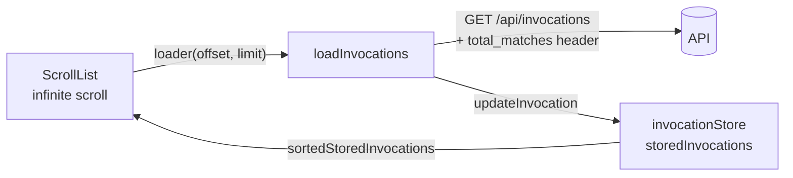
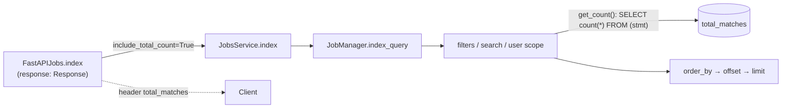
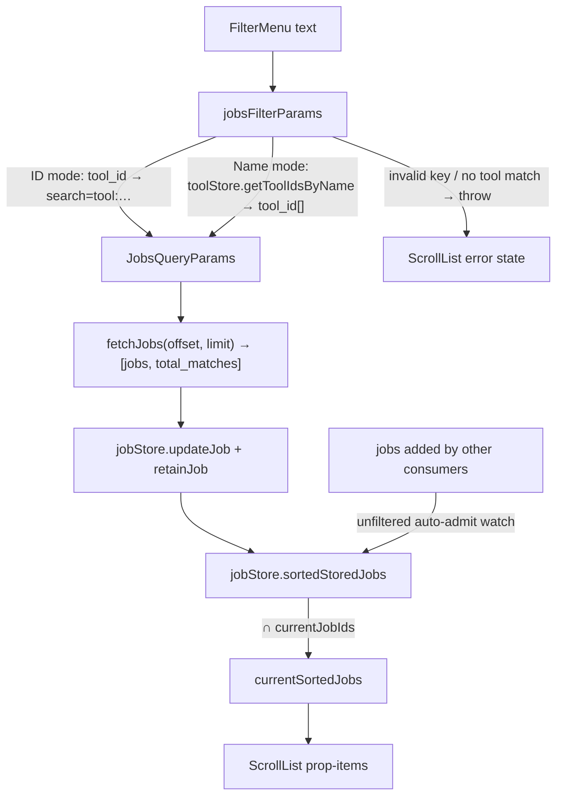

# Learning Galaxy: PR #24288 (Add jobs panel to activity bar)

Profile: [learning_galaxy](https://github.com/jmchilton/galaxy-brain/blob/main/vault/agents/_shared/reviewers/learning_galaxy.md) · Model: Opus 5.5 · Effort: medium · Reviewed commit: `f3fd25889b4` (diff base `0de6cc2d7fe`)

Verdict: architecturally interesting, modestly. Mostly the new panel reuses existing pieces: the activity-bar registry, `ScrollList`, the `Filtering` DSL, and the `total_matches` header convention. It also changes three shared things: `/api/jobs` now reports a count, `Filtering` handles `_eq` keys differently for every consumer, and `jobStore` goes from a per-job cache to a list cache.

## Before the PR

### Activity panels follow one recipe

A sidebar panel is an entry in `defaultActivities` (`client/src/stores/activitySetup.ts`) with `panel: true`, plus a `v-else-if="isActiveSideBar('<id>')"` branch in `ActivityBar.vue`. The closest existing panel is **Invocations**: `InvocationsPanel` → `InvocationScrollList` → `ScrollList`.

`ScrollList` does not own its items. The loader writes fetched pages into a Pinia store. The list renders a sorted computed from that store through `prop-items` / `prop-total-count`, so updates from elsewhere in the app, such as polling, show up in the list without a refetch.

### `jobStore` was a per-job cache with LRU eviction

Unlike `invocationStore`, `jobStore` (`client/src/stores/jobStore.ts`) caps its size: `MAX_CACHED_JOBS = 40`.

- `lruOrder` is a `Map` used as an LRU. Re-`set`ting a key moves it to the end.
- `evictIfOverCap` skips any job that has consumers (`retainJob` refcounts), an active poll, or an in-flight request.
- Consumers were single-job views (job info, tool-run success, polling). Nothing listed jobs from the store.

### `/api/jobs` index had no count

The path is `FastAPIJobs.index` → `JobsService.index` → `JobManager.index_query`, which returned a bare `ScalarResult`. Other list endpoints (datasets, histories, archived histories, invocations, bulk history-contents ops) already put a `total_matches` response header next to their body.

### `Filtering` and `_eq` siblings

`client/src/utils/filtering.ts` parses `key:value` text. With `quoteStrings`, a quoted value keeps its case and any other value is lowercased. A filter can declare a sibling `${key}_eq` (for example `HistoryFilters`' `name` / `name_eq`), and a quoted `name:'X'` is routed to the `_eq` key for an exact match.

## What the PR changes

### Backend: count before paging

- `index_query` and `JobsService.index` now return `(rows, total | None)`. The FastAPI index is the only caller, and it always asks for the count, so every `GET /api/jobs` now runs one extra `COUNT(*)` subquery, including admin job-list calls.
- The count is taken after filtering and before ordering and paging. This matches the header convention the other list endpoints use. The new module-level `get_count` helper is local to `managers/jobs.py`.

### Client: from filter text to rendered cards

- **`jobStore` becomes a list backend.** It gains `updateJob` (merges a list-row partial into the cache, calls `markUsed`, then evicts) and `sortedStoredJobs`. These mirror `invocationStore.updateInvocation` and `sortedStoredInvocations`. The store is global and keyed by id, so the panel keeps a `currentJobIds` set to narrow the list to the current filter's results. `invocationStore` has no such filter-scoping layer.
- **Retention goes against the cap.** The panel calls `retainJob` on every job it shows and releases them all when the filter changes or the panel unmounts. Without this, pages past the first 40 jobs would be evicted while the user scrolls. The tradeoff: while the panel is open, `MAX_CACHED_JOBS` is a target rather than a limit, and the cache grows with the scrolled list. The store's docstring already allows "mounted consumers… may temporarily exceed it". This is the first consumer that retains an unbounded set.
- **Name search happens on the client.** The backend has no "search by tool name" option, so name mode turns the name into ids with `toolStore.getToolIdsByName` (case-insensitive, substring unless quoted) and sends `tool_id: string[]`. This depends on `toolStore.toolsById` being loaded. `JobPanel` does not call `fetchTools()` itself. It relies on the Tool panel, Command Palette, or similar having loaded tools already. On an empty store, a name query throws "No tools matched".
- **Shared `Filtering` change.** `isEqualsKey` keeps the case of values written directly against a declared `*_eq` key, quoted or not. This applies to every `Filtering` consumer with `_eq` siblings, not just jobs: `HistoryFilters`' `name_eq:Foo` now keeps its case too. Keys whose handler only happens to use `equals()` (such as `state`) are still lowercased.
- **Invalid filters are now errors.** By default `Filtering` silently drops unknown keys. `jobsFilterParams` re-parses the raw text with `getValidFilters` and throws on invalid keys, so `xx:ss` shows an error rather than the unfiltered list. The `ScrollList` retry message was reworded for this ("Clear your search or…").
- **The panel can be hidden.** The `jobs` activity is registered with `optional: true`.
- A per-user local-storage preference `showToolNamesInJobPanel` lives in `userStore` and controls both card titles and the search mode. The unused `hasSeenUploadHelp` ref was removed alongside it; it had no readers at the base commit.

## Choices worth noticing

- **`serverOffset` is separate from `ScrollList`'s offset.** Upload jobs (`__DATA_FETCH__`, `upload1`) are dropped on the client after fetching. `ScrollList` computes its offset from the number of items rendered, which would request the same rows again and never reach `total_matches`. The panel tracks the server offset itself. When a page comes back short, it replaces the API total with the rendered count, so the "N jobs" footer and end-of-list detection stay consistent.
- **The store doubles as an event feed.** With no filter set, a watch on `sortedStoredJobs` adds any job that appears in `jobStore` from another part of the app, such as a tool submission or a job-info page. Jobs from upload tools and other users are skipped (`belongsToAnotherUser` checks `user_id`, then falls back to `user_email`). New jobs therefore show up live without polling `/api/jobs`. The cost is that whether a job is "in the panel" partly depends on which other components have loaded it.
- **Remount instead of reset.** `:key="filterKey"` on `ScrollList` throws the component away when the filter changes, which is simpler than adding a reset API to `ScrollList`.
- **Types come from the OpenAPI schema.** `JobsQueryParams = GalaxyApiPaths["/api/jobs"]["get"]["parameters"]["query"]` derives the query type from the generated schema, so the client filter mapping fails typecheck if backend parameters change.
