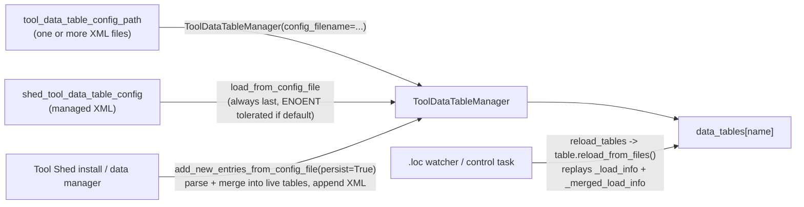
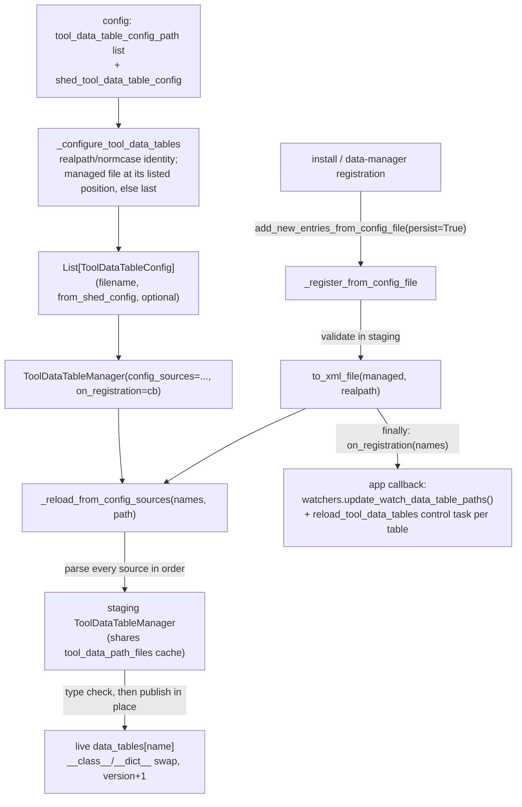

# Learning Galaxy — galaxy#24396

- Profile: [learning_galaxy](https://github.com/jmchilton/galaxy-brain/blob/main/vault/agents/_shared/reviewers/learning_galaxy.md)
- Model: Claude Opus 5.5, low effort
- Reviewed commit: `770965bef62` (diffed against merge-base with `origin/release_26.1`)

Architecturally interesting: yes. It changes cross-cutting precedence and merge rules for tool data tables: which source wins, how rows merge, and how every Galaxy process rebuilds tables after installs, data-manager runs and reloads.

## Before the change

`ToolDataTableManager` (`lib/galaxy/tool_util/data/__init__.py`) holds one `ToolDataTable` per table name. It's built from XML configs, and each `<table>` points at `.loc` files (or a Refgenie config). When two XML files define the same table name, the later one is **merged** into the first one with `merge_tool_data_table`.

Things worth knowing about the baseline:

- **Load order was hard-wired.** `MinimalGalaxyApplication._configure_tool_data_tables` loaded `tool_data_table_config_path` and then always loaded the managed shed file after it. Admins couldn't put Tool Shed data ahead of or behind a read-only mount such as IDC/CVMFS.
- **Each table rebuilds itself on reload.** `ToolDataTable.reload_from_files()` replays the table's own `_load_info` and then its `_merged_load_info` in the order they were *merged at runtime*. After an install merged new XML into a live table, that order could differ from the startup order, so peer processes and restarts could disagree about which row came first.
- **Lookups use the first match.** `TabularToolDataTable.get_field` and dynamic options resolve a `value` to the first matching row, so row order decides which reference wins.
- **On `release_26.1`, merges dedupe by value.** Commit `5f105497ad1` made `merge_tool_data_table` drop any incoming row whose `value` was already known. That collapsed distinct rows that share a `value` but differ in another column (e.g. snpEff `version`) before tool `<filter>`s could choose between them.
- **The watcher re-registration was broken.** `ConfigWatchers.update_watch_data_table_paths()` called `watch_directory(path)` without the callback or `.loc` filter that `start()` uses. Directories added later were watched, but changes in them triggered no reload.

## What the PR changes

The core idea is that the manager now owns an ordered list of **config sources**, and every rebuild re-reads all of them in that order. Tables no longer patch themselves incrementally.

- **Admins control the order.** `tool_data_table_config_path` can now list the managed shed file anywhere. Its position is honored once, with symlinks and aliases collapsed by `realpath`. If the file isn't listed, it's read last, as before. A missing *default* managed file is `optional`, so it keeps its slot when created later. A missing file that was explicitly configured is an error.
- **One rebuild path.** Startup, `reload_tables()` and persistent registrations all go through `_reload_from_config_sources`. Install-time XML is written to disk first, then all sources are re-read, so the in-memory order always matches the startup order. The old incremental `reload_from_files` replay only runs for managers built without sources: the legacy `config_filename` mode used by `tool_util` consumers, the Tool Shed webapp and unit mocks.
- **Merge semantics revert to complete-row dedupe.** `merge_tool_data_table` hands all incoming rows to `add_entries`, which skips only identical rows. Rows that share a `value` stay, tool filters run on them, and first-match lookup gives precedence to the earlier source. Source order, not value dedupe, is now the precedence mechanism.
- **Cross-process consistency.** `tool_util` has no queue worker, so the app passes an `on_registration` callback. After a registration, the callback refreshes watchers and broadcasts `reload_tool_data_tables` (one per table) to peer processes. The queue-worker handler also refreshes watchers after any reload. Watched directories now include the dirs of every non-transient `.loc` file currently loaded, not just `tool_data_path`/`shed_tool_data_path`.
- **Refgenie/tabular mixing** (second commit). The type check accepts any pair of `TabularToolDataTable` subclasses. On publish, `existing.__class__` is reassigned, so an earlier tabular source can replace a Refgenie table (or the reverse) the way startup would.

## Clever or notable choices

- **Staging manager, then publish.** `_new_staging_manager()` builds a throwaway `ToolDataTableManager` that shares the live `ToolDataPathFiles` cache. Registration and reload build everything there first, so a parse, column or type error leaves both the live tables and the managed XML untouched. It's a small two-phase commit with no new class.
- **Identity-preserving swap.** Tools and dynamic options hold references to `ToolDataTable` objects. Instead of replacing the dict entry, publish copies the rebuilt object's `__dict__` (and `__class__`) onto the existing object and bumps `_loaded_content_version`. Every held reference sees the new data and a new version, so version-keyed caches invalidate. The cost is that any state that lives outside `__dict__` (slots, caches keyed by `id()`) is silently replaced, and type safety depends on the `TabularToolDataTable` subclass guard.
- **Fingerprint of definitions.** `_loaded_config_definitions` maps each table name to a list of `(source filename, serialized <table> XML)`. A path-triggered reload compares that list against a fresh parse, so it also picks up tables whose XML definition changed or appeared, even if the triggering `.loc` path doesn't belong to any loaded table yet.
- **Inverted dependency through a callback.** `on_registration` keeps `galaxy.tool_util.data` free of app, queue and watcher imports. The app-level hook wraps the broadcast in `finally`, so peers are notified once the XML is on disk, even if this process's local reload raised.
- **`transient` file info.** `FileNameInfoT` gains `transient: NotRequired[bool]`, set when a `.loc` was fetched from a URL into a temp file. The watcher skips those directories.
- **`to_xml_file` uses `realpath`.** Writes to a symlinked managed file update its target, matching how sources are deduplicated.
- **Two manager modes coexist.** `config_sources is not None` switches `reload_tables` and `add_new_entries_from_config_file(persist=True)` onto the new path. The legacy `config_filename` path is unchanged for other consumers. Future work on data tables needs to keep both modes in mind until the legacy mode is retired.

## Research

No `vault/research/` note covers tool data tables, `.loc` resolution, Refgenie tables, or how data managers and Tool Shed installs register tables, so there are no stale-documentation conflicts and no `learning_galaxy_followup_issue.md` was written. This PR substantially reshapes the area, so one research request was queued:

- `/Users/jxc755/projects/repositories/galaxy-brain/vault/agents/gx_research/todo/tool_data_tables.md`
