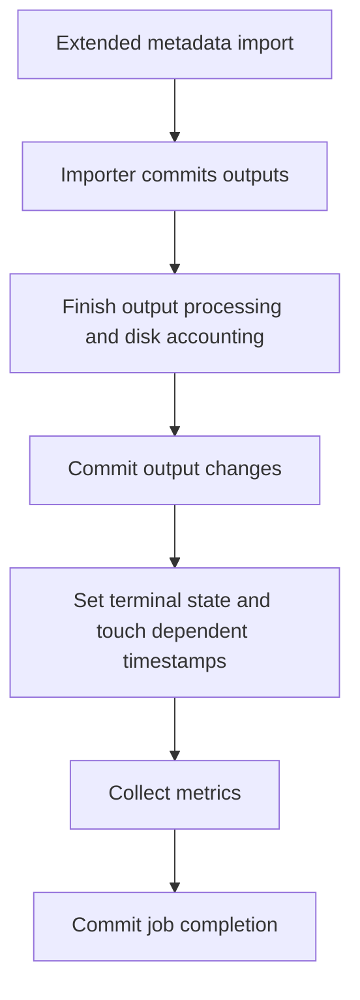
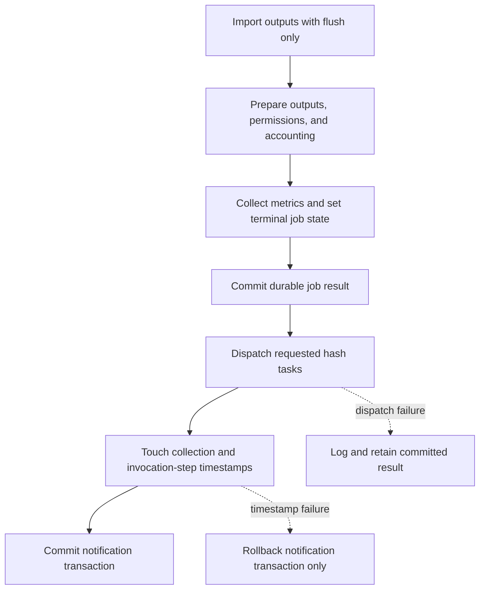

# Learning Galaxy

Profile: `learning_galaxy` · Model: GPT-6 · Effort: medium · Commit: `d7dfb46505d72d1a4d4891e2977781d721d1cd5a`

This is architecturally interesting: it changes the database visibility contract for job completion and separates durable results from notifications and background work.

## Before this change

`MinimalJobWrapper.finish()` coordinates output discovery and extended-metadata import, output processing and permissions, disk accounting, metrics, and the final job state. History readers, workflow scheduling, and Celery workers observe its database writes from other processes.

The baseline has multiple commit boundaries. Model-store import can commit output changes internally; finish commits output preparation before setting the terminal job state. `Job.set_final_state()` couples that transition to collection and workflow-step timestamp updates. Metrics are collected in the later transaction. An observer can therefore see completed datasets while the job remains running.

The importer branch applies only to extended metadata. Hash tasks could also be dispatched before the output commit, allowing a worker to query before newly discovered datasets became visible.

## What changes

The finish path owns the import transaction through `commit=False`. The model store still flushes to obtain database identities, but its `_flush()` helper leaves commit responsibility to the caller. Other import callers retain the default committing behavior.

Outputs, accounting, metrics, and terminal job state reach the final commit together in the ordinary finish path. Hash requests are assembled beforehand and dispatched afterward. Collection and invocation-step timestamp updates occur in a separate short transaction after completion is durable.

Mapped jobs share an invocation-step row. Keeping its timestamp writes outside the transaction that updates the user's disk usage avoids holding both shared rows together during completion. Timestamps help wake the workflow scheduler; they are not the job result itself. The scheduler also checks tracked dependencies against job states and has a periodic scheduling fallback (`workflow/scheduling_manager.py`).

## Choices worth learning from

- `Job.touch_dependent_update_times()` gives callers independent control over state persistence and scheduler notification. Existing `set_final_state()` callers keep the combined behavior; finish uses `set_state()` and calls the new method after committing.
- Flushing and committing solve different problems: the importer can obtain IDs for discovered HDAs without making outputs visible to another transaction.
- Background work must consume committed inputs. Capturing hash requests first and dispatching after commit makes that ordering explicit. Dispatch failures are logged; this is best-effort submission, with no durable retry/outbox introduced here.
- Timestamp failures cannot roll back the completed result because they occur after its commit. Tests cover this separation, state/metric ordering, and extended-metadata import in `test/unit/app/jobs/test_job_wrapper_finish.py`. They record session commit events, rather than exercising concurrent database observers.

## Research coverage

Read `Component - Collection Models.md`, `Component - Collection Tool Execution Semantics.md`, and the completion integration in `Component - Post Job Actions.md`. They cover adjacent models and hooks but do not describe this transaction sequence. No conflicting baseline claim was identified; missing lifecycle coverage is a research gap.

Research request: `vault/agents/gx_research/todo/job_completion_lifecycle.md`.
