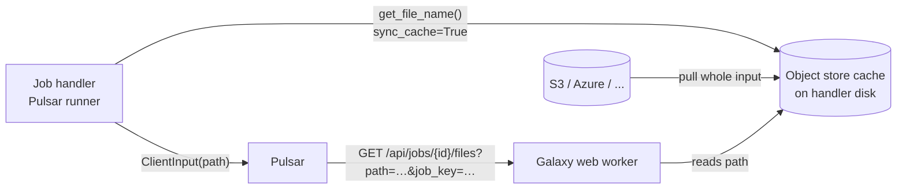
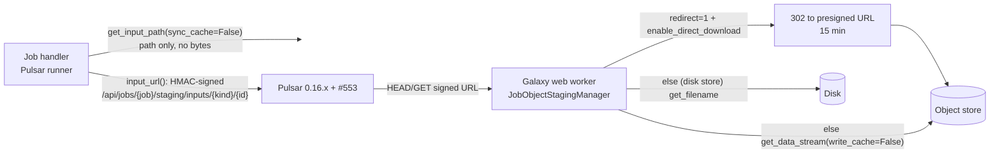
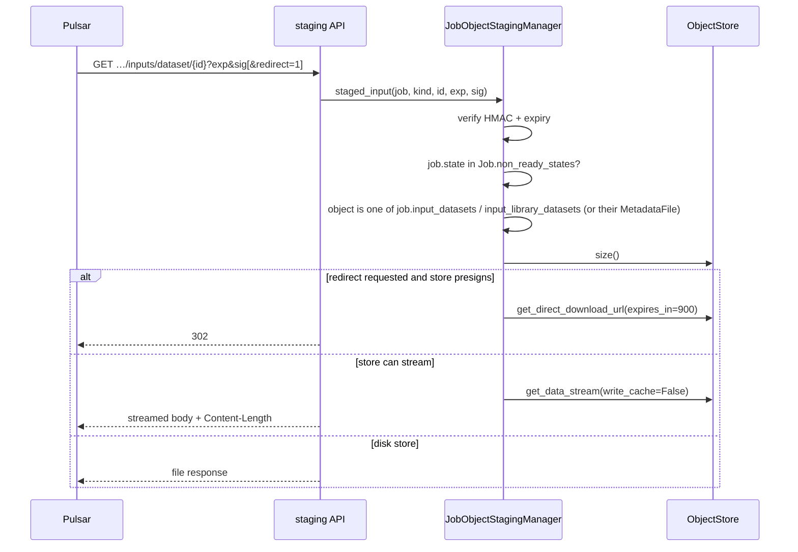

# Learning Galaxy — #24484

- Profile: [learning_galaxy](https://github.com/jmchilton/galaxy-brain/blob/main/vault/agents/_shared/reviewers/learning_galaxy.md)
- Model: Opus 5.5, medium effort
- Reviewed commit: `baeca0d7dc6ce8144de0ca0d95e6b5abb93a9ac4` (merge-base `557e7f327839`)
- Companion: galaxyproject/pulsar#553 (`ClientInput(url=...)`, `handle_transfer_manifest`)

Architecturally interesting: a new manager (`JobObjectStagingManager`), a new internal API, a new signed-URL primitive (`StagingUrlSigner`), and a widened object store contract (`get_data_stream` / `get_direct_download_url`).

## Before: how Pulsar gets job inputs

With `remote_transfer` and `rewrite_parameters`, the Pulsar runner builds a `ClientInputs` list of paths on the handler's disk. Pulsar then pulls each one through the **job files API** (`GET /api/jobs/{id}/files?job_key=…&path=…`, `api/job_files.py` → `JobFilesManager.readable_path`). That API is path-based: it authorizes with a per-job `job_key` (`encode_id(job_id, kind="jobs_files")`) and serves whatever path is on the answering web worker's disk.

Consequences a Galaxy developer should know:

- Preparing a Pulsar job against an object store **materializes every input into the handler's cache** just so its path exists — the bytes cross the network twice.
- The web worker answering Pulsar must **see the same disk as the handler** (NFS in practice), because a path is the only identity on the wire.
- `job_key` is broad: it authorizes reads/writes of any job-files path for that job (narrowed by #22781, still open).
- The object store already had a non-cache read path for user downloads (#22895): `get_data_stream` (stream straight from the backend, optionally teeing into the cache) and `get_direct_download_url` (presigned URL, gated by `enable_direct_download`). Those were addressed only by the object itself — no `extra_dir`/`alt_name`, so metadata files were unreachable — and presign lifetimes were hard-coded per backend (1h S3-boto3/Azure, 24h boto2/cloud).

## After: inputs addressed by identity

A new opt-in destination param `object_store_staging: stream | redirect` switches inputs (datasets and input metadata files) from path-based to **identity-based** URLs. Everything else (outputs, extra files, tool files, `.loc`) still uses the job files API.

Request path in the manager (`managers/job_object_staging.py`):

Architectural shifts worth internalizing:

1. **Identity, not path, on the wire.** The handler only computes the (cache) path to tell Pulsar what name to rewrite on the command line; it never fetches the bytes (`JobIO.get_input_path(..., sync_cache=False)`, threaded down from `PulsarComputeEnvironment.input_path_rewrite`). Shared disk between handler and web worker stops being a requirement for inputs.
2. **A second, narrower job credential.** `StagingUrlSigner` (`security/staging_signer.py`) is a capability-URL primitive: HMAC-SHA256 over `job|kind|object|path|expires`, keyed by an HMAC of `id_secret` with a purpose label. Unlike `job_key` (a reversible id encoding, path-agnostic), each URL authorizes exactly one object of one job, and is additionally revoked by job state. The unused `path` slot is reserved for signing path-based job files later (per the PR description).
3. **Object store contract widened, not forked.** `get_data_stream` gains `write_cache` and the `extra_dir`/`extra_dir_at_root`/`alt_name` addressing triple; `get_direct_download_url` gains the same triple plus `expires_in`. Every backend's `_get_object_url` now honors `expires_in`, keeping its old default for user downloads. `NestedObjectStore` passes kwargs through, so distributed/hierarchical stores work unchanged.
4. **`MetadataFile.object_store_path_kwargs()`** extracts the "where does this metadata file live in its dataset's store" rule out of `get_file_name`, so the same addressing feeds `size`, `get_data_stream`, `get_direct_download_url` and `get_filename`. This is the reusable piece other metadata-file code paths can adopt.
5. **Runner input assembly refactored** into `PulsarJobRunner._client_inputs`, and Pulsar's `ClientInput` grows `url` (and `extra_files` for the stacked follow-up). Pulsar's `FileActionMapper` uses a source `url` in place of `files_endpoint` only for remote-transfer actions; other actions still read `path`.

## Clever or notable choices

- **Retry/resume goes back through Galaxy.** The staging URL is long-lived (7 days, killed early by job state); the presigned redirect is short (15 min). Pulsar retries against the staging URL, so each attempt gets a fresh redirect — Galaxy never hands out a long-lived, unrevokable presigned URL.
- **HEAD never redirects.** Presigned S3 GET URLs reject HEAD, so size is answered by Galaxy directly (`head=True` short-circuits before redirect/stream).
- **`redirect` is deliberately unsigned.** It only changes how the job receives its own input, so a holder flipping it gains nothing.
- **Version gate is on the remote Pulsar, not the client lib.** `MINIMUM_PULSAR_VERSIONS["object_store_staging_redirect"] = 0.15.16` checks the Pulsar server's version (its curl transport follows redirects); older Pulsars silently fall back to stream mode.
- **`write_cache=False`** keeps one-off staging reads from evicting hot cache entries — reused from the #22895 tee-to-cache stream rather than a new read path.
- **Key derivation with a purpose label** (`galaxy-job-staging-v1`) so signatures can never collide with other `id_secret` uses; message is versioned (`v1|…`) too.
- **Metadata file → id recovery.** Tool evaluation only hands the runner a metadata *path*; `_metadata_file_with_path` walks the dataset's `FileParameter` specs to map it back to a `MetadataFile` id. Worth knowing as a seam: the compute-environment rewrite API is path-shaped, and identity has to be reconstructed.
- **Deferred inputs opt out naturally:** materialized deferred datasets have no `dataset_id`, so they get no URL and fall back to path staging.

## Research requests queued

- `vault/agents/gx_research/todo/pulsar_input_staging.md`
- `vault/agents/gx_research/todo/object_store_cache_and_direct_access.md`
