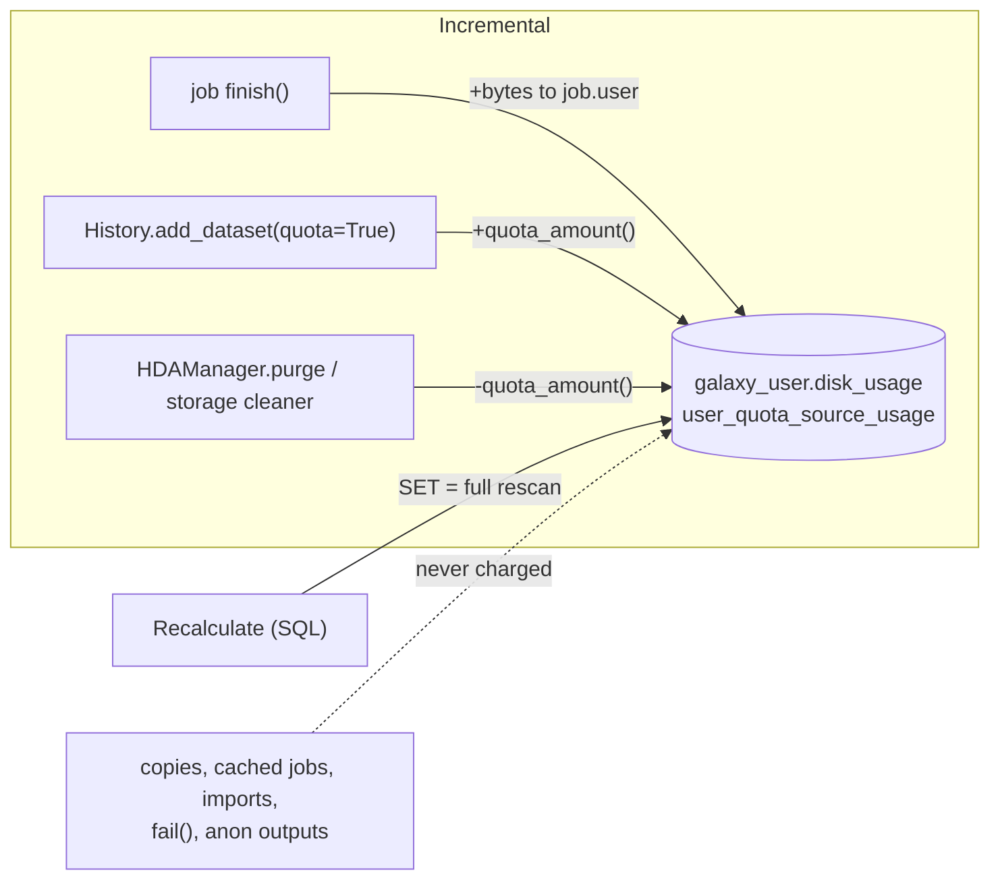
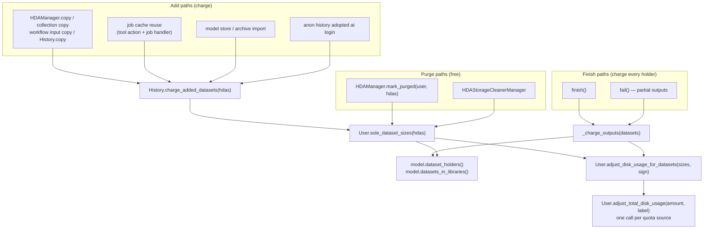
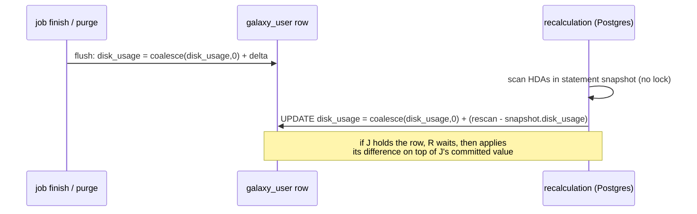

# Learning Galaxy: #24511 user disk usage accounting

- Profile: [learning_galaxy](https://github.com/jmchilton/galaxy-brain/blob/main/vault/agents/_shared/reviewers/learning_galaxy.md)
- Model: Claude Opus 5.5 (`claude-opus-5-5`), effort low
- Reviewed commit: `46102a0d363` (base `release_25.1`)

**Verdict: architecturally interesting.** It's a bug fix, but it changes a cross-cutting rule: who is charged for a dataset and when. It also changes how `User.disk_usage` is written and how a recalculation merges with concurrent writes. Every path that adds an HDA to a history or purges one now uses the new rule.

## Before: two bookkeepers that disagreed

Galaxy tracks per-user disk usage in two ways that are supposed to agree:

- **Incremental.** `galaxy_user.disk_usage` stores the default quota source's usage, and `user_quota_source_usage` stores one row per quota-source label. Code updates them through `User.adjust_total_disk_usage(amount, label)`. Charges came mainly from job `finish()`, which summed the outputs' bytes and charged `job.user`, and from `History.add_dataset(quota=True)`, using `hda.quota_amount(user)`. Purges subtracted `hda.quota_amount(user)`.
- **Recalculation** (`calculate_user_disk_usage_statements`, the Storage Dashboard's "Refresh", `set_user_disk_usage.py`). This is the source of truth. It sums each distinct dataset once across the user's non-purged HDAs in non-purged histories. It skips datasets in libraries and BYOS (`user_objects://`), and it overwrote the stored value.

The PR finds the drift on both sides:

- **Charges were missing.** Copies, cached-job outputs, imports, `fail()` outputs, and outputs of anonymous jobs were never charged.
- **Purges subtracted too much or at the wrong time.** Purges subtracted bytes that were never charged, such as outputs of a running job. They also committed `purged=True` and the usage decrease in separate transactions, so a concurrent recalculation counted the dataset twice.
- **Concurrent writes were lost.** The usage was updated as a Python read-modify-write, and a recalculation overwrote it.

Over time the stored usage fell below the real usage and went negative after purging.

## After: one charging rule, applied on both sides

The new rule is "a dataset counts once per user, only through HDAs that aren't purged, and not if it is in a library". It lives in `User.sole_dataset_sizes(hdas)`. Charging and purging both go through it, and a new constant, `Dataset.uncharged_states`, says when a dataset can't be charged yet.

What a Galaxy developer should take from the new shape:

- **`History.charge_added_datasets(hdas)` is the hook for "HDAs just landed in this history".** Anything that adds HDAs without a job (copy, import, cache reuse, login adoption) should call it. It charges only datasets the user didn't already hold, so copying your own data stays free. **This is a behavior change:** copies of another user's data now count immediately, so quota-limited users can hit their quota on copy.
- **Job outputs are charged to every holder, not to `job.user`.** `finish()` and `fail()` call `dataset_holders()` for all outputs in one query. The anonymous user who started the job, then logged in, gets charged, and so does anyone who copied the output while the job ran. Charging on copy and charging on finish split cleanly on `Dataset.uncharged_states`. Copy charges only datasets that are already final; finish charges the rest.
- **Purge is now two-phase.** `HDAManager.mark_purged()` sets `deleted`/`purged` and decreases usage in **one commit**. `purge()` (file removal, possibly in Celery) comes after. `HistoryManager.purge` calls `mark_purged` for all of the history's HDAs before marking the history purged, because a recalculation skips purged histories.
- **`quota_amount()` is legacy but still alive.** `History.add_dataset(quota=True)` and the optimized branch of `add_datasets(quota=True)` still charge through the per-HDA `quota_amount()`. The optimized branch is cruder: it sums every HDA's `get_total_size()` with no dedup and uses the first dataset's quota source. So the "one rule" isn't the only rule yet. Treat `charge_added_datasets` as the direction of travel, not a completed migration.

### Concurrency model

- **Increment writes, not overwrites.** Default-source adjustments now flush as `disk_usage = coalesce(disk_usage, 0) + delta`, and labeled sources already used upserts. On Postgres, a recalculation now applies `(rescan − snapshot value)` instead of `SET = rescan`. Adjustments committed while it runs are kept, and the scan holds no lock. SQLite still overwrites.
- **Lock ordering.** `_charge_outputs` locks users in ascending id order. A labeled-source adjustment first runs `SELECT … FOR UPDATE` on the `galaxy_user` row, so purges, jobs, and recalculations always lock user before label row.
- **Known gap (from the PR body).** If a copy happens during `finish()`, after the holders were read and before the commit, neither side charges it. A recalculation fixes it.

## Clever or surprising choices

- **`User.disk_usage` can hold a SQL expression.** Until the user is flushed, the mapped attribute is a `ClauseElement` (`func.coalesce(User.disk_usage, 0) + delta`), and later adjustments add to `_pending_disk_usage_delta` so the result is one `UPDATE`. `_has_pending_disk_usage_adjustment` detects this state. `get_disk_usage()` flushes the user before reading, and `dictify_usage*` switched to `get_disk_usage()`. **Gotcha for anyone touching usage code (and for forward merges): don't read `user.disk_usage` directly.**
- **Postgres MVCC does the work in the recalculation's difference-apply.** The scalar subquery `SELECT snapshot.disk_usage …` reads the statement snapshot. Under READ COMMITTED, after waiting on a row lock, the outer `UPDATE` re-reads the row's latest version and evaluates `COALESCE(disk_usage, 0)` against it. So one statement gets "delta computed against the snapshot, applied to the latest value."
- **`dataset_holders()` reads the identity map and `session.new`.** Galaxy sessions don't autoflush, so a plain SQL query wouldn't see unflushed copies or in-session `purged` flips. The helper runs one batched `SELECT (hda.id, dataset_id, history.user_id)` per 1000 datasets. When an HDA is already loaded, it uses the in-session object instead of the row, then adds pending new HDAs. `datasets_in_libraries()` does the same for pending LDDAs. Both are reusable for any "who holds this dataset" question and replace the old `dataset.history_associations` walk, which issued one query per HDA.
- **`Dataset.uncharged_states` is not `non_ready_states`.** It adds `PAUSED` and drops `SETTING_METADATA`, since metadata regeneration runs on datasets that are already charged. This is a new, named distinction worth knowing when reasoning about dataset state.
- **`total_size is None` marks a dataset as uncharged.** `finish()` sets `total_size` and charges in the same transaction. So `fail()` decides what to charge by collecting outputs with `total_size is None` *before* refreshing them.
- **`adjust_total_disk_usage` has three write modes.** If the user isn't persisted yet, it does a plain Python add. With `preserve_update_time`, it runs an immediate `UPDATE` that sets `update_time` explicitly (a flush would trigger `onupdate=now`), then expires `disk_usage` unless an adjustment is pending. Otherwise it records the deferred SQL increment.
- **`Job.output_hdas()`** is a new small helper that flattens plain outputs, output collection elements, and implicit collection elements. Reuse it wherever a job's full output HDA set is needed.

## Research

No galaxy-brain research note covers quota or disk usage accounting, so nothing conflicts. The only adjacent note is `Component - Private Object Stores`, whose Quota section covers BYOS exemption; this PR doesn't change it. No follow-up issue file was written.

Research requests queued or extended:

- `vault/agents/gx_research/todo/user_disk_usage_accounting.md` (new)
- `vault/agents/gx_research/todo/job_completion_lifecycle.md` (added a Requested-by line for `finish()`/`fail()` charging)
