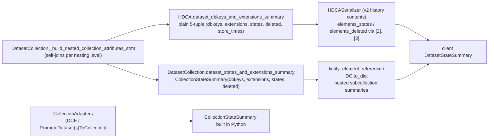
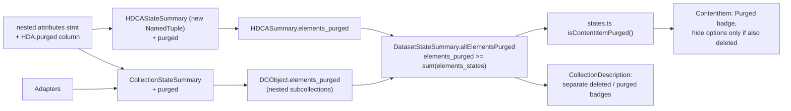

# learning_galaxy — galaxy#24540

- Profile: [learning_galaxy](https://github.com/jmchilton/galaxy-brain/blob/main/vault/agents/_shared/reviewers/learning_galaxy.md)
- Model: Opus 5.5 (claude-opus-5-5), effort medium
- Reviewed commit: `613265a0d2f`

Borderline but in scope: a UI bug fix that changes a shared payload shape (`elements_purged` on `HDCASummary`, `DCObject`, `CollectionStateSummary`) and defines what "purged" means for a collection.

## Before the PR

Collections have no purge state of their own. `HistoryDatasetCollectionAssociation` has `deleted` but no `purged` column; "purge a collection" means purging its leaf HDAs. Any collection-level status is derived from leaf-dataset aggregates, computed in one SQL query over nested collections.

- Two parallel summaries exist: the `DatasetCollection` one (named tuple, also implemented by adapters so tool evaluation can treat adapters as collections) and the HDCA one (positional tuple that adds `store_times`). Consumers indexed the HDCA tuple by position.
- The history panel's "Purged" badge read `item.purged`, which HDCA payloads never carry, so a fully purged collection looked merely deleted.

## What the PR changes

- New API contract: `elements_purged` is a leaf count, and purged elements are *also* counted in `elements_deleted` (documented in the schema). The client subtracts to get "deleted but not purged".
- Collection purge state stays derived, not stored. The client decides "this collection is purged" from counts; no backend `purged` flag on HDCAs.
- The HDCA summary's positional tuple becomes `HDCAStateSummary`, and every consumer (`hdcas.py`, `collections.py`, `to_dict`, unit test) switches to field names. Adding a field mid-tuple would otherwise have silently shifted `[4]` (store_times).
- `isContentItemPurged()` becomes the shared "is this purged" predicate for datasets, HDCAs, and DCEs with subcollections, next to `getContentItemState()`.

## Notable choices

- **Leaf denominator, not `element_count`.** `allElementsPurged` compares against `datasetCount` (sum of `elements_states`), not `element_count`. For nested types `element_count` counts top-level elements, so only the leaf state sum is comparable. The API test pins that purged datasets keep their state, so this sum includes them.
- **Purged but not deleted.** `ContentItem` hides `ContentOptions` only when `isPurged && item.deleted`. If every leaf is purged but the HDCA itself is not deleted, the user can still delete the collection.
- **Deleted vs. purged sources differ.** Adapters count `deleted` as `hda.deleted or dataset.deleted`, but `purged` reads only `hda.purged`. The SQL path reads only HDA columns for both. So the in-memory adapter and SQL paths already disagreed on `deleted`. `purged` is consistent across paths, but it ignores `Dataset.purged`.
- **Session-less fallback types.** `DatasetCollection.elements_deleted` falls back to a *bool* without a session, and the new `elements_purged` fallback returns an *int*. This pre-existing quirk is now visible next to a correct sibling.
- **Badge de-duplication.** The `hideAllPurgedCount` prop lets the host (`ContentItem`) suppress "N purged" when it already shows a "Purged" badge. The component stays reusable where no host badge exists.

## Research requests

None queued. `Component - Collection Models` and `Component - Collection API` cover this area; see `learning_galaxy_followup_issue.md` for the updates they need.
