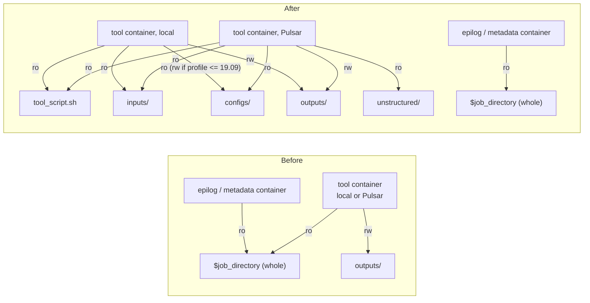
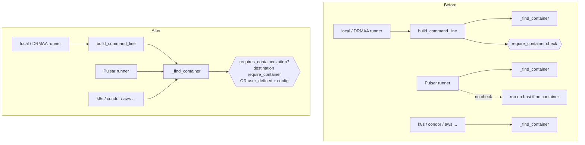

# Learning Galaxy - PR #24561

- Profile: [learning_galaxy](https://github.com/jmchilton/galaxy-brain/blob/main/vault/agents/_shared/reviewers/learning_galaxy.md)
- Model: Opus 5.5 (claude-opus-5-5), effort medium
- Reviewed commit: `e43b2db63a4d96f238d577b0ca0c79c2ed043d3a` (base `release_26.2`)

Architecturally interesting, despite the `kind/bug` label. It changes three cross-cutting things: the `$defaults` volume contract every containerized tool on every runner gets, where `require_container` is enforced (now the shared `_find_container` seam), and precedence (a tool-type policy now beats destination config).

## Before: what to know

### Container volumes come from one place

Every runner that containerizes a tool asks `BaseJobRunner._find_container` (`lib/galaxy/jobs/runners/__init__.py`). It packages a `ToolInfo` (containers, profile, env pass-through) and a `JobInfo` (working/tool/job/tmp/home dirs plus `job_directory_type: "galaxy" | "pulsar"` and `job_type: "tool" | "epilog"`), then calls `ContainerFinder.find_container`. The resulting `DockerContainer` / `SingularityContainer` expands `$defaults` in `docker_volumes` / `singularity_volumes` via `HasDockerLikeVolumes` (`lib/galaxy/tool_util/deps/container_classes.py`). Admins extend it as `$defaults,/extra:ro`.

Before this PR, `$defaults` mounted the whole job directory read-only. Only `outputs` (and `configs` for profile <= 19.09 tools) was writable:

- local: `$galaxy_root:ro,$tool_directory:ro,$job_directory:ro,$job_directory/outputs:rw,$working_directory:rw,...`
- Pulsar: `$job_directory:ro,$tool_directory:ro,$job_directory/outputs:rw,$working_directory:rw`

### The job directory is not just tool I/O

The job directory (`working_directory` on `JobWrapper`; `working` is the tool's cwd beneath it) mixes tool-facing and Galaxy-facing files:

| Path | Who uses it | Runs where |
| --- | --- | --- |
| `tool_script.sh` | the tool command | in container |
| `inputs/`, `configs/`, `outputs/`, `working/` | tool | in container |
| `unstructured/` (Pulsar) | tool (e.g. `.loc`-referenced files) | in container |
| `galaxy_<id>.sh` / `command.sh` | job script wrapping the container invocation | host |
| `metadata/` (`params.json`, `set.py`, extended-mode `object_store_conf.json`) | metadata setting | host or metadata container |
| `launch_config` (Pulsar) | callback endpoints + `job_key` | Pulsar |

Mounting the root handed every tool all of it.

### `require_container` lived in one runner path

`requires_containerization` on `MinimalJobWrapper` read the destination param `require_container`. Only `BaseJobRunner.build_command_line` checked it. Pulsar (and other runners that build their own command line) called `_find_container` directly and never hit the check. The "UDTs must be containerized" guarantee was therefore only a model-level rule (`UserToolSource._require_container` rejects a UDT with no `container:` field). Whether the job actually ran in a container depended on each destination.

## After: what changes

- **Narrowed default mounts.** For `job_type == "tool"`, `$defaults` mounts a file (`tool_script.sh`) plus named subdirectories, never the root. `_job_directory_volumes` / `_job_directory_subdirectories` in `container_classes.py` now own the job-dir part of `$defaults` for both local and Pulsar layouts, replacing two inline string fragments.
- **Epilog containers unchanged.** Prolog/epilog (containerized metadata) still get the whole job dir. They run Galaxy's own code against `metadata/`.
- **Mount sources must exist.** Galaxy now creates `inputs/` and `configs/` with the job dir (`MinimalJobWrapper._setup_working_directory`), not lazily. Pulsar's `unstructured/` is created only when staging happens, so the container command prepends `mkdir -p .../unstructured` for Pulsar tool jobs.
- **Enforcement moved to the shared seam.** The `require_container` check moved from `build_command_line` into `_find_container`, which every container-aware runner calls (local/DRMAA via `build_command_line`, Pulsar, kubernetes, condor, htcondor, aws, gcp_batch, ...).
- **Tool-type policy over destination.** `requires_containerization` returns `True` for `tool_type == "user_defined"` when the new `require_container_for_user_defined_tools` (default `true`) is set, whatever the destination says. The test driver flips it off because its runners have no container engine.

## Clever or interesting choices

- **Single-file bind mount of `tool_script.sh`.** The tool only needs that script from the job root (`command_factory` runs it, Pulsar as `bash ../tool_script.sh` from `working/`), so a file mount avoids exposing siblings. A file bind keeps the inode it saw at mount time, which is fine here because the script is written before the container starts.
- **`job_type` split.** The tool/epilog split already existed on `JobInfo` for metadata containers. The PR reuses it as the trust boundary: Galaxy code gets the job dir, tool code does not.
- **`mkdir -p unstructured` in the container command.** It works around engine differences: Singularity refuses missing bind sources, and Docker creates them root-owned. Galaxy-side dirs are created eagerly in Python. The Pulsar-side dir can only be created in the remote shell script.
- **Legacy writable `configs` is local-only.** Profile <= 19.09 tools that `mv` their config files (#9234) keep `configs:rw` on Galaxy-layout jobs. Pulsar never had that carve-out and still doesn't.
- **Check at lookup, not at command build.** Placing the raise where the container is resolved makes the guarantee runner-agnostic without touching each runner. It is a small example of fixing a policy at the shared seam rather than duplicating it per runner.
- **The option defaults secure, the test driver opts out.** `driver_util.setup_galaxy_config` sets `require_container_for_user_defined_tools=False`, so existing UDT API tests keep running on container-less runners. Integration tests with real Docker/Pulsar destinations exercise the secure default.

## Research requests queued

- `vault/agents/gx_research/todo/tool_containers_volumes_and_enforcement.md`
