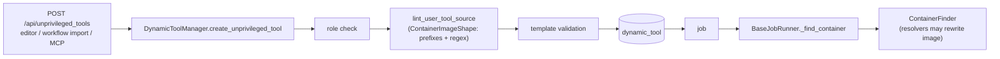
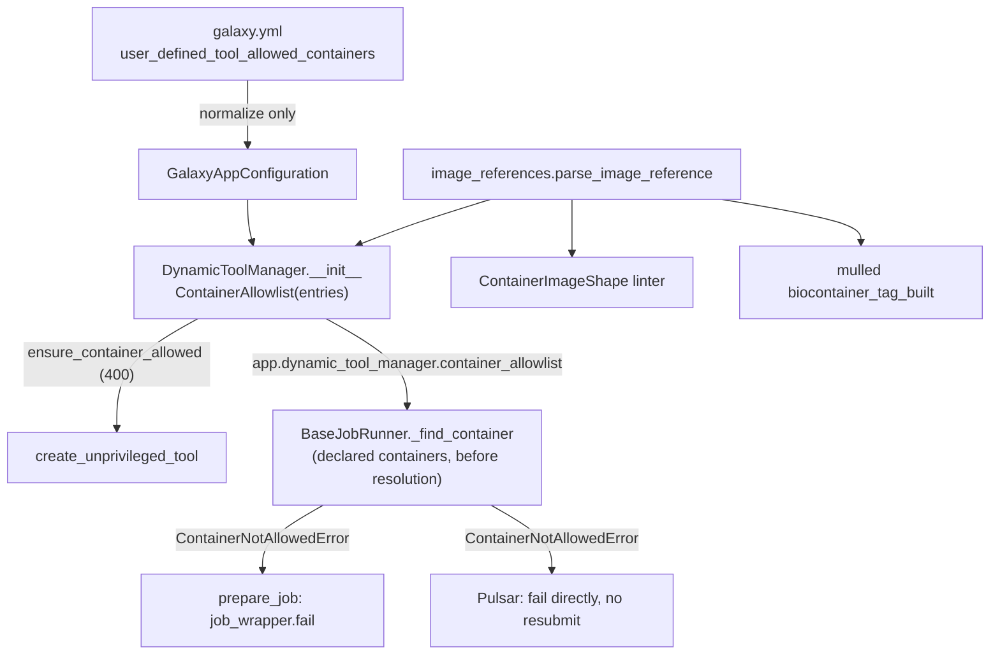

# Learning Galaxy: #24635 (restrict container images for user-defined tools)

- Profile: [learning_galaxy](https://github.com/jmchilton/galaxy-brain/blob/main/vault/agents/gx_reviews/reviewers/learning_galaxy.md)
- Model: Opus 5.5 (`claude-opus-5-5`), effort medium
- Reviewed commit: `64dad7223ea`, a merge of `origin/release_26.2` into PR head `fa12a2252dc`

This PR is architecturally interesting. It adds Galaxy's first canonical container image-reference parser (`galaxy.tool_util.deps.image_references`). It also adds an admin policy that `DynamicToolManager` owns, enforced at two seams: tool creation and the job runners' shared `_find_container`.

## Before: the relevant pieces

- **User-defined tools (UDTs)** are `class: GalaxyUserTool` YAML stored in the DB. `UserToolSource` requires a non-blank `container:` string. Any image string that passed the `ContainerImageShape` linter was accepted.
- **Creation** runs only through `DynamicToolManager.create_unprivileged_tool`. The API, the tool editor, workflow-import copies and the agent/MCP all call it. Its checks run in this order: beta formats enabled, then the `USER_TOOL_EXECUTE` role, then `lint_user_tool_source` (lint warnings count as errors), then template validation. There is no update path. An edit saves a new tool.
- **Job time.** Every runner gets its container from `BaseJobRunner._find_container`. That method builds `ToolInfo` from the tool's *declared* `tool.containers` and asks `ContainerFinder` (the container resolvers) for the actual container. Resolvers may rewrite the image, for example to a CVMFS or cached Singularity path. Pulsar calls `_find_container` itself, on two paths.
- **Image strings were handled ad hoc.** The linter used a prefix tuple (`quay.io/biocontainers/`, `docker://`, `oras://`) plus a Docker-Hub-only regex. `biocontainer_tag_built` used `startswith` plus `rsplit(":")`. Neither understood registry ports or digests.

## After: what changes architecturally

1. **A shared reference model.** `image_references.py` parses a string into a frozen `ImageReference(registry, repository, tag, digest)`, canonicalized the way the Docker CLI does it:
   - a `docker://` prefix is dropped;
   - `python` becomes `docker.io/library/python`;
   - Docker Hub aliases are folded into `docker.io`;
   - the registry host is lowercased.

   It uses the `distribution/reference` grammar. Three consumers use it: the allowlist, `ContainerImageShape`, and `biocontainer_tag_built`. Future code that needs to take an image string apart should start here rather than splitting on `:`.
2. **A policy object.** `ContainerAllowlist(entries)` compiles admin entries (`*`, `ns/*`, `repo`, `repo:tag`, `repo@digest`) into `_Entry` matchers. `allows(identifier)` never raises: an unparseable identifier is simply not allowed.
3. **Ownership and lifecycle.** `DynamicToolManager.__init__` builds the allowlist from config. A bad entry raises `ConfigurationError` and stops startup. The config layer (`GalaxyAppConfiguration`) only normalizes the value: null becomes the schema default, and an env-var string becomes a list. It can't validate entries, because the `galaxy-config` package depends only on `galaxy-util` and can't import `galaxy.tool_util`.
4. **Two enforcement seams with one policy:**
   - *Creation*: `ensure_container_allowed` runs after lint and raises a 400.
   - *Job prep*: `_find_container` checks every declared container of a `tool_type == "user_defined"` tool and raises `ContainerNotAllowedError`. The prepare path in `BaseJobRunner` catches it like other "job rejected" errors and calls `job_wrapper.fail(..., exception=False)`. Pulsar catches it separately and fails directly, without `fail_job`.

What a Galaxy developer should take away:

- **Policy is applied to the declared image, not the resolved one.** The allowlist names what the tool author asked for. Admin resolvers stay free to map it to any local artifact. Anyone adding container policy later should keep this split: the author's input is policed, and the admin's mapping is trusted.
- **Job-time re-checking is the real guarantee.** It covers tools created before the list was tightened and tools referenced from workflows. It also covers `GalaxyUserTool` files an admin loads from disk, which bypass `create_unprivileged_tool`.
- **The job runners now depend on a manager.** `_find_container` reaches through `self.app.dynamic_tool_manager`. Earlier, runner code used `app.container_finder` and config, not managers.
- The PR's own Limits section states the scope: this is an early, clear error, not network isolation.

## Clever or notable choices

- **Matching compares parsed parts, never prefixes.** Because entries and references are compared field by field, `quay.io/biocontainers/*` can't match `quay.io.evil.com/...` or `quay.io/biocontainers-evil/...`. A namespace entry uses `startswith(f"{repo}/")` on the *repository path*, after the registry has matched exactly.
- **A tag entry requires that the reference has no digest.** Runtimes pull the digest of a `name:tag@digest` reference and ignore the tag. A tag entry that matched any digest would therefore allow any image in that repository. A digest entry, in turn, ignores the tag.
- **Namespace parsing takes a special case.** `_split_name(..., namespace=True)` treats a single component that looks like a host (`quay.io/*`) as a whole registry, and doesn't add `library/`. In a plain reference, the same single component would be a Docker Hub repository.
- **Parsing again only on failure.** `ensure_container_allowed` calls `allows()` first, and runs `parse_image_reference` only after a refusal. That second parse tells "malformed" apart from "disallowed", so both errors are precise and the success path does no extra work.
- **No resubmission on Pulsar.** A refusal is deterministic, so the Pulsar runner skips the `fail_job` and resubmission machinery. Resubmitting would only fail again elsewhere.
- **Unchecked schemes.** `oras://` and other non-Docker schemes never match a restricted list. The linter still lets `oras://` through without checking its shape. Shape and policy are now separate concerns.
- **Gotcha (pre-existing):** `app/__init__.py` builds `DynamicToolManager` twice: once directly at `:427`, and again through `_register_singleton` at `:806`. The allowlist is therefore parsed twice at startup. This is harmless, but "parsed once" is only true per instance.

## Research requests

- Extended the existing request [`vault/agents/gx_research/todo/tool_containers_volumes_and_enforcement.md`](../../../../../agents/gx_research/todo/tool_containers_volumes_and_enforcement.md). Its enforcement scope now covers this PR's allowlist and parser, and this review is listed as a requester.
