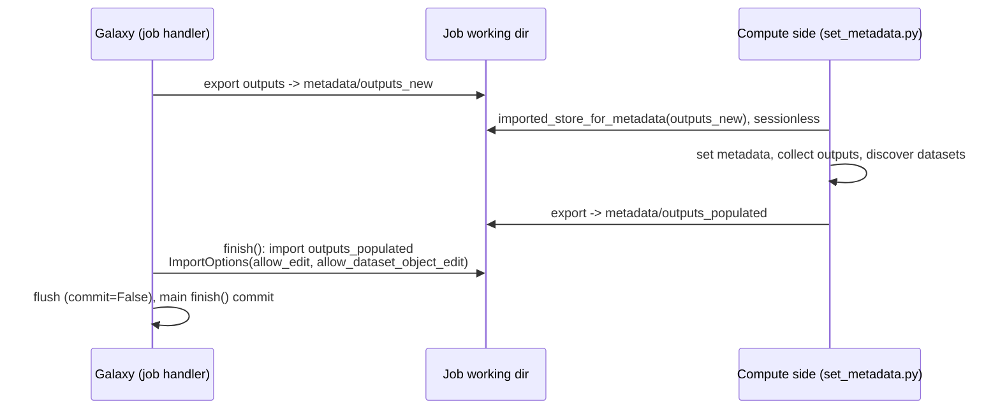
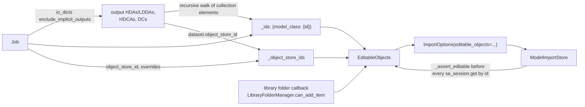
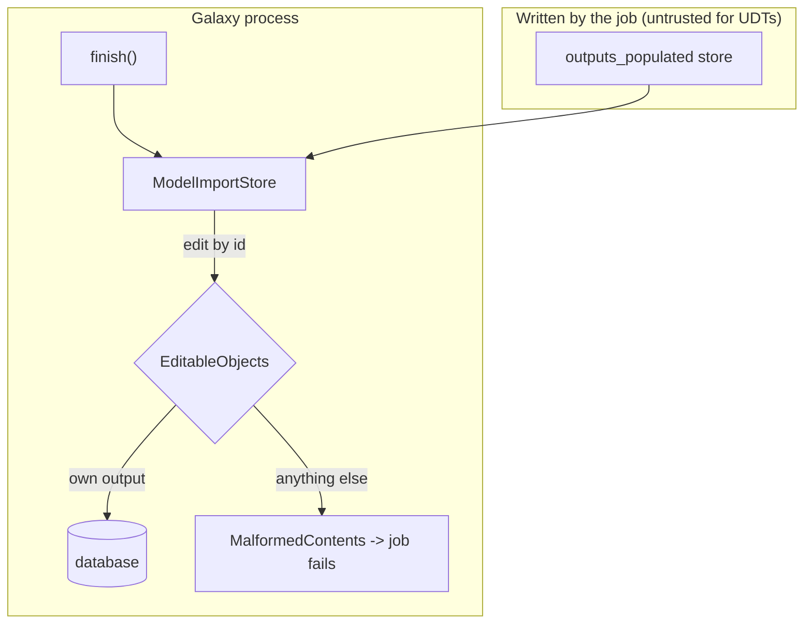

# Learning Galaxy review: #24647

- Profile: [learning_galaxy](https://github.com/jmchilton/galaxy-brain/blob/main/vault/agents/gx_reviews/reviewers/learning_galaxy.md)
- Model: claude-opus-5-5, medium effort
- Reviewed commit: `7247fea9983` (base `release_26.2`)

Architecturally interesting: yes, narrowly. It is a security fix, but it changes the trust contract of model store import. `ImportOptions` gains an allowlist that scopes `allow_edit` to specific objects. Until now, `allow_edit` meant "any existing row named by id."

## Before: what to know

### Extended metadata is a round trip through a model store

With `metadata_strategy: extended`, Galaxy does not set output metadata itself. It exports the job's outputs as a model store, the compute side (`set_metadata.py`, next to the tool, possibly in Pulsar or a container) imports that store sessionlessly, sets metadata, moves files, discovers new outputs, and exports a second store. `MinimalJobWrapper.finish()` then imports that second store into the real database.

### `allow_edit` means "trust the ids in the store"

`ModelImportStore` creates new objects by default. With `allow_edit=True` and a session, an entry carrying an `id` resolves to the existing row with `sa_session.get(model_class, id)` and gets overwritten in place. That applies to dataset instances, `Dataset`, `DatasetCollection`, HDCAs, library folders, and `Job` (whose I/O associations are connected). Metadata files are resolved by `uuid` in `replace_metadata_file`. Dataset attributes such as `external_filename` and `object_store_id` are copied from the store onto the `Dataset`.

User-facing imports (`managers/model_stores.py`) never set `allow_edit`. The only `allow_edit` importers are metadata paths: the in-job sessionless import, which has no database to edit, and `finish()`, which does. So `finish()` was the one place a store written outside Galaxy's process could rewrite arbitrary rows. The baseline for this call site is in [[Component - Job Completion Lifecycle]] (Extended-metadata path).

### Why it matters now: user-defined tools

[[Component - User-Defined Tools]] treats the tool author as potentially adversarial. Its defenses are the sandboxed expression language, mandatory containers, and per-user authorization. None of them covered the model store coming back from the job directory. A job can write `outputs_populated`, so a hostile job can name any database id, so `finish()` would edit it.

## After: what changes

### A per-job allowlist, `EditableObjects`

- `finish()` builds `EditableObjects(job, ...)` from the job's own outputs (the same set Galaxy exported to `outputs_new`) and passes it in `ImportOptions`.
- Every by-id edit site in `ModelImportStore` now calls `_assert_editable(model_class, id)` first. An unlisted id raises `MalformedContents`. `finish()` already turns that into a job failure.
- `replace_metadata_file` refuses a metadata-file uuid that only belongs to other datasets, which would otherwise make two datasets share one file.
- For user-defined tools (`dynamic_tool.tool_format == "GalaxyUserTool"`), `allow_dataset_file_edit=False` also forbids setting `external_filename` and moving a dataset to a different object store. A new dataset may only land in a user object store (`user_objects://`) the job already uses. Admin tools keep both abilities, since data-fetch and similar tools legitimately use them.
- Library folders are the one dynamic case. Data-fetch jobs name the folder they fill by id, and that folder is not a job output. So a callback checks `can_add_item` for the job's user rather than consulting the allowlist.

`editable_objects=None` keeps the old behavior, so every other `ImportOptions` caller is unchanged.

### Where the boundary sits

The trust decision lives in the import options, not in the store reader. The importer stays generic, and the caller, which knows who wrote the store, supplies the policy.

## Interesting choices

- **The allowlist reuses the export set.** `job.io_dicts(exclude_implicit_outputs=True)` is the same view of outputs that drives the extended-metadata export. What Galaxy handed out is exactly what it accepts back.
- **Ids may arrive as strings.** Stores written sessionlessly carry ids as strings, so `assert_editable` normalizes with `str(id).isdigit()`. A non-numeric id fails closed.
- **Old vs new datasets are judged differently.** For an existing `Dataset`, any `object_store_id` change is a move. For a new discovered dataset there is no prior value, so only user object stores outside the job's set are refused. A plain admin object store id picked by the metadata step stays allowed.
- **Policy injected as a callable.** `can_add_to_library_folder` is a `functools.partial` over the job wrapper's method. That keeps `galaxy.model.store` free of manager imports and permission logic.
- **The integration test reuses a class with one flag.** `TestUserDefinedToolExtendedMetadata` subclasses the recommended UDT job setup with `metadata_strategy = "extended"`, so the existing UDT end-to-end checks run on the extended path too.

## Research requests queued

- `vault/agents/gx_research/todo/model_store_import_trust.md` (Component - Model Store Import and Export)
