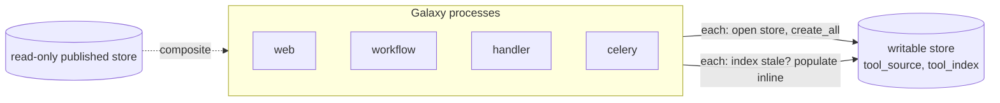

# Learning Galaxy — #24666

- Profile: [learning_galaxy](https://github.com/jmchilton/galaxy-brain/blob/main/vault/agents/gx_reviews/reviewers/learning_galaxy.md)
- Model: Claude Opus 5.5, effort low
- Reviewed commit: `7587ed8a9ff` (base `release_26.2`)

Verdict: architecturally interesting, modestly. A release-branch bug fix, but it adds a new cross-process coordination primitive (`PopulateLease`) to the `ToolSourceStore` interface and a new table to the store schema. No P-labeled findings (profile produces none).

## Before: what to know

The cached toolbox (`use_cached_toolbox`) keeps tool sources and a derived `ToolIndex` in a standalone SQLAlchemy database (`tool_source_database_connection`, SQLite file by default). Named stores (e.g. a read-only CVMFS-published store) are layered over the writable default in a `CompositeToolSourceStore`.

At boot and on toolbox reload, every Galaxy process (web, workflow scheduler, job handlers, celery) independently builds a `CachedToolBox`. If the index is missing tool paths from the confs, that process runs the populator inline, which writes through a *separate* store instance, so the toolbox then invalidates and reloads its index.



Two races follow when processes share one writable store:

1. `create_all` is check-then-create per table in separate statements, so simultaneous first opens crash with `table tool_source already exists` (#24519).
2. Every process seeing a stale index runs a full populate concurrently; duplicate inserts per source path were possible.

## After: what changes

**Schema.** For SQLite, if any table is missing, the store opens a connection, issues `BEGIN IMMEDIATE` (take the database write lock up front) and runs `create_all` on that connection. Check and DDL become one atomic step across processes. Already-complete stores skip the lock. Remote backends keep best-effort `create_all`.

**Populate.** A new abstraction:

- `ToolSourceStore.populate_lease() -> PopulateLease | None` (default `None` = "cannot coordinate, populate anyway").
- `PopulateLease` ABC: `last_populated_at`, `try_acquire`, `renew`, `release(holder, populated)`.
- `_SqlAlchemyPopulateLease`: a singleton row in a new `tool_source_populate_lease` table in the store's own DB.
- `CompositeToolSourceStore` delegates to its default (writable) store; read-only stores return `None`.
- `coordination.populate_once(lease, needs_population, populate, peer_result_usable=...)` is the generic algorithm; `CachedToolBox._populate_once` adapts it.

```mermaid
sequenceDiagram
  participant A as Process A
  participant B as Process B
  participant L as lease row
  A->>L: last_populated_at (t0)
  B->>L: last_populated_at (t0)
  A->>L: try_acquire -> true
  B->>L: try_acquire -> false (poll 1s)
  loop every 20s
    A->>L: renew(ttl 120s)
  end
  A->>A: needs_population()? yes -> populate
  A->>L: release(populated=True) sets populated_at=t1
  B->>L: try_acquire -> true
  B->>B: reload index; needs_population()?
  B->>L: populated_at != t0 and peer result usable -> skip
  B->>L: release(populated=False)
```

Both call sites in `CachedToolBox` (boot/reload index check, and the fast panel init "panel ids missing from index" path) now go through `_populate_once`, each passing its own `still_needed` predicate that is evaluated on a freshly reloaded index under the lease.

Not covered by the lease (stated in the PR): `populate_store.py`, `reconcile_index` and watch mode still write uncoordinated; no upper bound on waiting for a holder that hangs while still renewing.

## Interesting choices

- **Lease, not lock.** Holding a SQLite write transaction across a multi-minute populate would hit busy timeouts and block other writers. Instead each lease operation is a short transaction; waiting is polling, so populate duration is unbounded independent of `SQLITE_BUSY_TIMEOUT_SECONDS`. The subprocess test sets that timeout to 1 s against a 3 s populate to prove it.
- **Heartbeat renewal on a daemon thread** (`_LeaseRenewal`) with TTL 120 s / renew 20 s. TTL doubles as clock-skew allowance, since expiry compares wall clocks of different hosts (`galaxy.util.now`, naive UTC).
- **Read-before-write in `try_acquire`.** Waiters first `SELECT` the row and only take the store's write lock when the lease looks free/expired, so 1 s polls from many processes don't contend on the SQLite write lock.
- **Upsert by `UPDATE ... WHERE free` then `INSERT`, relying on the PK `IntegrityError`** to resolve the first-ever-acquire race without dialect-specific upsert syntax.
- **"Peer populated since I started" detection** via `populated_at` snapshot taken before waiting. If it changed, the waiter trusts the peer's result even when `needs_population()` still says yes ("the same populate run again would not change its result") — avoids N processes re-running a populate that legitimately leaves some conf paths unindexed. `peer_result_usable` guards the rolling-upgrade case where an index written by another Galaxy version loads as empty.
- **Failure semantics.** A raising populate releases without setting `populated_at`, so the next waiter retries rather than reusing a failed result. Release errors are swallowed (TTL cleans up). `OperationalError` during polling is treated as transient. A missing lease table on a server DB degrades to uncoordinated populate with a warning.
- **Reload bookkeeping** in `CachedToolBox._populate_once`: the `nonlocal reloaded` flag avoids a redundant index reload when the predicate already reloaded and nothing was populated.
- **Generic coordination module** with callables rather than toolbox knowledge, which is why it is unit-testable with fake/flaky leases and real multi-process SQLite tests.

## Research

No galaxy-brain note covers the cached toolbox or tool source store (`Component - Dynamic Tool Manager and Toolbox Lifecycle` only mentions `CachedToolBox` in passing), so nothing is stale; no `learning_galaxy_followup_issue.md` written.

Queued research request:

- `vault/agents/gx_research/todo/cached_toolbox_tool_source_store.md`
