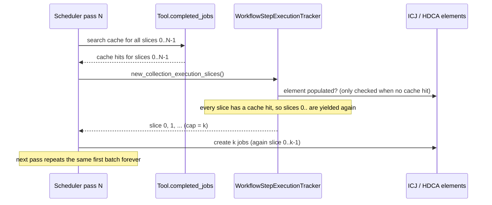
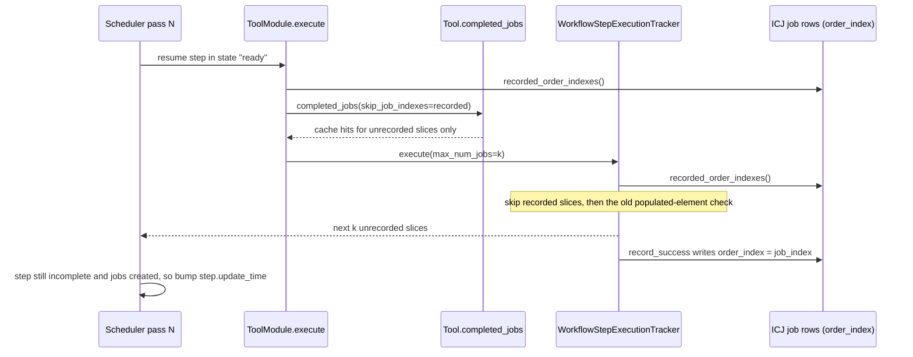
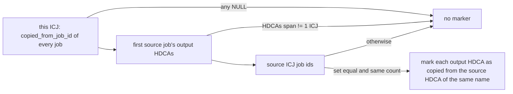

# Learning Galaxy: PR #24670

- Profile: [learning_galaxy](https://github.com/jmchilton/galaxy-brain/blob/main/vault/agents/gx_reviews/reviewers/learning_galaxy.md)
- Model: Opus 5.5 (`claude-opus-5-5`), medium effort
- Reviewed commit: `ff156cf34cd` (diff vs `origin/release_25.1`)

This is a release-branch bug fix, but it is still architecturally interesting because it changes three contracts other code reads:

- The `ImplicitCollectionJobs` (ICJ) job rows' `order_index` values become the durable record of which map-over slices are already scheduled.
- An ICJ can now exist, and record jobs, with no implicit output HDCAs.
- `WorkflowInvocationStep.update_time` becomes a deliberate wake-up signal for the scheduler.

## Before: how a mapped tool step is scheduled

- **Scheduling iterations.** `WorkflowInvoker` walks the invocation's steps once per pass. With `maximum_workflow_jobs_per_scheduling_iteration` set, `WorkflowProgress.maximum_jobs_to_schedule_or_none` caps how many jobs a pass may create, and `execute(..., max_num_jobs=...)` stops early.
- **Partial steps.** A capped step returns incomplete and is left in state `ready`. On the next pass it is rebuilt from scratch (`ToolModule.execute`), and its existing HDCAs and ICJ are reloaded from the invocation step (`ensure_implicit_collections_populated`).
- **Slice resumption.** `WorkflowStepExecutionTracker.new_collection_execution_slices` decided which slices still needed jobs by looking at the output collections: if a slice's output element was already populated, skip it. That check only ran when the slice had **no** job cache hit.
- **Early job cache.** `Tool.completed_jobs` searched the cache for **every** slice on **every** pass.
- **Waking the scheduler.** `ready_to_schedule_more` only revisits an invocation promptly when the history's or a step's `update_time` moved since the last pass; otherwise it waits for a timeout.
- **ICJ bookkeeping.** `ExecutionTracker.implicit_collection_jobs` was derived from the first implicit HDCA. With no HDCAs (every output filtered out), there was no ICJ to attach jobs to, so `record_success` recorded nothing.

With the cache on and a cap, a pass never got past the first batch. Each pass created duplicate copied jobs for the same slices (issue #24665).

## After: what this PR changes

- **The ICJ is the slice ledger.** `ImplicitCollectionJobs.recorded_order_indexes()` (model) returns the `order_index` of every recorded job. Both the early cache search (`modules.py`, through the new `Tool.completed_jobs(skip_job_indexes=...)`) and slice generation (`execute.py`) skip those indexes. Resumption no longer depends on the output elements, which may be missing (filtered outputs) or already filled by a cache hit.
- **ICJ tracked on its own.** `ExecutionTracker` now holds `_implicit_collection_jobs` directly. It is set in `precreate_output_collections` (and explicitly added to the session) and reloaded from the invocation step on resume. `record_success` and `finalize_dataset_collections` use it whether or not any HDCA exists. A map-over whose outputs are all filtered out still records its jobs.
- **Scheduler wake-up.** In `WorkflowInvoker`, if a step created jobs this pass but stayed incomplete, it sets `workflow_invocation_step.update_time = now()`. Jobs with only filtered outputs never touch the history, so without this `ready_to_schedule_more` would sit on the timeout.
- **Copied-HDCA marker rewritten.** `_copied_from_implicit_collections` replaces the inline check in `finalize_dataset_collections`. It looks at **all** jobs recorded on the ICJ, across passes, not just the ones created in this call. It marks outputs as copies only when every job was copied from exactly the jobs of one earlier ICJ.

## Interesting code choices

- **`completed_jobs.get(execution_slice.job_index)` in `execute()`.** The loop used to index `completed_jobs` by loop position. Once the tracker skips slices, position and `job_index` drift apart, so it now keys by `job_index`. This is a latent trap for anyone iterating `new_execution_slices()`: the yielded slices are not dense.
- **Skipping on both sides.** `skip_job_indexes` in `Tool.completed_jobs` only saves cache queries. Correctness comes from the tracker skip. The modules-side guard is limited to resumed steps (`not invocation_step.is_new`) with `use_cached_job` and a mapping.
- **Fixes a silent provenance bug as a side effect.** The old check compared a set of SQLAlchemy `Row` tuples to a set of ints (`.all()` vs ids), so `copied_from_history_dataset_collection_association_id` was never set for cached map-overs. The new helper uses `.scalars()` and a stricter one-to-one rule against a single source ICJ. `test_cached_mapped_step_scheduled_once_per_element` is the first test to assert that column.
- **A test tool with a filtered-out output.** `output_filter_all_by_param.xml` maps over a collection while producing no output collections. This exercises the "ICJ without HDCAs" path and the `update_time` wake-up together.

## Research queued

- `vault/agents/gx_research/todo/workflow_scheduling_iterations.md`: Component - Workflow Scheduling. There is no note on the invoker loop, the per-iteration job cap, `ready` steps, or how mapped steps resume.
