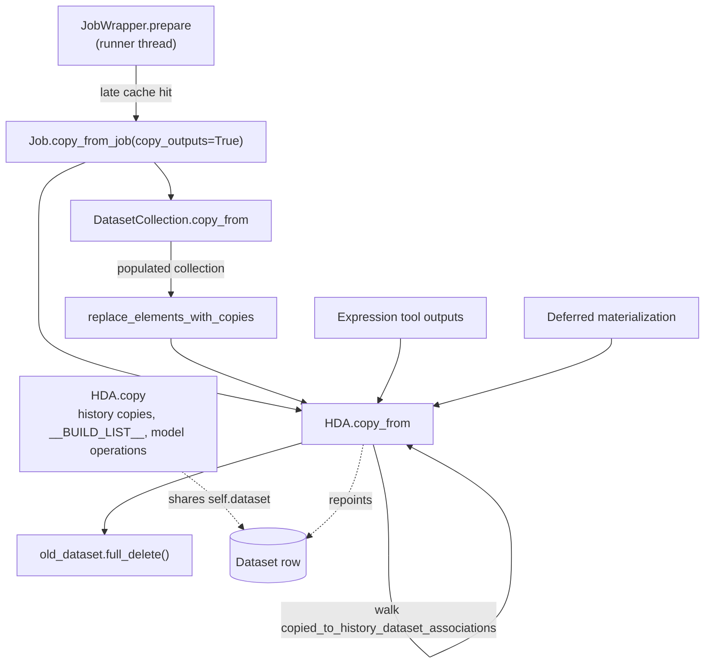
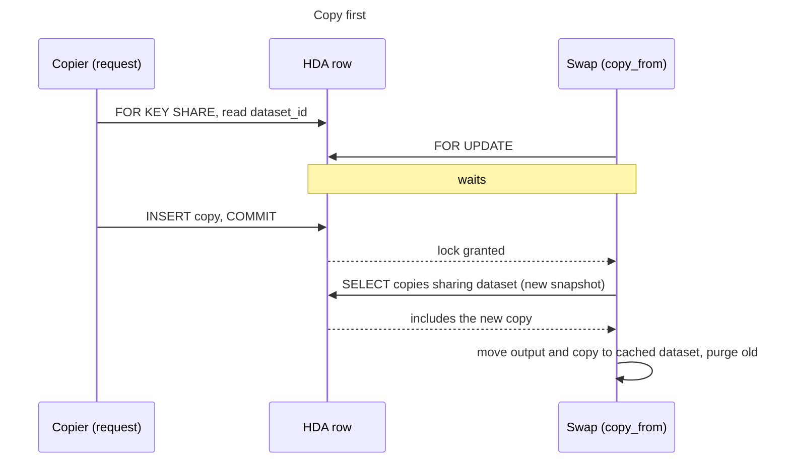
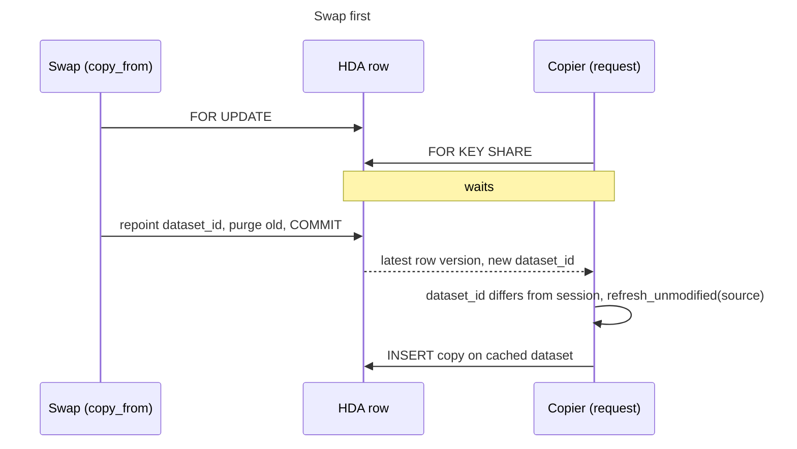

# learning_galaxy: #24673

Profile `learning_galaxy`, model Opus 5.5 (`claude-opus-5-5`), effort medium, reviewed commit `7db61c5f53a00485aa058a02ce0cd2533034ce3b`.

**Architecturally interesting, narrowly.** It's a release-branch bug fix, but it changes cross-cutting semantics in two ways:

- `HDA.copy()` and `HDA.copy_from()` now follow a row-lock protocol. Every copy path that goes through `copy()` takes part when its source is still in flight.
- The rule for what propagates to copies changes: propagated copies keep their own `visible` and `deleted`.

## Before this PR

An HDA is a history's view of a `Dataset` row, and copies share that row. A late job cache hit breaks the usual assumption that an HDA keeps its dataset. It replaces the dataset of an output that is already visible to other requests.

What matters before the change:

- **The copy walk only saw the runner's view.** `copied_to_history_dataset_associations` can't include a copy that another transaction hasn't committed.
- **`full_delete()` only marks the row purged.** A copy that commits later still passes its foreign key check, so nothing fails. The HDA simply stays `queued` on a dataset no job will run.
- **`copy_from` overwrote everything on the way down.** `visible` and `deleted` were copied onto each copy as well as the direct target. `copy_from_job` and the expression tool path already saved and restored `visible` around their own call.

Galaxy has few explicit row locks, mostly for job grabbing and cancellation and for worker heartbeats. `touch_collection_update_time` is the closest precedent, using `key_share=True` with id ordering.

## What this PR changes

The two sides now serialize on the row of the HDA being swapped. Under PostgreSQL READ COMMITTED, the outcome depends on which side reaches the row first, and both outcomes leave the copy on the cached dataset.

The rest of the shape:

- **`copy()` is gated by state.** It only locks a persistent source in `Dataset.swappable_states`, which is `non_ready_states` plus `paused`. Copies of finished datasets cost nothing extra. `paused` already counts as a "ready" state, so the new tuple is a separate question from readiness: can this dataset still be replaced?
- **`copy_from_job` locks all outputs up front, in id order.** Copiers that walk outputs in id order can't deadlock with it. Copies are locked later, as the recursion reaches them, so the order isn't global. The PR names the deadlock that remains, and PostgreSQL resolves it by aborting one side.
- **The locks live until the late hit commits.** That commit comes after non-immediate post job actions in `JobWrapper.prepare`, so those actions run with the output rows locked.
- **Propagation rule.** Inside `copy_from`, a copy's `visible` and `deleted` are restored after the recursive call. The direct target still takes them from the source, so `copy_from_job` and the expression tool path keep their own `visible` handling. `replace_elements_with_copies` calls `copy_from` with no restore, so an element HDA takes the replacement's values.

Limits the PR calls out:

- SQLite ignores both locks and keeps the old behaviour.
- With `extended` metadata strategies, an expression tool output commits as `ok` before `finish()` swaps it. A copy made in that window skips the lock, because `ok` isn't swappable.

## Choices worth noticing

- **Lock strength is the design.** PostgreSQL's `FOR KEY SHARE` conflicts only with `FOR UPDATE`. Ordinary `UPDATE`s take `FOR NO KEY UPDATE`, so a copy doesn't block job finishing or metadata updates on its source. Foreign key checks take the same `KEY SHARE`, so `copy_from` also waits for any open transaction that inserted a row referencing the output. The copier's explicit lock effectively takes that foreign key lock earlier, before it reads the dataset.
- **The waiter gets the new row without a new snapshot.** A locking `SELECT` under READ COMMITTED returns the latest row version after its wait. The swap side relies on a different rule: its next statement gets a fresh snapshot. That is why `_lock_and_load_copies` locks first and queries second.
- **The copier selects a column, not the entity.** A plain `dataset_id` select under `no_autoflush` leaves the session's object alone. Comparing it with `self.dataset_id` detects the swap, and only then does the source reload.
- **`refresh_unmodified` is a small reusable helper.** It refreshes unmodified columns and expires unmodified relationships, so pending changes survive and relationships follow the refreshed foreign keys. It also guards a SQLAlchemy trap: an empty `attribute_names` list means every attribute.
- **`_lock_and_load_copies` merges two views.** The relationship supplies this session's copies, including uncommitted ones. The query supplies other transactions' committed copies, filtered to those still sharing the dataset.
- **The tests force the interleaving instead of sleeping.** `test/unit/data/test_hda_copy_from.py` runs two real sessions and polls `pg_stat_activity` until one is waiting on a lock, then lets the other commit. The poll commits on each pass because that view is a per-transaction snapshot. These tests need PostgreSQL, so `unit-postgres.yaml` gets its own step for them.

## Research

Follow-up: see `learning_galaxy_followup_issue.md`, which has one stale naming point and the post-merge note updates.

Research requested:

- `vault/agents/gx_research/todo/hda_copies_and_dataset_sharing.md`
