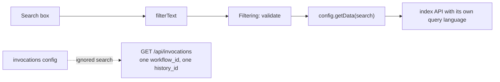
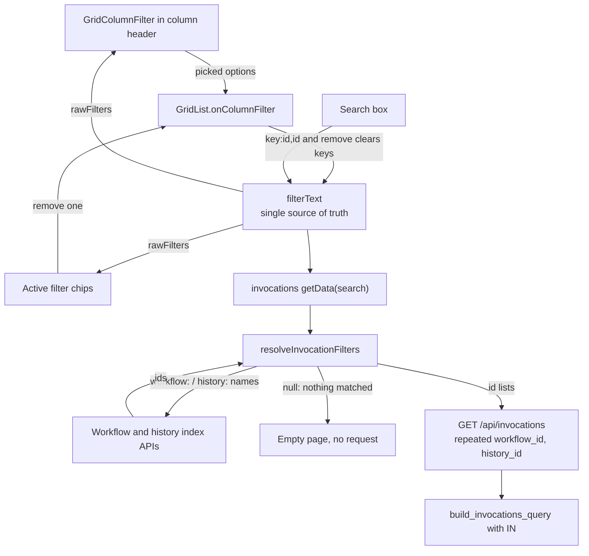

# learning_galaxy: #24708

- Profile: `learning_galaxy`
- Model: Opus 5.5 (`claude-opus-5-5`)
- Effort: medium
- Reviewed commit: `86a724b7bf5e37461797d823287e193afe61fff7` (merge-base `e922a682376`)

Architecturally interesting: the PR adds a reusable extension point to `GridList`, and changes the shape of a shared backend payload from a single id to a list.

## Before this PR

**Every generic grid is one `GridList` plus a config object.** A `GridConfig` lists fields, an optional `Filtering` instance and a `getData` function. `GridList` owns the search box, pagination and sort, and it knows nothing about any entity.

**`filterText` is the only filter state.** `GridList` parses this string with `Filtering` into `rawFilters`, then valid and invalid filters. Any invalid filter stops the fetch. Otherwise `getData` receives the validated text as `search`, and each config decides what that means. Most configs forward it to an index API that understands `key:value` queries.

**The main invocation grid had no filtering.** `configs/invocations.ts` ignored `search`, and `/api/invocations` has no text query. The endpoint took at most one `workflow_id` and one `history_id`.

**The two `workflow_id`s are different ids.**
- `GET /api/invocations?workflow_id=` means a `StoredWorkflow`, unless `instance=true`.
- `invocation.workflow_id` in a response row is a `Workflow`, meaning one version.
- The grid's name column already bridges this with `workflowStore.getStoredWorkflowNameByInstanceId`.

**Scoping happens in the service, not through the workflow.** For non-admins, `InvocationsService.index` forces `user_id` to the current user. A stored workflow id gets only an existence check unless `instance=true`, which resolves it through `get_stored_workflow`. The history id gets a `get_accessible` check.

## What this PR changes

**1. `GridList` gains a generic column filter.** `FieldEntry.filter` is a `FieldFilter`: `{ key, clears, plural, search }`. Any field that declares one gets a `GridColumnFilter` dropdown in its header and removable chips under the search box. The contract is deliberately small: `search(query)` returns `FilterOption`s, and picks are written to `filterText` as `key:<id>,<id>`. `GridList` has no knowledge of workflows or histories.

**2. Filter state stays in the text.** A selection is derived from `rawFilters[key]`, so the search box, chips, header badge and fetch cannot disagree. The new filter state is only a display cache, `columnFilterNames`, mapping ids to labels. An id not in that cache, such as a hand-typed one, shows as a raw id.

**3. Name search is a client-side join.** `resolveInvocationFilters` turns `workflow:` and `history:` terms into ids using the existing workflow and history index APIs, then sends only ids to `/api/invocations`. The invocation query gains no name logic and no new joins.

**4. The backend moves from one id to a set.** The change runs through all three layers, using `IN` queries:
- Query parameters: `WorkflowIdsQueryParam`, `HistoryIdsQueryParam`
- Schema: `InvocationIndexQueryPayload.workflow_id` and `history_id` become `list[int]`
- Manager: `build_invocations_query(stored_workflow_ids, history_ids)`

Internal callers now wrap single values, including `AgentOperationsManager` and `index_workflow_invocations`. That nested route keeps a scalar `history_id` through the retained `HistoryIdQueryParam`. The history-scoped and workflow-scoped invocation grids also wrap, and they do not get column filters.

### What to carry forward

- **New grid filters:** provide a `FieldFilter` and handle its key in `getData`. Also declare the key in `validFilters`. `workflow_id` and `history_id` are declared with `menuItem: false` because `GridList` refuses to fetch on an undeclared key.
- **Filter ids are not row ids here:** the column is keyed `workflow_id` and its filter key is `workflow_id`, but picks are stored ids while the row value is a version id. Picks therefore match every version of a workflow.
- **One API call for each deleted or hidden kind:** the workflow and history indexes list deleted, hidden and purged items only on request, and not together. That is why a name lookup makes three parallel calls and merges them by id.

## Interesting code choices

- **`null` protects against an unfiltered query.** The manager now tests `if stored_workflow_ids:` and `if history_ids:`, so an empty list means no filter at all. The client therefore returns `null` when a name matches nothing, and `getData` returns an empty page without calling the API. Sending `[]` would show every invocation.
- **Picks are narrowed, not unioned, with names.** `combine` intersects picked ids with name matches. A `clears` key then removes the name filter of the same kind as soon as the user picks from the column, so the two rarely coexist.
- **One batch existence check.** `build_invocations_query` compares `len(found_ids)` with `len(set(stored_workflow_ids))`, so duplicate ids are not reported as missing.
- **Quoting reuses `Filtering` behavior.** With `quoteStrings=false`, values keep their quotes verbatim. `nameSearch` uses that to send a quoted value as one exact `name:` term and an unquoted value as one substring term per word.
- **`FilterOption.detail` is a function.** Evaluated at render, it reads the run count from a keyed store cache, so counts load lazily and fill in reactively. It also survives in `columnFilterNames` along with the option.
- **`GridColumnFilter` handles stale and early searches.** A `latestSearch` counter drops out-of-order responses, and the first load waits for the dropdown to open, so a grid with filters makes no lookups until one is used.
- **`setFilters` applies removals, then sets.** `Filtering.applyFiltersToText` takes a single remove-or-set mode per call, so a pick that also clears a name filter takes two passes before one `filterText` write. That single write triggers one fetch.

## Research requests

- `vault/agents/gx_research/todo/client_grids_and_filtering.md`
