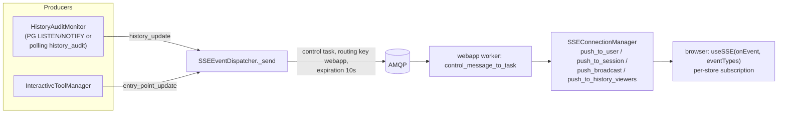
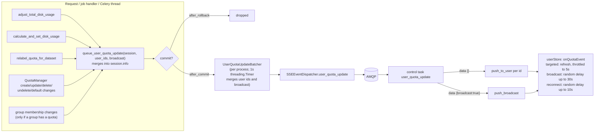

# Learning Galaxy: #24738 — live storage usage updates

- Profile: [learning_galaxy](https://github.com/jmchilton/galaxy-brain/blob/main/vault/agents/gx_reviews/reviewers/learning_galaxy.md)
- Model: Claude Opus 5.5, low effort
- Reviewed commit: `c55d04482f9` (merge-base `fc2a8be4887` on `dev`)

Architecturally interesting. The PR adds a second way to produce SSE events. The existing producers watch the database. The new one is fired from application code and is tied to the SQLAlchemy transaction: changes are queued in `session.info`, sent after commit, and dropped on rollback. It also adds a new control task, a new SSE event type, and a client store that subscribes to live updates.

## Before: what to know

### SSE fan-out pipeline

The pipeline already existed, from #24664 and the history SSE work. Producers never talk to browsers directly. They hand a payload to `SSEEventDispatcher`, which sends a Kombu control task to every live **webapp** process. Each process then pushes the event to the connections it holds locally.

- `SSEEventDispatcher` lives in `managers/sse_dispatch.py`, kept apart from `managers/sse.py` to break an import cycle with `queue_worker`. It does nothing when AMQP isn't configured.
- Celery workers build `GalaxyManagerApplication`, which creates a publisher-only `queue_worker`. So code that runs in Celery can dispatch SSE events too.
- `history_update` is detected from the **database**: the audit table plus a trigger or polling. It sees every writer, including scripts and raw SQL.

### Storage usage on the client before this PR

After #24664, `userStore` refreshed the usage only on local triggers:

- the browser's own purges;
- `watchOwnHistorySize`, which compared a history's size before and after a `history_update`;
- tab focus, at most once a minute;
- refreshes skipped while the tab was hidden, run when it became visible.

Changes made elsewhere stayed invisible until the next focus: admin quota edits, recalculations, Celery purges.

### Server-side usage accounting

The accounting is on `dev` now, since #24511 merged on 2026-11-05. Every incremental change goes through `User.adjust_total_disk_usage`. Its callers are `sole_dataset_sizes`, `adjust_disk_usage_for_datasets`, `mark_purged` and `_charge_outputs`. Full recalculation is `calculate_and_set_disk_usage`, which commits by itself. A dataset moving to another object store goes through `DatabaseQuotaAgent.relabel_quota_for_dataset`. The quotas that apply to a user come from their own `UserQuotaAssociation`s, their groups' `GroupQuotaAssociation`s, and `DefaultQuotaAssociation`s.

## After: what changes

- **New producer pattern, a commit hook.** `galaxy.model.user_quota_updates` does three things:
  - `queue_user_quota_update` adds user ids to a `UserQuotaUpdates` in `session.info`.
  - `send_user_quota_updates_on_commit` installs `after_commit` and `after_rollback` listeners on `app.model.session`. Listeners on a `scoped_session` apply to every session its factory creates.
  - `UserQuotaUpdateBatcher` merges updates for a process and sends them from a timer thread, so the committing thread, often a job handler, never blocks on AMQP.

  With live updates off (`enable_sse_updates: false`), the listener is still installed with `send=None` and simply discards what was queued. So call sites never need to check the config.
- **The hooks sit on the shared primitives, not on each feature.** Putting them in `adjust_total_disk_usage`, `calculate_and_set_disk_usage` and relabel covers every charge and free path #24511 consolidated: job finish, copies, imports, purges, and the Celery `purge_history_datasets` recalculation. Quota and group changes are hooked one by one in `QuotaManager`, `GroupUsersManager`, `GroupsManager.purge` and `GalaxyRBACAgent`.
- **Two producers with opposite tradeoffs.** `history_update` is detected from the database, so it sees every writer, but it needs triggers or polling. `user_quota_update` is fired from app code, so it costs almost nothing per commit, but it covers only sessions built from `app.model.session`. Standalone scripts such as `set_user_disk_usage.py` and `pgcleanup.py`, and raw-SQL cleanups, send nothing. That gap is why the client keeps its refresh on tab focus.
- **New wire contract.** The `UserQuotaUpdatePayload` TypedDict is `user_ids`, `broadcast` and `event_id`. The event carries no usage data, because it is a wake-up only, like `entry_point_update`. A broadcast reaches anonymous connections as well.
- **Client.** `userStore` becomes an SSE subscriber with `useSSE(onQuotaEvent, ["user_quota_update"])`, after waiting for `configStore.isLoaded`. `refreshStorageUsageUnlessLive()` replaces the public `refreshStorageUsageInBackground` and `refreshStorageUsageThrottled`. The local triggers (purge, archive purge, `watchHistory` size change, storage run watcher) now refresh only when the server won't announce the change. `watchOwnHistorySize` is removed from `historyStore`.
- **Possible mismatch with the PR description.** Its note says finished jobs don't send the event. At this head, `adjust_total_disk_usage` queues an update for any persisted user, and `test_user_quota_update_after_job_finishes` asserts that the event arrives. Removing `watchOwnHistorySize` relies on exactly that.

## Clever or interesting choices

- **The queue call comes before the state change when the change would hide who to tell.** Each call reads the old state, so users who are losing a quota or membership are still told:
  - `QuotaManager.update_quota` queues the quota's current users before `set_entity_quota_associations` replaces them.
  - `GroupsManager.purge` queues the members before deleting the UGAs.
  - `_set_user_groups` and `_set_group_users` queue the symmetric difference of the old and new sets.
  - `calculate_and_set_disk_usage` queues first, because the recalculation commits internally.
- **Commit changed to flush in `set_entity_quota_associations`.** The old intermediate commit would have sent the queued updates while the new associations weren't written yet. Browsers would then have fetched the half-updated state. With a flush, the associations and the announcement land in one commit.
- **`_any_group_has_quota` short-circuit.** It runs a `LIMIT 1` probe on `GroupQuotaAssociation` before loading group members. The PR's own measurement: saving 20k members of a group without a quota costs nearly nothing extra.
- **Users not in the database yet are skipped.** `adjust_total_disk_usage` queues only when `self.id is not None` and an object session exists. A transient user has no browser to tell.
- **Ordering at shutdown (haltables).** `GalaxyManagerApplication` inserts the batcher's flush at index 0. `UniverseApplication` then reassigns `self.haltables` wholesale, so the PR lists the flush again ahead of `"queue worker"`. Pending updates are sent before AMQP goes away. Both registrations matter: the first serves Celery, the second the web process.
- **Spreading load from broadcast and reconnect.** A default-quota change reaches every client. When Galaxy restarts, every tab reconnects at once. Both cases use `refreshAfterRandomDelay` (up to 30s and 10s), and calls that come in while a delayed refresh is pending merge into it. When a hidden tab's connection has dropped, returning to it defers the refresh to the reconnect, with a 10s fallback timer in case the reconnect never happens.
- **The test SSE mock routes by event type.** `sseStoreSupport.sseMockFactory` now keeps one handler per event type, because the history and user stores both call `useSSE` in the same test.

## Research

No `vault/research/` note covers SSE or live updates. The only grep hits are the Agents notes, which are about chat streaming. Queued:

- `vault/agents/gx_research/todo/sse_live_updates.md`

`Component - User Disk Usage Accounting` is now stale on #24511 and needs post-merge additions for this PR. See `learning_galaxy_followup_issue.md`.
