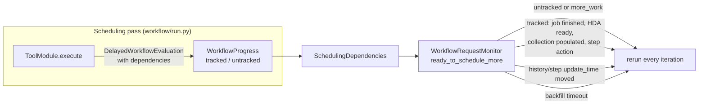

# Learning Galaxy — #24770

- Profile: [learning_galaxy](https://github.com/jmchilton/galaxy-brain/blob/main/vault/agents/gx_reviews/reviewers/learning_galaxy.md)
- Model: Claude Opus 5.5, effort low
- Reviewed commit: `8ec2452c3bb` (diff vs `origin/release_26.2`)

Architecturally interesting: yes, narrowly. It is a release-branch bug fix, but it changes a cross-cutting contract. `ToolInputsNotReadyException`, raised deep in tool execution, now carries scheduler dependencies. It also adds a new kind of wait to the scheduler: "wake when this value changes" instead of "wake when this becomes ready". The dependency types move out of `workflow/modules.py` into their own module so tools can import them.

## Before: how scheduling waits worked on release_26.2

Each scheduling pass of an invocation returns `SchedulingDependencies`. That holds tracked dependencies (job, HDA, collection, invocation step), untracked delay reasons, and a `more_work` flag. On the next monitor iteration, `WorkflowRequestMonitor.ready_to_schedule_more` reruns the invocation only when something has plausibly changed. Untracked delays and `more_work` always rerun it. Tracked dependencies are checked with batched count queries in `_any_dependency_satisfied`.

Connection-level waits in `WorkflowProgress.replacement_for_connection` already raised `DelayedWorkflowEvaluation` with an HDA or collection dependency. Some tools check readiness themselves: model operations (`DatabaseOperationTool.check_inputs_ready`), `KeepSuccessDatasetsTool`, `__expand_collection_parameter`, `_resolve_collection_ref`, and datatype resolution for `auto`/`_sniff_` in `DefaultToolAction`. Those raise `ToolInputsNotReadyException`, a plain `MessageException` with no payload. `ToolModule.execute` turned it into a `DelayedWorkflowEvaluation` without dependencies, and the scheduler counted it as an untracked delay. The invocation was then fully re-evaluated on every monitor pass until the input settled. Each pass rebuilt modules and recovered outputs.

## After: the exception carries the blocker

```mermaid
flowchart LR
  subgraph Tools["Tool input checks"]
    DOT[DatabaseOperationTool.check_inputs_ready]
    KS[KeepSuccessDatasetsTool]
    Meta[meta.__expand_collection_parameter]
    Exec[execute._resolve_collection_ref]
    Act[DefaultToolAction auto/_sniff_]
  end
  SDmod["workflow/scheduling_dependencies.py<br/>input_readiness_dependencies()<br/>unpopulated_collection_dependencies()"]
  Ready["model/dataset_collections/readiness.py<br/>ReadinessSnapshot, blocking_dataset()"]
  Tools --> SDmod --> Ready
  Tools -->|ToolInputsNotReadyException<br/>dependencies=...| TM[ToolModule.execute]
  TM -->|DelayedWorkflowEvaluation<br/>dependencies=exc.dependencies| Progress[tracked dependencies]
  Progress --> Mon[_any_dependency_satisfied]
  Mon -->|HDA + readiness: one column query,<br/>rerun if snapshot differs| Rerun[rerun]
  Mon -->|other types: unchanged count queries| Rerun
```

Key changes at the architecture level:

- **New shared module.** `galaxy.workflow.scheduling_dependencies` now owns `DependencyType`, `SchedulingDependency`, `SchedulingDependencies` and `unpopulated_collection_dependencies`. They used to live in `workflow/modules.py`, which `galaxy.tools` cannot import without a cycle. Tool code, `run.py`, `scheduling_manager.py` and the scheduler plugins now import from this module. Downstream code that imports these names from `galaxy.workflow.modules` will break.
- **The exception carries data.** `ToolInputsNotReadyException(..., dependencies=...)`, with `exceptions/__init__.py` using a `TYPE_CHECKING`-only import to avoid a cycle. An exception class from the web/API layer now carries a scheduler payload. When one is raised outside a workflow (an API tool request), the dependencies are simply ignored.
- **New dependency semantics: "changed", not "ready".** `SchedulingDependency` gains an optional `readiness: ReadinessSnapshot` holding (effective state, extension, deleted, dataset deleted). An HDA dependency with a snapshot wakes the invocation when any of those values changes. One without a snapshot keeps the old "state left `non_ready_states`" test. This matters because the waits being tracked are not all "pending". Some are paused (an HDA `_state` override), and some are "terminal but extension still `auto`". A readiness test would either never fire or fire right away.
- **One blocker per delayed step.** `input_readiness_dependencies` returns the first blocking HDA it finds. When that one changes, the next pass finds the next blocker. The PR description accepts the tradeoff: a failure in another input may be noticed late.
- **Model operations rely on flattened inputs.** `DatabaseOperationTool.check_inputs_ready` no longer reads `dataset_states_and_extensions_summary` for collections. It relies on collection members also appearing in `input_datasets`, so it checks real HDAs it can name as blockers. For collections it only checks population.

## Interesting choices

- **The blocker is found in SQL, not Python.** `blocking_dataset` reuses `DatasetCollection._build_nested_collection_attributes_stmt`, the nested-collection join builder behind the summary properties. It adds `coalesce(HDA._state, Dataset.state)`, optional state and extension filters, and `LIMIT 1`. Deep or large collections never become Python lists of IDs or ORM objects.
- **The effective-state expression appears three times**: in `blocking_dataset`, in the new monitor query, and as a `case(...)` in the older HDA count query. They mean the same thing. This is a natural candidate for one shared SQL expression (a hybrid property or helper next to `HistoryDatasetAssociation.state`).
- **Set equality in the monitor.** Snapshots are grouped per HDA id as a set. If two steps recorded different snapshots for the same HDA, the check `{current} != recorded` is always true, so the invocation reruns. That is a conservative default that never misses a wakeup. A missing row (`len(rows) != len(batch)`) also reruns.
- **The batching bound is local.** IDs are chunked at 500 per `IN (...)`. The older count queries for jobs, HDAs and collections are not chunked.
- **Datatype resolution waits on paused members too.** For `auto`/`_sniff_`, the filter is `non_ready_states + PAUSED` plus `extension == ext`. A paused member with an unresolved extension now blocks instead of slipping through. The comment explains that a member that finished without resolving must not hide one that still can.
- **Test harness reuse.** The new `test/unit/workflows/test_input_readiness.py` drives real scheduling passes through `SchedulingHarness` in `workflow_support.py`, against a real database (`create_and_drop_database`). It asserts that replays don't happen. It does not unit-test the helpers in isolation.

## Research

- [[Component - Job Completion Lifecycle]] describes the scheduler's dependency checks as "finished, ready or populated" and cites `scheduling_manager.py` line ranges. After merge it needs the new "readiness snapshot changed" HDA kind. See `learning_galaxy_followup_issue.md`.
- No note covers workflow scheduling iterations or delays. The pending request `vault/agents/gx_research/todo/workflow_scheduling_iterations.md` covers this area, so a `Requested by` line for this PR was added to it rather than a new request.
