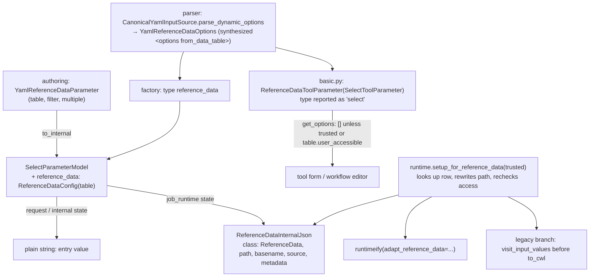

# Learning Galaxy — #24798 Add reference_data input for YAML tools

- Profile: [learning_galaxy](https://github.com/jmchilton/galaxy-brain/blob/main/vault/agents/gx_reviews/reviewers/learning_galaxy.md)
- Model: Claude Opus 5.5, effort medium
- Reviewed commit: `5abbfd9d5a6` (base `origin/dev`)
- Framed against [#23888](https://github.com/galaxyproject/galaxy/issues/23888) (authoring models vs `YamlToolSource` dialect) and [#22700](https://github.com/galaxyproject/galaxy/issues/22700) (reference data for `GalaxyUserTool`; this PR is option B, tool data tables)

Architecturally interesting: a new YAML parameter type that crosses every layer of the tool stack, a public trust property on `ToolSource`/`InputSource`, and a new admin-controlled access flag on tool data tables.

## Before the PR

A YAML tool parameter has two independent descriptions that only meet by convention (#23888):

```mermaid
flowchart LR
    subgraph Authoring["Authoring (API only)"]
        Y[yaml_parameters.py<br/>Yaml*Parameter] -->|to_internal| M1[ParameterModel]
    end
    subgraph Loading["Loading (every YAML tool)"]
        D[dict] --> P[YamlToolSource /<br/>CanonicalYamlInputSource]
        P --> F[parameters/factory.py<br/>_from_input_source_galaxy] --> M2[ParameterModel<br/>tool.parameters]
        P --> B[basic.py<br/>parameter_types → ToolParameter<br/>tool.inputs]
    end
    M2 --> R[runtimeify<br/>job_internal → job_runtime]
    B --> L[legacy to_cwl fallback]
    R --> E[UserToolEvaluator<br/>CWL-style inputs for $(...) expressions]
    L --> E
```

- `M1` and `M2` should agree, but production uses `M2`. Unit tests mostly check `M1`.
- `basic.py` is the XML-era form/validation layer. Its selects read `from_data_table` options through `DynamicOptions`, which is built from an XML `<options>` element (`input_source.parse_dynamic_options().elem()`).
- `runtimeify` turned `data`/`data_collection` references into dataset-shaped `File` dicts via callbacks set up in `tools/runtime.py` (`setup_for_runtimeify`). Other parameter types passed through.
- Trust was a private parser detail: `YamlToolSource._trusted` (`class != GalaxyUserTool`) gated root keys, `dynamic_options` and unsafe validators. `YamlInputSource` already carried a `trusted` attribute, but nothing outside the parser read it.
- Tool data tables were readable by any tool that named them. There was no per-table policy, and user-defined tools had no input type that could reach them. `doc/source/admin/user_defined_tools.md` listed "access to reference data is not supported".

## What the PR changes



1. **One parameter, many layers.** Adding a YAML input type now touches authoring model, parser input source, parameter factory, `basic.py` registry, `runtimeify`, the evaluator's legacy branch, the parameter specification, the authoring help, and two generated schemas. The PR is a good worked example of the full checklist.
2. **Reuse over a new model type.** There's no `ReferenceDataParameterModel`. `SelectParameterModel` gains an optional `reference_data` config. Request and internal states stay a plain string (the entry's `value`). Only the `job_runtime` representation changes, to a dataset-like `ReferenceDataInternalJson`. That keeps existing select handling working (encode/decode, workflow editor, client form, which sees `type: select`) and isolates the new behavior in one state representation.
3. **Trust is now public.** `ToolSource.trusted` (default `True`, `YamlToolSource` overrides by class) and `InputSource.trusted` (class attribute `True`) let code outside the parser make policy decisions. `basic.py` uses it for the form, and the evaluator passes `tool.tool_source.trusted` to the runtime callback. Trust still follows `class`, not the creation path, so admin-created `GalaxyTool` YAML can read every table.
4. **Admin-controlled table opt-in.** `ToolDataTable.user_accessible` comes from `tool_data_table_conf.xml`, is OR-merged across sources with the same name, and is stripped from Tool Shed-supplied table configs before they're persisted. Only a config the admin manages can open a table, which is the core of #22700 option B.
5. **Checked twice.** The form offers no options from a closed table, so a request naming one is rejected (the API test expects 400), and `adapt_reference_data` raises at job evaluation if the table is closed, missing or lacks the value. The second check covers stale jobs and rows edited after submission.
6. **`data_meta` filters on unknown tables.** `DataMetaFilter` used to resolve a named column at tool load and failed for tables this instance doesn't configure. It now defers resolution to filter time. The fix applies to XML tools too.

### Through the #23888 lens

- **Parity by duplication, again.** `YamlReferenceDataParameter.to_internal()` and the factory's `reference_data` branch each build the same `SelectParameterModel` by hand. They agree today (table, multiple, optional defaulting to `false` in both), but nothing enforces it, which is the drift #23888 describes. `parameter_specification.yml` entries check the factory side.
- **A new parser→XML bridge.** `YamlReferenceDataOptions.elem()` builds an XML `<options from_data_table><filter type="data_meta"/></options>` element so `basic.py`'s `DynamicOptions` can consume YAML. The authoring model's `filter: {from_input, on_metadata}` exists only as this XML translation. The internal `ReferenceDataConfig` has no filter, so the Pydantic model layer doesn't see filtering. A model-backed `InputSource` adapter (#23888 slice 2) would have to replicate this bridge.
- **Validation scattered across layers.** `filter.on_metadata` must be a table column, but that's checked only in `ReferenceDataToolParameter.__init__`, and only when the table is configured on this instance. The authoring model can't know tables. That's legitimate, but it's one more rule that lives outside the canonical representation.
- **Two runtime paths both patched.** `runtimeify` and the deprecated `to_cwl` fallback each get their own reference-data resolver, built from the same `adapt_reference_data` callback. Every new runtime-shaped type has to remember both until the legacy branch is removed.

## Interesting code choices

- `ReferenceDataToolParameter` sets `self.type = "select"` after construction, so the client and workflow editor need no changes. The registry key (`reference_data`) and the reported type differ on purpose.
- `get_options` filters out `option.dataset` entries. Table-backed selects normally also offer history data-manager bundles. A reference must be an installed row.
- `class: "ReferenceData"` (not `File`) lets expressions tell reference data from history datasets. `source: {table, value}` and `metadata` (every named column except `value`/`path`) keep the entry addressable without new expression syntax. Path rewriting uses `compute_environment.unstructured_path_rewrite`, the same hook remote and containerized runners use for non-dataset paths. The admin docs note that container volumes must cover the table's paths (e.g. CVMFS).
- Shed stripping happens on the XML element (`table_elem.attrib.pop("user_accessible")`) before persistence, because the managed shed config is later reloaded as a local, admin-trusted source. Stripping only at parse time would be undone on reload.
- `has_data_table` gates the legacy-branch visit, so tools without table selects pay nothing.

## Research requests

None queued. Existing notes cover the touched areas (see `learning_galaxy_followup_issue.md` for updates).
