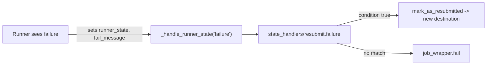
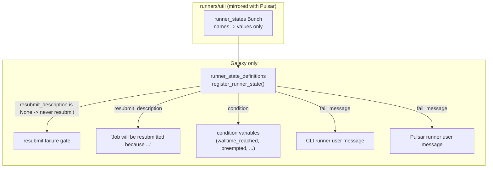

# Learning Galaxy from #24804: structured failure reasons and Pulsar resubmission

- Profile: `learning_galaxy` (`gx_reviews/reviewers/learning_galaxy.md`)
- Model: Claude Opus 5.5, effort medium
- Reviewed commit: `677cab47347c1b40acf2988bed2f8ae18507ca9e`

This PR is architecturally interesting. It does not add a plugin. It changes a cross-cutting rule: how any job runner says *why* a job failed, and how resubmit conditions see that reason. It also adds a small registry that replaces four hand-maintained lists, and it moves more Slurm code into the util tree that Galaxy shares with Pulsar.

Follow-up on stale research: [learning_galaxy_followup_issue.md](learning_galaxy_followup_issue.md).

## Before the PR

### Runner states and the resubmit handler

A runner that sees a failed job sets `job_state.runner_state` to one of the strings in `runner_states`, a `Bunch` in `lib/galaxy/jobs/runners/util/__init__.py`. That file is part of the util tree that is copied by hand between Galaxy (`galaxy.jobs.runners.util`) and Pulsar (`pulsar.managers.util`). The runner then calls `_handle_runner_state("failure", job_state)`. That call runs every function named `failure` in `galaxy.jobs.runners.state_handlers.*`. In practice that means `state_handlers/resubmit.py`.

If a handler resubmits the job, it sets `job_state.runner_state_handled = True`, and the runner stops. Otherwise the runner calls `job_wrapper.fail(job_state.fail_message)`.



Before the PR, what a reason meant was spread across four places, and they drifted apart:

| Place | What it held |
|---|---|
| `resubmit.failure` | an allowlist of states that may be resubmitted |
| `resubmit.MESSAGES` | the "because ..." text, keyed by state value |
| `_ExpressionContext` | the boolean variables offered to `condition:` expressions |
| `cli.py` `__handle_job_failure_reasons` | the user message for each state, for the CLI runner only |

The drift caused a real bug. `JOB_OUTPUT_NOT_RETURNED_FROM_CLUSTER` was on the allowlist but had no entry in `MESSAGES`, so the handler raised a `KeyError`. `_handle_runner_state` caught it and only logged it.

### Pulsar failures were opaque

The Pulsar runner turned the status `failed` into the fixed message `FAILED_REMOTE_ERROR` and set no `runner_state`. So the resubmit handler treated every Pulsar failure as `unknown_error`. Rules such as `memory_limit_reached` or `walltime_reached` could never match a Pulsar job.

Tool-detected errors had their own gap. `AsynchronousJobRunner._finish_or_resubmit_job` runs `check_tool_output` and offers `TOOL_DETECT_ERROR` or `MEMORY_LIMIT_REACHED` to the resubmit handler. Pulsar does not use that method. It finishes jobs through `_complete_staged_job`, which went straight to `job_wrapper.finish()`, so a Pulsar job was never resubmitted for a tool error.

### The resubmit config is not persisted

When `JobWrapper` is built with `use_persisted_destination=True`, it rebuilds its destination from the `Job` row (`JobDestination(from_job=job)`). The row stores the destination id and params, but not the `resubmit` list. Pulsar's message-queue path (`__async_update`) gets its wrapper through `JobHandlerQueue.job_pair_for_id`, so jobs updated over the queue had no resubmit rules at all.

## What the PR changes

### One registry declares each reason

The new module `galaxy.jobs.runners.runner_state_definitions` holds a `RUNNER_STATE_DEFINITIONS` dict. Each entry is filled by a single `register_runner_state(name, value, fail_message, resubmit_description, condition)` call. The four places listed above now all read from it:



The split is deliberate (commit `10c4fdfa`). The shared `runner_states` Bunch only names the reasons, because Galaxy and Pulsar both have to agree on those strings. What the user is told, and whether a job is resubmitted, are Galaxy's decisions, so those stay out of the mirrored tree.

Things a Galaxy developer should take from this:

- **Adding a reason is one call.** No other file needs to change. Leave out `resubmit_description` and the reason is never resubmitted. `CANCELLED`, `GLOBAL_WALLTIME_REACHED` and `OUTPUT_SIZE_LIMIT` use this.
- **The "deny" check is inverted.** The resubmit gate used to allow only listed states. Now it blocks only states that are registered *without* a `resubmit_description`. A state Galaxy has never heard of is allowed through. That is how a newer Pulsar can report a reason that this Galaxy doesn't define.
- **Unknown reasons still count as `unknown_error`,** and conditions can also test the raw string through a new `runner_state` variable (`runner_state == 'gpu_lost'`).
- **New conditions:** `node_failure` and `preempted`, plus `job_output_not_returned_from_cluster`, which comes for free from the registry but is not documented.
- **Semantics change:** `unknown_error` no longer matches node failures or preemption. Before, the Slurm CLI plugin mapped those to no state, so they fell back to `unknown_error`. This should go in the release notes, and the PR says so.

### Pulsar now reports why, and Galaxy listens

```mermaid
sequenceDiagram
  participant P as Pulsar server (#570)
  participant G as PulsarJobRunner
  participant RS as resubmit handler
  G->>P: status poll / MQ message
  P-->>G: status = failed
  G->>P: full_status() (poll path only; MQ already carries it)
  P-->>G: runner_state, runner_state_message
  G->>G: _apply_remote_runner_state()
  Note over G: known -> use definition<br/>unknown but well-formed -> keep string<br/>malformed -> ignore
  G->>RS: fail_job -> _handle_runner_state('failure')
  RS-->>G: resubmitted, or fail with the matching message
```

Resubmitting to the *same* Pulsar server needed two more changes, because a resubmitted job reuses its Galaxy job id:

- On resubmission, `queue_job` calls `client.clean()` first. A Pulsar server ignores a job id whose directory already reached a final status.
- `get_client_from_wrapper` always adds `resubmission_count` to the client params. Over a message queue the new server and library use it to tell a new attempt from a duplicate setup.

The PR description's compatibility table spells out which Pulsar server and library versions each part needs.

### Tool-detected failures for Pulsar

`_complete_staged_job` now takes the `AsynchronousJobState` rather than the wrapper, and starts with `_resubmitted_for_tool_failure`. That method copies the resubmit step of `_finish_or_resubmit_job`: run `check_tool_output`, commit, map `OUT_OF_MEMORY_ERROR` to `MEMORY_LIMIT_REACHED` and anything else to `TOOL_DETECT_ERROR`, then call the handler. It only runs when the destination has `resubmit` rules, so destinations without them behave exactly as before.

### Slurm code converges between the two repositories

`lib/galaxy/jobs/runners/util/slurm/` is new. It holds the `scontrol`/`sacct` lookup and the stderr memory scan that used to sit inside the DRMAA `SlurmJobRunner`. It is byte-identical to Pulsar's `pulsar/managers/util/slurm/__init__.py` on Pulsar master. The CLI Slurm plugin is now nearly identical between the two repositories too (only import style and line wrapping differ). This is the opposite direction from the drift recorded in [[Component - Galaxy Pulsar Runner Code Sharing]].

## Clever or interesting choices

- **`register_runner_state` is idempotent and checks for conflicts in one expression.** `runner_states.get(name, value) != value or RUNNER_STATE_DEFINITIONS.setdefault(value, definition) != definition` accepts re-registering the same definition and rejects a different one. It also uses `setattr` to add the name to the shared `runner_states` Bunch, so a new reason becomes `JobState.runner_states.GPU_LOST` without editing the mirrored file. One catch: that only changes Galaxy's copy. `pulsar.managers.util.runner_states`, which an embedded Pulsar uses, doesn't get the new name.
- **Values from a remote server are validated before they reach `safe_eval`.** `REMOTE_RUNNER_STATE = re.compile(r"[a-z][a-z0-9_]*")` limits an undefined reason to identifier-like strings. The value only goes into the expression context as data, but the regex keeps junk out of logs and out of `runner_state` comparisons.
- **The condition variables are built from the registry.** `{definition.condition: runner_state == definition.value ...}` means the variables offered to `condition:` can't drift from the registry again. The cheap path that skips AST parsing when `condition in self._lazy_context` still works for the new names.
- **The registry already exposed a latent bug.** `JOB_OUTPUT_NOT_RETURNED_FROM_CLUSTER` used to crash the handler, as described above. Its definition now carries a `resubmit_description`, so the bug can't come back.
- **`job_pair_for_id` puts back only `resubmit`.** It reloads the rules from the configured destination with `job_config.get_destination(job.destination_id)` and ignores a `KeyError`. That is why TPV destinations over a message queue still get no resubmission, as the PR's "Not in this PR" section says. TPV builds its destinations dynamically, so their ids are not in `job_config`.
- **`squeue -t all`.** Without it, `squeue` drops a job as soon as it ends, so a failed job looked the same as a finished one to the CLI plugin. Preempted (`PR`) jobs now count as `ERROR`, not `RUNNING`, which stops them from being watched forever.
- **`scontrol` before `sacct`** in `get_failure_reason`. `scontrol` remembers finished jobs for `MinJobAge` even without accounting, so failure reasons now work on clusters without `slurmdbd`. `sacct` is only the fallback.
- **`check_tool_output` can run twice for Pulsar jobs.** When a destination has resubmit rules and the tool failed but no rule matched, `_resubmitted_for_tool_failure` has already run it, and `finish()` runs it again because `_finish_pulsar_job` doesn't pass `check_output_detected_state`. The generic `_finish_or_resubmit_job` does pass it. This costs a little extra work but gives the same result.

## Research requests queued

- `vault/agents/gx_research/todo/job_resubmission_and_runner_states.md` (new): no note covers the resubmit state handler, the runner-state registry, condition variables, or resubmission across runners.
- `vault/agents/gx_research/todo/galaxy_job_runner_monitor_and_stop_lifecycle.md` (existing request, line added under `## Requested by`): the Pulsar `failed`-status path now fetches `full_status` and records a runner state, and the MQ path depends on `job_pair_for_id` restoring `resubmit`.
