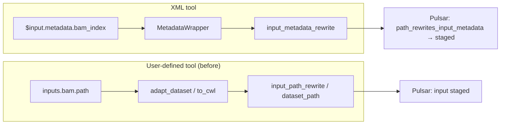
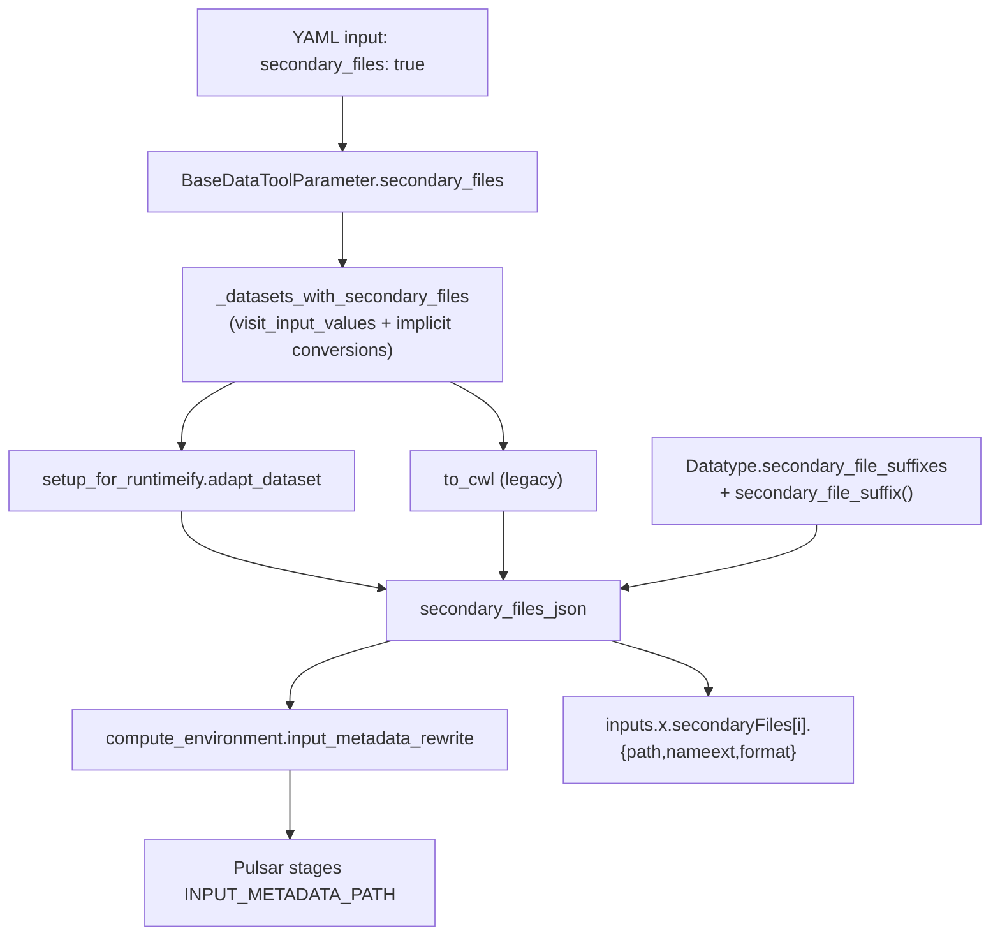

# Learning Galaxy — #24818

- Profile: learning_galaxy (`gx_reviews/reviewers/learning_galaxy.md`)
- Model: Claude Opus 5.5, effort medium
- Reviewed commit: `efa3e7bbdaf10581dc1ffb037ec762d879dd8869`

Architecturally interesting. The PR is mostly a new tool option, but it adds a datatype-level contract (`Data.secondary_file_suffixes`), adds a field to the shared runtime payload (`DataInternalJson.secondaryFiles`), and gives the user-defined tool (UDT) runtime its first path to dataset metadata files. That also means its first Pulsar metadata staging.

## Before the change

**Indexes are metadata, not files beside the dataset.** A BAM's `.bai`, a CRAM's `.crai`, a BCF's `.csi` and a tabix `.tbi` sit in `MetadataFile` rows behind `FileParameter` metadata elements (`bam_index`, `bam_csi_index`, `cram_index`, `bcf_index`, `tabix_index`). `set_meta` makes them. Nothing on the datatype said "this element is an index, and tools expect it with suffix X". The only nearby hint is the display-oriented `data_sources = {"data": "bai", ...}` on `Bam`.

**XML tools reach indexes through Cheetah wrappers.** `$input.metadata.bam_index` resolves through `DatasetFilenameWrapper.MetadataWrapper.__getattr__` (`tools/wrappers.py`). For a `FileParameter` it calls `compute_environment.input_metadata_rewrite(...)`. Under Pulsar that call does more than return a path: it records the local-to-remote pair in `path_rewrites_input_metadata`, and `queue_job` later turns that pair into an `INPUT_METADATA_PATH` client input to stage. **Pulsar stages a metadata file only when something asks for its rewrite.** The tool author still links the index next to the input in the command (`ln -s $input input.bam && ln -s $input.metadata.bam_index input.bam.bai`).

**UDTs build CWL-style inputs through two paths.** `UserToolEvaluator.build_param_dict` uses `runtimeify` + `setup_for_runtimeify.adapt_dataset` (`tools/runtime.py`) when the job has a validated `tool_state`. Otherwise it falls back to the legacy `workflow.modules.to_cwl`. Both emit CWL `File`-like dicts that JavaScript expressions read as `inputs.x.path`. `DataInternalJson` had a commented-out `# "secondaryFiles": List[Any]` placeholder, and there was no way to reach metadata from a UDT.

## What the change does

**1. The datatype declares its indexes.** `Data.secondary_file_suffixes: dict[str, str]` maps a metadata element name to the suffix tools expect. `Bam`, `CRAM`, `Bcf`, `VcfGz` and `IntervalTabix` fill it in, and subclasses inherit it. The hook `secondary_file_suffix(metadata_name, file_name)` lets a datatype decide the suffix from the file itself (see the BAM CSI point below). This is a new, reusable "which metadata is an index" declaration on the datatype. Other consumers, such as a future XML-side or CWL-side `secondaryFiles` export, could read it instead of hard-coding element names.

**2. The tool input opts in.** `secondary_files: true` on YAML `data` / `data_collection` (`YamlDataParameter`, `YamlDataCollectionParameter`) flows through the tool source to `BaseDataToolParameter.secondary_files` (`basic.py`). The authoring option is snake_case, Galaxy-style. The runtime value is CWL's `secondaryFiles`, kept apart with a pydantic alias (`DataInternalJson.secondary_files` ↔ `secondaryFiles`).

**3. The evaluator works out which job datasets get indexes.** `UserToolEvaluator._datasets_with_secondary_files` walks the tool inputs with `visit_input_values`, collects the datasets (including `dataset_instances` of HDCAs/DCEs) given to opted-in inputs, and adds any implicit conversion whose `parent_hda` is in that set. Both runtime paths receive the same `secondary_file_datasets` set, so they agree.

**4. One function builds the payload for both paths.** `tools/runtime.secondary_files_json(dataset, basename, compute_environment)` iterates the datatype's declared elements, calls `input_metadata_rewrite`, and that call is what makes Pulsar stage the file. It returns a list of `{class: File, path, basename, nameroot, nameext, format}`. `adapt_dataset` (runtimeify path) and `to_cwl` (legacy path) both call it.

**5. Semantics follow CWL: staging, not placement.** Galaxy makes the index available but does not symlink it next to the primary file. That matches CWL keeping `secondaryFiles` separate from `InitialWorkDirRequirement`, and matches XML tools linking by hand. The authoring help, the tool-authoring agent prompt and the help-example stubs all teach the `ln -s` idiom.

**6. Strictness is per dataset, decided at job build.** The check runs against the format of the dataset the job actually received, after conversion, not against the input's allowed formats:
- a datatype with no declared indexes (e.g. `sam` on a `[bam, sam]` input) gives `[]`;
- a datatype that has indexes but whose index is missing raises `RequestParameterInvalidException` naming the dataset;
- a deferred dataset passed as a URI gives `[]`;
- an input that doesn't opt in gives `[]`.

## Interesting choices

- **Rewriting a path registers it for staging.** `secondary_files_json` warns callers that calling it causes staging. That is why the feature is opt-in and is not computed for every UDT data input: an unconditional call would make Pulsar ship every BAM index for every UDT job. It is the same side-effect contract the Cheetah `MetadataWrapper` relies on lazily, made explicit.
- **BAM CSI is told apart by magic bytes.** For BAMs with very long contigs, `Bam.set_meta` stores a CSI index in `bam_index`. Rather than changing `set_meta`, which display apps, the genome data provider and XML tools read, `Bam.secondary_file_suffix` reads the first four bytes and returns `.csi` unless they are `BAI\x01`. Payload entries are deduplicated by suffix, so a BAM whose `bam_index` and `bam_csi_index` are both CSI yields one entry.
- **The two runtime paths default differently but end up the same.** On the `runtimeify` path, `secondaryFiles` is a pydantic default `[]` set only for opted-in datasets. On `to_cwl`, the key is written (as `[]` or a list) only when the UDT evaluator passed the set, so workflow callers of `to_cwl` are unchanged. This is the same pattern `element_identifiers` uses in `to_cwl`.
- **Implicit conversions inherit the opt-in.** The evaluator maps "the dataset the user picked" to "the dataset the job got" through `implicitly_converted_parent_datasets`. The same idea is used in `setup_for_runtimeify.find_input`.
- **Tests go through the populator.** A new `DatasetPopulator.get_history_dataset_metadata_file` fetches the stored index bytes. The API and embedded-Pulsar tests compare the index the job saw with Galaxy's copy byte for byte (`od` hex dump in a busybox container).

## Research requests

- Added a requester line to the existing pending request `vault/agents/gx_research/todo/dataset_metadata_files.md` (Component - Dataset Metadata and MetadataFile), covering how tools reach index metadata files and the new `secondary_file_suffixes` declaration. No new request was written.

Stale research and post-merge updates: [learning_galaxy_followup_issue.md](learning_galaxy_followup_issue.md).
