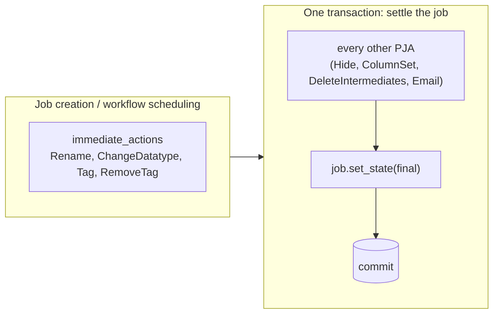
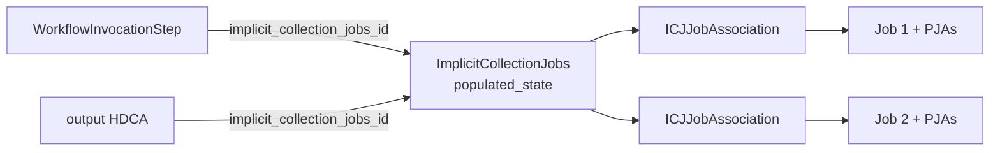
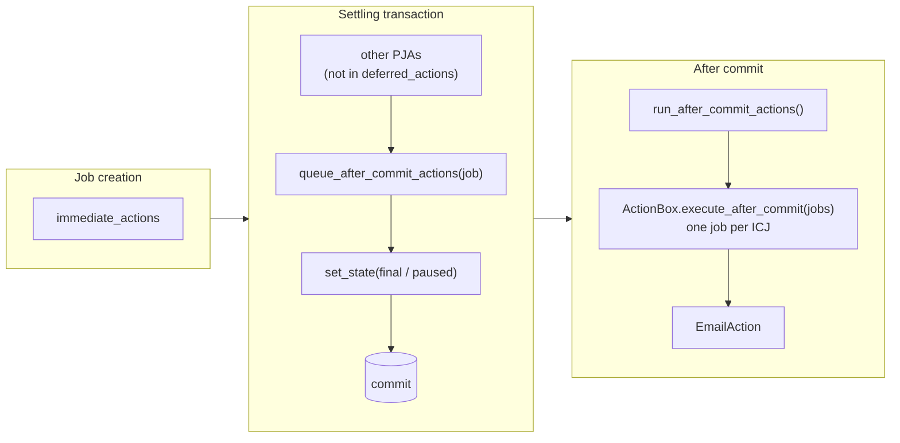
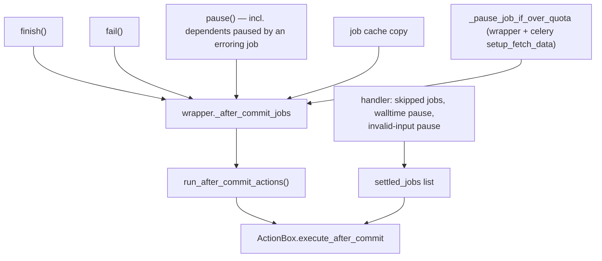
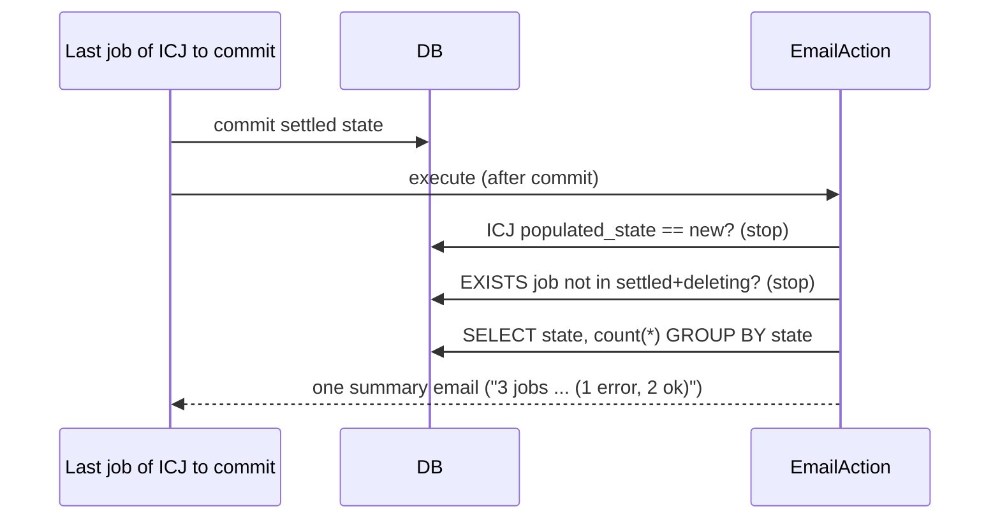

# Learning Galaxy: PR #24835

- Profile: `learning_galaxy` (`gx_reviews/reviewers/learning_galaxy.md`)
- Model: Claude Opus 5.5, effort low
- Reviewed commit: `f207f12dd5e528573a50cabca345d31fac34f76e` (base `release_26.0`)

No P-labeled findings; this profile reports what to learn, not what to fix.

**Verdict: architecturally interesting.** It's a bug fix (one email per map-over instead of one per element), but it changes cross-cutting semantics. Post job actions (PJAs) used to run in two phases. Now there are three: some PJAs run *after* the commit that settles a job, not inside it. It also adds a named job-state vocabulary (`Job.settled_states`) and the first PJA that reasons about a whole map-over rather than one job.

## Before: what to know first

### PJAs ran in two phases

`ActionBox` (`lib/galaxy/job_execution/actions/post.py`) splits actions by when they run. Immediate actions run at job creation, while the workflow is scheduled. All other actions run inside the transaction that settles the job, before its final state is written.

More than one code path settles a job, and each one ran the non-immediate PJAs itself:

| Path | Where | Ran PJAs? |
|---|---|---|
| Runner finish | `MinimalJobWrapper.finish()` | all non-immediate PJAs, before the main commit |
| Failure | `MinimalJobWrapper.fail()` | only `EmailAction`, after the error commit |
| Job cache hit | `MinimalJobWrapper` copy-from-cached-job branch (`jobs/__init__.py` ~1316) | all non-immediate PJAs, before its commit |
| Skipped job | `JobHandlerQueue.__monitor_step` (`jobs/handler.py` ~561) | all non-immediate PJAs, before the handler pass commit |
| Pause (failed input, quota, walltime) | `pause()`, `_pause_job_if_over_quota`, handler | none |
| Stop/delete | `JobHandlerStopQueue.__delete` | none |

### A map-over is an `ImplicitCollectionJobs` (ICJ)

A tool mapped over a collection creates one job per element. They are grouped by an `ImplicitCollectionJobs` row (through `ImplicitCollectionJobsJobAssociation`), and its `populated_state` stays `new` until every job link exists. The workflow invocation step points at the ICJ, not at any one job. That's why `job.workflow_invocation_step` is `None` for a mapped-over job and `job.effective_workflow_invocation_step` goes through the ICJ.

Each element job carries its own copy of the step's PJA associations, so a per-job `EmailAction` fires once per element.

### Job state vocabularies already overlap

`Job` has `terminal_states` (ok, error, deleted) and `finished_states` (terminal plus deleting). There was also a third, unnamed set inline in `Job.is_terminal`: ok, error, deleted, skipped, paused, stopped. The workflow completion code uses that one (`WorkflowInvocationStep.is_complete` → `all(job.is_terminal ...)`). The name `is_terminal` does **not** match `terminal_states`, which trips up readers.

### Other code that aggregates job states

- `HistoryDatasetCollectionAssociation.job_state_summary`: per-state counts for an HDCA's jobs, from one `SUM(CASE ...)` query over ICJ ∪ direct job.
- `WorkflowInvocationStep.is_complete`: Python `all()` over `implicit_collection_jobs.job_list`.
- `WorkflowCompletionManager` + `WorkflowInvocationCompletion` + `completion_hooks/` (`SendNotificationHook`): invocation-level "done" detection with a stored completion row. The row makes notification hooks run exactly once. This is the stored marker the PR's NOTE says a map-over would need to send exactly once.

### `finish()` commit layout on `release_26.0`

On this branch, `finish()` commits outputs, metrics, the collections' `update_time` and the final state together. Only the bump of `workflow_invocation_step.update_time` runs in a second short transaction. The galaxy-brain research note still describes an older split (see the follow-up issue).

## After: how the PR changes the architecture

### A third PJA phase: after commit

`ActionBox` gains `after_commit_actions = ["EmailAction"]` and `deferred_actions = immediate_actions + after_commit_actions`. Every "run the non-immediate PJAs" loop now skips `deferred_actions`. After-commit actions are queued before the settling commit and run once it is done.

Why it matters: an action that reads *other* jobs' state has to run after its own state is visible to them. Otherwise two concurrent finishers each see the other as unfinished, and nobody reports. `DeleteIntermediatesAction` has exactly that blind spot today (it still runs in-transaction). The new phase is the general home for any future "look at my siblings" action.

### Every settle path feeds the same queue

The queue lives on the job wrapper (`MinimalJobWrapper._after_commit_jobs`). Paths that don't go through a wrapper (the handler's skipped/paused jobs, the Celery `setup_fetch_data` quota pause) collect jobs locally and call `ActionBox.execute_after_commit` themselves.

Behavioral consequence: **pausing a job now runs its `EmailAction`**. A standalone paused job suppresses the email itself (`_job_completed` returns `None` for `PAUSED`). A map-over counts paused as settled and sends a summary.

### EmailAction becomes map-over aware

- `Job.settled_states` names the `is_terminal` set; `is_terminal` now reads it.
- `ImplicitCollectionJobs` gains two SQL helpers, `has_job_not_in_states()` (an `EXISTS`) and `job_state_counts()` (a `GROUP BY`). This is the first job-state query on the ICJ itself rather than through an HDCA or a step.
- The email body comes from a "what completed" string (`_job_completed` / `_map_over_completed`) plus a shared `_send`. The invocation report link now uses `effective_workflow_invocation_step`, so map-over emails get it for the first time.
- The send isn't recorded anywhere. Duplicates are possible when two jobs commit within milliseconds, and a resumed paused job produces a second summary. Exactly-once needs a marker like `WorkflowInvocationCompletion`, and that's deferred to `dev`.

## Clever or interesting choices

- **Queue before commit, run after.** `has_after_commit_actions()` is checked before the commit because `expire_on_commit` would otherwise force a reload of `job.post_job_actions` for every job. Jobs without an email PJA never get queued and pay nothing.
- **Per-batch ICJ dedup.** `execute_after_commit` keeps `reported_map_over_ids`, so when one failing job pauses 500 dependents in the same ICJ, the check and email run once, not 500 times.
- **Cheap check first.** Each finishing job runs only the `EXISTS` for an unsettled sibling, which stops at the first hit. The `GROUP BY` count runs only for a job that sees everything settled. The PR body has measured numbers. Total cost still grows with the square of the map-over size, which is why the constant-cost version (a counter or marker column) is a follow-up.
- **`DELETING` is asymmetric.** Siblings count `DELETING` as settled (`MAPPED_OVER_SETTLED_STATES`), because a deleting job turns deleted without running its PJAs and would otherwise block the summary forever. The job's *own* `DELETING`/`DELETED` suppresses the email, so cancelling a running map-over doesn't spray emails.
- **Double-queue guard.** `queue_after_commit_actions` dedupes because `finish()` queues and then raises into `fail()`, which queues again.
- **Handler's extra commit.** After running actions the handler commits again, only to end the read transaction the email queries opened. It's a reminder that SQLAlchemy reads start transactions in Galaxy's long-lived handler session.
- **Test seam reuse.** `mock_emails_to_path://` now accepts a directory and writes one timestamp-prefixed file per email, with `read_mock_emails()` to read them back. The integration test pins the local runner to one worker, so the ordering is deterministic and the known duplicate race can't make it flaky.

## Research requests

None queued. The touched areas have notes (`Component - Post Job Actions`, `Component - Job Completion Lifecycle`, `Component - Collection Models`). Their stale points and post-merge updates are in `learning_galaxy_followup_issue.md`.
