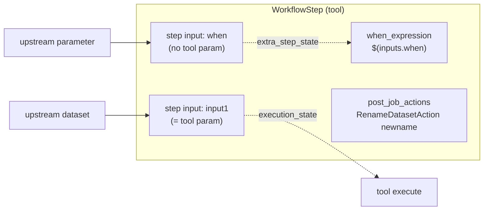
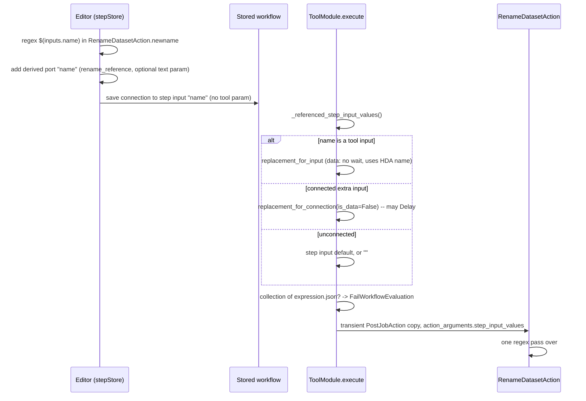

# Learning Galaxy: PR #25002

- Profile: learning_galaxy (`gx_reviews/reviewers/learning_galaxy.md`)
- Model: Claude Opus 5.5, effort medium
- Reviewed commit: `8dd9549cab94b9b3568b098fcc02255faecfcead` (merge-base with dev `6864679ef0b0`)
- No P-labeled findings (profile produces none).

**Architecturally interesting: yes.** Not because of one new rename token, but because it turns "extra step inputs" (step inputs that aren't tool parameters) from a `when`-only feature into a general mechanism. The editor derives the ports, the scheduler resolves and waits on them, and post job actions get a value channel at scheduling time. All three layers change together.

## Before: what to know

### Step inputs and tool inputs are different things

A `WorkflowStep` has `inputs` (`WorkflowStepInput` rows, each with connections and an optional default). A tool has its own parameter tree. Usually each step input names a tool parameter. Before this PR, only `when` expressions created step inputs that matched no tool parameter. gxformat2 `in:` entries such as `when: param/out` are stored the same way.

- **Scheduler (`ToolModule.execute`):** for a `when` step it builds `extra_step_state` from step inputs missing from `execution_state.inputs`. Each value comes from `progress.replacement_for_connection(...)`, which raises `DelayedWorkflowEvaluation` until the upstream value exists. CWL JS (`do_eval`) then evaluates the `when`. Before the PR, the loop indexed `connections[0]` with no check, so an unconnected non-tool input with only a default would crash.
- **`MapOverPlanner`:** it also iterated `step.inputs` not in the tool's known inputs and indexed `connections[0]`, assuming every extra step input is connected.
- **Rename PJA (`RenameDatasetAction.execute`):** this is an *immediate* action that runs in the `job_callback` during scheduling, and on the implicit collection through `execute_on_mapped_over`. It has two template layers:
  - `#{input|filter}` resolved by `RENAME_INPUT_REFERENCE_PATTERN.sub(resolve, …)` against the job's input datasets
  - `${key}` workflow parameters, which `replacement_dict` replaces afterwards, across the whole string
  
  Nothing tied a rename to a step input value that the workflow computes during the run.

### Editor: extra inputs are derived, not stored

`workflowStepStore` computes `stepExtraInputs` from the step (`findStepExtraInputs`). Before the PR this meant only the `when` "gate" ports parsed out of the expression. `getCombinedStepInputs` merges them with `step.inputs` for rendering. `terminalFactory` maps `input_type: "parameter"` to `InputParameterTerminal`. `BaseOutputTerminal.validInputTerminals()` (the drag/ConnectionMenu target scan) looked only at `step.inputs`, so gate ports were not offered as drop targets while dragging.

## After: what changes

1. **Generalized extra step inputs.**
   - **Editor:** `findStepExtraInputs` now merges two sources. It keeps `findGatePorts` (the old `when` logic) and adds `renameReferencePort`s for every `$(inputs.name)` in a rename action. It skips names that are already step inputs, gate ports, or keys of `tool_state`.
   - **Scheduler:** `extra_step_state` and `MapOverPlanner` now accept a step input that has no connection. They fall back to its default, and the planner skips mapping. This also changes `when` semantics: an unconnected `when` input with a default now evaluates to that default instead of erroring.
2. **A new scheduling dependency source.** Before, a step waited only on tool parameter connections and `when` inputs. Now a reference in a rename PJA also counts. `_referenced_step_input_values` runs once per step, before jobs are built, so a pending upstream parameter delays the whole step. Data tool inputs deliberately don't wait; they resolve to the HDA's name the way `#{}` does.
3. **Scheduling-time values reach a PJA without being stored.** The resolved strings go on a transient `PostJobAction` copy under `action_arguments["step_input_values"]` (`STEP_INPUT_VALUES_ARGUMENT`). The stored workflow keeps `$(inputs.name)`, so the next invocation re-resolves. This is a new pattern: before, the only runtime channel into a PJA was `replacement_dict`, which is shared and applies to the whole invocation. This channel is per step and holds structured values.
4. **Rename template grammar.** One combined regex (`#{…}|$(inputs.x)`) does a single substitution pass, so a substituted value is never re-parsed as `#{}` or `$(inputs.)`. Outside a workflow, references nobody resolved are left as written.
5. **Editor terminal type.** A `rename_reference` flag on `ParameterStepInput` selects `InputRenameReferenceTerminal`. It accepts any single non-collection, non-multiple `OutputParameterTerminal`, whatever its type. `validInputTerminals()` now scans `getCombinedStepInputs`, so all derived ports, gate ports included, become drop targets.
6. **Test framework (separate commit):** `ConfiguredDriver` and `get_playwright_driver` gain `video_dir` and `slow_mo`, set from `GALAXY_TEST_PLAYWRIGHT_VIDEO_DIRECTORY` and `GALAXY_TEST_PLAYWRIGHT_SLOW_MO`. Teardown now closes the context before the browser so Playwright flushes the video.

## Choices worth noticing

- **`$(inputs.x)` is CWL syntax, but nothing evaluates it.** It looks like the `when` expression language, yet it is a regex token replaced by a formatted string. Rename never invokes `do_eval` or Node, and needs no expression-isolation command. The price is that `$(inputs.x + 1)` and similar expressions are not supported. The regex is mirrored on both sides (`STEP_INPUT_REFERENCE_PATTERN` in `post.py`, `RENAME_STEP_INPUT_REFERENCE` in `workflowStepStore.ts`), with a comment cross-referencing them.
- **Formatting rules (`format_step_input_reference`):**
  - booleans become `true`/`false` (CWL style, not Python's `True`)
  - lists are comma-joined
  - HDAs and HDCAs give their `.name`
  - `None` and `NO_REPLACEMENT` become `""`
  
  These are the PR's de facto typed-to-string contract, comparable to `to_cwl` for expressions.
- **The `${…}` pass still runs after substitution.** A computed value that contains `${key}` would still be expanded by `replacement_dict`. The single-pass guarantee covers only `#{}` and `$(inputs.)`, as the code comment says.
- **Collections of values are rejected at scheduling time.** The check looks for `expression.json` elements that aren't skipped, because skipped data elements are also stored as `expression.json`. One name per step can't vary per element. The editor's terminal rejects these connections up front, and the backend repeats the check with `workflow_parameter_invalid`.
- **The editor avoids shadowing tool state.** `findStepExtraInputs` skips `name` when `tool_state` has that key, which mirrors the backend preferring `all_inputs_by_name`. Both sides apply the same precedence: tool input, then extra connection, then default.
- **Ports linger as invalid.** Removing the reference from the text leaves the connection in place but shown as invalid, the same as `when` gate ports today. Derived ports have no lifecycle hook to clean up their connections.

## Research requests queued

- `vault/agents/gx_research/todo/workflow_extra_step_inputs.md`
