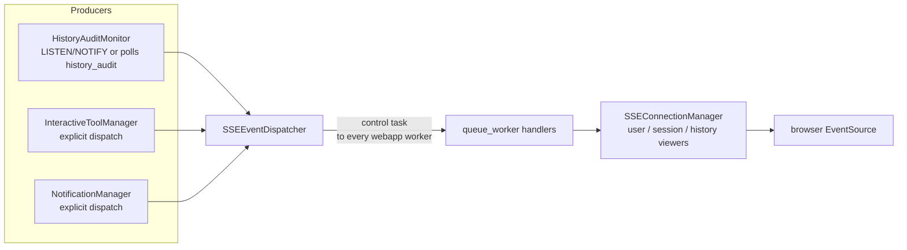
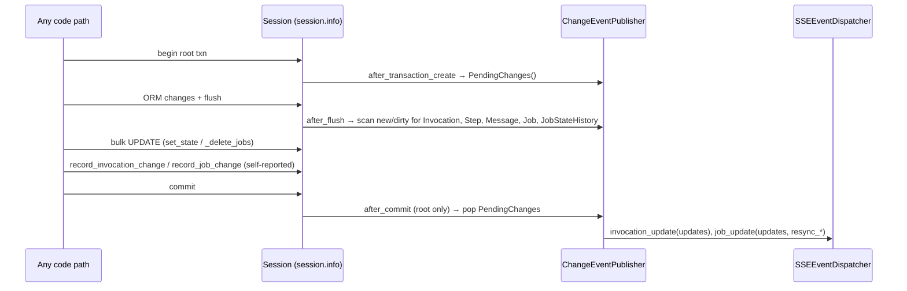
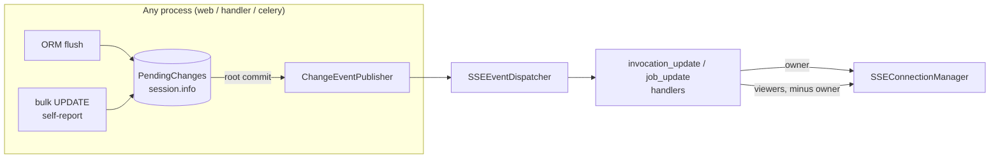

# Learning Galaxy — PR #25003

- Profile: learning_galaxy (`gx_reviews/reviewers/learning_galaxy.md`)
- Model: Claude Opus 5.5, effort: medium
- Reviewed commit: `e9fa3cda0899fe6de6fa53b13064a12905b97620`
- Follow-up issue: [learning_galaxy_followup_issue.md](learning_galaxy_followup_issue.md)

Architecturally interesting: it adds a new producer pattern for SSE (a SQLAlchemy session-event publisher that turns committed ORM changes into events), two new event types, an access check on history-viewer subscriptions, and rewires the test populators so `wait_on_*` helpers are event-driven against SSE-enabled servers.

## Before: what to know

With `enable_sse_updates`, Galaxy pushes events to browsers over one `EventSource` per tab (`/api/events/stream`). The pipeline has three layers:

- **Producers** call `SSEEventDispatcher` (`managers/sse_dispatch.py`), which sends a Kombu control task to every live webapp worker's control queue.
- **Control-task handlers** in `queue_worker/__init__.py` (`history_update`, `entry_point_update`, ...) run on each webapp worker, encode ids, and build `SSEEvent`s.
- **`SSEConnectionManager`** (`managers/sse.py`) holds one `asyncio.Queue` per connected tab, indexed by user id, galaxy session id, and history-viewer subscriptions (`POST /api/events/history-subscriptions`).

Before this PR there were two producer styles. One is database-detected: `history_audit` triggers feed a monitor thread. The other is explicit: the mutating code path calls the dispatcher. Invocations and jobs had no events, so the invocation page, job views, and API tests polled (`wait_on`, every ~3s on the client).

Two facts about the model layer matter here:

- Invocation and job state often changes through **bulk `UPDATE`s that bypass the unit of work**. `WorkflowInvocation.set_state` uses a guarded `UPDATE ... WHERE state NOT IN final_states`. `Job.set_state` uses a guarded `UPDATE` for non-terminal targets, then appends a `JobStateHistory` row. `cancel_invocation_steps` bulk-sets jobs to `deleting`. ORM flush listeners never see these column changes.
- The commit is usually made **far from the change**, by a caller in the web request, workflow scheduler iteration, job handler, runner, or Celery task. That is why explicit "dispatch after commit" calls never fit invocations and jobs.

History-viewer subscription used to have no authorization check. The docstring argued that events only carried history ids.

## After: what changes

A new `ChangeEventPublisher` (`managers/change_events.py`) is registered on the `scoped_session` factory in `GalaxyManagerApplication` when SSE is on. This is the base app for web, handler, and Celery processes, so whichever process commits a change also publishes it. The publisher is a third producer style: **transaction-scoped change capture**.

Key pieces:

- **`model/pending_changes.py`** is a tiny model-layer module. It holds the `PendingChanges` dataclass (`invocations: {id: (owner, history, state)}`, `jobs: {id: (user, session, history, state)}`) stored in `session.info["galaxy.pending_changes"]`, plus `record_job_change`. `record_invocation_change` lives in `model/__init__.py`. Recording is a no-op when no publisher is listening, so the model has no dependency on managers or SSE.
- **Two capture sources.**
  - ORM changes are read in `after_flush` from attribute history: invocation state assignments, new steps and messages, step state changes, job state assignments, and new `JobStateHistory` rows. The last one is how the bulk-`UPDATE` branch of `Job.set_state` gets noticed.
  - Bulk `UPDATE`s self-report. `WorkflowInvocation.set_state` checks `rowcount`. The new `WorkflowInvocation._delete_jobs` uses `UPDATE ... RETURNING` to learn which jobs it touched.
- **New control tasks** `invocation_update` and `job_update`, with `TypedDict` wire contracts (`InvocationUpdate(Payload)`, `JobUpdate(Payload)`) next to the existing payloads in `queue_worker`. One transaction produces one control message per event type, however many objects changed.
- **Routing.** Invocations go to the history owner. Jobs go to the job's user, or the galaxy session for anonymous jobs. Both also go to that history's viewers. The client payload is minimal (`{"invocations"|"jobs": [{id, state}]}`), so clients refetch through the normal access-controlled API.
- **Viewer subscriptions are now access-checked** (`EventsService._is_accessible_history` → `HistoryManager.is_accessible`). Viewers now receive object ids and states, not just "history X changed". The endpoint switched to `ProvidesHistoryContext` so the anonymous current-history case works.

### Test infrastructure shift

`BaseDatasetPopulator` gains `wait_on_sse`, `wait_on_job_update`, `wait_on_history_update`, and `wait_on_invocation`. When the server reports `enable_sse_updates`, `wait_for_history`, `wait_for_job`, `wait_for_invocation`, and `wait_for_invocation_completion` open an SSE stream and **re-check only when a matching event arrives**. Otherwise they poll as before. A missing event therefore makes a wait time out, so every API/integration test that waits on a job or invocation against an SSE-enabled server implicitly tests the producers. `wait_on_state` (tool-util `wait_on_state`) gains a pluggable `wait=` strategy to make this possible.

## Clever or interesting choices

- **Savepoint-correct buffering.** `after_transaction_create` snapshots `PendingChanges` when a nested transaction (savepoint) begins. A release pops the snapshot, and a rollback restores it in `after_transaction_end`. Each root transaction starts with a fresh buffer, so rolled-back work is never published. `after_commit` checks `get_nested_transaction()` to tell a savepoint release from the real commit. This is a reusable recipe for any "publish after commit" producer. #24738's quota producer solves the same problem differently.
- **Detecting `Job.set_state`'s bulk path through its side effect.** Instead of editing `set_state`, the publisher treats a new `JobStateHistory` row as a signal and re-reads the job. Every state-history append is effectively a change notification.
- **`UPDATE ... RETURNING` only when someone listens.** `_delete_jobs` keeps the plain `UPDATE` when there is no `PendingChanges`, and adds `RETURNING` only to collect routing info. Non-SSE deployments pay nothing.
- **Best-effort publishing.** Dispatcher failures are logged and swallowed in `after_commit`. The commit is authoritative, and an event must never fail the committer.
- **Fan-out cap.** More than `MAX_JOBS_PER_EVENT` (500) job changes for one owner in a transaction, typically a large collection map-over, collapse into one `{"resync": true}` event for that owner and the affected histories' viewers.
- **Owner/viewer dedupe.** `push_to_history_viewers` gains `exclude_user_ids`, so an owner who also has a viewer subscription isn't sent the event twice.
- **`session.new` is materialized once** in `after_flush`, because SQLAlchemy builds a new set on every access and a flush can hold thousands of objects.
- **Event-driven test waits without races.** `wait_on_events` records the matching-event count *before* running the check. It then blocks on a `threading.Condition` until the count goes up, so a change that commits between the check and the wait still wakes it. `SSELineListener.stop()` shuts the socket down so it doesn't sit until the 30s keepalive. Viewer subscription travels on the same control queue as the events, so it is ordered ahead of later events.

## Research requests

No new request. The PR reshapes the area covered by the existing pending request `vault/agents/gx_research/todo/sse_live_updates.md`. I added this PR to its scope and its `## Requested by` list.
