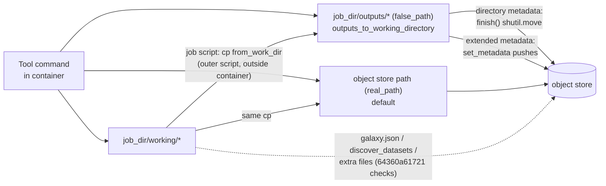
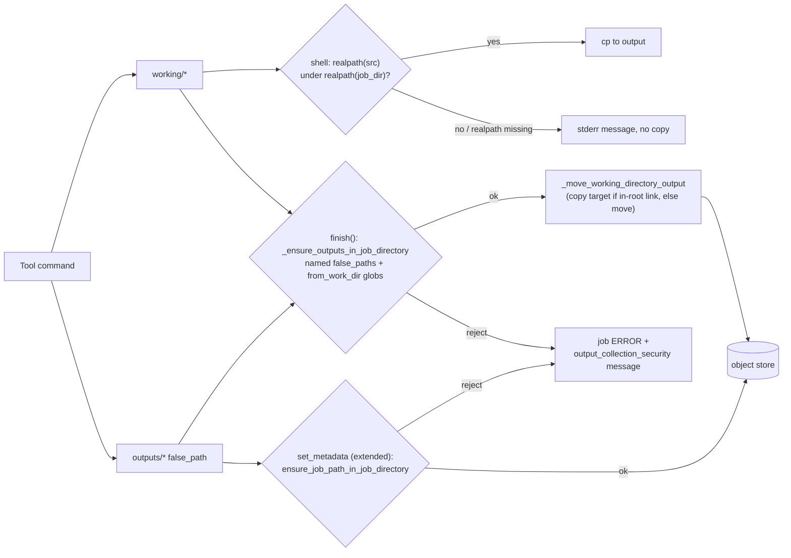

# Learning Galaxy — #25005

- Profile: `learning_galaxy` (`gx_reviews/reviewers/learning_galaxy.md`)
- Model: Claude Opus 5.5, effort low
- Reviewed commit: `2b11cda0d36d236a4562eb8ef7be2cfeb77add03`

Verdict: architecturally interesting, narrowly. It's a security fix, but it finishes a cross-cutting invariant started in `64360a61721` ("Harden tool-provided dynamic output collection"): **a path located in the job directory must also resolve into the job directory**. After this PR every local output collection path enforces that invariant, not only the dynamic/discovered ones.

## Before: three ways an output leaves the job directory

A job's named outputs reach the object store by one of three routes, chosen by job config and tool XML:

- **`from_work_dir`**: `command_factory.__copy_if_exists_command` appends `cp working/<src> <output>` to the job script. It runs in the outer job script, outside the tool container, with Galaxy's (or the job user's) view of the filesystem.
- **`outputs_to_working_directory`**: the tool writes to `false_path` in the job directory. With `metadata_strategy: directory`, `MinimalJobWrapper.finish()` moves `false_path` to `real_path`. With `extended`, `set_metadata.py` (running in the job) does the move/push and `finish()` imports the resulting model store.
- **Dynamic outputs** (`galaxy.json`, `discover_datasets`, extra files, metadata file): `64360a61721` added realpath containment (`ensure_path_in_directory`, `safe_path_from_directory`, `InvalidDiscoveredFilePathError`), all subclasses of `OutputCollectionSecurityError` in `lib/galaxy/model/store/discover.py`, and a `output_collection_security` job message.

The gap: named outputs and `from_work_dir` sources were followed blindly. A tool could replace an output with `ln -s /some/host/file out` and Galaxy's own process copied/moved the target.

### The `output_collection_security` job message (John's question)

Already defined on `release_26.1` by `64360a61721`; this PR only reuses it.

- Python type: `OutputCollectionSecurityJobMessage` in `lib/galaxy/tool_util/output_checker.py`, a member of the `AnyJobMessage` union and `JobMessageTypeLiteral`.
- Persisted via `Job.job_messages: Mapped[Optional[list[AnyJobMessage]]]` (`lib/galaxy/model/__init__.py`), exposed by the jobs API model in `lib/galaxy/webapps/galaxy/api/jobs.py` (`job_messages: Optional[list[AnyJobMessage]]`).
- OpenAPI/TS: `components["schemas"]["OutputCollectionSecurityJobMessage"]` in `client/packages/api-client/src/schema/schema.ts`; added to the client `JobMessage` union in `client/src/api/jobs.ts`.
- Producers: `set_metadata.py` builds it with the TypedDict constructor; `finish()` (both the `64360a61721` discovery path and this PR's new path) writes a plain dict literal with the same keys. Small inconsistency, no behavior difference.

## After: one containment rule at every hand-off

Key architectural points:

- **New shared helper** `ensure_job_path_in_job_directory(path, job_directory)` lives beside `ensure_path_in_directory()` in `galaxy.model.store.discover`. That module is becoming the home of Galaxy's output-collection trust-boundary predicates; new collection paths should reach for these instead of ad hoc `realpath` checks.
- **Check scope is "located in the job dir", not "every path"**. Outputs written straight to the object store (default config) aren't checked, because Galaxy never re-reads them from the job directory. The check matters only where Galaxy later moves or copies a job-directory path the tool could have replaced.
- **Layered defense for `from_work_dir`**: the shell guard prevents the copy (the only thing that can, since with direct object-store outputs a copied link would already be in the store); `finish()` then re-globs the same source in Python and fails the job with the security message. Without the Python pass the job would just look like a missing/empty output.
- **Failure plumbing reuses `64360a61721`'s pattern**: `OutputCollectionSecurityError` → `final_job_state = ERROR` → `output_collection_security` job message, rather than raising into the runner's `fail()`. `fail()` itself now also routes through `_move_working_directory_output`, so a rejected output is not moved there either.
- **Pulsar is out of scope by construction**: Pulsar already refuses escaping output links at stage-out and does not run the `from_work_dir` copy commands. The `remote_command_params["working_directory"]` branch in `__handle_work_dir_outputs` just keeps the shell guard's `job_directory` in sync with whatever directory the script will run in.

## Clever / interesting choices

- **"Located in" is decided lexically, "resolves to" by realpath.** The helper walks `Path(abspath(path)).parents` and asks whether any parent's `realpath` equals `realpath(job_directory)`. Links *above* the job dir (a symlinked `jobs_directory`) are therefore trusted; links *below* it are not. `os.path.lexists` (not `exists`) means dangling links are still checked, since their realpath points wherever the tool aimed them.
- **Copy, don't move, in-root symlinks.** Moving `out.txt -> real.txt` into the object store would store a link into the job directory that dangles after cleanup. `_move_working_directory_output` copies the target when `false_path` is a link (already proven in-root).
- **Shell and Python agree on glob semantics.** `command_factory.__quote_preserving_globs` shell-quotes everything except `*` and `?`; `_ensure_outputs_in_job_directory` mirrors that with `glob.escape` on every non-`*`/`?` segment, so Python checks exactly the files the shell copied.
- **Fail-closed shell idiom.** `case "$(realpath SRC)" in "$(realpath JOBDIR)"/*) cp ... ;; *) echo ... >&2 ;; esac`. If `realpath` is absent both substitutions are empty, the pattern `/*` doesn't match `""`, and the copy is refused. The trailing `/` prevents prefix collisions (`/jobs/1` vs `/jobs/10`).
- **Job message appended late.** `finish()` stashes the error and appends the message after extended-metadata import and discovery, because both overwrite `job.job_messages`.
- **`_files` directories**: `cp -r` copies nested links as links; extra-files collection (`safe_walk`) already drops escaping ones, so only the top-level source needs the realpath guard.

## Research

- `vault/research/Component - Job Completion Lifecycle.md` is the only note on the touched code; see `learning_galaxy_followup_issue.md` for one baseline conflict and post-merge updates.
- No note covers the output-collection trust boundary (named outputs, `from_work_dir`, `outputs_to_working_directory` × metadata strategy, dynamic discovery, Pulsar stage-out). Queued:
  - `vault/agents/gx_research/todo/job_output_collection_trust_boundary.md`
