# Learning Galaxy — PR #25023

- Profile: `learning_galaxy` (`gx_reviews/reviewers/learning_galaxy.md`)
- Model: Claude Opus 5.5; effort: medium
- Reviewed commit: `ff96b8bb47c49cd0886b04747bc1825bc8e25601` (merge base `4d02c778c4c7`)

Architecturally interesting: yes. Labeled a bug fix, but it changes a shared payload (a new `compute_environment.json` in the job's model-store directory), a cross-cutting interface (`ComputeEnvironment.input_metadata_rewrite`), adds a `ComputeEnvironment` subclass and a `Tool` class hook, and removes the coupling between remote tool evaluation and the `extended` metadata strategy.

## Before: what to know

### Two places a command line can be built

`tool_evaluation_strategy` (galaxy.yml or destination param) picks where `ToolEvaluator.build()` runs.

- `local` (default): the job handler evaluates the Cheetah templates in `MinimalJobWrapper.prepare()`. Every path a template sees comes from a `ComputeEnvironment` (`lib/galaxy/job_execution/compute_environment.py`). `SharedComputeEnvironment` returns Galaxy paths (rewrites return `None`, meaning "use the model's path"); `PulsarComputeEnvironment` (`jobs/runners/pulsar.py`) returns the paths Pulsar will stage to, via Pulsar's `PathMapper`.
- `remote`: `prepare()` still runs tool hooks (`exec_before_job`), but skips templating. It drops `job_io.json` and `tool_data_tables.json` into `metadata/outputs_new/`, next to the job model store that `PortableDirectoryMetadataGenerator.setup_external_metadata` exports there for both metadata strategies. `command_factory.__handle_remote_command_line_building` prepends a `remote_tool_eval.py` invocation to the job script. On the compute node `RemoteToolEvaluator` imports the model store into a `SessionlessContext`, materializes deferred inputs, builds the command and appends it to `tool_script.sh`.

```mermaid
flowchart LR
  subgraph Handler["Galaxy job handler (before)"]
    P[prepare()] -->|local| TE[ToolEvaluator.build<br/>+ ComputeEnvironment]
    P -->|remote| EX[export model store,<br/>job_io.json, tool_data_tables.json<br/>to metadata/outputs_new]
    EX --> OSC[metadata/object_store_conf.json<br/>extended only]
  end
  subgraph Node["Compute node (before)"]
    RTE[remote_tool_eval.py] --> OS[build object store<br/>from object_store_conf.json]
    OS --> SCE[SharedComputeEnvironment<br/>paths = dataset.get_file_name&#40;&#41;]
    SCE --> TS[append to tool_script.sh]
  end
  EX --> RTE
  OSC --> OS
```

### Why remote evaluation required `extended`, and why Pulsar did not work

The remote evaluator resolved file paths the only way the model knows how: `Dataset.get_file_name()` through an object store, rebuilt on the node from `metadata/object_store_conf.json` (`set_metadata.get_object_store`). Only the `extended` strategy writes that file (`write_object_store_conf = True`), so `remote_command_line` required `external_output_metadata.extended`. That also implicitly excluded interactive tools, `__SET_METADATA__` and task-split jobs, which always get the directory strategy.

That works when the compute node shares Galaxy's object store paths. Under Pulsar with `rewrite_parameters`, the paths that exist on the node are the ones Pulsar chose during staging, not Galaxy's. The baseline Pulsar branch literally carried a TODO saying so (`bash ../tool_script.sh` after evaluation, "doesn't really work if there are no shared paths").

### Tool hooks always run on the handler

Even with remote evaluation, `exec_before_job` hooks run in `prepare()` on Galaxy. Expression tools write `_evaluate_expression_.py` and `_expression_inputs_.json` into the Galaxy job directory there, and `json_wrap` reads `load_contents` inputs while doing so. Pulsar only staged `tool_script.sh` from the job directory.

### Path accessors that bypassed the compute environment

`DatasetFilenameWrapper.all_metadata_files` and `DatasetCollectionWrapper.element_identifiers_extensions_paths_and_metadata_files` (used by `staging_path_and_source_path` serialization) read paths straight from the model, giving Galaxy-side paths regardless of compute environment. This is the same bypass tracked in branch `issue_25040_collection_paths_rewrite_26_2`.

## After: what changes

### A recorded path map replaces the object store

The core move: Galaxy decides every job file's compute-side path once, on the handler, and ships the answer as data. The evaluator looks paths up instead of recomputing them.

```mermaid
flowchart LR
  subgraph Handler["Galaxy job handler (after)"]
    CE["ComputeEnvironment<br/>(Shared or Pulsar)"] --> REP[remote_evaluation_paths&#40;&#41;]
    REP --> CEJ[outputs_new/compute_environment.json]
    P2[prepare&#40;&#41;] --> MS[model store + job_io.json<br/>any metadata strategy]
  end
  subgraph Node["Compute node (after)"]
    RTE2[remote_tool_eval.py] --> RCE["RemoteComputeEnvironment<br/>lookup by Dataset.id / instance:id:name"]
    RCE --> TS2[tool_script.sh]
    RTE2 --> CL[outputs_populated/remote_command_line.txt]
  end
  CEJ --> RCE
  MS --> RTE2
  CL -->|staged back| FIN["finish(): job.command_line"]
```



- `remote_evaluation_paths(job_io, compute_environment, unstructured)` serializes four maps: `datasets` and `extra_files` keyed by `Dataset.id`, `metadata_files` keyed by `"<InstanceClass>:<instance id>:<metadata name>"`, and `unstructured` keyed by Galaxy path. Values come from whatever `ComputeEnvironment` the job was prepared with, falling back to the model path when the environment returns `None`.
- `RemoteComputeEnvironment(SharedComputeEnvironment)` is the evaluator-side reader. Deferred inputs are deliberately absent from the map; the evaluator materializes them and `input_path_rewrite` falls back to the parent.
- `ToolApp.object_store` is now `None`. Object store credentials no longer travel with remote evaluation; `extended` still writes `metadata/object_store_conf.json` for metadata collection.
- Since the command line used to return only through the extended model-store import, the evaluator also writes `outputs_populated/remote_command_line.txt` (`REMOTE_COMMAND_LINE_FILE` in `galaxy.metadata`), and the non-extended branch of `finish()` reads it.
- `remote_command_line` loses its `extended` check and gains explicit exclusions for `interactive`, `set_metadata` tool types and task-split jobs.

### Pulsar: evaluate after staging, with Pulsar's paths

```mermaid
sequenceDiagram
  participant H as Galaxy handler
  participant PCE as PulsarComputeEnvironment
  participant Pul as Pulsar
  participant N as Job on node
  H->>PCE: prepare(compute_environment) — hooks only
  H->>H: force rewrite_parameters, require remote_metadata
  H->>PCE: input/output/metadata rewrites
  H->>H: _setup_remote_tool_evaluation: rewrite job_io.json (remote dirs) + compute_environment.json (incl. unstructured)
  H->>Pul: stage inputs (minus deferred), metadata files, Tool.job_directory_files, whole tool dir if no required_files
  Pul->>N: run script
  N->>N: remote_tool_eval.py && { tool commands; }
  N-->>H: outputs, outputs_populated/remote_command_line.txt
```

- `rewrite_parameters` is forced on for remote-evaluation jobs: structured path mapping is the only option when the command doesn't exist yet for Pulsar's text find-and-replace to act on.
- `remote_metadata: true` is required, because the node already needs a Galaxy runtime.
- Deferred inputs are filtered out of `ClientInput`s; the evaluator fetches them.
- Without `<required_files>`, the whole tool directory is staged via a synthetic `RequiredFiles` with a `""` prefix include, since nobody can know which tool files an unevaluated template references.
- `version_path` for the in-job metadata command now comes from the compute environment (`remote_command_params["version_path"]`).

### New and changed extension points

- `ComputeEnvironment.input_metadata_rewrite(dataset, metadata_name, metadata_file)` replaces `(dataset, metadata_value)`. Passing the name and `MetadataFile` lets an environment resolve by identity instead of Galaxy path. Every subclass must follow (Pulsar's now calls `metadata_file.get_file_name()` itself).
- `Tool.job_directory_files: tuple[str, ...]` declares files a tool's hooks write to the job directory. `ExpressionTool` sets it; the Pulsar runner stages them like `tool_script.sh` and registers them as config files so their paths are rewritten.
- `all_metadata_files` and collection element paths now route through wrappers and `input_metadata_rewrite`, so `staging_path_and_source_path` JSON gets compute-side paths.
- `json_wrap` reads `load_contents` and `expression.json` nulls through `_galaxy_file_name` (`wrapper.unsanitized.get_file_name()`), because these run in handler-side hooks where `str(wrapper)` is a node path.

## Clever or interesting choices

- **Keys by database id, not UUID.** The PR description and `metadata_file_key` comment explain it: `Dataset.uuid` and `MetadataFile.uuid` are nullable and metadata file UUIDs aren't unique; `MetadataFile` ids aren't exported, so metadata is keyed by owning instance class, id and metadata name. The class name in the key keeps HDA and LDDA ids from colliding. `test_remote_evaluation_paths.py` pins this with two UUID-less BAM inputs.
- **Data over configuration.** Replacing "ship the object store config and recompute" with "ship the answers" both fixes Pulsar and removes a credential leak surface. The same `remote_evaluation_paths` serves the local runner (Galaxy paths) and Pulsar (staged paths); only the environment passed in differs.
- **Shell guard.** `commands_builder.commands = f"{{ {commands_builder.commands}; }}"` wraps the whole multi-line tool block so `remote_tool_eval && { ... }` can't half-run the tool when evaluation fails (stdout/stderr streaming adds a multi-line setup block that a bare `&&` would only guard partially).
- **Written twice for Pulsar.** `prepare()` writes `compute_environment.json` with the Pulsar environment; `_setup_remote_tool_evaluation` overwrites it after `build_command`, adding unstructured rewrites and replacing `job_io.json` directory fields with remote ones. The first write's comment ("Pulsar rewrites this") refers to the Galaxy-side Pulsar runner, not the Pulsar server.
- **Overlap with #25040 work.** The wrapper changes to `all_metadata_files` and collection element paths cover part of what branch `issue_25040_collection_paths_rewrite_26_2` fixes (collection `all_paths`, `serialize()`, `data_style="paths"`). Whichever lands second will need to reconcile.
- **Known gap left for Pulsar.** Expression tools on REST/embedded Pulsar need `PYTHONPATH=$GALAXY_LIB` in destination `env` until Pulsar passes on `preserve_galaxy_python_environment`; the integration job confs carry this workaround.

## Research requests

Both relevant gaps already have pending requests; per this run's coordinator instructions nothing outside this file and the follow-up file was written. Suggested `## Requested by` lines for the coordinator to add:

- `vault/agents/gx_research/todo/tool_evaluation_compute_environment.md` — `vault/repositories/galaxy/reviews/active/25023`: needed `RemoteComputeEnvironment`, the `compute_environment.json` path map, the new `input_metadata_rewrite(dataset, metadata_name, metadata_file)` signature, and `RemoteToolEvaluator` without an object store.
- `vault/agents/gx_research/todo/job_preparation_and_job_script.md` — `vault/repositories/galaxy/reviews/active/25023`: needed the remote-evaluation branch of `prepare()` (files written to `metadata/outputs_new/`), the guarded `remote_tool_eval && { ... }` job script shape, and `Tool.job_directory_files`.
