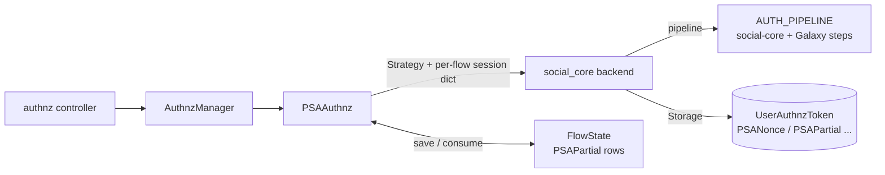
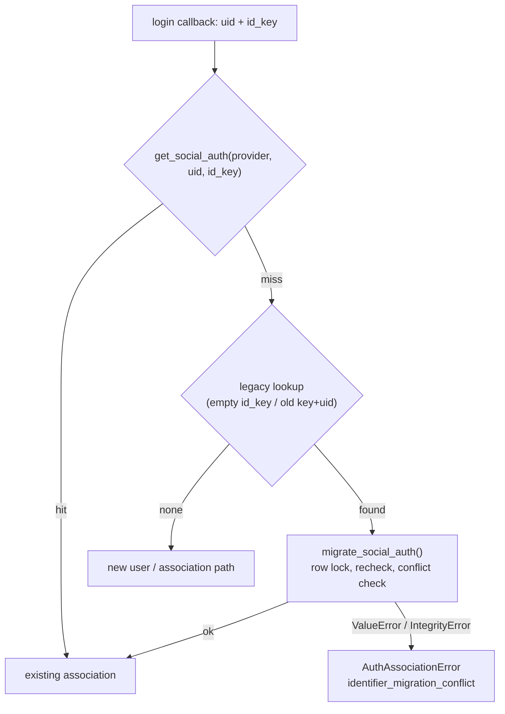
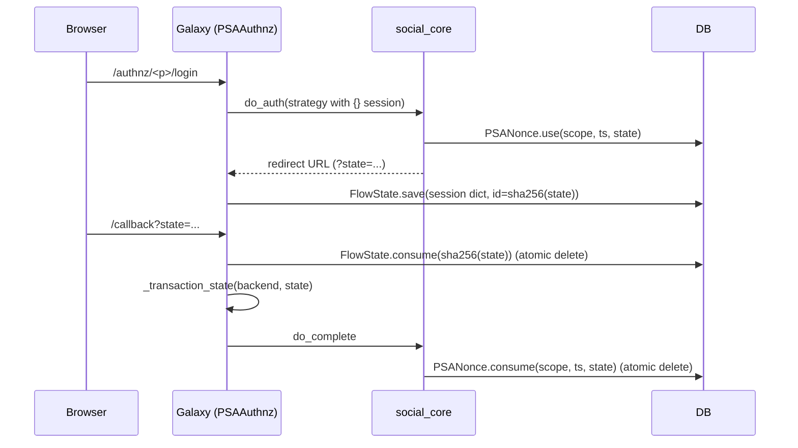

# Learning Galaxy — #25081 Upgrade social-auth-core to 6.2.0

- Profile: learning_galaxy (`gx_reviews/reviewers/learning_galaxy.md`)
- Model: Claude Opus 5.5, effort: medium
- Reviewed commit: `975fd1a7ad0551b4b1c7f79084499d97e75f7ca5`

No P-labeled findings (profile produces none).

**Verdict: architecturally interesting.** Nominally a dependency bump, but it changes what identifies an external identity (`(provider, uid)` becomes `(provider, uid, id_key)`, with a schema migration and on-login row migration), changes how OAuth2 state is stored and validated, and widens the storage contract Galaxy implements for social-auth-core.

## Before: how OIDC login fits together

Galaxy doesn't own the OAuth/OIDC protocol. It plugs into python-social-auth (`social_core`) by implementing three of its extension points:

- **Strategy** (`psa_authnz.Strategy`): gives social-core request data, settings, and a "session" dict. Galaxy never hands it the HTTP session. `authenticate()` passes a fresh `{}`, and `FlowState` saves that dict as a `PSAPartial` row bound to the `GalaxySession` + provider, keyed by `sha256(state)`. `callback()` consumes that row atomically and rebuilds the strategy around it. That's how login state survives across workers and stays single-use.
- **Storage** (`psa_authnz.Storage`): points social-core at Galaxy ORM classes in `galaxy.model` (`UserAuthnzToken`, `PSANonce`, `PSAPartial`, `PSACode`, `PSAAssociation`). Their class-level `sa_session` is set per request by `on_the_fly_config()`.
- **Pipeline** (`AUTH_PIPELINE`): stock social-core steps interleaved with Galaxy steps (`verify`, `associate_by_email_if_logged_in`, `check_user_creation_confirmation`, `create_user_and_activate`, `sync_user_profile`, ...).

`AuthnzManager` (`managers.py`) sits above all this. It picks the provider, translates social-core exceptions into user-facing messages, and drives token refresh.

Before this PR, an association was identified by `(provider, uid)`. The OAuth2 state lived in the flow session under `<backend>_state`, and Galaxy compared it to the callback's `state` itself. `PSANonce` was used only for the OIDC `nonce` claim, and its `use()` was broken (`where(**kwargs)`).

## After: what changes architecturally

### 1. Identity key gets a third component: `id_key`

social-auth-core 6 records which response field the `uid` came from (`sub`, `email`, `preferred_username`, `id`). `social_user` now looks up `(provider, uid, id_key)`. If that misses, it falls back to legacy candidates (empty `id_key`, backend-declared legacy identifiers) and calls the storage's `migrate_social_auth()` to rewrite the row in place. Galaxy adds the column and implements the migration hook.

The Alembic migration (`ddd0f036e070`) backfills `id_key` from a **frozen** per-backend table of social-auth-core 5.2.0 keys. Google is the special case: rows whose `uid` contains `@` get `email` and the rest get `sub`. Those rows are then migrated to `sub` lazily, on each user's next login, by social-core plus Galaxy's `migrate_social_auth()`. The schema migration only does the deterministic part. The part that needs fresh IdP evidence is left to login time.

Deferred account creation (`require_create_confirmation`) now carries `id_key` through the confirmation payload, so accounts created after confirmation store the same key that pipeline-created ones do.

### 2. OAuth2 state becomes a per-state transaction plus a DB nonce

social-core now writes `<backend>_oauth2_state_<state>` transactions (plus an index) into the strategy session. It also records each state as a `PSANonce` row (`use()` at begin, atomic `consume()` at callback). Galaxy's own state check changes from reading `<name>_state` to asking `_transaction_state(backend, state)` whether the restored flow session holds that transaction. `authenticate()` now takes the state from the redirect URL's query string, since there's no single session key to read any more.

The result is two independent single-use guards. Galaxy's `FlowState` binds the attempt to the browser's `GalaxySession`, and social-core's nonce binds the state to one server-side claim. Each uses its own conditional `DELETE ... rowcount == 1`.

### 3. Exceptions become a taxonomy with recovery hints

social-core 6 replaced the flat exception zoo with categories (`AuthSessionError`, `AuthAssociationError`, `AuthProviderError`, ...). Each carries a `code`, `source`, `stage`, and `recovery` (`restart_login`, `retry_later`, `reauthenticate`, `contact_administrator`, ...). `AuthnzManager` now branches on `recovery`/`code` instead of on class names:

- Refresh: any `AuthException` means reauth required, unless `recovery == "retry_later"`.
- Callback: `restart_login` gets the "multiple tabs" message, and other recoveries get the generic contact-admin message.
- `identifier_migration_conflict` gets its own message.

`PKCECodeVerifierMissing` is re-parented onto `AuthSessionError`, so Galaxy's own exceptions now speak the same metadata language.

### 4. The storage contract is wider

`UserAuthnzToken` gains `get_social_auth(..., id_key)`, `get_social_auth_by_extra_data`, `migrate_social_auth`, and an `id_key`-aware `create_social_auth`. `PSANonce` gains `get`/`delete`/`consume`. The `Storage` classes in `galaxy.model` are effectively an adapter Galaxy maintains against a third-party protocol (`social_core.storage.*Mixin`/`UserProtocol`). Any future social-core major bump will land here first.

### 5. Data fixes must not import live models

`custos_to_psa.get_psa_table()` used `UserAuthnzToken.table`. Once the model gained `id_key`, an old migration that used it would emit a column the database doesn't have yet. The data fix now declares the table shape as of its own revision. This is a general Galaxy rule worth internalizing: migrations and data fixes freeze their schema and constants (as `OLD_ID_KEYS` does too) and never reach into `galaxy.model`.

## Clever or interesting choices

- **Frozen key table in the migration.** `OLD_ID_KEYS` copies social-auth-core 5.2.0's per-backend `ID_KEY` instead of importing backends, so the migration gives the same result whatever social-core is installed. Tapis is listed as `id` even though it builds its own uid, because that is what social-core reports.
- **Inferring Google's historical key from the data.** Instead of needing the old `GOOGLE_OPENIDCONNECT_USE_UNIQUE_USER_ID` setting at migration time, the migration classifies rows by `uid LIKE '%@%'`.
- **`migrate_social_auth` lock-and-recheck.** It snapshots `uid`/`id_key`, then re-selects the row `FOR UPDATE` with `populate_existing=True`. The `populate_existing` matters: without it the identity map would hand back the stale in-memory object and the recheck would be a no-op. It then rechecks the evidence under the lock and checks for a `(provider, uid)` collision before writing.
- **`create_social_auth` rolls back on failure.** social-core's `associate_user` catches `IntegrityError` and looks up the existing row. That lookup only works if the SQLAlchemy session isn't left in a failed transaction.
- **`PSANonce.consume` as one conditional DELETE.** This mirrors `FlowState.consume`'s pattern (`synchronize_session=False`, rowcount check). Both now follow the same "no read-then-delete" rule for single-use tokens.
- **`_psa_session()` guard.** It turns the implicit "`on_the_fly_config()` must have run" precondition into an explicit `RuntimeError` and narrows `Session | None` for typing. It's a small step toward retiring the class-attribute session pattern.
- **Operational side effect worth knowing:** every login now writes a `psa_nonce` row at begin and deletes it at callback. Abandoned logins leave rows behind, and nothing in this PR prunes them. Today it's minor, but `psa_nonce` is now live operational state rather than a near-unused table.

## Research

No existing `vault/research/` note covers OIDC/PSA authnz (`Component - User Password Management` explicitly excludes OIDC), so there are no conflicts. In-repo docs that go stale with this PR are listed in [learning_galaxy_followup_issue.md](learning_galaxy_followup_issue.md).

Queued research request:

- `vault/agents/gx_research/todo/oidc_authentication.md`
