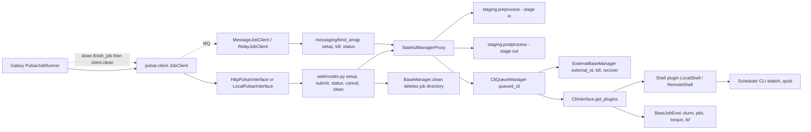
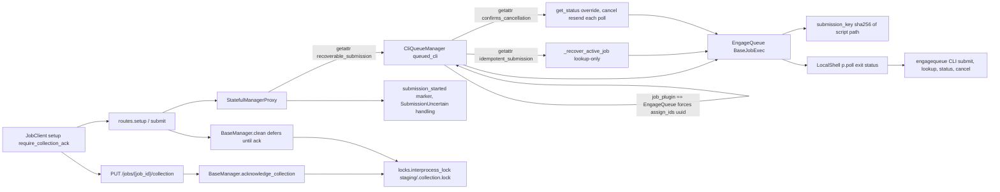
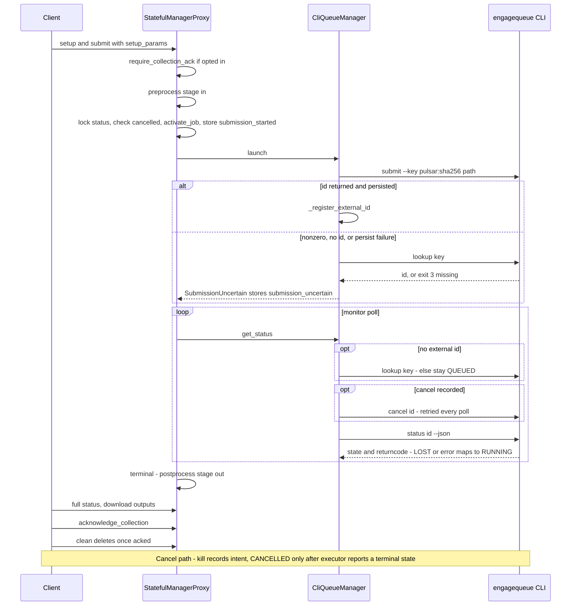
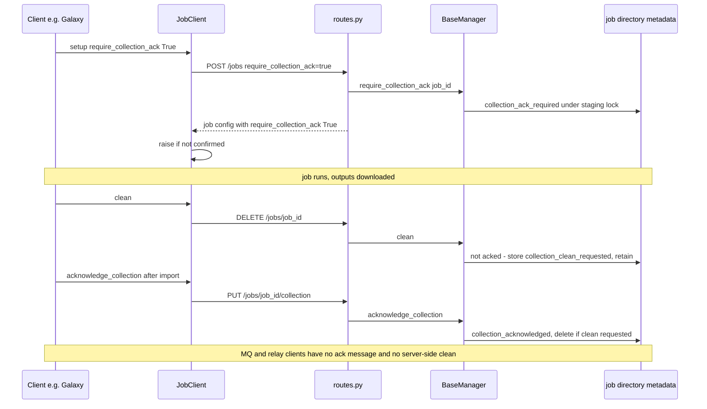
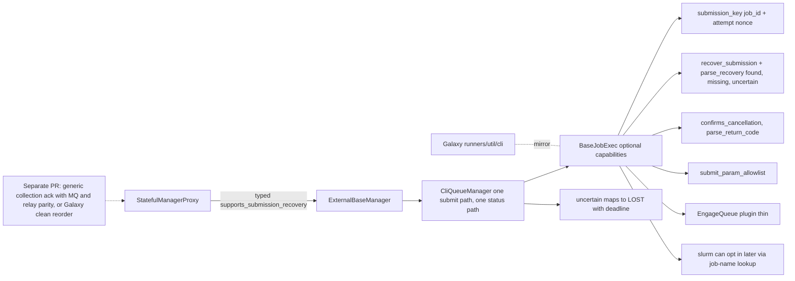

# PR #571 design review

- Profile: `design` (ad hoc)
- Model: Claude Opus 5.5, effort medium
- Reviewed commit: `a08303706ea4b66fc46b5f03a5016b355e0e1414` (single commit, base `origin/master`)

## Verdict

Hosting EngageQueue under `queued_cli` is the right place. mvdbeek asked for exactly that on #550: a standalone supervisor behind a thin `BaseJobExec` plugin, "used through `queued_cli`". The plugin isn't thin, though. About 110 lines of EngageQueue-shaped behavior leak into `queued_cli.py` and about 40 into `stateful.py`. They're gated by a plugin-name check and by `getattr` duck typing on hooks the `BaseJobExec` interface doesn't declare. Collection ack is manager-agnostic but not transport-agnostic, and nothing consumes it today. It also ignores mvdbeek's explicit request that it be "a small, generic PR that isn't tied to this manager". Recommend splitting the PR, and formalizing the recovery hooks as optional `BaseJobExec` capabilities rather than writing a new manager.

## Prior maintainer direction (#550)

The author closed #550, a dedicated `detached` manager, after mvdbeek's design review. That review said:

- "Pulsar's model is that a manager is a thin adapter over an external executor."
- Option 1: "a thin job plugin next to `pulsar/managers/util/cli/job/{slurm,pbs,lsf}.py` … used through `queued_cli`. Restart recovery then comes from the existing stateful machinery, and Galaxy needs no new client contract."
- On collection ack: it is "a reasonable idea in its own right, but it applies to every manager. If you want to pursue it, please make it a small, generic PR that isn't tied to this manager."

#571 follows the first point in placement but not in thinness. It adds its own recovery state machine rather than relying on the existing stateful recovery, and it bundles the ack anyway. Read every answer below against that baseline.

## 1. New manager vs. overloading `queued_cli`?

**How existing plugins plug in.**

- `CliInterface.get_plugins` resolves a shell plugin and a job plugin from `shell_*`/`job_*` kwds (`pulsar/managers/util/cli/__init__.py:30-62`, `split_params` at 65-74).
- `BaseJobExec` declares only `submit`, `delete`, `get_status`, `get_single_status`, `parse_status`, `parse_single_status`, plus failure-reason hooks (`pulsar/managers/util/cli/job/__init__.py:24-90`).
- slurm, torque, pbs and lsf need nothing beyond that.
- On master `CliQueueManager` holds no plugin-specific code. It writes the script, runs `submit`, parses the external ID and polls `get_single_status`.

**What #571 adds outside `engagequeue.py`.** All of this is leakage evidence.

| Site | What | Kind |
|---|---|---|
| `queued_cli.py:59-60` | `if kwds.get("job_plugin") == "EngageQueue": kwds.setdefault("assign_ids", "uuid")` | Plugin-name special case in the manager. The attempt key is `sha256(script path)` (`engagequeue.py:35-39`), so it is only unique per attempt if setup directories are UUIDs. |
| `queued_cli.py:66-70` | `recoverable_submission` property via `getattr(job_interface, "idempotent_submission")` | Undeclared hook, read by `stateful.py`. |
| `queued_cli.py:83-88` | Copies `cpus`, `memory_mb`, `timeout` and `output_limit` from `submit_params` into `job_interface.params` | Per-job resource passing. On master `queued_cli` ignores `submit_params` for every plugin. The allowlist is gated on *idempotency*, which is unrelated. |
| `queued_cli.py:110-130` | Three `idempotent_submission` branches: a failed submit, a missing ID or a failed ID persist turns into recovery or `SubmissionUncertain` | Alternative submit protocol. |
| `queued_cli.py:136-141` | `_kill_external` raises on a nonzero exit | Generic behavior change for **all** CLI plugins. `ExternalBaseManager.kill` (`base/external.py:48-59`) catches and logs the error, so slurm, pbs and lsf now log where they were silent before. |
| `queued_cli.py:143-188` | Full `get_status` override when `confirms_cancellation`: a cancel resend on every poll, uncertain mapped to RUNNING, `parse_return_code` written to `return_code` | Second status path, using `parse_return_code`, a hook not on `BaseJobExec`. |
| `queued_cli.py:190-211` | `_recover_active_job` falls back to `recover_submission` and `submission_missing` (exit code 3) | Undeclared hooks. |
| `stateful.py:73, 277-330` | `submission_started` marker, pre-dispatch activation under the status lock, `except SubmissionUncertain`, `deactivate_job` on failure | New launch protocol in the generic proxy, gated by `getattr(manager, "recoverable_submission")`. |
| `stateful.py:391-394` | The preprocessing status check also skips on `submission_started` | Generic status logic now aware of the new marker. |
| `stateful.py:585-595` | When recovery fails for a recoverable manager, mark it preprocessed and skip `__handle_recovery_problem` | A recovery failure no longer fails the job. |
| `util/external.py:9` | `SubmissionUncertain` | New cross-layer exception. |
| `shell/local.py:71-74` | `p.poll()` replaces `check_pg` | Generic bug fix, mirrored in Galaxy #24810. |
| `base/__init__.py:130-182`, `locks.py:34-71`, `routes.py`, `client.py`, `setup_handler.py`, `managers/__init__.py:132-136` | Collection ack | Separate concern; see Q3. |

**Sibling templates.**

- `queued_condor` (`queued_condor.py:32-130`) and `queued_external_drmaa` show the "dedicated manager" pattern. Each overrides `launch`, `_kill_external` and `get_status` because its executor has no CLI-plugin shape.
- `unqueued`/`CoexecutionManager` own the process directly. That is what #550 did and what mvdbeek rejected.
- EngageQueue has a CLI with submit, status, cancel and list. By shape, `queued_cli` is the right template, closer than condor.
- A dedicated `queued_engagequeue` subclassing `CliQueueManager` would quarantine the overrides from slurm users. It would still need every `stateful.py` change, though. It would also leave the recovery protocol unavailable to other schedulers and contradict the #550 guidance.

**Are the attempt-key, ID-recovery and cancel-intent semantics generic?** Mostly yes.

- The crash window between `sbatch` returning and `_register_external_id` persisting (`base/external.py:73-78`) exists for every external manager today. After a restart, `_recover_active_job` raises (`external.py:87-94`), `__handle_recovery_problem` fails the job, and the slurm job is orphaned.
- Slurm can do lookup-only recovery by job name or comment: `sbatch --job-name=pulsar_<id>` or `--comment=<key>`, then `squeue`/`sacct --name`. That is the slurm equivalent of `recover_submission`.
- A per-job resource allowlist (`submit_params` → plugin params) is likewise something every CLI plugin lacks.
- "Cancelled but not terminal until the scheduler confirms" differs from master, where `ExternalBaseManager.get_status` returns CANCELLED immediately (`external.py:65-66`). It is defensible generally, but it is a client-visible behavior change and should be opt-in per plugin.
- The macOS foreground and Docker ownership rules are genuinely EngageQueue-only, and they already live in the plugin. That part is fine.

Pulsar's `util/cli` is a diverged copy of Galaxy's `lib/galaxy/jobs/runners/util/cli`: `diff -rq` shows `__init__`, `job/__init__`, slurm, pbs, lsf, torque and `shell/local` all differ. Growing `BaseJobExec` here without Galaxy widens that drift. #24810 already mirrors the LocalShell fix, so the author knows about the pairing.

## 2. Is overloading `queued_cli` right?

**Steelman.**

- It is what the maintainer asked for.
- It reuses the CLI-runner's submit/status/kill protocol and its config surface: `type: queued_cli, job_plugin: EngageQueue, job_state_dir: …`. Operators already know these.
- No new manager type, no Galaxy runner change, and the executor's lifecycle stays outside Pulsar.
- The generic hardening is real: exit-status preservation, a restart-safe submit window, and a cancel that is not "fire and forget".

**Critique.**

- The plugin interface didn't fit, and instead of growing it the PR bent the manager and the proxy around one plugin.
- The evidence is a name check (`queued_cli.py:59`), five undeclared duck-typed hooks (`idempotent_submission`, `confirms_cancellation`, `recover_submission`, `submission_missing`, `parse_return_code`), a parallel `get_status` path, and `getattr(manager, "recoverable_submission")` in three places in `stateful.py`.
- Every `queued_cli` user now runs through code paths shaped by EngageQueue, and the only tests exercising them use EngageQueue.
- Nonterminal states have no bound and never reach Galaxy:
  - executor LOST is mapped to RUNNING (`engagequeue.py:106`);
  - an uncertain status command maps to RUNNING (`queued_cli.py:170-176`);
  - a missing lookup stays QUEUED (`queued_cli.py:151-158`).

  Pulsar already has `status.LOST` for this, and `stateful.py:74-77` notes LOST is non-terminal. This repeats mvdbeek's "stays `running` forever" concern from #550, without a timeout or an operator signal.

**Recommendation.** Keep `queued_cli` as the host. Turn the hooks into declared, typed, optional capabilities of `BaseJobExec`, and make `CliQueueManager` and `StatefulManagerProxy` check one declared capability rather than plugin names or `getattr`. A subclass manager is only the fallback if the author won't generalize.

## 3. Collection ack: plugin-only or all managers?

**It is already manager-agnostic.**

- `BaseManager.clean`, `require_collection_ack` and `acknowledge_collection` (`base/__init__.py:130-179`) apply to every `BaseManager` subclass.
- `ManagerProxy` forwards both (`managers/__init__.py:132-136`).
- `system_properties` advertises `collection_ack: {schema: 1}` unconditionally (`base/__init__.py:181-182`).
- Apart from bundling, nothing ties it to EngageQueue.

**It is not transport-agnostic.**

| Transport | Opt-in reaches server | Ack possible | Server ever cleans |
|---|---|---|---|
| HTTP (`HttpPulsarInterface`) | yes, `routes.setup` query param (`routes.py:49-55`) or launch `setup_params` (`stateful.py:223-224`) | yes, `PUT /jobs/{job_id}/collection` (`routes.py:68-71`, `server_interface.py:44,72`) | only via client `DELETE` |
| Local in-process (`LocalPulsarInterface`, dispatches to `routes`, `server_interface.py:145-157`) | yes | yes | only via client `clean` |
| AMQP MQ (`MessageJobClient`) | yes, `_setup_params_from_job_config` carries it (`client.py:652-668`) | **no**: no client method, and `bind_amqp.py` handles only setup, kill and status (149-161) | **never**: `BaseMessageJobClient.clean` only drops `status_cache` (`client.py:452-453`) |
| pulsar-relay (`RelayJobClient`) | yes, same path | **no** relay topic | never |
| kubernetes, coexecution, TES, GCP, AWS clients | n/a | n/a | own `clean()` (`kubernetes.py:114`, `tes.py:144`, `gcp.py:151`) |

So on MQ and relay a job can be flagged `collection_ack_required` with no way ever to ack it. Today that's harmless, because the server never deletes there anyway. But it's a sibling-path inconsistency, and the advertised capability is true only for two of the transports.

**Relation to existing cleanup.**

- On the server, deletion happens only in `BaseManager.clean`, reached only through `routes.clean`, i.e. client `DELETE`. `ensure_cleanup` in `core.py:60,71` joins MQ threads; it is not directory cleanup.
- With exactly one cleanup actor, the client that imports, "retain until ack, then clean" behaves the same as that client calling `clean()` later.
- The real gap is on the Galaxy side. `pulsar_finish_job` → `down._clean` → `client.clean()` (`pulsar/client/staging/down.py:33,273-285`) runs inside `PulsarJobRunner.finish_job` at `lib/galaxy/jobs/runners/pulsar.py:839`, before `_complete_staged_job` does metadata and `job_wrapper.finish` (`pulsar.py:859`).
- Moving that clean after import, honoring `cleanup_job`, gives the same guarantee with no protocol, no lock and no new route.

**Steelman for a server protocol.**

- Server-enforced retention holds regardless of client ordering bugs, and it composes with old call sites that call `clean()` early.
- If Pulsar ever cleans autonomously after MQ postprocess, an ack message is exactly what is needed. But that is the transport this PR doesn't cover.

**Consumers.**

- Galaxy `dev` has none.
- The live companion, galaxyproject/galaxy#24809, is a native `EngageQueueJobRunner` using EngageQueue's Python API. Its file list doesn't touch `runners/pulsar.py`.
- The only consumer, #24378, is closed.
- So the ack is a protocol with no caller. It is also the source of the second lock abstraction, `locks.interprocess_lock` (`locks.py:34-71`), alongside `LockManager` and `job_directory.lock`. The separate lock is justified because it must survive deletion, but it still accretes.

**Recommendation.** Split it out. Land it only with a real client consumer and MQ/relay parity, either an ack message or an explicit "HTTP/local only" capability flag. If the Galaxy-side reorder covers the need, drop it.

## 4. PR shape

Yes, split into three PRs plus a deferred fourth, in this order:

1. **LocalShell exit status** (`shell/local.py:71-74`, `test/cli_test.py`). A standalone bug fix that pairs with Galaxy #24810.
2. **Recoverable-submission capability** on `BaseJobExec`, `CliQueueManager` and `StatefulManagerProxy`: declared attributes and hooks, a `submit_params` allowlist, confirmed-kill opt-in and a bounded uncertain state. Tested with a fake in-tree plugin, so it doesn't depend on engagequeue. This is where a maintainer should spend review time.
3. **The EngageQueue plugin**, now thin: `engagequeue.py`, docs, optional tests and CI.
4. *(Deferred)* **Collection ack**, generic, with a consumer and transport parity.

## 5. External dependency (routine diligence)

- `engagequeue` is MIT-licensed, by Daniel Blankenberg (the PR author), at `github.com/BlankenbergLab/engagequeue`.
- The repo was created 2026-11-06 and has 2 commits and 1 contributor. It has `tests.yml` and `publish.yml` workflows.
- PyPI 0.1.0 shipped 2026-11-07 and 0.1.1 on 2026-11-09, the day #571 opened. It requires Python >=3.10 and depends on `psutil` and `PyYAML`.
- The adapter depends on an unversioned CLI contract:
  - the flags `--state-dir`, `--execution-mode local`, `submit --key`, `lookup` and `cancel --wait`;
  - exit code 3 meaning "missing" (`engagequeue.py:77-79`);
  - the JSON fields `id`, `state` and `returncode`;
  - the state enum (`engagequeue.py:99-111`), where an unknown state raises `KeyError`.
- Only `dev-requirements.txt` and CI pin `==0.1.1`. Production installs it separately with no guard, and `job_executable` can point at any binary.
- Suggest a `--version` (or `capabilities --json`) check at manager init, failing fast on an unsupported major version. Upstream should also publish a CLI stability statement.
- CI cost: a two-runner macOS matrix job plus an `alpine` Docker pull in the main matrix, all for one optional plugin. Consider running these on a schedule or a label instead of on every push.

## Recommended alternative

The plugin keeps its placement in `queued_cli`, and its hooks are formalized:

- **`BaseJobExec` grows optional declared capabilities**, with defaults that mean "not supported":
  - `submission_key(job_id, attempt)`, where the manager supplies a per-setup attempt nonce. This replaces the `assign_ids=uuid` name hack and the path hash.
  - `recover_submission(key)` returning a command, and `parse_recovery(result)` returning `found(id) | missing | uncertain`. This replaces `submission_missing`.
  - `confirms_cancellation: bool` and `parse_return_code(status_output)`.
  - `submit_param_allowlist: FrozenSet[str]` (default empty). Slurm could later opt in, for example for `time` or `mem`.
- **`CliQueueManager` has one submit path and one status path.** It branches on the capabilities, never on plugin names. Uncertainty maps to `status.LOST` with a configurable deadline, after which the job fails visibly.
- **`ExternalBaseManager` and `StatefulManagerProxy`** read a typed `supports_submission_recovery` property, declared on the manager base class and False by default, in place of the `getattr` calls. The pre-dispatch `submission_started` marker becomes generic for any external manager that supports recovery.
- **Mirror** the interface growth into Galaxy's `runners/util/cli`.
- **Collection ack** lives in its own PR, in `BaseManager`, with transport parity, or is replaced by the Galaxy-side reorder.

**Cost to the author.** Moderate. Most of the logic already exists; it moves from `getattr` branches into named hooks and gets a fake-plugin test. That is roughly 150–250 changed lines, plus re-pointing the existing EngageQueue tests. Splitting adds review round-trips but shrinks each PR to a size that can be reviewed.

## Diagrams

### A. Current architecture on master

### B. The PR's architecture

### C. Job lifecycle in the PR

### D. Collection ack across client and server

### E. Proposed alternative layout

## Evidence index

- #550 maintainer review: `gh pr view 550 --repo galaxyproject/pulsar --comments`, mvdbeek's first comment, "What I'd suggest instead".
- Plugin interface: `pulsar/managers/util/cli/__init__.py:30-74`, `pulsar/managers/util/cli/job/__init__.py:24-90`.
- Leakage: `pulsar/managers/queued_cli.py:59-60, 66-70, 83-88, 110-130, 136-141, 143-188, 190-211`. Also `pulsar/managers/stateful.py:73, 223-224, 277-330, 391-394, 585-595` and `pulsar/managers/util/external.py:9`.
- Plugin: `pulsar/managers/util/cli/job/engagequeue.py:18-19` (capability flags), `35-39` (key), `77-79` (exit 3), `99-111` (state map).
- External base: `pulsar/managers/base/external.py:48-59, 64-71, 73-78, 87-94`. Condor template: `pulsar/managers/queued_condor.py:32-130`.
- Ack server: `pulsar/managers/base/__init__.py:130-182`, `pulsar/locks.py:34-71`, `pulsar/managers/__init__.py:132-136`, `pulsar/web/routes.py:49-55, 68-71`.
- Ack client: `pulsar/client/client.py:96-112, 210-213, 452-453, 656-668`, `pulsar/client/setup_handler.py:28-36, 77-97`, `pulsar/client/server_interface.py:44, 72, 145-157`.
- MQ handlers: `pulsar/messaging/bind_amqp.py:55-57, 149-161`.
- Cleanup ordering: `pulsar/client/staging/down.py:21-34, 273-285`. Galaxy `lib/galaxy/jobs/runners/pulsar.py:827, 839, 859` (local clone of galaxyproject/galaxy, last commit 2026-10-20).
- Shell fix: `pulsar/managers/util/cli/shell/local.py:71-74`. Galaxy mirror: galaxyproject/galaxy#24810.
- Companion PRs: galaxyproject/galaxy#24809 (native runner, open), #24378 (closed).
- Dependency: `https://pypi.org/pypi/engagequeue/json`, `gh repo view BlankenbergLab/engagequeue`, `dev-requirements.txt:13-14`, `.github/workflows/pulsar.yaml` (`engagequeue-macos` job).
